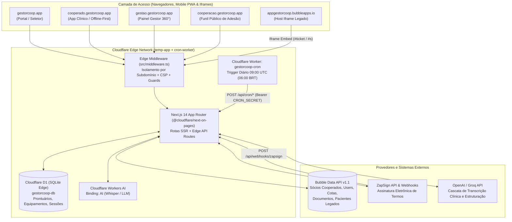
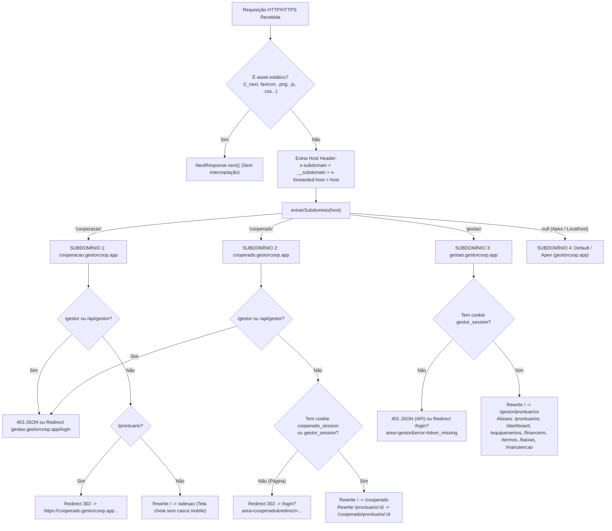
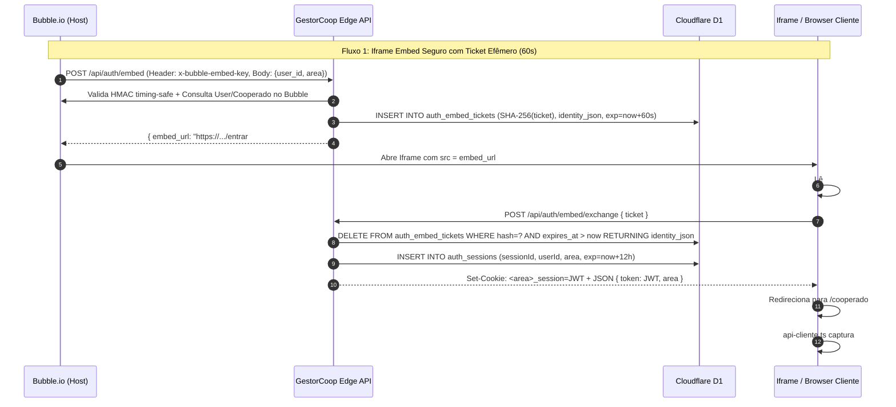

# Manual de Handover Técnico — Módulo 01: Arquitetura, Infraestrutura, CI/CD, Multi-Subdomínio e Autenticação

> **Escopo deste Documento**: Documentação técnica exaustiva, linha a linha, bloco a bloco e regra de negócio por regra de negócio da fundação arquitetural do ecossistema **GestorCoop**. Abrange topologia em nuvem (Cloudflare Pages + Workers + D1 + Workers AI + Bubble Data API + ZapSign), variáveis de ambiente e segredos, configuração de build e dependências, esteira de CI/CD com Self-Hosted Runner na VPS Oracle Cloud, roteamento multi-subdomínio no Edge Middleware, motor criptográfico de autenticação/sessão (JWT HS256, Cookies compartilhados, Fallback Safari/iOS Iframe, Embed HMAC-SHA256 com tickets efêmeros e SSO) e as páginas estruturais de entrada e tema dinâmico.

---

## Sumário

1. [Visão Geral da Arquitetura e Topologia Híbrida](#1-visão-geral-da-arquitetura-e-topologia-híbrida)
2. [Dicionário Completo de Variáveis de Ambiente e Segredos](#2-dicionário-completo-de-variáveis-de-ambiente-e-segredos)
3. [Infraestrutura Cloudflare Pages & D1 (`temp-app/wrangler.toml`)](#3-infraestrutura-cloudflare-pages--d1-temp-appwranglertoml)
4. [Gerenciamento de Pacotes, Scripts e Testes (`temp-app/package.json`)](#4-gerenciamento-de-pacotes-scripts-e-testes-temp-apppackagejson)
5. [Worker Dedicado de Agendamento Cron (`cron-worker`)](#5-worker-dedicado-de-agendamento-cron-cron-worker)
6. [Pipeline de CI/CD, Fluxo de Branches e os 4 Gates Obrigatórios (`.github/workflows/ci.yml`)](#6-pipeline-de-cicd-fluxo-de-branches-e-os-4-gates-obrigatórios-githubworkflowsciyml)
7. [Arquitetura Multi-Subdomínio (`subdominios.ts` e `middleware.ts`)](#7-arquitetura-multi-subdomínio-subdominiosts-e-middlewarets)
8. [Motor Completo de Autenticação, Sessão e Segurança Criptográfica](#8-motor-completo-de-autenticação-sessão-e-segurança-criptográfica)
   - [8.1 Emissão e Verificação de JWT HS256 (`src/lib/sessao-token.ts`)](#81-emissão-e-verificação-de-jwt-hs256-srclibsessao-tokents)
   - [8.2 Cache por Isolate no Cloudflare Workers (`src/lib/cache-memoria.ts`)](#82-cache-por-isolate-no-cloudflare-workers-srclibcache-memoriats)
   - [8.3 Validação de Sessão Ativa no D1 e Extração Híbrida (`src/lib/sessao.ts`)](#83-validação-de-sessão-ativa-no-d1-e-extração-híbrida-srclibsessaots)
   - [8.4 Sessão do Cooperado, Herança de Gestor e Selo de Assinatura HMAC v2 (`src/lib/sessao-cooperado.ts`)](#84-sessão-do-cooperado-herança-de-gestor-e-selo-de-assinatura-hmac-v2-srclibsessao-cooperadots)
   - [8.5 Autenticação de Iframe via Tickets Efêmeros (`src/lib/auth-embed.ts`)](#85-autenticação-de-iframe-via-tickets-efêmeros-srclibauth-embedts)
   - [8.6 Transporte Autenticado no Cliente e Contorno de ITP Safari/iOS (`src/lib/api-cliente.ts`)](#86-transporte-autenticado-no-cliente-e-contorno-de-itp-safariios-srclibapi-clientets)
9. [Rotas de Autenticação da API (`src/app/api/auth/*`)](#9-rotas-de-autenticação-da-api-srcappapiauth)
   - [9.1 Login de Cooperado por CPF com Auto-Provisionamento (`api/auth/cooperado-login/route.ts`)](#91-login-de-cooperado-por-cpf-com-auto-provisionamento-apiauthcooperado-loginroutets)
   - [9.2 Emissão de Ticket para Iframe do Bubble (`api/auth/embed/route.ts`)](#92-emissão-de-ticket-para-iframe-do-bubble-apiauthembedroutets)
   - [9.3 Troca Atômica de Ticket por Sessão (`api/auth/embed/exchange/route.ts`)](#93-troca-atômica-de-ticket-por-sessão-apiauthembedexchangeroutets)
   - [9.4 Single Sign-On Unificado GET/POST (`api/auth/sso/route.ts`)](#94-single-sign-on-unificado-getpost-apiauthssoroutets)
   - [9.5 Logout e Revogação Multicamada (`api/auth/logout/route.ts`)](#95-logout-e-revogação-multicamada-apiauthlogoutroutets)
10. [Páginas Base, Casca Visual e Motor de Tema Noturno](#10-páginas-base-casca-visual-e-motor-de-tema-noturno)
    - [10.1 Root Layout e Prevenção de FOUC Noturno (`src/app/layout.tsx`)](#101-root-layout-e-prevenção-de-fouc-noturno-srcapplayouttsx)
    - [10.2 Motor de Tema Clínico Claro/Escuro (`src/lib/tema.ts`)](#102-motor-de-tema-clínico-claroescuro-srclibtemats)
    - [10.3 Portal Institucional e Seletor de Subdomínios (`src/app/page.tsx`)](#103-portal-institucional-e-seletor-de-subdomínios-srcapppagetsx)
    - [10.4 Central Unificada de Login (`src/app/login/page.tsx`)](#104-central-unificada-de-login-srcapploginpagetsx)
    - [10.5 Porta de Entrada de Iframe (`src/app/entrar/page.tsx`)](#105-porta-de-entrada-de-iframe-srcappentrarpagetsx)
11. [Guia Passo a Passo de Setup Local e Deploy](#11-guia-passo-a-passo-de-setup-local-e-deploy)

---

## 1. Visão Geral da Arquitetura e Topologia Híbrida

O **GestorCoop** opera sob uma arquitetura distribuída de borda (**Edge-First**) projetada para unir a base cadastral legada da cooperativa (hospedada no **Bubble.io**) a um motor clínico, operacional e de assinatura digital de altíssima performance e baixa latência construído sobre a **Cloudflare Developer Platform**.



### 1.1 Componentes da Stack e Responsabilidades

1. **Next.js 14.2.35 (App Router) + `@cloudflare/next-on-pages` (`^1.13.16`)**:
   - Todo o aplicativo principal vive no diretório `temp-app/`.
   - As rotas de API (`src/app/api/**`) declaram `export const runtime = 'edge'` e `export const dynamic = 'force-dynamic'`, rodando diretamente nos isolates V8 da Cloudflare em mais de 300 data centers ao redor do mundo, sem cold start de containers Node.js tradicionais.
   - O pacote `@cloudflare/next-on-pages` compila o output da build para `.vercel/output/static`, convertendo rotas dinâmicas em um `_worker.js` compatível com Cloudflare Pages Functions.

2. **Cloudflare D1 (`gestorcoop-db` — UUID `ab487796-11d9-4f62-8aff-3df7843ce394`)**:
   - Banco de dados relacional SQLite nativo de borda, acessado via binding `DB` (`src/lib/db/client.ts`).
   - Armazena todas as entidades de alta frequência, baixa latência e rigor transacional:
     - **Segurança e Autenticação**: `auth_sessions` (sessões JWT ativas/revogadas) e `auth_embed_tickets` (tickets efêmeros de uso único com TTL de 60 segundos).
     - **Prontuário Eletrônico do Paciente (PEP)**: `pacientes`, `evolucoes`, `sinais_vitais`, `prescricoes`, `aprazamentos`, `planos_terapeuticos`, `plano_terapeutico_metas`, `auditoria_prontuario`, `agendamentos_plantao`, etc.
     - **Gestão de Equipamentos e Locações v2**: `equipamentos`, `locacoes`, `movimentacoes`, `manutencoes`, `alertas_equipamentos`, `termos_equipamentos`, `baixas_equipamentos`.
   - O acesso ao binding D1 é abstraído em `src/lib/db/client.ts` pelas funções `getDb()` (tenta `getRequestContext().env.DB` do `@cloudflare/next-on-pages` e faz fallback para `process.env.DB`) e `requireDb()` (que lança `D1IndisponivelError` caso o binding não esteja presente).

3. **Bubble.io Data API v1.1 (`src/lib/bubble.ts`)**:
   - Sistema ERP/cadastral onde residem as tabelas corporativas originais (`socio_cooperado`, `User`, `cooperativa`, `profissao`, `dados_bancarios`, `documento`, `termo_cooperativa`, `parcela_cota`, etc.).
   - **Decisão Crítica de Arquitetura (Lazy Proxy Initialization)**: Em `src/lib/bubble.ts` (linhas 18–50), o cliente `axios` **não** é instanciado na importação do arquivo. Durante a etapa `Collecting page data` do `next build` no Cloudflare Pages, as variáveis de ambiente de runtime não estão presentes. Se o módulo validasse `process.env.BUBBLE_API_URL` no topo, o build quebraria. Por isso, `bubbleClient` é um `Proxy` JavaScript que só invoca `obterCliente()` e valida `BUBBLE_API_URL` na **primeira requisição HTTP real**.

4. **Cloudflare Workers AI (`binding = "AI"`) + Cascata OpenAI / Groq**:
   - Utilizado no módulo de prontuário clínico para transcrição de áudio de evoluções de enfermagem/médicas e estruturação automática em formato SOAP/clínico.
   - Opera em arquitetura de cascata configurável: se um provedor falhar ou exceder tempo limite, faz fallback transparente entre OpenAI (`OPENAI_API_KEY`), Groq (`GROQ_API_KEY`) e Cloudflare Workers AI (`env.AI`).

5. **ZapSign API (`src/lib/zapsign.ts` e `src/app/api/webhooks/zapsign/route.ts`)**:
   - Motor de assinatura eletrônica com validade jurídica utilizado tanto no funil público de adesão de novos cooperados (`cooperacao.gestorcoop.app`) quanto na geração avulsa de termos pelo painel do gestor.
   - Segurança por design no Webhook (`src/app/api/webhooks/zapsign/route.ts`): o endpoint público **não confia cegamente** nos dados enviados no payload do POST; ele extrai apenas o `token` do documento e realiza uma chamada autenticada (`GET /api/v1/docs/{token}/`) com `ZAPSIGN_API_TOKEN` diretamente nos servidores da ZapSign para confirmar que `status === 'signed' || status === 'completed'` antes de averbar o PDF assinado no cadastro do cooperado no Bubble.

---

## 2. Dicionário Completo de Variáveis de Ambiente e Segredos

A tabela abaixo documenta **todas** as variáveis de ambiente e bindings lidos pelo código-fonte em `temp-app/` e `cron-worker/`, onde são consumidos e o comportamento exato do sistema quando estão ausentes.

| Variável / Binding | Obrigatória? | Onde é Usada | Papel e Regras de Negócio | Comportamento se Ausente / Inválida |
| :--- | :---: | :--- | :--- | :--- |
| `DB` (Binding D1) | **Sim** (Prod) | `src/lib/db/client.ts` e todas as rotas D1 | Binding nativo do banco SQLite Cloudflare D1 (`gestorcoop-db`). | `getDb()` retorna `undefined`; chamadas a `requireDb()` lançam `D1IndisponivelError` (`503` / `500`). Em dev local sem D1, `validarSessaoAtiva` aprova sessões com JWT válido. |
| `AI` (Binding Workers AI) | Opcional | `wrangler.toml`, rotas de IA clínica | Binding nativo da GPU Cloudflare Workers AI para Whisper/LLM. | Desativa o provedor `workersai` na cascata de IA; utiliza `OPENAI_API_KEY` ou `GROQ_API_KEY`. |
| `AUTH_JWT_SECRET` | **Sim** (`>= 32` chars) | `src/lib/sessao-token.ts` (linha 10) | Chave secreta simétrica para assinatura e verificação HMAC-SHA256 (`HS256`) dos tokens JWT de sessão (`cooperado_session` e `gestor_session`). | `chave()` lança `Error('AUTH_JWT_SECRET deve conter ao menos 32 caracteres.')`. Nenhum login, SSO ou validação de token funciona. |
| `AUTH_JWT_ISSUER` | Opcional | `src/lib/sessao-token.ts` (linha 14) | Identificador do emissor (`iss`) gravado e exigido no payload JWT. | Assume o fallback padrão `'gestorcoop'`. |
| `ASSINATURA_SECRET` | **Sim** (`>= 32` chars) | `src/lib/sessao-cooperado.ts` (linha 35) | Segredo criptográfico para geração do selo de integridade HMAC-SHA256 (`v2:<hex>`) nas evoluções clínicas assinadas pelo cooperado. | `gerarSeloAssinatura()` lança `Error('ASSINATURA_SECRET deve conter ao menos 32 caracteres.')`, impedindo a assinatura de evoluções. |
| `BUBBLE_EMBED_SECRET` | **Sim** (`>= 32` chars) | `src/lib/auth-embed.ts` (linha 8) | Chave compartilhada enviada pelo Bubble no cabeçalho `x-bubble-embed-key` ao solicitar um ticket de abertura de iframe em `/api/auth/embed`. | `validarChaveIntegracao()` lança `Error('BUBBLE_EMBED_SECRET não configurada.')` e a rota `/api/auth/embed` retorna HTTP `503`. |
| `BUBBLE_API_URL` | **Sim** | `src/lib/bubble.ts` (linha 19) | URL base da Data API v1.1 do Bubble (ex.: `https://gestorcoop.app/version-test/api/1.1/obj` ou equivalente de produção). | Na primeira chamada ao Bubble, `urlBaseBubble()` lança erro explicativo informando que sem ela o Axios tentaria URL relativa malformada. |
| `BUBBLE_API_TOKEN` | **Sim** | `src/lib/bubble.ts` (linha 36) | Bearer Token administrativo da Data API do Bubble para leitura/escrita em `socio_cooperado`, `User`, `documento`, etc. | Requisições ao Bubble enviam `Authorization: Bearer undefined` e falham com HTTP `401 Unauthorized` na API do Bubble. |
| `ZAPSIGN_API_TOKEN` | **Sim** (Adesão/Termos) | `src/lib/zapsign.ts`, `api/cooperado/adesao`, `api/webhooks/zapsign` | Token de autenticação da conta ZapSign para criar envelopes de assinatura de termos de adesão e consultar status de documentos. | Criação de termo e webhook de validação falham ao autenticar na API da ZapSign. |
| `ZAPSIGN_BASE_URL` | Opcional | `src/lib/zapsign.ts` | Endpoint base da API ZapSign (permite alternar entre sandbox `https://sandbox.api.zapsign.com.br` e produção `https://api.zapsign.com.br`). | Usa a URL padrão de produção da API ZapSign definida em `src/lib/zapsign.ts`. |
| `ZAPSIGN_WEBHOOK_URL` | Opcional | `api/cooperado/adesao/route.ts`, `api/gestor/cooperados/gerar-termo/route.ts` | URL pública completa para onde a ZapSign deve enviar notificações de documentos assinados (`/api/webhooks/zapsign`). | Faz fallback para `${NEXT_PUBLIC_APP_URL}/api/webhooks/zapsign` ou omite o webhook automático na criação do documento. |
| `CRON_SECRET` | **Sim** (Cron) | `cron-worker/src/index.js` e `src/app/api/cron/*/route.ts` | Segredo Bearer compartilhado entre o worker agendador (`gestorcoop-cron`) e as rotas `/api/cron/alertas-gerar`, `/api/cron/reservas-expirar` e `/api/cron/sync-pacientes-bubble`. | O `cron-worker` aborta o disparo com log de erro; as rotas `/api/cron/*` recusam chamadas com HTTP `401`. |
| `APP_BASE_URL` | **Sim** (no `cron-worker`) | `cron-worker/wrangler.toml` e `cron-worker/src/index.js` | URL base pública do app no Cloudflare Pages (`https://gestorcoop.pages.dev`) para a qual o worker dispara os POSTs diários. | `dispararRotinas` no `cron-worker` aborta a execução e registra erro no console. |
| `APP_ORIGIN` | Opcional | `src/app/api/auth/embed/route.ts` (linha 15) | Origem canônica usada para montar a `embed_url` (`${origin}/entrar#ticket=...`). Ignorada se contiver `bubbleapps.io`. | Usa fallback dinâmico extraído de `x-forwarded-host` / `host` ou `https://gestorcoop.pages.dev`. |
| `EMBED_ORIGEM` | Opcional | `src/middleware.ts` (linha 32) | Lista de origens separadas por espaço permitidas na diretiva `Content-Security-Policy: frame-ancestors 'self' ...`. | Usa o padrão: `'https://gestorcoop.app https://cooperado.gestorcoop.app https://gestao.gestorcoop.app https://cooperacao.gestorcoop.app https://appgestorcoop.bubbleapps.io'`. |
| `GESTOR_USER_IDS` | Opcional | `api/auth/embed/route.ts` (linha 25), `api/auth/sso/route.ts` (linha 19) | Lista de IDs de usuários Bubble (`_id`) separados por vírgula que recebem permissão de `gestor` mesmo que `bool_colaborador_interno` não esteja marcado no Bubble. | Apenas usuários com `bool_colaborador_interno === true` no cadastro do Bubble entram como gestor. |
| `OPENAI_API_KEY` | Opcional (IA) | Rotas de IA clínica (`/api/cooperado/ia/*`) | Chave da API OpenAI para transcrição Whisper e estruturação de evolução clínica. | Pula para o próximo provedor da cascata (Groq / Workers AI) ou retorna erro se nenhum provedor estiver ativo. |
| `GROQ_API_KEY` | Opcional (IA) | Rotas de IA clínica (`/api/cooperado/ia/*`) | Chave da API Groq para transcrição rápida (`whisper-large-v3`) e LLM (`llama-3`). | Pula o provedor Groq na cascata de IA. |
| `GROQ_MODELO_WHISPER` | Opcional | Rotas de IA clínica | Nome do modelo Whisper na Groq. | Usa o modelo default configurado no serviço de IA. |
| `GROQ_MODELO_LLM` | Opcional | Rotas de IA clínica | Nome do modelo LLM na Groq para estruturação de texto clínico. | Usa o modelo default configurado no serviço de IA. |
| `IA_PERMITIR_SIMULACAO` | Opcional | Rotas de IA clínica | Quando `'true'` em ambiente de homologação/dev, permite resposta simulada caso nenhuma chave de IA esteja configurada. | Desabilitado por padrão em produção. |
| `APRAZAMENTO_UTC_OFFSET` | Opcional | Serviços de prescrição e aprazamento | Offset de fuso horário em horas (ex.: `-3` para `America/Sao_Paulo`) usado no cálculo de janelas de medicação no Edge (que roda em UTC). | Assume `-3` (horário de Brasília) por padrão. |
| `EQUIPAMENTOS_V2_ENABLED` | Opcional | Rotas do módulo de equipamentos | Feature flag para ativação de recursos do motor v2 de equipamentos no D1. | Comportamento padrão do módulo D1 ativo. |
| `GESTORCOOP_ENABLE_MOCK_SEED` | Opcional | Rotas de seed/dev | Habilita rotas ou cargas de dados fictícios apenas em desenvolvimento/testes. | Bloqueado em produção. |
| `NEXT_PUBLIC_APP_URL` | Opcional | `api/cooperado/adesao`, `api/gestor/cooperados/gerar-termo` | URL pública da aplicação exposta ao bundle para compor links de retorno e callbacks. | Usa fallback baseado nos cabeçalhos da requisição. |
| `NEXT_PUBLIC_SUPORTE_WHATSAPP` | Opcional | `src/app/cooperado/adesao/page.tsx` | Número de WhatsApp exibido no botão de suporte durante o funil de adesão. | Usa número padrão de suporte ou oculta atalho. |
| `NEXT_PUBLIC_SUPORTE_EMAIL` | Opcional | `src/app/cooperado/adesao/page.tsx` | E-mail de suporte exibido no funil de adesão. | Usa e-mail padrão da cooperativa. |

---

## 3. Infraestrutura Cloudflare Pages & D1 (`temp-app/wrangler.toml`)

Arquivo: `temp-app/wrangler.toml` (29 linhas). Define como o Cloudflare Pages empacota, executa e injeta bindings nativos no aplicativo Next.js.

```toml
# Configuration for Cloudflare Pages with Next-on-Pages / D1 Database
name = "gestorcoop"
compatibility_date = "2026-09-10"
compatibility_flags = ["nodejs_compat"]
pages_build_output_dir = ".vercel/output/static"

# Domínios e Subdomínios do GestorCoop (Configurados no Cloudflare Pages Custom Domains):
# CNAME DNS Apontamentos:
# - gestorcoop.app          -> gestorcoop.pages.dev (Portal institucional / seletor unificado)
# - gestao.gestorcoop.app     -> gestorcoop.pages.dev (Painel do Gestor: Prontuários 360°, Equipamentos, Financeiro)
# - cooperado.gestorcoop.app  -> gestorcoop.pages.dev (Portal do Cooperado: Plantões, Agenda, Prontuário Clínico)
# - cooperacao.gestorcoop.app -> gestorcoop.pages.dev (Cooperação Online: Funil de adesão e ZapSign de novos cooperados)

[ai]
binding = "AI"

[[d1_databases]]
binding = "DB"
database_name = "gestorcoop-db"
database_id = "ab487796-11d9-4f62-8aff-3df7843ce394"
migrations_dir = "migrations"
```

### Explicação Linha a Linha

- **Linha 2 (`name = "gestorcoop"`)**: Nome oficial do projeto no Cloudflare Pages. Determina o subdomínio técnico padrão `gestorcoop.pages.dev`.
- **Linha 3 (`compatibility_date = "2026-09-10"`)**: Trava a versão de comportamento do runtime `workerd` (Cloudflare Workers) para garantir determinismo de APIs Web Standard (`fetch`, `crypto.subtle`, `TextEncoder`, `Headers`).
- **Linha 4 (`compatibility_flags = ["nodejs_compat"]`)**: **Crítico**. Habilita a camada de compatibilidade com módulos nativos do Node.js (`node:buffer`, `node:crypto`, `node:AsyncLocalStorage`, `node:events`) no runtime Edge. Sem essa flag, o `@cloudflare/next-on-pages` e pacotes como `axios` falham em tempo de execução.
- **Linha 5 (`pages_build_output_dir = ".vercel/output/static"`)**: Diretório onde o adaptador `@cloudflare/next-on-pages` deposita os assets estáticos e o bundle `_worker.js` gerado após o build do Next.js.
- **Linhas 7–12 (Documentação de DNS e Custom Domains)**: Registra os 4 domínios personalizados apontados via CNAME no DNS da Cloudflare para `gestorcoop.pages.dev`:
  1. `gestorcoop.app` (Apex / Portal Institucional e Seletor Unificado).
  2. `gestao.gestorcoop.app` (Painel Administrativo e Prontuários 360°).
  3. `cooperado.gestorcoop.app` (Portal Clínico Mobile-First do Cooperado).
  4. `cooperacao.gestorcoop.app` (Funil Público de Adesão e Assinatura ZapSign).
- **Linhas 18–19 (`[ai]` / `binding = "AI"`)**: Injeta o binding da GPU serverless **Cloudflare Workers AI** no objeto `env.AI` do runtime. Conforme documentado nas linhas 14–17, a ordem da cascata de transcrição de áudio começa pela OpenAI e pode ser invertida via variável de ambiente `IA_ORDEM_TRANSCRICAO="workersai,groq,openai"` sem necessidade de novo deploy.
- **Linhas 21–28 (`[[d1_databases]]`)**:
  - `binding = "DB"`: Nome da propriedade injetada em `getRequestContext().env.DB` / `process.env.DB`.
  - `database_name = "gestorcoop-db"`: Nome legível do banco na conta Cloudflare.
  - `database_id = "ab487796-11d9-4f62-8aff-3df7843ce394"`: UUID real do banco de produção/homologação na Cloudflare. **Atenção (Linhas 24–26)**: Este UUID **nunca** deve ser substituído por valores fictícios como `"local"`, pois o comando `wrangler pages deploy` valida o formato UUID e aborta com `Error 8000022: Invalid database UUID`. Para desenvolvimento local contra SQLite em disco (`.wrangler/state/v3/d1`), usa-se a flag `--local` do Wrangler.
  - `migrations_dir = "migrations"`: Aponta para a pasta `temp-app/migrations/`, onde ficam todos os arquivos `.sql` numerados sequencialmente.

---

## 4. Gerenciamento de Pacotes, Scripts e Testes (`temp-app/package.json`)

Arquivo: `temp-app/package.json` (44 linhas).

### 4.1 Explicação Linha a Linha dos Scripts (`lines 5–17`)

| Script | Comando Executado | Finalidade Técnica e Operacional |
| :--- | :--- | :--- |
| `"dev"` (L6) | `next dev` | Inicia o servidor de desenvolvimento do Next.js (por padrão na porta `3000`, ou `-p 3005` nos testes locais). |
| `"build"` (L7) | `next build` | Executa a compilação de produção do Next.js App Router, validando tipos, gerando páginas estáticas e bundles Edge. |
| `"start"` (L8) | `next start` | Inicia o servidor Node.js de produção padrão do Next.js (usado apenas fora do Cloudflare Pages). |
| `"lint"` (L9) | `next lint` | Executa o ESLint com as regras `eslint-config-next` (`14.2.35`). Gate obrigatório no CI. |
| `"equip:probe"` (L10) | `tsx scripts/probar-schema.mts` | Utilitário CLI executado via `tsx` para inspecionar e diagnosticar a estrutura real de campos retornada pela Data API do Bubble para equipamentos. |
| `"equip:audit-values"` (L11) | `tsx scripts/auditar-option-values.mts` | Script de auditoria que varre os Option Sets e valores de status de equipamentos no Bubble para garantir paridade com a máquina de estados do D1. |
| `"equip:homolog"` (L12) | `tsx scripts/homologacao-equipamentos.mts` | Script de verificação e carga de homologação do módulo de equipamentos. |
| `"test:e2e"` (L13) | `playwright test` | Roda a suíte completa de testes End-to-End automatizados no navegador com Playwright. |
| `"test:documentacao"` (L14) | `node --import tsx --test tests/api/documentacao.test.ts` | Usa o **Node.js Native Test Runner** (`node --test`) com loader TypeScript (`--import tsx`) para testar a lógica de documentos, normalização de URLs e regras da API de documentação. Gate obrigatório no CI. |
| `"test:prontuarios"` (L15) | `node --require ./tests/api/stubs/next-on-pages.cjs --import tsx --test tests/api/prontuarios-rpc.test.ts tests/api/prontuarios-schema.test.ts` | Executa a suíte de testes de integração de Prontuários (RPC + Contrato de Schema SQLite). Nota técnica crucial: injeta antes de tudo `--require ./tests/api/stubs/next-on-pages.cjs`, que faz stub de `@cloudflare/next-on-pages` (`getRequestContext`) para que as rotas Edge rodem diretamente no Node.js durante os testes sobre um banco SQLite em memória. Gate obrigatório no CI. |
| `"test:e2e:ui"` (L16) | `playwright test --ui` | Abre a interface gráfica interativa do Playwright para depuração visual de testes E2E. |

### 4.2 Dependências de Produção (`lines 18–29`)

- `@cloudflare/next-on-pages` (`^1.13.16`): Adaptador oficial que converte o build do Next.js App Router para rodar no Cloudflare Pages Functions e expõe `getRequestContext()` para acesso aos bindings `DB` e `AI`.
- `axios` (`^1.18.1`): Cliente HTTP usado no servidor (`src/lib/bubble.ts`, `src/lib/zapsign.ts`) e no cliente (`src/lib/api-cliente.ts`, com interceptador global de token Bearer).
- `framer-motion` (`^12.42.0`): Biblioteca de animações declarativas usada nas transições de passos do funil de adesão, modais e drawers clínicos.
- `jose` (`^5.10.0`): Implementação WebCrypto-nativa (Zero-Dependency, 100% compatível com Cloudflare Edge Runtime) de JSON Web Tokens (JWS/JWT), usada em `src/lib/sessao-token.ts` para assinar e verificar tokens `HS256`.
- `jspdf` (`^4.2.1`): Geração client-side/isomórfica de documentos PDF (termos de adesão, fichas cadastrais, relatórios de prontuário e termos de responsabilidade de equipamentos).
- `lucide-react` (`^1.22.0`): Biblioteca padronizada de ícones vetoriais SVG.
- `next` (`14.2.35`), `react` (`^18`), `react-dom` (`^18`): Core do framework React e Next.js App Router.
- `react-dropzone` (`^15.0.0`): Componente de drag-and-drop para upload de documentos comprobatórios no funil de adesão do cooperado.

### 4.3 Dependências de Desenvolvimento (`lines 30–42`)

- `@playwright/test` (`^1.61.1`): Motor de testes E2E multi-browser.
- `@types/node` (`^20`), `@types/react` (`^18`), `@types/react-dom` (`^18`), `typescript` (`^5`): Tipagem estática.
- `eslint` (`^8`), `eslint-config-next` (`14.2.35`): Linter estático.
- `postcss` (`^8`), `tailwindcss` (`^3.4.1`): Motor de estilização utilitária e design tokens CSS (`globals.css`).
- `react-grab` (`^0.1.47`): Ferramenta de inspeção rápida em ambiente de desenvolvimento (injetada condicionalmente em `src/app/layout.tsx` apenas quando `NODE_ENV === 'development'`).
- `tsx` (`^4.23.1`): Executor TypeScript de alta velocidade para rodar scripts `.mts` e testes nativos do Node.js.

---

## 5. Worker Dedicado de Agendamento Cron (`cron-worker`)

Como projetos no **Cloudflare Pages** não suportam `triggers.crons` diretamente no seu próprio `wrangler.toml`, a arquitetura desacopla o agendador em um **Cloudflare Worker standalone** levíssimo (`cron-worker/`), que opera dentro da cota gratuita do Cloudflare Workers e atua exclusivamente como um **disparador HTTP autenticado** para o app principal.

### 5.1 Configuração (`cron-worker/wrangler.toml` — Linhas 1–20)

```toml
name = "gestorcoop-cron"
main = "src/index.js"
compatibility_date = "2026-07-01"

[triggers]
crons = ["0 9 * * *"]

[vars]
APP_BASE_URL = "https://gestorcoop.pages.dev"
```

- **Linha 4 (`name = "gestorcoop-cron"`)**: Identificador do Worker independente na conta Cloudflare.
- **Linha 5 (`main = "src/index.js"`)**: Ponto de entrada ES Module do Worker.
- **Linhas 10–11 (`[triggers]` / `crons = ["0 9 * * *"]`)**: Expressão Cron padrão de 5 campos executada em **UTC**. `0 9 * * *` dispara todos os dias às **09:00 UTC**, o que corresponde às **06:00 da manhã no horário de Brasília (`America/Sao_Paulo`, UTC-3)** — antes do início da troca de plantão matinal das 07:00h.
- **Linhas 13–15 (`[vars]` / `APP_BASE_URL = "https://gestorcoop.pages.dev"`)**: Define a URL base de destino.
- **Linhas 17–19 (Segredo `CRON_SECRET`)**: Documenta que `CRON_SECRET` jamais deve ser versionado em texto claro no `wrangler.toml`; deve ser injetado via `npx wrangler secret put CRON_SECRET` com o mesmo valor configurado nas variáveis de ambiente do projeto Pages.

### 5.2 Código-Fonte (`cron-worker/src/index.js` — Linhas 1–56)

```javascript
const ENDPOINTS = [
  '/api/cron/alertas-gerar',
  '/api/cron/reservas-expirar',
  '/api/cron/sync-pacientes-bubble',
];
```

- **Linhas 5–9 (`ENDPOINTS`)**: Lista ordenada das 3 rotinas diárias de manutenção e sincronização:
  1. `/api/cron/alertas-gerar`: Varre contratos/locações e manutenções no D1 para gerar alertas de vencimento, atraso ou calibração preventiva de equipamentos.
  2. `/api/cron/reservas-expirar`: Expira automaticamente reservas de equipamentos cujo prazo limite de retirada venceu sem confirmação.
  3. `/api/cron/sync-pacientes-bubble`: Sincroniza a base de pacientes do Bubble para a tabela espelho `pacientes` no Cloudflare D1.
- **Linhas 11–34 (`async function dispararRotinas(env)`)**:
  - **Linha 12**: Normaliza `env.APP_BASE_URL` removendo qualquer barra final (`.replace(/\/$/, '')`).
  - **Linhas 15–18**: Guard de configuração: se `base` ou `secret` (`env.CRON_SECRET`) estiverem vazios, registra `console.error('[cron] APP_BASE_URL ou CRON_SECRET ausente — abortando.')` e encerra sem disparar requisições inválidas.
  - **Linhas 20–23**: Monta os cabeçalhos HTTP com `Authorization: Bearer ${secret}` e `'content-type': 'application/json'`.
  - **Linhas 25–33**: Itera sequencialmente (`for...of`) sobre `ENDPOINTS`. Cada chamada é envolvida em seu próprio bloco `try / catch` (linhas 26–32): **se uma rotina falhar ou der timeout, o erro é logado no console mas não interrompe a execução das próximas rotinas da fila**.
- **Linhas 38–40 (`async scheduled(event, env, ctx)`)**:
  - Handler nativo invocado pela Cloudflare no horário do Cron Trigger.
  - Usa `ctx.waitUntil(dispararRotinas(env))` para garantir que o runtime do Worker permaneça vivo até que todas as Promises de `fetch` das 3 rotinas terminem.
- **Linhas 44–54 (`async fetch(request, env)`)**:
  - Permite disparar as rotinas manualmente sob demanda via HTTP (`curl -X POST https://gestorcoop-cron.<subdominio>.workers.dev -H "Authorization: Bearer <CRON_SECRET>"`).
  - **Linhas 45–47**: Recusa qualquer método diferente de `POST` com HTTP `405 Method Not Allowed`.
  - **Linhas 48–51**: Valida se `env.CRON_SECRET` existe e se o header `authorization` corresponde exatamente a `Bearer ${env.CRON_SECRET}`; caso contrário, retorna HTTP `401 Não autorizado.`.
  - **Linhas 52–53**: Aguarda `await dispararRotinas(env)` de forma síncrona e responde HTTP `200 Rotinas disparadas.`.

---

## 6. Pipeline de CI/CD, Fluxo de Branches e os 4 Gates Obrigatórios (`.github/workflows/ci.yml`)

### 6.1 Governança de Branches (`dev/*` → `homolog` → `main`)

O repositório segue um modelo estrito de promoção em dois estágios protegido por regras no GitHub e validado pelo próprio workflow de CI:

1. **Branch Default (`homolog`)**:
   - Toda branch de trabalho (`feat/*`, `fix/*`, `chore/*`) deve ser criada a partir de `origin/homolog`.
   - Todo Pull Request de desenvolvimento deve apontar como base para `homolog` (**jamais** diretamente para `main`).
2. **Branch de Produção (`main`)**:
   - Tanto `homolog` quanto `main` bloqueiam `git push` direto.
   - `main` só aceita Pull Requests cuja branch de origem (`head_ref`) seja exatamente `homolog`.
3. **Execução em Self-Hosted Runner (VPS Oracle Cloud `163.176.25.166`)**:
   - Todos os 4 jobs declaram `runs-on: self-hosted`, executando integralmente no runner dedicado na VPS Oracle Cloud, garantindo custo zero de minutos do GitHub Actions e alta velocidade de I/O.

### 6.2 Explicação Linha a Linha de `.github/workflows/ci.yml` (165 linhas)

#### Gatilhos e Concorrência (Linhas 1–14)
- **Linhas 6–9 (`on: pull_request: branches: [main, homolog]` e `workflow_dispatch`)**: Dispara automaticamente em qualquer PR aberto/atualizado mirando `main` ou `homolog`, além de permitir execução manual na aba Actions.
- **Linhas 11–13 (`concurrency`)**: Agrupa execuções por `ci-${{ github.workflow }}-${{ github.ref }}` com `cancel-in-progress: true`. Se o desenvolvedor fizer um novo push na mesma branch de PR enquanto o CI anterior ainda estiver rodando, a execução antiga é cancelada imediatamente para economizar CPU no runner.

---

#### Gate 1: `guards` — Guards (migração e padrões) (Linhas 16–87)

1. **Bloqueio de Promoção Direta para `main` (Linhas 20–24)**:
   - Condição: `if: github.base_ref == 'main' && github.head_ref != 'homolog'`.
   - Se alguém abrir um PR de `feat/minha-feature` direto para `main`, o passo emite `::error::PR para main vindo de '...'. Produção (main) só recebe promoção de homolog` e falha com `exit 1` em menos de 1 segundo, antes mesmo do `checkout`.
2. **Checkout com Histórico Completo e Fetch da Base (Linhas 26–32)**:
   - Executa `actions/checkout@v4` com `fetch-depth: 0` e atualiza a referência remota `origin/$GITHUB_BASE_REF` para permitir comparação precisa via `git diff "origin/$GITHUB_BASE_REF"...HEAD`.
3. **Proteção Expand/Contract contra DDL Destrutivo no D1 (Linhas 34–57)**:
   - Inspeciona todos os arquivos `.sql` alterados ou adicionados em `temp-app/migrations/` no PR (`git diff --name-only "origin/$GITHUB_BASE_REF"...HEAD -- temp-app/migrations/`).
   - **Regex de Bloqueio (`BLOQUEIA`, linha 41)**: `DROP +(TABLE|COLUMN)|RENAME +(TO|COLUMN)|TRUNCATE|DELETE +FROM`.
   - **Regex de Aviso (`AVISA`, linha 42)**: `DROP +(INDEX|VIEW|TRIGGER)` — emite um `::warning` lembrando o autor de confirmar a recriação do objeto.
   - **Regra de Negócio (Por que existe)**: No Cloudflare Pages + D1, as migrações do banco rodam **antes** do código novo terminar de propagar para todos os isolates de borda. Se uma migração fizer `DROP COLUMN` ou `RENAME TABLE` no mesmo deploy que altera o código, o código em execução durante a janela de transição causará erro em produção. Por isso, exige-se o padrão **Expand/Contract**: primeiro faz-se deploy da adição (Expand), e somente em PR futuro remove-se a coluna antiga (Contract) — ocasião em que o PR deve receber explicitamente a label `contract-aprovado` no GitHub (verificada na linha 53 via `echo "$LABELS" | grep -q 'contract-aprovado'`).
4. **Ordem Estritamente Crescente de Migrações (Linhas 59–77)**:
   - Filtra arquivos `.sql` recém-adicionados (`--diff-filter=A`).
   - Normaliza o prefixo numérico de cada arquivo com zero-padding de 8 dígitos (`pad() { printf '%08d' "$((10#$1))"; }`, linha 64).
   - Descobre o maior número de migração já existente na branch base (`origin/$GITHUB_BASE_REF`, linhas 65–67).
   - Se qualquer migração nova tiver prefixo menor ou igual (`-le`) à última migração já mergeada, falha com `exit 1` (linhas 72–75), prevenindo colisão de números entre PRs paralelos.
5. **Validação de Nomenclatura de Migrações (Linhas 79–86)**:
   - Verifica com `grep -vE '^[0-9]{4,14}_[a-z0-9_]+\.sql$'` se todos os arquivos dentro de `temp-app/migrations/` seguem estritamente o formato `<numero_de_4_a_14_digitos>_<slug_snake_case_minusculo>.sql` (ex.: `0025_criar_tabela_exemplo.sql`).

---

#### Gate 2: `build-test` — Lint · Typecheck · Test · Build (Linhas 88–110)

- **Configuração do Ambiente (Linhas 91–96)**:
  - `working-directory: temp-app`
  - `NODE_OPTIONS: --max-old-space-size=2560`: Limita o heap V8 do Node.js a 2.5 GB para evitar OOM (Out-of-Memory) na VPS durante o build do Next.js.
  - `NEXT_TELEMETRY_DISABLED: 1`: Desativa telemetria externa do Next.js.
- **Sequência de Passos (Linhas 98–110)**:
  1. `npm ci --no-audit --no-fund`: Instalação limpa e determinística a partir do `package-lock.json`.
  2. `npm run lint`: Validação ESLint.
  3. `npx tsc --noEmit`: Verificação completa de tipos TypeScript em todo o projeto.
  4. `npm run test:documentacao`: Testes automatizados de documentação e APIs.
  5. `npm run test:prontuarios`: Testes automatizados de RPC e schema de prontuários.
  6. `npm run build`: Compilação completa de produção do Next.js.

---

#### Gate 3: `db` — Migrações do zero (D1 efêmero) (Linhas 112–150)

- Cria um banco SQLite em memória totalmente limpo usando o módulo nativo `node:sqlite` do Node.js 22+ (`new DatabaseSync(":memory:")`, linha 126).
- Lê e ordena alfabeticamente todos os arquivos `.sql` de `temp-app/migrations/` e aplica um por um via `db.exec(sql)` (linhas 127–132). Se houver qualquer erro de sintaxe SQL, referência a tabela inexistente ou falha de constraint, o script quebra imediatamente.
- **Validação de Contrato de Tabelas (Linhas 133–149)**:
  - Consulta `sqlite_master` e exige a presença obrigatória das 10 tabelas nucleares: `pacientes`, `evolucoes`, `prescricoes`, `aprazamentos`, `sinais_vitais`, `equipamentos`, `locacoes`, `movimentacoes`, `planos_terapeuticos`, `plano_terapeutico_metas`.
  - Exige que o total de tabelas criadas seja `>= 18` (linha 145).

---

#### Gate 4: `gitleaks` — Segredos (gitleaks) (Linhas 152–165)

- Verifica se o binário `gitleaks` está instalado no runner; caso não esteja, baixa automaticamente a release oficial `v8.24.3` (linhas 159–160).
- Executa `gitleaks detect --source . --no-git --redact --no-banner --exit-code 1` (linhas 161/163), varrendo toda a árvore de arquivos em busca de chaves privadas, tokens JWT hardcoded, chaves da OpenAI/Groq/Bubble/ZapSign e bloqueando o PR caso encontre qualquer vazamento.

---

## 7. Arquitetura Multi-Subdomínio (`subdominios.ts` e `middleware.ts`)

O GestorCoop serve **4 experiências distintas** a partir de **um único deploy monolítico** no Cloudflare Pages, isolando cada perfil por subdomínio no Edge Middleware.



### 7.1 Explicação Linha a Linha de `src/lib/subdominios.ts` (143 linhas)

- **Linhas 9–11**:
  - `export type SubdominioTipo = 'cooperado' | 'gestao' | 'cooperacao' | null;`
  - `export const DOMINIO_PRINCIPAL = 'gestorcoop.app';`
- **Linhas 17–32 (`extrairSubdominio(host?: string | null): SubdominioTipo`)**:
  - Recebe o host bruto, converte para minúsculas, remove a porta (`.split(':')[0]`) e espaços (`.trim()`).
  - Verifica se começa com `'cooperado.'` ou é exatamente `'cooperado'` → retorna `'cooperado'`. (Suporta tanto `cooperado.gestorcoop.app` em produção quanto `cooperado.localhost:3005` em desenvolvimento local e header `x-subdomain: cooperado` nos testes).
  - Verifica `'gestao.'` / `'gestao'` → retorna `'gestao'`.
  - Verifica `'cooperacao.'` / `'cooperacao'` → retorna `'cooperacao'`.
  - Caso contrário (ex.: `gestorcoop.app`, `localhost:3005`, `gestorcoop.pages.dev`) → retorna `null`.
- **Linhas 39–68 (`obterUrlCooperado(caminho: string = ''): string`)**:
  - Normaliza o `caminho` garantindo barra inicial `/` quando não vazio.
  - Quando executado no navegador (`typeof window !== 'undefined'`) em ambiente de produção (`hostname.endsWith('gestorcoop.app') || hostname.endsWith('pages.dev')`) ou no servidor (SSR, linhas 62–67): remove o prefixo redundante `/cooperado` para gerar URLs limpas no subdomínio (ex.: `https://cooperado.gestorcoop.app/prontuario/123` em vez de `/cooperado/prontuario/123`).
  - Quando executado em desenvolvimento local (`localhost`): preserva o prefixo `/cooperado` no mesmo origin (`http://localhost:3005/cooperado/...`).
- **Linhas 75–93 (`obterUrlGestao(caminho: string = ''): string`)**:
  - Em produção ou SSR: retorna `https://gestao.gestorcoop.app${pathNormalizado}`.
  - Em `localhost`: garante o prefixo `/gestor` (`${window.location.origin}/gestor${pathNormalizado}`).
- **Linhas 100–123 (`obterUrlCooperacao(caminho: string = ''): string`)**:
  - Em produção ou SSR: remove prefixos `/cooperado/adesao` ou `/adesao` e aponta para a raiz limpa `https://cooperacao.gestorcoop.app`.
  - Em `localhost`: aponta para `${window.location.origin}/cooperado/adesao`.
- **Linhas 125–126**:
  - `URL_BUBBLE_GESTORCOOP = 'https://appgestorcoop.bubbleapps.io'`
  - `URL_APEX_GESTORCOOP = 'https://gestorcoop.app'`
- **Linhas 134–141 (`obterDominioCookie(host?: string | null): string | undefined`)**:
  - **Regra Crítica de Compartilhamento de Sessão entre Subdomínios**:
  - Se o host limpo terminar com `'gestorcoop.app'`, retorna `'.gestorcoop.app'` (com ponto inicial). Isso permite que um cookie `gestor_session` ou `cooperado_session` emitido em `gestorcoop.app` ou `gestao.gestorcoop.app` seja automaticamente enviado pelo navegador para `cooperado.gestorcoop.app` (e vice-versa).
  - Em `localhost` ou `*.pages.dev` (que está na Public Suffix List onde cookies wildcard são proibidos pelos navegadores), retorna `undefined`, instruindo o navegador a gravar um cookie *host-only* seguro.

---

### 7.2 Explicação Linha a Linha de `src/middleware.ts` (311 linhas)

- **Linhas 5–10 (Isolamento de Bundle no Edge Middleware)**:
  - Define diretamente `COOKIE_SESSAO_COOPERADO = 'cooperado_session'` e `COOKIE_SESSAO_GESTOR = 'gestor_session'`.
  - **Nota Arquitetural Importante**: O comentário explica por que essas constantes não são importadas de `@/lib/sessao-cooperado` na árvore do middleware: manter o middleware livre de dependências pesadas evita arrastar módulos de API/banco para o bundle Edge que intercepta 100% das requisições.
- **Linhas 18–26 (`ROTAS_COOPERADO_PUBLICAS`)**:
  - Lista branca de rotas sob o namespace de cooperado que **precisam permanecer públicas** porque atendem candidatos que ainda estão se inscrevendo no funil de adesão online ou callbacks externos:
    - `/adesao`, `/cooperado/adesao`
    - `/api/cooperado/adesao`
    - `/api/cooperado/verificar-cpf`
    - `/api/cooperado/upload`
    - `/api/cooperado/validar-conselho`
    - `/api/webhooks`
- **Linhas 31–43 (`ORIGEM_EMBED` e `aplicarHeadersSeguranca`)**:
  - Define o cabeçalho `Content-Security-Policy: frame-ancestors 'self' ${ORIGEM_EMBED}` em todas as respostas do middleware, autorizando exclusivamente os subdomínios oficiais do `gestorcoop.app` e o portal legado `https://appgestorcoop.bubbleapps.io` a embutirem a aplicação em `<iframe>` (prevenindo ataques de Clickjacking de domínios terceiros).
- **Linhas 45–66 (`naoAutenticado(request, motivo, area?)`)**:
  - Se a requisição for para uma rota de API (`pathname.startsWith('/api/')`), responde imediatamente com HTTP `401` e JSON `{ success: false, error: 'Sessão inválida ou não autenticada.' }`.
  - Se for navegação de página, constrói um redirecionamento `307/302` para `/login`, preservando o caminho original + query string no parâmetro `?redirect=...`, anexando `?error=${motivo}` e determinando `?area=gestor` ou `?area=cooperado`.
- **Linhas 68–80 (`rotaBloqueada(request, mensagem)`)**:
  - Acionada quando alguém tenta acessar rotas administrativas (`/gestor` ou `/api/gestor`) a partir dos subdomínios `cooperado.` ou `cooperacao.`.
  - Em chamadas `/api/*`, retorna HTTP `403 Forbidden` com JSON `{ success: false, error: mensagem }`.
  - Em páginas, redireciona para `https://gestao.gestorcoop.app/login?error=acesso_restrito_gestao&area=gestor`.
- **Linhas 85–92 (Bypass de Estáticos)**:
  - Ignora imediatamente `/_next`, `/favicon.ico` e extensões `.png`, `.jpg`, `.jpeg`, `.gif`, `.webp`, `.svg`, `.woff`, `.woff2`, `.css`, `.js`.
- **Linhas 95–103 (Resolução Prioritária do Subdomínio)**:
  - Lê na seguinte ordem de precedência:
    1. Header `x-subdomain` (útil para testes automatizados e proxies).
    2. Query param `__subdomain` (permite simular subdomínios localmente via `?__subdomain=gestao`).
    3. Header `x-forwarded-host` (proxies reversos / Cloudflare).
    4. Header `host`.
    5. `request.nextUrl.hostname`.
- **Linhas 109–144 (Bloco 1 — Subdomínio `cooperacao`)**:
  - Bloqueia `/gestor` e `/api/gestor` via `rotaBloqueada()` (linhas 111–113).
  - Se tentarem abrir um prontuário (`/cooperado/prontuario` ou `/prontuario`) dentro de `cooperacao.gestorcoop.app`, redireciona para `https://cooperado.gestorcoop.app${pathname}` (linhas 116–119).
  - Na raiz `/` ou `/adesao`, faz **rewrite transparente** para `/adesao` (linhas 122–126), renderizando o formulário de adesão em tela cheia sem a casca mobile do cooperado.
  - Libera as APIs públicas de adesão, webhooks e autenticação (linhas 129–138).
  - Qualquer outra rota desconhecida nesse subdomínio sofre rewrite para `/adesao` (linhas 141–143).
- **Linhas 151–207 (Bloco 2 — Subdomínio `cooperado`)**:
  - Libera `/login` e `/api/auth/*` (linhas 153–155).
  - Bloqueia terminantemente `/gestor` e `/api/gestor` via `rotaBloqueada()` (linhas 158–160) — garantindo que um cooperado nunca acesse telas de gestão pelo subdomínio de atendimento.
  - Verifica se existe o cookie `cooperado_session` **ou** `gestor_session` (linhas 162–163).
  - Se não houver cookie (linhas 166–173): redireciona (`302`) para `/login?area=cooperado` preservando `redirect`.
  - Na raiz `/`, faz rewrite interno para `/cooperado` (agenda/plantões do dia, linhas 176–180).
  - Na rota curta `/prontuario/:id`, faz rewrite interno para `/cooperado/prontuario/:id` (linhas 183–187).
  - Nas chamadas `/api/cooperado/*` não públicas (linhas 195–204): aceita tanto o cookie de sessão quanto o header `Authorization: Bearer ...` (`temToken`), retornando 401 via `naoAutenticado` apenas se ambos faltarem.
- **Linhas 213–264 (Bloco 3 — Subdomínio `gestao`)**:
  - Libera `/login`, `/api/auth/*` e `/entrar` (usado na troca de ticket de iframe, linhas 215–217).
  - Exige exclusivamente o cookie `gestor_session` (`temCookieGestor`, linha 219).
  - Na raiz `/`, se autenticado, faz rewrite para `/gestor/prontuarios` (linhas 222–229).
  - **Tabela de Atalhos Amigáveis (`aliasesGestor`, linhas 232–253)**: Permite que o gestor acesse URLs curtas como `gestao.gestorcoop.app/equipamentos` ou `gestao.gestorcoop.app/financeiro`, fazendo rewrite transparente para `/gestor/equipamentos`, `/gestor/financeiro`, `/gestor/prontuarios`, `/gestor/dashboard`, `/gestor/termos`, `/gestor/baixas` e `/gestor/manutencao`.
  - Protege todas as rotas `/gestor` e `/api/gestor` exigindo `temCookieGestor` (linhas 256–261).
- **Linhas 270–300 (Bloco 4 — Fallback Default / Apex / Localhost / `pages.dev`)**:
  - Mantém o roteamento tradicional baseado em caminho para `gestorcoop.app` e `localhost:3005`:
    - `/gestor*` e `/api/gestor*` exigem cookie `gestor_session`.
    - `/cooperado/prontuario*` e `/prontuario*` exigem `cooperado_session` ou `gestor_session`.
    - `/api/cooperado*` (exceto rotas públicas de adesão) exige cookie de sessão ou header `Authorization`.
- **Linhas 303–310 (`export const config`)**: Define a regex do `matcher` do Next.js para interceptar todas as rotas exceto `_next/static`, `_next/image`, `favicon.ico` e imagens/fontes.

---

## 8. Motor Completo de Autenticação, Sessão e Segurança Criptográfica

O sistema de autenticação do GestorCoop foi projetado para resolver quatro cenários reais simultâneos:
1. **Acesso direto do Cooperado em campo (Mobile/Desktop)** via CPF com sessão de longa duração (30 dias) e suporte offline.
2. **Acesso administrativo do Gestor** via Single Sign-On (SSO) originado no Bubble (12 horas).
3. **Execução embutida em `<iframe>` dentro do Bubble (`appgestorcoop.bubbleapps.io`)**, onde navegadores com **ITP (Intelligent Tracking Prevention)** como **Safari no iOS/macOS** e modos restritos bloqueiam 100% dos cookies de terceiros (`SameSite=None`).
4. **Revogação imediata no servidor** via tabela `auth_sessions` no D1 combinada com cache em memória de 30 segundos por isolate.



---

### 8.1 Emissão e Verificação de JWT HS256 (`src/lib/sessao-token.ts`)

Arquivo: `temp-app/src/lib/sessao-token.ts` (39 linhas).

- **Linha 1**: Importa `SignJWT` e `jwtVerify` da biblioteca `jose` (baseada em Web Crypto API nativa do Edge).
- **Linha 2 (`VALIDADE_PADRAO_SEGUNDOS = 12 * 60 * 60`)**: Define o tempo de vida padrão das sessões emitidas via SSO e Embed em **12 horas (43.200 segundos)** — cobrindo um plantão inteiro de 12h sem deslogar o profissional no meio do atendimento.
- **Linhas 3–8 (Tipos e Interfaces)**:
  - `AreaSessao`: `'cooperado' | 'gestor'`.
  - `IdentidadeSessao`: `{ userId: string; area: AreaSessao; cooperadoId?: string; nome: string; cargo?: string; cpf?: string; }`.
  - `ClaimsSessao`: estende `IdentidadeSessao` adicionando `sessionId: string` (mapeado do claim `jti`) e `exp: number` (timestamp Unix em segundos).
- **Linhas 9–13 (`function chave()`)**:
  - Lê `process.env.AUTH_JWT_SECRET`.
  - Exige que exista e tenha **no mínimo 32 caracteres** (256 bits de entropia para o algoritmo `HS256`). Caso contrário, lança erro explícito.
  - Converte a string para `Uint8Array` via `new TextEncoder().encode(secret)`.
- **Linha 14 (`const issuer`)**: Lê `process.env.AUTH_JWT_ISSUER` ou usa `'gestorcoop'`.
- **Linhas 15–20 (`emitirTokenSessao(identity, sessionId, segundos = VALIDADE_PADRAO_SEGUNDOS)`)**:
  - Cria um `new SignJWT` contendo no payload os atributos de negócio: `{ area, cooperadoId, nome, cargo, cpf }`.
  - Define o cabeçalho protegido: `{ alg: 'HS256', typ: 'JWT' }`.
  - Define os claims registrados RFC 7519:
    - `sub`: `identity.userId`
    - `iss`: `issuer()` (`'gestorcoop'`)
    - `aud`: `'gestorcoop-app'`
    - `jti`: `sessionId` (UUID da linha correspondente em `auth_sessions` no D1)
    - `iat`: timestamp atual (`setIssuedAt()`)
    - `exp`: `Math.floor(Date.now() / 1000) + segundos`
  - Assina com `chave()` e retorna a string compacta do JWT.
- **Linhas 21–35 (`validarTokenSessao(token, area?)`)**:
  - **Linha 22**: Proteção contra DoS de payload gigante: se `!token || token.length > 8192`, retorna `null` imediatamente.
  - **Linhas 24–26**: Executa `jwtVerify` restringindo o algoritmo exclusivamente a `['HS256']` (impedindo ataques de *algorithm confusion* `alg: none`), conferindo `issuer`, `audience: 'gestorcoop-app'` e exigindo a presença de `['sub', 'iat', 'exp', 'jti']`.
  - **Linhas 27–29 (Invariantes Estritas de Domínio)**:
    - `protectedHeader.typ === 'JWT'`
    - `payload.area` deve ser `'cooperado'` ou `'gestor'`
    - Se o chamador especificou `area` (ex.: `'gestor'`), `payload.area` deve coincidir exatamente
    - `typeof payload.nome === 'string'`
    - **Regra Crítica**: Se `payload.area === 'cooperado'`, o claim `payload.cooperadoId` é **obrigatório** (`!(payload.area === 'cooperado' && !payload.cooperadoId)`).
  - **Linhas 30–33**: Retorna o objeto tipado `ClaimsSessao`. Qualquer exceção de assinatura inválida ou token expirado cai no `catch` (linha 34) e retorna `null`.
- **Linhas 36–38 (`tokenDoCabecalho(value)`)**:
  - Extrai o token JWT de cabeçalhos `Authorization: Bearer <token>` usando a regex `/^Bearer ([A-Za-z0-9_.-]+)$/i`.

---

### 8.2 Cache por Isolate no Cloudflare Workers (`src/lib/cache-memoria.ts`)

Arquivo: `temp-app/src/lib/cache-memoria.ts` (73 linhas).

Este módulo resolve dois problemas fundamentais do Cloudflare Workers:
1. Evita consultar o banco D1 a cada única chamada HTTP para saber se a sessão não foi revogada (cache de 30 segundos por sessão via `TTL_SESSAO_MS = 30_000`) ou paginar todos os pacientes do Bubble repetidamente (`TTL_PACIENTES_BUBBLE_MS = 60_000`).
2. **Regra Crítica do Runtime Cloudflare (Linhas 8–15)**: No Cloudflare Workers, cada requisição HTTP possui seu próprio contexto de I/O. Se o cache guardasse uma *Promise em andamento* criada pela Requisição A e a Requisição B ficasse aguardando essa mesma Promise, caso a Requisição A fosse cancelada pelo cliente, o runtime abortaria o I/O e travaria a Requisição B com o erro `"A promise was resolved or rejected from a different request context"`. Por isso, `memoizarComTtl` **jamais armazena Promises pendentes**; armazena apenas **valores JS já resolvidos** (`estado.valores`).

- **Linhas 27–31**: Armazena o estado em `globalThis.__gestorcoop_cacheMemoriaV2` com dois `Map`s: `valores` (valor + timestamp `expiraEm`) e `geracoes` (contador monotônico por chave).
- **Linhas 33–43 (`memoizarComTtl`)**:
  - Se houver valor em cache e `atual.expiraEm > Date.now()`, retorna imediatamente.
  - Caso contrário, lê o contador `geracao` antes de `await carregar()`. Ao terminar a carga, só grava no `Map` se `estado.geracoes.get(chave) === geracao`. Isso garante que se `invalidarCacheMemoria(chave)` (linhas 45–48) foi chamada **enquanto** a leitura antiga ainda estava em voo, o dado obsoleto não sobrescreverá a invalidação!
- **Linhas 64–72**: Exporta `TTL_SESSAO_MS = 30_000`, `chaveCacheSessao(sessionId)` (`sessao:${sessionId}`) e `invalidarSessaoMemoria(sessionId)`.

---

### 8.3 Validação de Sessão Ativa no D1 e Extração Híbrida (`src/lib/sessao.ts`)

Arquivo: `temp-app/src/lib/sessao.ts` (178 linhas).

- **Linhas 11–45 (`validarSessaoAtiva(sessionId, userId, expTimestampSec?)`)**:
  - **Linhas 16–22**: Calcula `tempoRestanteMs`. Se o token já expirou pelo relógio, invalida a sessão em memória e retorna `false`.
  - **Linhas 24–37**: Usa `memoizarComTtl` com TTL igual a `Math.min(TTL_SESSAO_MS, tempoRestanteMs)` (máximo 30 segundos):
    - Se não houver binding D1 (`!db`) e `process.env.NODE_ENV !== 'production'`, retorna `true` (permitindo rodar testes e dev local sem D1).
    - Em produção (ou com D1 ativo), executa no D1:
      ```sql
      SELECT id FROM auth_sessions WHERE id = ? AND user_id = ? AND revoked_at IS NULL AND expires_at > ?
      ```
  - **Linhas 39–42**: Se a linha não existir, tiver `revoked_at` preenchido ou estiver expirada, chama `invalidarSessaoMemoria(sessionId)` e retorna `false`.
- **Linhas 50–115 (`validarSessao(token, area?)`)**:
  - **Linhas 54–74 (Bypass de Testes E2E fora de Produção)**: Quando `NODE_ENV !== 'production'` e o token começa com `'user-e2e-'` ou `'token-e2e-'`, sintetiza uma identidade de teste (`Marcos gabryel`, `Juliana Campos` com `coop_123`, ou genérico) sem exigir banco externo.
  - **Linha 76**: Valida a assinatura criptográfica e os claims do JWT via `validarTokenSessao(token, area)`.
  - **Linhas 79–84**: Aceita `sessionId` iniciado por `'sess-e2e'` ou `'session-e2e'` fora de produção.
  - **Linhas 86–87**: Confere `validarSessaoAtiva(claims.sessionId, claims.userId, claims.exp)` no D1. Se ativa, retorna `claims`.
  - **Linhas 89–112 (Auto-Recuperação de Sessão em `development`)**: Se `NODE_ENV === 'development'`, o JWT tem assinatura HMAC válida, mas o banco SQLite local foi recriado ou montado depois da emissão do cookie, verifica se não há registro revogado em `auth_sessions` e executa `INSERT OR IGNORE INTO auth_sessions` automaticamente para não forçar relogin a cada restart do banco local.
- **Linhas 117–134 (`extrairCookieDeHeader`)**: Parser manual seguro do header `Cookie:` bruto com `decodeURIComponent` protegido por `try/catch`.
- **Linhas 136–177 (`obterSessao(area, req?)`)**:
  - Resolve a sessão a partir de um objeto `Request` passado explicitamente ou via `headers()` / `cookies()` do `next/headers` (protegido por `try/catch` para não quebrar quando chamado fora do contexto de request do Next em testes unitários, linhas 155–162).
  - **Ordem de Precedência e Fallback (Linhas 166–174)**:
    1. Tenta primeiro validar o **Cookie HTTP-Only** (`${area}_session`, linhas 166–169).
    2. Se não houver cookie ou se ele estiver inválido/expirado, tenta validar o **Bearer Token do cabeçalho `Authorization`** (`headerToken`, linhas 171–174) — que é exatamente como o cliente em iframe no Safari/iOS autentica!

---

### 8.4 Sessão do Cooperado, Herança de Gestor e Selo de Assinatura HMAC v2 (`src/lib/sessao-cooperado.ts`)

Arquivo: `temp-app/src/lib/sessao-cooperado.ts` (42 linhas).

- **Linhas 4–6 (`SemSessaoError`)**: Exceção tipada com mensagem padrão `'Sessão expirada. Abra novamente pelo Bubble.'`, capturada pelas rotas `/api/cooperado/*` para retornar HTTP `401`.
- **Linhas 7–25 (`obterSessaoCooperado(req?)`)**:
  - **Linhas 10–13**: Tenta obter uma sessão com `area = 'cooperado'`. Se existir e possuir `cooperadoId`, retorna os dados do cooperado.
  - **Linhas 14–23 (Regra de Negócio — Supervisão Clínica pelo Gestor)**: Se não houver sessão de cooperado, verifica se há uma sessão válida de **gestor** (`obterSessao('gestor', req)`). Se houver, **permite que o gestor acesse rotas de leitura/atendimento do cooperado**, mapeando `cooperadoId: sessaoGestor.cooperadoId || sessaoGestor.userId` e `nome: sessaoGestor.nome || 'Profissional Cooperado'`. Isso permite que coordenadores de enfermagem ou auditores abram links de prontuários sem precisar deslogar do painel de gestão.
- **Linhas 26–32 (`exigirSessaoCooperado(req?)`)**: Wrapper que retorna `SessaoCooperado` ou lança `SemSessaoError`.
- **Linhas 34–41 (`gerarSeloAssinatura(dados)`)**:
  - Gera o selo criptográfico de integridade para evoluções clínicas finalizadas no prontuário.
  - Exige `process.env.ASSINATURA_SECRET` com `>= 32` caracteres (linha 36).
  - Importa a chave na Web Crypto API (`crypto.subtle.importKey`, algoritmo `HMAC` com `SHA-256`, linha 37).
  - Serializa de forma determinística o array JSON: `JSON.stringify(['evolucao:v2', dados.evolucaoId, dados.cooperadoId, dados.instante, dados.conteudo])` (linha 38). Usar array JSON evita qualquer ataque de concatenação ambígua de delimitadores entre campos.
  - Retorna a assinatura em hexadecimal prefixada com a versão do protocolo: `v2:<64_caracteres_hex>` (linha 40).

---

### 8.5 Autenticação de Iframe via Tickets Efêmeros (`src/lib/auth-embed.ts`)

Arquivo: `temp-app/src/lib/auth-embed.ts` (36 linhas).

Quando o aplicativo do Bubble precisa abrir o prontuário dentro de um `<iframe>`, passar um JWT de 12 horas diretamente na URL seria um risco de segurança (o token ficaria gravado em logs de proxy ou histórico). Por isso, utiliza-se o padrão **One-Time Exchange Ticket**:

- **Linhas 3–6 (`hashTicket(ticket)`)**: Calcula o digest `SHA-256` do ticket em hexadecimal. **O ticket em texto claro jamais é salvo no banco D1**, apenas seu hash SHA-256 (assim, mesmo quem tiver acesso de leitura à tabela `auth_embed_tickets` não consegue usar o ticket).
- **Linhas 7–15 (`validarChaveIntegracao(recebida)`)**:
  - Lê `process.env.BUBBLE_EMBED_SECRET` (exige `>= 32` chars).
  - Rejeita entradas vazias ou maiores que 512 bytes.
  - **Comparação em Tempo Constante (Timing-Safe, linhas 11–14)**: Para impedir ataques de temporização (*timing attacks*) que tentem adivinhar `BUBBLE_EMBED_SECRET` byte a byte, calcula o SHA-256 de `recebida` (`a`) e o SHA-256 de `secret` (`b`) — ambos com exatos 64 caracteres hexadecimais — e acumula o XOR de todos os caracteres (`delta |= a.charCodeAt(i) ^ b.charCodeAt(i)`), retornando `delta === 0`.
- **Linhas 16–22 (`criarTicket(identity)`)**:
  - **Linha 17 (`await emitirTokenSessao(identity, 'configuration-check', 1)`)**: Faz um *preflight check* rápido para garantir que `AUTH_JWT_SECRET` está devidamente configurada antes mesmo de gravar o ticket no banco.
  - **Linha 18**: Gera um ticket de 72 caracteres concatenando dois UUIDs v4 CSPRNG (`${crypto.randomUUID()}${crypto.randomUUID()}`).
  - **Linhas 19–20**: Insere em `auth_embed_tickets` apenas o `await hashTicket(ticket)`, o `JSON.stringify(identity)` e `expires_at = Math.floor(Date.now() / 1000) + 60` (**TTL estrito de 60 segundos**).
- **Linhas 23–35 (`trocarTicket(ticket)`)**:
  - **Linha 24**: Valida formato com regex `/^[a-f0-9-]{72}$/`.
  - **Linhas 26–27 (Consumo Atômico Single-Use)**: Executa uma única instrução SQL atômica `DELETE ... RETURNING`:
    ```sql
    DELETE FROM auth_embed_tickets WHERE hash = ? AND expires_at > ? RETURNING identity_json
    ```
    Como o SQLite/D1 serializa escritas, é **impossível** que duas requisições simultâneas consumam o mesmo ticket (Replay Attack Prevention): a primeira apaga a linha e recebe `identity_json`; a segunda encontra zero linhas e recebe `null`.
  - **Linhas 29–34**: Reconstrói `identity`, gera `sessionId = crypto.randomUUID()`, emite o JWT definitivo de 12 horas via `emitirTokenSessao`, grava a sessão em `auth_sessions` no D1 e retorna `{ token, identity }`.

---

### 8.6 Transporte Autenticado no Cliente e Contorno de ITP Safari/iOS (`src/lib/api-cliente.ts`)

Arquivo: `temp-app/src/lib/api-cliente.ts` (132 linhas).

Este módulo é a contraparte client-side que garante que o app do cooperado funcione perfeitamente mesmo dentro de um `<iframe>` no Safari do iPhone/iPad (onde cookies de terceiros são bloqueados pelo WebKit ITP e onde até `sessionStorage` pode lançar `SecurityError` em modos privados estritos):

1. **Armazenamento Triplo Resiliente (`guardar`, `lerToken`, `descartarToken` — Linhas 23–70)**:
   - Mantém o token sob a chave `CHAVE = 'gc_sessao'` em três níveis:
     1. Variável em memória do módulo (`let tokenEmMemoria: string | null = null`, linha 32) — nunca falha, mesmo que o navegador bloqueie 100% do Web Storage no iframe, e sobrevive a toda navegação client-side do Next.js.
     2. `window.sessionStorage.setItem('gc_sessao', token)` (protegido por `try/catch`).
     3. `window.localStorage.setItem('gc_sessao', token)` (protegido por `try/catch`).
2. **Captura Imediata do Fragmento `#s=<token>` (`capturarTokenDoFragmento` — Linhas 76–94)**:
   - Quando `/api/auth/sso` (GET) ou `/entrar` redireciona o cooperado para `/cooperado#s=<JWT>`, o token vem no `location.hash` (que nunca é enviado na rede HTTP para servidores intermediários).
   - Assim que `api-cliente.ts` é importado no cliente (linhas 128–131 — **antes mesmo dos `useEffect` do React rodarem**), `capturarTokenDoFragmento()` extrai o parâmetro `s` do hash, chama `guardar(token)`, remove `s` do hash e executa `window.history.replaceState(...)` (linhas 89–93) para limpar a barra de endereços sem deixar rastro no histórico do botão "Voltar".
3. **Injeção Automática de `Authorization: Bearer <token>` (`instalarInterceptador` e `fetchAutenticado` — Linhas 96–126)**:
   - A função `precisaDeToken(url)` (linhas 97–99) identifica qualquer chamada cujo destino contenha `/api/cooperado`.
   - `instalarInterceptador()` (linhas 103–116) registra um interceptor global no `axios.interceptors.request` que anexa automaticamente `Authorization: Bearer ${token}` em todas as chamadas Axios para `/api/cooperado/*`.
   - `fetchAutenticado(entrada, init)` (linhas 119–126) oferece o mesmo comportamento para chamadas que usam a `fetch` API nativa (como `cooperado-context.tsx`).

---

## 9. Rotas de Autenticação da API (`src/app/api/auth/*`)

### 9.1 Login de Cooperado por CPF com Auto-Provisionamento (`api/auth/cooperado-login/route.ts`)

Arquivo: `temp-app/src/app/api/auth/cooperado-login/route.ts` (176 linhas).

- **Linhas 8–11**: Roda no Edge (`runtime = 'edge'`, `dynamic = 'force-dynamic'`) e define `VALIDADE_COOPERADO_SEGUNDOS = 30 * 24 * 60 * 60` (**30 dias = 2.592.000 segundos**), desenhado para que profissionais em plantão domiciliar não percam a sessão no celular.
- **Linhas 15–25 (Sanitização e Validação de CPF)**:
  - Extrai `cpf` e `redirect` do JSON do body.
  - Remove tudo que não for dígito (`String(rawCpf).replace(/\D/g, '')`). Se não tiver exatamente 11 dígitos, retorna HTTP `400`.
- **Linhas 27–37 (Busca no Quadro de Sócios do Bubble)**:
  - Chama `await bubbleApi.findCooperadoByCPF(digits)`.
  - Se não encontrar registro ou `_id`, retorna HTTP `404` (`'CPF não encontrado no quadro de cooperados...'`).
- **Linhas 39–73 (Regra de Negócio — Resolução e Auto-Provisionamento de `User` no Bubble)**:
  - Verifica se o registro `socio_cooperado` já possui o campo `fk_usuario` preenchido (linha 40).
  - Se `fk_usuario` estiver vazio:
    1. Procura na tabela `User` do Bubble um usuário com `fk_cooperado == cooperado._id` (`bubbleApi.findUserByCooperado(cooperado._id)`, linha 43).
    2. Se ainda não existir, **auto-provisiona** um novo registro `User` no Bubble (`bubbleApi.createUser`, linhas 48–54) com `fk_cooperado: cooperado._id`, `txt_nome`, `txt_email` (com fallback para `cooperado_${digits}@gestorcoop.local`) e `bool_colaborador_interno: false`.
    3. Em seguida, atualiza o registro `socio_cooperado` gravando o vínculo reverso `fk_usuario: userId` (`bubbleApi.updateCooperado`, linha 59).
  - **Fallback de Resiliência (Linhas 70–73)**: Se a API de escrita do Bubble falhar ou oscilar durante o auto-provisionamento, o login **não quebra**: `userId` assume `cooperado._id` como âncora da sessão.
- **Linhas 75–91 (Emissão do Token JWT de 30 dias)**:
  - Gera `sessionId = crypto.randomUUID()` e chama `emitirTokenSessao` com `area: 'cooperado'`, `cooperadoId: cooperado._id`, `nome`, `cargo` (`cooperado.txt_profissao || 'Tecnico_Enfermagem'`) e `cpf: digits`.
- **Linhas 93–117 (Persistência Resiliente em `auth_sessions` no D1)**:
  - Tenta inserir a sessão em `auth_sessions`.
  - Se o `INSERT` falhar (por exemplo, banco SQLite local recém-iniciado sem migração de auth), o bloco `catch` (linhas 102–115) executa `CREATE TABLE IF NOT EXISTS auth_sessions (...)` e repete o `INSERT`.
- **Linhas 119–123 (Prevenção de Open Redirect)**:
  - Garante que `destino` comece com `/` e **não** comece com `//` (o que redirecionaria para um domínio externo malicioso `//atacante.com`). Caso contrário, força `/cooperado`.
- **Linhas 127–146 (Normalização de Foto e Resposta JSON)**:
  - Se a URL da foto vinda do S3 do Bubble começar com `//` (protocol-relative URL padrão do Bubble), prefixa com `https:` (linha 128).
  - Retorna JSON contendo `{ success: true, redirect: destino, token, cooperado: { id, nome, cargo, profissao, email, cpf, foto } }`.
- **Linhas 148–166 (Gravação de Cookies com Domínio Compartilhado)**:
  - Obtém `cookieDomain` via `obterDominioCookie` (`'.gestorcoop.app'` em produção).
  - Grava `cooperado_session` (`httpOnly: true`, `secure: isProduction`, `sameSite: 'lax'`, `domain: cookieDomain`, `maxAge: 30 dias`) e `gc_user_id` (`httpOnly: false` para leitura auxiliar se necessário).

---

### 9.2 Emissão de Ticket para Iframe do Bubble (`api/auth/embed/route.ts`)

Arquivo: `temp-app/src/app/api/auth/embed/route.ts` (36 linhas).

- **Linha 10**: Valida o cabeçalho `x-bubble-embed-key` usando `validarChaveIntegracao()` (comparação timing-safe contra `BUBBLE_EMBED_SECRET`). Se inválido, retorna HTTP `401`.
- **Linhas 11–12**: Lê `{ user_id, area = 'cooperado' }` do body e valida tipos e limites.
- **Linhas 13–18 (Cálculo Seguro do `origin`)**:
  - Determina a origem pública do app. Nota importante na linha 16: `(configuredOrigin && !configuredOrigin.includes('bubbleapps.io')) ? configuredOrigin : fallbackOrigin` — protege contra o erro operacional de alguém configurar `APP_ORIGIN` apontando para o próprio Bubble em vez do app no Cloudflare Pages.
- **Linhas 19–27 (Verificação de Autorização no Bubble)**:
  - Busca o usuário real no Bubble (`await bubbleApi.getUser(user_id)`).
  - **Regra de Negócio (Quem é Gestor — Linhas 20–26)**: Um usuário é autorizado como `gestor` se `user.bool_colaborador_interno === true` no Bubble **OU** se seu `user_id` constar na lista de exceção da variável de ambiente `GESTOR_USER_IDS`.
  - Se `area === 'gestor'` e não for gestor, ou se `area === 'cooperado'` e o usuário não tiver `user.fk_cooperado`, retorna HTTP `403` (`'Usuário sem acesso a esta área.'`).
- **Linhas 28–31 (Normalização Obrigatória da Especialidade Clínica)**:
  - Quando `area === 'cooperado'`, busca o cadastro do cooperado (`bubbleApi.getCooperado(user.fk_cooperado)`) e passa a profissão por `normalizarEspecialidade(cargoBruto)` (que converte variações textuais como `"Técnico em Enfermagem"`, `"Médico"`, `"Fisioterapeuta"` para os enums canônicos do prontuário). Se o cooperado não tiver profissão cadastrada, bloqueia com HTTP `403` (`'Profissão do cooperado não cadastrada.'`).
- **Linhas 32–33**: Cria o ticket efêmero de 60 segundos no D1 via `criarTicket(...)` e responde `{ success: true, embed_url: "${origin}/entrar#ticket=${ticket}", expires_in: 60 }`.

---

### 9.3 Troca Atômica de Ticket por Sessão (`api/auth/embed/exchange/route.ts`)

Arquivo: `temp-app/src/app/api/auth/embed/exchange/route.ts` (17 linhas).

- **Linhas 9–11**: Recebe `{ ticket }` via POST enviado pela página `/entrar` e chama `await trocarTicket(ticket)`. Se o ticket já tiver sido usado, não existir ou tiver passado dos 60 segundos de validade, retorna HTTP `401` (`'Acesso expirado ou já utilizado. Abra novamente pelo Bubble.'`).
- **Linhas 12–14**: Caso válido, retorna `{ success: true, token: session.token, area: session.identity.area }` e grava o cookie HTTP-Only `${session.identity.area}_session` com validade de 12 horas (`VALIDADE_PADRAO_SEGUNDOS`).

---

### 9.4 Single Sign-On Unificado GET/POST (`api/auth/sso/route.ts`)

Arquivo: `temp-app/src/app/api/auth/sso/route.ts` (190 linhas).

Suporta autenticação por token SSO descartável gravado no registro `User` do Bubble, tanto via redirecionamento de navegador (`GET /api/auth/sso?token=...`) quanto via chamada programática (`POST /api/auth/sso`).

- **Função Central `processarSSO(ssoToken, targetArea?, redirectPath?)` (Linhas 12–71)**:
  - **Linhas 13–17**: Busca no Bubble o usuário detentor do `ssoToken` (`bubbleApi.findUserBySSOToken(ssoToken)`). Se não encontrar, lança `'Token SSO inválido ou expirado.'`.
  - **Linhas 19–30 (Resolução Inteligente de Área)**:
    - Verifica se `ehGestor` (`user.bool_colaborador_interno === true || liberadosPorAmbiente.includes(userId)`).
    - Se `targetArea === 'gestor'` mas `!ehGestor`, lança erro.
    - Se `targetArea` não foi informada, infere automaticamente: se for gestor e não tiver vínculo `fk_cooperado`, entra como `'gestor'`; caso contrário, entra como `'cooperado'`.
  - **Linhas 32–41**: Valida vínculo `fk_cooperado` e profissão normalizada (`normalizarEspecialidade`) para cooperados, extraindo também o CPF limpo.
  - **Linhas 43–60**: Gera `sessionId`, emite o JWT HS256 de 12 horas e grava a sessão na tabela `auth_sessions` do D1.
  - **Linha 61 (`await bubbleApi.clearSSOToken(userId)`)**: **Invalidação Imediata de Uso Único no Bubble**. Limpa o campo de token SSO no registro do usuário no Bubble para que o mesmo link não possa ser reutilizado.
  - **Linhas 63–68 (Sanitização Estrita de `destino`)**: Previne Open Redirect e garante que um login de `gestor` redirecione para `/gestor/*` (default `/gestor/prontuarios`) e um de `cooperado` para `/cooperado/*` (default `/cooperado`).
- **Handler `GET` (Linhas 73–132)**:
  - Processa o SSO via query params `token`, `area` e `redirect`.
  - **Linhas 89–92 (Injeção do Fragmento `#s=` para Cooperado)**: Quando `area === 'cooperado'`, adiciona `redirectUrl.hash = s=${encodeURIComponent(token)}` na URL de redirecionamento `302`, alimentando o fallback de iframe `api-cliente.ts`.
  - **Linhas 97–122 (Cookies Cross-Site `SameSite=None; Secure`)**: Define os cookies `${area}_session`, `cooperado_session` e `gc_user_id` com `sameSite: 'none'`, `secure: true` e `domain: cookieDomain` (`'.gestorcoop.app'`), permitindo funcionamento tanto em navegação top-level quanto em iframes de navegadores que aceitam cookies `SameSite=None`.
- **Handler `POST` (Linhas 134–189)**:
  - Executa o mesmo fluxo `processarSSO` a partir de um payload JSON `{ token, area, redirect }`, gravando os cookies e devolvendo os dados da sessão em JSON (`200 OK`).

---

### 9.5 Logout e Revogação Multicamada (`api/auth/logout/route.ts`)

Arquivo: `temp-app/src/app/api/auth/logout/route.ts` (89 linhas).

Realiza o encerramento completo da sessão em **4 camadas**:
1. **Coleta Abrangente de Tokens (Linhas 12–27)**: Reúne todos os tokens presentes na requisição: cabeçalho `Authorization: Bearer`, cookie `gestor_session` e cookie `cooperado_session` (lidos tanto de `request.cookies` quanto de `cookies()` do `next/headers`).
2. **Invalidação do Cache em Memória do Isolate + Revogação no D1 (Linhas 29–45)**:
   - Para cada token válido, extrai `claims.sessionId`:
     - Chama `invalidarSessaoMemoria(claims.sessionId)` (linha 34) para limpar imediatamente o cache de 30s no isolate atual.
     - Executa no D1 (linhas 36–39):
       ```sql
       UPDATE auth_sessions SET revoked_at = ? WHERE id = ?
       ```
       Isso garante que mesmo que o JWT seja copiado antes do logout, qualquer tentativa subsequente de uso será rejeitada por `validarSessaoAtiva`.
3. **Expurgo Duplo de Cookies no `NextResponse` (Linhas 49–72)**:
   - Para cada um dos 3 cookies (`gestor_session`, `cooperado_session`, `gc_user_id`):
     - Zera o cookie com `maxAge: 0` **sem** atributo `domain` (limpando cookies *host-only*, linhas 54–60).
     - Se `cookieDomain` (`'.gestorcoop.app'`) existir, zera também o cookie **com** `domain: cookieDomain` (limpando o cookie compartilhado entre subdomínios, linhas 62–71).
4. **Expurgo no Cookie Jar do Next.js (Linhas 74–85)**: Repete a limpeza no `cookies()` do `next/headers`.

---

## 10. Páginas Base, Casca Visual e Motor de Tema Noturno

### 10.1 Root Layout e Prevenção de FOUC Noturno (`src/app/layout.tsx`)

Arquivo: `temp-app/src/app/layout.tsx` (66 linhas).

- **Linhas 5–10 (Remoção Intencional de Fontes Externas WOFF)**: Documenta que as fontes `Geist` e `Geist Mono` foram removidas porque faziam preload desnecessário de arquivos `.woff` sem uso no `tailwind.config`, adotando a stack sans-serif nativa do sistema operacional para performance máxima no Edge.
- **Linhas 12–15 (`metadata`)**: Define título `"GestorCoop - Gestão de Cooperados"` e descrição padrão.
- **Linhas 17–37 (`SCRIPT_TEMA` — Prevenção de Flash Branco em Plantão Noturno)**:
  - **Problema Clínico Resolvido**: Um técnico de enfermagem ou médico abrindo o prontuário às 3h da manhã no quarto escuro de um paciente não pode levar um "flash" de tela branca (`FOUC` — *Flash of Unstyled Content*) enquanto o bundle JavaScript do React baixa e hidrata.
  - **Como Funciona Linha a Linha**:
    - `Linha 29`: Verifica via regex `/^\/cooperado(\/|$)/` se a rota atual pertence à área do cooperado. (O script **não** roda em `/gestor` porque sete módulos administrativos do `GestorShell` ainda usam fundo claro fixo).
    - `Linhas 30–31`: Verifica se a URL contém `?tema=claro|escuro|auto` (enviado pelo app hospedeiro Bubble no `src` do iframe) e persiste em `localStorage.setItem('gc_tema', q)`.
    - `Linhas 32–33`: Lê `localStorage.getItem('gc_tema')`; se não for `'claro'` nem `'escuro'`, assume `'auto'`.
    - `Linhas 34–35`: Calcula se o tema deve ser escuro: `p === 'escuro'` **OU** (`p === 'auto'` e (`prefers-color-scheme: dark` do sistema **OU** hora local `h >= 19 || h < 7`)).
    - `Linha 36`: Se escuro, aplica `document.documentElement.setAttribute('data-theme', 'escuro')` **sincronamente no `<head>` antes da primeira pintura do navegador**.
- **Linhas 39–65 (`RootLayout`)**:
  - Renderiza `<html lang="pt-BR" suppressHydrationWarning>` (o `suppressHydrationWarning` na linha 47 é indispensável porque o `SCRIPT_TEMA` altera os atributos da tag `<html>` antes da hidratação do React).
  - Injeta `SCRIPT_TEMA` via `dangerouslySetInnerHTML` (linha 49).
  - Injeta o script de inspeção `react-grab` exclusivamente quando `process.env.NODE_ENV === "development"` (linhas 50–56).

---

### 10.2 Motor de Tema Clínico Claro/Escuro (`src/lib/tema.ts`)

Arquivo: `temp-app/src/lib/tema.ts` (150 linhas).

- **Linhas 43–50**: Define `PreferenciaTema = 'auto' | 'claro' | 'escuro'`, `TemaResolvido = 'claro' | 'escuro'`, `CHAVE_TEMA = 'gc_tema'` e os limites da janela de plantão noturno: `NOITE_INICIO = 19` (19:00h) e `NOITE_FIM = 7` (07:00h).
- **Linhas 56–72 (`lerPreferencia` e `salvarPreferencia`)**: Lê e grava `gc_tema` no `localStorage`, envolvendo tudo em `try/catch` para não quebrar em iframes ou navegação privada onde o storage é bloqueado.
- **Linhas 74–86 (`ehHorarioNoturno` e `resolverTema`)**:
  - Se a preferência for explícita (`'claro'` ou `'escuro'`), respeita a escolha manual do profissional.
  - Se for `'auto'`, ativa `'escuro'` quando `window.matchMedia('(prefers-color-scheme: dark)').matches` for verdadeiro **ou** quando o relógio local do dispositivo estiver entre **19h00 e 06h59**.
- **Linhas 88–93 (`aplicarTema`)**: Define ou remove o atributo `data-theme="escuro"` no `document.documentElement` (`<html>`), acionando os tokens CSS escuros definidos em `globals.css`.
- **Linhas 103–149 (`useTema()`)**:
  - Inicializa os estados React com `'auto'` e `'claro'` para evitar *hydration mismatch* com o SSR (linhas 104–105).
  - No `useEffect` de montagem (linhas 107–119), sincroniza o estado React com a preferência salva e registra um **cleanup de desmontagem (`return () => aplicarTema('claro')`, linha 118)**: se o usuário navegar via client-side router para fora do layout do cooperado (ex.: para `/gestor` ou `/login`), o atributo `data-theme="escuro"` é limpo do `<html>` para não contaminar telas claras.
  - No segundo `useEffect` (linhas 121–133), escuta mudanças em tempo real de `prefers-color-scheme: dark` do sistema operacional enquanto a preferência estiver em `'auto'`.
  - Exporta `definir(pref)` e `alternar()` (que alterna entre claro e escuro no botão de Sol/Lua do cabeçalho de `src/app/cooperado/layout.tsx`).

---

### 10.3 Portal Institucional e Seletor de Subdomínios (`src/app/page.tsx`)

Arquivo: `temp-app/src/app/page.tsx` (161 linhas).

Renderiza a página inicial do domínio raiz (`https://gestorcoop.app`):
- **Linhas 16–18**: Resolve dinamicamente as URLs dos 3 portais através dos helpers de `src/lib/subdominios.ts`:
  - `urlCooperacao = obterUrlCooperacao()` → `https://cooperacao.gestorcoop.app` (ou `/cooperado/adesao` em dev local).
  - `urlCooperado = obterUrlCooperado()` → `https://cooperado.gestorcoop.app` (ou `/cooperado` em dev local).
  - `urlGestao = obterUrlGestao('/prontuarios')` → `https://gestao.gestorcoop.app/prontuarios` (ou `/gestor/prontuarios` em dev local).
- **Linhas 27–41**: Cabeçalho institucional com selo de segurança `"Ambiente Seguro & Separado por Subdomínios"`.
- **Linhas 62–149**: Grade responsiva de 3 cartões de acesso (`grid-cols-1 md:grid-cols-3`):
  1. **Card 1 — Cooperação Online (`Público`, linhas 64–90)**: Aponta para `cooperacao.gestorcoop.app` (ficha de inscrição, upload de documentos e assinatura ZapSign).
  2. **Card 2 — Portal do Cooperado (`Cooperados`, linhas 93–119)**: Aponta para `cooperado.gestorcoop.app` (plantões, agenda do dia, evolução clínica, transcrição por IA e prontuário).
  3. **Card 3 — Painel do Gestor (`Gestão`, linhas 122–148)**: Aponta para `gestao.gestorcoop.app` (Prontuários 360°, auditoria clínica, controle de cotas, equipamentos e financeiro).

---

### 10.4 Central Unificada de Login (`src/app/login/page.tsx`)

Arquivo: `temp-app/src/app/login/page.tsx` (462 linhas).

Página Client Component (`'use client'`) que centraliza a autenticação tanto de Gestores quanto de Cooperados, adaptando sua interface automaticamente conforme o subdomínio e os parâmetros de URL.

- **Linhas 20–49 (Detecção Inteligente da Aba Inicial `gestao` vs `cooperado`)**:
  - Lê `?redirect=`, `?error=` e `?area=` via `useSearchParams()`.
  - Ativa a aba `'gestao'` automaticamente se `area === 'gestor'`, se o erro for `token_missing`, `invalid_token` ou `acesso_restrito_gestao`, se `redirect` começar com `/gestor`, ou se `window.location.hostname` começar com `'gestao.'` (linhas 28–49).
  - Caso contrário, abre diretamente na aba `'cooperado'`.
- **Linhas 61–75 (`handleCpfChange`)**: Aplica máscara progressiva `000.000.000-00` restringindo a entrada a 11 dígitos numéricos.
- **Linhas 77–140 (`handleCpfSubmit` — Fluxo de Login do Cooperado)**:
  - Envia `POST /api/auth/cooperado-login` com `{ cpf: digitsOnly, redirect }`.
  - **Cache Offline Imediato (Linhas 108–127)**: Em caso de sucesso:
    1. Grava os dados completos do perfil em `window.localStorage.setItem('cooperado_session', JSON.stringify({...}))` para que o `CooperadoProvider` (`src/app/cooperado/cooperado-context.tsx`) consiga renderizar o cabeçalho e o cargo do profissional mesmo se o celular perder sinal de internet em seguida.
    2. Grava o JWT em `window.sessionStorage.setItem('gc_sessao', data.token)` (linhas 122–126).
  - **Redirecionamento Cross-Subdomain (Linhas 130–135)**: Se o cooperado fez login estando acidentalmente no hostname `gestao.gestorcoop.app`, força o redirecionamento completo para `https://cooperado.gestorcoop.app...`; caso contrário, navega via `router.push(destino)`.
- **Linhas 142–153 (`handleSsoSubmit` — Fluxo de Login do Gestor com Token SSO)**:
  - Redireciona o navegador para `/api/auth/sso?token=${encodeURIComponent(token)}&area=gestor&redirect=${encodeURIComponent(destino)}`.
- **Linhas 196–325 (Renderização da Aba 1: Gestão & Administração)**:
  - Exibe alertas contextuais amigáveis para `token_missing` / `invalid_token` / `acesso_restrito_gestao` (linhas 213–230).
  - Oferece o botão principal para abrir o portal administrativo no Bubble (`URL_BUBBLE_GESTORCOOP`, linhas 234–242) e o formulário de colagem direta de Token SSO (linhas 256–306).
- **Linhas 330–437 (Renderização da Aba 2: Portal do Cooperado)**:
  - Detecta se o cooperado veio de um link direto de prontuário (`isProntuarioRedirect`, linha 155) e adapta o título para `"Acesso ao Prontuário"` / `"Digite seu CPF para abrir o prontuário do paciente compartilhado."` (linhas 338–345).
  - Exibe o formulário de zero atrito apenas com CPF e link para o funil de adesão (`https://cooperacao.gestorcoop.app`, linhas 421–429).
- **Linhas 442–461 (`LoginPage`)**: Envolve `LoginContent` em uma boundary `<Suspense>` obrigatória no Next.js 14 App Router para componentes que consomem `useSearchParams()`.

---

### 10.5 Porta de Entrada de Iframe (`src/app/entrar/page.tsx`)

Arquivo: `temp-app/src/app/entrar/page.tsx` (18 linhas).

Página minimalista responsável pela segunda etapa do handshake de segurança quando o Bubble abre o GestorCoop em um `<iframe>`:

- **Linhas 4–8**: Usa `const started = useRef(false)` para garantir que o `useEffect` execute a troca do ticket **exatamente uma vez** (mesmo sob o *Strict Mode* do React 18 em desenvolvimento, que monta efeitos duas vezes — se disparasse duas vezes, a segunda chamada falharia porque o ticket é deletado na primeira!).
- **Linhas 9–10**:
  - Extrai o parâmetro `ticket` do fragmento `location.hash` (`#ticket=...`).
  - Executa imediatamente `history.replaceState(null, '', location.pathname)` para apagar o ticket da URL antes mesmo da requisição de rede.
- **Linha 11**: Se não houver ticket no hash, exibe o alerta `'Abra o prontuário pelo Bubble para validar seu acesso.'`.
- **Linhas 12–14**:
  - Dispara `POST /api/auth/embed/exchange` com `{ ticket }`.
  - Se a resposta for OK, substitui a localização atual (`location.replace`) por:
    - `/cooperado#s=${encodeURIComponent(data.token)}` quando `data.area === 'cooperado'` (passando o JWT no hash `#s=` para que `src/lib/api-cliente.ts` o capture em memória/sessionStorage caso o Safari bloqueie o cookie `Set-Cookie` da resposta).
    - `/gestor/prontuarios` quando `data.area === 'gestor'`.

---

## 11. Guia Passo a Passo de Setup Local e Deploy

### 11.1 Pré-requisitos da Máquina de Desenvolvimento
- **Node.js**: v20.x ou v22.x LTS (recomendado **Node.js v22.5+** para executar nativamente o Gate 3 de validação SQLite via `node:sqlite`).
- **Wrangler CLI**: Instalado via `npx wrangler` (já gerenciado no ecossistema Cloudflare).

### 11.2 Configuração do `.env.local` em `temp-app/`
Crie o arquivo `temp-app/.env.local` com as chaves mínimas para desenvolvimento local:

```ini
# Criptografia e Sessão (mínimo de 32 caracteres cada)
AUTH_JWT_SECRET="chave-secreta-jwt-desenvolvimento-local-32chars"
AUTH_JWT_ISSUER="gestorcoop"
ASSINATURA_SECRET="chave-secreta-assinatura-evolucao-clinica-32chars"
BUBBLE_EMBED_SECRET="chave-secreta-embed-iframe-bubble-local-32chars"

# Integração Bubble Data API v1.1
BUBBLE_API_URL="https://gestorcoop.app/version-test/api/1.1"
BUBBLE_API_TOKEN="seu_token_bubble_aqui"

# Integração ZapSign (Sandbox ou Produção)
ZAPSIGN_API_TOKEN="seu_token_zapsign_aqui"
ZAPSIGN_BASE_URL="https://sandbox.api.zapsign.com.br"

# Provedores de IA Clínica (Transcrição e Estruturação)
OPENAI_API_KEY="sk-..."
GROQ_API_KEY="gsk_..."
IA_PERMITIR_SIMULACAO="true"

# Segredo compartilhado do Cron
CRON_SECRET="segredo-cron-local"
```

### 11.3 Inicialização do Banco D1 Local e Execução

```bash
# 1. Acessar o diretório da aplicação Next.js
cd temp-app

# 2. Instalar as dependências de forma determinística
npm ci

# 3. Aplicar todas as migrações SQL no banco D1 SQLite local (.wrangler/state)
npx wrangler d1 migrations apply gestorcoop-db --local

# 4. Iniciar o servidor de desenvolvimento Next.js
npm run dev
```

### 11.4 Como Testar os 4 Subdomínios Localmente

Em desenvolvimento local (`http://localhost:3000`), você pode testar o roteamento do `middleware.ts` de duas maneiras sem precisar editar o arquivo `hosts` do sistema operacional:

1. **Via Query Parameter `__subdomain`**:
   - Portal de Adesão: `http://localhost:3000/?__subdomain=cooperacao`
   - Portal do Cooperado: `http://localhost:3000/?__subdomain=cooperado`
   - Painel do Gestor: `http://localhost:3000/?__subdomain=gestao`
2. **Via Subdomínio `.localhost` nativo do navegador**:
   - `http://cooperacao.localhost:3000`
   - `http://cooperado.localhost:3000`
   - `http://gestao.localhost:3000`

### 11.5 Checklist de Validação Local Obrigatória Antes de Abrir PR

Antes de realizar qualquer `git push` e abrir Pull Request para a branch `homolog`, execute obrigatoriamente dentro de `temp-app/`:

```bash
npm run lint && npx tsc --noEmit && npm run test:documentacao && npm run test:prontuarios && npm run build
```
