# 02 — Banco de Dados Cloudflare D1 (SQLite) e Migrações (`0001` a `0012`)

> **Escopo deste documento**: Documentação técnica exaustiva da camada de persistência relacional do **GestorCoop** no **Cloudflare D1 (SQLite Edge)**, cobrindo a arquitetura híbrida (Cloudflare D1 vs. Bubble Data API), o Diagrama Entidade-Relacionamento (`erDiagram`) completo de todas as 16 tabelas do banco D1, a dissecação linha a linha das **12 migrações SQL** (`temp-app/migrations/0001_init_prontuario.sql` até `0012_versionamento_planos_terapeuticos.sql`) e a análise linha a linha / função por função dos módulos TypeScript de acesso a dados (`src/lib/db/client.ts`, `src/lib/db/prontuarios.ts`, `src/lib/db/equipamentos.ts` e `src/lib/db/terceiros.ts`).

---

## 1. Arquitetura do Banco de Dados Híbrido (Cloudflare D1 SQLite vs. Bubble Data API)

O GestorCoop opera sob uma **arquitetura de persistência híbrida** estrategicamente desenhada para combinar a base legada corporativa da cooperativa (hospedada no **Bubble.io**) com alta performance, integridade transacional, constraints relacionais (`CHECK`, `UNIQUE`, `FOREIGN KEY`, `TRIGGER`) e baixa latência na borda providas pelo **Cloudflare D1 (SQLite)**.

### 1.1. Divisão de Responsabilidades: O que vive onde e por quê?

| Domínio / Entidade | Onde Vive (Fonte da Verdade) | Tabelas / Data Types | Motivação Arquitetural e Regra de Negócio |
| :--- | :--- | :--- | :--- |
| **Autenticação Corporativa, Cooperados e Escalas de Plantão** | **Bubble Data API** | `User`, `cooperado`, `escala`, `plantao`, `locais_de_trabalho_pacientes` | O backoffice administrativo, financeiro e de RH da cooperativa já opera no Bubble. Os cooperados, seus vínculos societários, escalas macro e cadastros financeiros residem lá. |
| **Sessões Web, Tickets de Embed e Recibos de Sincronização Offline** | **Cloudflare D1** | `auth_embed_tickets`, `auth_sessions`, `clinical_sync_receipts` | Exigem validação em milissegundos no Edge Worker a cada requisição HTTP, revogação imediata (`revoked_at`) e idempotência atômica (`PRIMARY KEY(user_id, action_id)`) para sincronização offline-first do app do cooperado. |
| **Prontuário Eletrônico do Paciente (PEP), Prescrições, Aprazamentos, Sinais Vitais, Evoluções SOAP e Auditoria Clínica** | **Cloudflare D1** *(com auto-provisionamento sob demanda a partir do Bubble)* | `pacientes`, `prescricoes`, `aprazamentos`, `sinais_vitais`, `evolucoes`, `pareceres_auditoria` | Dados clínicos de alta frequência exigem: (1) imutabilidade pós-assinatura garantida por trigger (`evolucao_finalizada_imutavel`), (2) transações atômicas (`db.batch`) ao criar prescrições + slots de aprazamento, (3) consultas agregadas complexas (`JOIN`, `GROUP BY`, subconsultas correlacionadas com covering indexes) que seriam inviáveis ou lentas (N+1 HTTP requests) na API REST do Bubble. |
| **Planos Terapêuticos, Metas por Especialidade e Versionamento (`v1`, `v2`, ...)** | **Cloudflare D1** | `planos_terapeuticos`, `plano_terapeutico_metas` | O controle de cota de visitas por especialidade, escalação nominal de cooperados em JSON, bloqueio de check-in quando a cota é atingida e o versionamento histórico (`versao INTEGER`) com renovação automática de ciclo mensal dependem de leituras consistentes junto às `evolucoes`. |
| **Controle de Cota de Transcrição de Áudio por IA** | **Cloudflare D1** | `uso_transcricao` | A cota do Cloudflare Workers AI (10.000 neurons/dia) e os créditos da OpenAI/Groq são compartilhados por toda a cooperativa. Registrar cada tentativa por cooperado/dia no D1 impede que um único profissional esgote a cota global e serve como trilha de auditoria. |
| **Patrimônio, Equipamentos Próprios e Sublocados de Terceiros, Domicílios, Locações e Movimentações** | **Cloudflare D1** *(com referência externa `cliente_bubble_id` e `ordem_servico_id`)* | `proprietarios`, `contratos_terceiro`, `equipamentos`, `domicilios`, `locacoes`, `movimentacoes` | No Bubble não era possível impor `CHECK` constraints (ex.: obrigar `proprietario_id`, `custo_mensal_terceiro` e `data_entrada_terceiro` quando `origem = 'Terceiro'`), nem garantir unicidade parcial de `numero_serie` (`WHERE numero_serie IS NOT NULL AND numero_serie <> ''`), nem idempotência atômica em movimentações (`chave_idempotencia UNIQUE` + `ON CONFLICT DO NOTHING`) sem sofrer condição de corrida (*race condition*). |
| **Ordens de Serviço de Manutenção (Legado) e Cadastro Base de Clientes/Locais** | **Bubble Data API** *(referenciados no D1 por ID textual)* | `locais_de_trabalho_pacientes` (`cliente_bubble_id`), OS de manutenção (`ordem_servico_id`) | Os clientes/pacientes originais nascem no Bubble (`cliente_bubble_id`). Para evitar que relatórios e PDFs de locação quebrem caso o Bubble fique indisponível ou sofra rate-limit, a tabela `locacoes` no D1 aplica **desnormalização deliberada** através da coluna `cliente_nome_cache`. |

### 1.2. Estratégia de Auto-Provisionamento e Coexistência de IDs
1. **Formatos de ID (`novoId` vs. Bubble `_id`)**:
   - No Bubble, todo registro possui um `_id` no formato `<timestamp>x<random_digits>` (ex.: `1710000000000x123456789012345678`).
   - No D1, todas as chaves primárias são `TEXT PRIMARY KEY`. Quando um registro é criado diretamente no D1 via [`novoId(prefixo)`](file:///c:/Users/admin/Documents/projetos/gestorcoop/temp-app/src/lib/db/client.ts#L90-L92), ele recebe o formato `<prefixo>_<uuid_sem_hifens>` (ex.: `pac_a1b2c3...`, `evo_...`, `presc_...`, `pln_...`, `meta_...`, `equip_...`, `mov_...`, `loc_...`, `dom_...`, `prop_...`, `ctr_...`).
   - Quando um paciente ou equipamento é migrado ou auto-provisionado do Bubble, **o `_id` original do Bubble é preservado como `id` no D1**, permitindo que ambos os formatos convivam sem atrito.
2. **Auto-Provisionamento Clínico Transparente ([`obterPacienteClinico`](file:///c:/Users/admin/Documents/projetos/gestorcoop/temp-app/src/lib/db/prontuarios.ts#L1026-L1080))**:
   - Quando um cooperado ou gestor acessa um paciente cujo ID existe no Bubble mas ainda não foi gravado na tabela `pacientes` do D1, `obterPacienteClinico(id)` consulta `bubbleApi.getPaciente(id)` e executa imediatamente `salvarPacienteClinico(...)`, materializando o registro no D1 antes de qualquer inserção filha (`evolucoes`, `prescricoes`, `sinais_vitais`, `pareceres_auditoria`, `planos_terapeuticos`) para satisfazer as constraints `FOREIGN KEY (paciente_id) REFERENCES pacientes(id) ON DELETE CASCADE`.

---

## 2. Diagrama Entidade-Relacionamento Completo (`erDiagram`)

O diagrama abaixo representa **todas as 16 tabelas** criadas pelas migrações `0001` a `0012` no Cloudflare D1, com todas as suas colunas no estado final consolidado, tipos SQLite, chaves primárias (`PK`), chaves estrangeiras (`FK`) e índices únicos (`UK`).

```mermaid
erDiagram
    pacientes ||--o{ prescricoes : "possui (ON DELETE CASCADE)"
    prescricoes ||--o{ aprazamentos : "gera (ON DELETE CASCADE)"
    pacientes ||--o{ evolucoes : "recebe (ON DELETE CASCADE)"
    pacientes ||--o{ sinais_vitais : "aferido em (ON DELETE CASCADE)"
    evolucoes |o--o{ sinais_vitais : "vincula opcionalmente (evolucao_id)"
    pacientes ||--o{ pareceres_auditoria : "auditado em (ON DELETE CASCADE)"
    evolucoes |o--o{ pareceres_auditoria : "avaliada em (evolucao_id)"
    pacientes ||--o{ planos_terapeuticos : "possui (ON DELETE CASCADE)"
    planos_terapeuticos ||--o{ plano_terapeutico_metas : "define (ON DELETE CASCADE)"

    proprietarios ||--o{ contratos_terceiro : "firma"
    proprietarios |o--o{ equipamentos : "possui (quando Terceiro)"
    contratos_terceiro |o--o{ equipamentos : "rege (quando Terceiro)"
    equipamentos ||--o{ locacoes : "alocado em"
    domicilios |o--o{ locacoes : "instalado em"
    equipamentos ||--o{ movimentacoes : "sofre"
    locacoes |o--o{ movimentacoes : "referencia"
    domicilios |o--o{ movimentacoes : "localiza"

    pacientes {
        TEXT id PK
        TEXT nome "NOT NULL"
        TEXT cpf
        TEXT data_nascimento
        TEXT endereco
        TEXT warnings "JSON array de alertas/alergias"
        TEXT telefone "NOT NULL DEFAULT ''"
        TEXT responsavel_nome "NOT NULL DEFAULT ''"
        TEXT responsavel_telefone "NOT NULL DEFAULT ''"
        TEXT diagnostico_principal "NOT NULL DEFAULT ''"
        TEXT cid10 "NOT NULL DEFAULT ''"
        TEXT complexidade "NOT NULL DEFAULT 'Baixa'"
        TEXT plano_saude "NOT NULL DEFAULT ''"
        TEXT numero_carteirinha "NOT NULL DEFAULT ''"
        TEXT status "NOT NULL DEFAULT 'Ativo'"
        TEXT created_at
        INTEGER limite_visitas_mes "NOT NULL DEFAULT 0"
        TEXT responsaveis_json "NOT NULL DEFAULT '[]'"
    }

    prescricoes {
        TEXT id PK
        TEXT paciente_id FK "NOT NULL -> pacientes.id"
        TEXT medicamento "NOT NULL"
        TEXT dosagem "NOT NULL"
        TEXT via_administracao "NOT NULL"
        INTEGER frequencia_horas "NOT NULL"
        TEXT data_inicio "NOT NULL"
        TEXT data_fim "NOT NULL"
        TEXT medico_nome "NOT NULL DEFAULT ''"
        TEXT medico_crm "NOT NULL DEFAULT ''"
        TEXT horarios_padrao "NOT NULL DEFAULT '[]'"
        TEXT instrucoes "NOT NULL DEFAULT ''"
        TEXT status "NOT NULL DEFAULT 'Ativa'"
        TEXT created_at
    }

    aprazamentos {
        TEXT id PK
        TEXT prescricao_id FK "NOT NULL -> prescricoes.id"
        TEXT horario_previsto "NOT NULL (ISO Datetime)"
        TEXT horario_executado "ISO Datetime"
        TEXT status "NOT NULL DEFAULT 'Pendente'"
        TEXT justificativa
        TEXT profissional_id
        TEXT assinatura_digital
    }

    evolucoes {
        TEXT id PK
        TEXT paciente_id FK "NOT NULL -> pacientes.id"
        TEXT profissional_id "NOT NULL"
        TEXT tipo_profissional "NOT NULL"
        TEXT turno
        TEXT check_in "NOT NULL (ISO Datetime)"
        TEXT check_out "NOT NULL (ISO Datetime)"
        TEXT audio_url
        TEXT transcricao_crua
        TEXT transcricao_revisada
        TEXT status "NOT NULL DEFAULT 'Em_Andamento'"
        TEXT data_assinatura "ISO Datetime"
        TEXT assinatura_digital "HMAC-SHA256 v1:..."
        TEXT profissional_nome "NOT NULL DEFAULT ''"
        TEXT soap_subjetivo
        TEXT soap_objetivo
        TEXT soap_avaliacao
        TEXT soap_plano
        TEXT responsavel_id "DEFAULT ''"
        TEXT responsavel_nome "DEFAULT ''"
        TEXT responsavel_parentesco "DEFAULT ''"
    }

    sinais_vitais {
        TEXT id PK
        TEXT paciente_id FK "NOT NULL -> pacientes.id"
        TEXT evolucao_id "Opcional (sem FK rígida)"
        TEXT data_hora "NOT NULL"
        INTEGER pa_sistolica
        INTEGER pa_diastolica
        INTEGER fc_bpm
        INTEGER fr_rpm
        REAL temp_celsius
        INTEGER spo2_percent
        INTEGER glicemia_mg_dl
        INTEGER dor_escala
        TEXT nivel_consciencia
        TEXT observacoes
        TEXT profissional_id
        TEXT profissional_nome
        TEXT created_at "NOT NULL DEFAULT (datetime('now'))"
    }

    pareceres_auditoria {
        TEXT id PK
        TEXT paciente_id FK "NOT NULL -> pacientes.id"
        TEXT evolucao_id "Opcional"
        TEXT auditor_id "NOT NULL"
        TEXT auditor_nome "NOT NULL"
        TEXT tipo_parecer "NOT NULL"
        TEXT descricao "NOT NULL"
        TEXT data_registro "NOT NULL"
    }

    planos_terapeuticos {
        TEXT id PK
        TEXT paciente_id FK "NOT NULL -> pacientes.id"
        TEXT data_inicio "NOT NULL (YYYY-MM-DD)"
        TEXT data_fim "NOT NULL (YYYY-MM-DD)"
        TEXT status "NOT NULL DEFAULT 'Ativo'"
        TEXT observacoes
        TEXT created_at "NOT NULL DEFAULT (datetime('now'))"
        TEXT updated_at "NOT NULL DEFAULT (datetime('now'))"
        INTEGER versao "NOT NULL DEFAULT 1"
    }

    plano_terapeutico_metas {
        TEXT id PK
        TEXT plano_id FK "NOT NULL -> planos_terapeuticos.id"
        TEXT especialidade "NOT NULL"
        INTEGER quantidade_prevista "NOT NULL DEFAULT 1"
        TEXT profissionais_designados "JSON array"
        TEXT created_at "NOT NULL DEFAULT (datetime('now'))"
    }

    auth_embed_tickets {
        TEXT hash PK
        TEXT identity_json "NOT NULL"
        INTEGER expires_at "NOT NULL"
    }

    auth_sessions {
        TEXT id PK
        TEXT user_id "NOT NULL"
        TEXT area "NOT NULL"
        INTEGER expires_at "NOT NULL"
        INTEGER revoked_at
    }

    clinical_sync_receipts {
        TEXT user_id PK "NOT NULL"
        TEXT action_id PK "NOT NULL"
        TEXT payload_hash "NOT NULL"
        TEXT created_at "NOT NULL"
    }

    uso_transcricao {
        TEXT id PK
        TEXT cooperado_id "NOT NULL"
        TEXT dia "NOT NULL (YYYY-MM-DD UTC)"
        TEXT criado_em "NOT NULL"
        INTEGER bytes "NOT NULL"
        REAL minutos_estimados "NOT NULL"
        TEXT provedor "workersai | groq | openai | null"
        INTEGER sucesso "NOT NULL DEFAULT 0"
    }

    proprietarios {
        TEXT id PK
        TEXT nome "NOT NULL"
        TEXT documento "CNPJ/CPF"
        TEXT contato_nome
        TEXT contato_telefone
        TEXT contato_email
        TEXT observacoes
        INTEGER ativo "NOT NULL DEFAULT 1"
        TEXT criado_em "NOT NULL"
    }

    contratos_terceiro {
        TEXT id PK
        TEXT proprietario_id FK "NOT NULL -> proprietarios.id"
        TEXT numero
        TEXT data_inicio "NOT NULL"
        TEXT data_fim "NULL = indeterminado"
        INTEGER dia_vencimento "1..31"
        INTEGER aviso_previo_dias
        TEXT indice_reajuste "Informativo"
        TEXT status "NOT NULL DEFAULT 'Ativo'"
        TEXT observacoes
        TEXT criado_em "NOT NULL"
    }

    equipamentos {
        TEXT id PK
        TEXT nome "NOT NULL"
        TEXT marca
        TEXT modelo
        TEXT numero_serie UK "UNIQUE parcial quando nao vazio"
        TEXT patrimonio
        TEXT categoria
        TEXT status "NOT NULL DEFAULT 'Disponível'"
        TEXT origem "NOT NULL DEFAULT 'Proprio'"
        TEXT proprietario_id FK "-> proprietarios.id"
        TEXT contrato_terceiro_id FK "-> contratos_terceiro.id"
        REAL custo_mensal_terceiro "Confidencial"
        TEXT data_entrada_terceiro
        TEXT data_devolucao_terceiro
        REAL valor_mensal_padrao
        TEXT criado_em "NOT NULL"
    }

    domicilios {
        TEXT id PK
        TEXT cliente_bubble_id "NOT NULL (ID no Bubble)"
        TEXT endereco "NOT NULL"
        TEXT cep
        TEXT numero
        TEXT complemento
        TEXT bairro
        TEXT cidade
        TEXT estado
        TEXT ponto_referencia
        TEXT contato_local
        TEXT instrucoes_acesso
        INTEGER ativo "NOT NULL DEFAULT 1"
        TEXT criado_em "NOT NULL"
    }

    locacoes {
        TEXT id PK
        TEXT equipamento_id FK "NOT NULL -> equipamentos.id"
        TEXT cliente_bubble_id "NOT NULL (ID no Bubble)"
        TEXT cliente_nome_cache "Desnormalizacao deliberada"
        TEXT domicilio_id FK "-> domicilios.id"
        TEXT data_inicio "NOT NULL"
        TEXT data_fim_previsto
        TEXT data_fim_real
        REAL valor_mensal "NOT NULL"
        TEXT status "NOT NULL DEFAULT 'Ativo'"
        TEXT observacoes
        TEXT criado_em "NOT NULL"
    }

    movimentacoes {
        TEXT id PK
        TEXT equipamento_id FK "NOT NULL -> equipamentos.id"
        TEXT locacao_id FK "-> locacoes.id"
        TEXT ordem_servico_id "ID no Bubble (sem FK)"
        TEXT domicilio_id FK "-> domicilios.id"
        TEXT localizacao_anterior
        TEXT nova_localizacao
        TEXT tipo "NOT NULL"
        TEXT status_anterior
        TEXT novo_status "NOT NULL"
        TEXT data_hora "NOT NULL (ISO Datetime)"
        TEXT responsavel
        TEXT observacoes
        TEXT justificativa
        TEXT chave_idempotencia UK "NOT NULL UNIQUE"
        INTEGER cancelado "NOT NULL DEFAULT 0"
        TEXT criado_em "NOT NULL"
    }
```



---

## 3. Análise Linha a Linha das 12 Migrações SQL (`0001` a `0012`)

> [!IMPORTANT]
> **Política de Migrações e Gate de CI/CD**:
> No pipeline do GestorCoop, o job `Guards (migração e padrões)` e o job `Migrações do zero (D1 efêmero)` validam que todas as migrações em `temp-app/migrations/` seguem numeração sequencial crescente (`<numero>_<slug>.sql`), aplicam-se do zero sem erros em um banco SQLite limpo e não executam comandos destrutivos (`DROP TABLE`, `DROP COLUMN`, `RENAME`, `TRUNCATE`, `DELETE FROM`) sem a label `contract-aprovado`.

---

### 3.1. Migração `0001_init_prontuario.sql`

**Arquivo**: [`temp-app/migrations/0001_init_prontuario.sql`](file:///c:/Users/admin/Documents/projetos/gestorcoop/temp-app/migrations/0001_init_prontuario.sql)  
**Motivação de Negócio**: Inaugurar a estrutura relacional básica do Prontuário Eletrônico do Paciente (PEP) no Cloudflare D1, permitindo registrar pacientes, prescrições médicas, horários de aprazamento (checagem beira-leito) e evoluções de atendimento com gravação de áudio no R2 e transcrição por IA.

#### Código SQL Integral
```sql
-- Migration: 0001_init_prontuario.sql
-- Description: Inicialização das tabelas de prontuário, prescrições, aprazamentos e evoluções clínicas.

-- Tabela de Pacientes
CREATE TABLE IF NOT EXISTS pacientes (
    id TEXT PRIMARY KEY,
    nome TEXT NOT NULL,
    cpf TEXT,
    data_nascimento TEXT,
    endereco TEXT,
    warnings TEXT -- JSON array de strings (ex: Alergias)
);

-- Tabela de Prescrições Médicas
CREATE TABLE IF NOT EXISTS prescricoes (
    id TEXT PRIMARY KEY,
    paciente_id TEXT NOT NULL,
    medicamento TEXT NOT NULL,
    dosagem TEXT NOT NULL,
    via_administracao TEXT NOT NULL,
    frequencia_horas INTEGER NOT NULL,
    data_inicio TEXT NOT NULL,
    data_fim TEXT NOT NULL,
    FOREIGN KEY (paciente_id) REFERENCES pacientes(id) ON DELETE CASCADE
);

-- Tabela de Aprazamento de Medicamentos (Turnos e checagens)
CREATE TABLE IF NOT EXISTS aprazamentos (
    id TEXT PRIMARY KEY,
    prescricao_id TEXT NOT NULL,
    horario_previsto TEXT NOT NULL, -- ISO Datetime
    horario_executado TEXT,         -- ISO Datetime
    status TEXT NOT NULL DEFAULT 'Pendente', -- 'Pendente', 'Administrado', 'Nao_Administrado'
    justificativa TEXT,
    profissional_id TEXT,
    assinatura_digital TEXT,
    FOREIGN KEY (prescricao_id) REFERENCES prescricoes(id) ON DELETE CASCADE
);

-- Tabela de Evoluções e Atendimentos
CREATE TABLE IF NOT EXISTS evolucoes (
    id TEXT PRIMARY KEY,
    paciente_id TEXT NOT NULL,
    profissional_id TEXT NOT NULL,
    tipo_profissional TEXT NOT NULL, -- 'Tecnico_Enfermagem', 'Medico', 'Terapeuta'
    turno TEXT,                      -- 'Diurno', 'Noturno', '24h'
    check_in TEXT NOT NULL,          -- ISO Datetime
    check_out TEXT NOT NULL,         -- ISO Datetime
    audio_url TEXT,                  -- URL do arquivo no R2
    transcricao_crua TEXT,
    transcricao_revisada TEXT,
    status TEXT NOT NULL DEFAULT 'Em_Andamento', -- 'Em_Andamento', 'Assinado_Pendente_Sync', 'Finalizado'
    data_assinatura TEXT,            -- ISO Datetime
    FOREIGN KEY (paciente_id) REFERENCES pacientes(id) ON DELETE CASCADE
);
```

#### Dissecação Linha a Linha e Conexão com o Código TypeScript
- **Linhas 5–12 (`CREATE TABLE IF NOT EXISTS pacientes`)**:
  - `id TEXT PRIMARY KEY`: Identificador único do paciente (pode ser o `_id` do Bubble ou gerado via `novoId('pac')`).
  - `nome TEXT NOT NULL`: Nome completo do paciente. Obrigatório.
  - `cpf TEXT`: CPF do paciente (formatado ou apenas dígitos).
  - `data_nascimento TEXT`: Data de nascimento em formato ISO (`YYYY-MM-DD`).
  - `endereco TEXT`: Endereço domiciliar completo onde ocorre o atendimento *Home Care*.
  - `warnings TEXT`: String JSON contendo um array de strings (`string[]`) com alertas críticos de segurança do paciente (ex.: `["Alergia a Dipirona", "Risco Alto de Queda"]`). Serializado com `JSON.stringify` em `salvarPacienteClinico` e desserializado em `mapearPacienteRow`.
- **Linhas 15–25 (`CREATE TABLE IF NOT EXISTS prescricoes`)**:
  - `id TEXT PRIMARY KEY`: ID da prescrição (`novoId('presc')`).
  - `paciente_id TEXT NOT NULL`: Referência ao paciente.
  - `medicamento TEXT NOT NULL`: Nome do fármaco e concentração (ex.: `Losartana Potássica 50mg`).
  - `dosagem TEXT NOT NULL`: Posologia por administração (ex.: `1 comprimido via SNE`).
  - `via_administracao TEXT NOT NULL`: Via de administração (`Oral`, `Intravenosa`, `Intramuscular`, `Subcutânea`, `Inalatória`, `Tópica`, `Enteral`, `Ocular`).
  - `frequencia_horas INTEGER NOT NULL`: Intervalo em horas entre doses (ex.: `24`, `12`, `8`, `6`, `4`). Usado como fallback em `gerarSlotsAprazamento` quando `horarios_padrao` não é informado.
  - `data_inicio TEXT NOT NULL` e `data_fim TEXT NOT NULL`: Período de vigência da prescrição médica.
  - `FOREIGN KEY (paciente_id) REFERENCES pacientes(id) ON DELETE CASCADE`: Se o paciente for removido, suas prescrições são excluídas em cascata.
- **Linhas 28–38 (`CREATE TABLE IF NOT EXISTS aprazamentos`)**:
  - `id TEXT PRIMARY KEY`: Identificador determinístico do slot gerado por `gerarSlotsAprazamento` no formato `apraz_<prescricao_id>_<YYYY-MM-DD>_<HHMM>` (ou UUID quando criado avulso).
  - `prescricao_id TEXT NOT NULL`: Vínculo com a prescrição mãe.
  - `horario_previsto TEXT NOT NULL`: Instante ISO UTC calculado a partir do horário de Brasília (`FUSO_APRAZAMENTO = '-03:00'`).
  - `horario_executado TEXT`: Instante ISO UTC em que o técnico de enfermagem realizou a checagem beira-leito.
  - `status TEXT NOT NULL DEFAULT 'Pendente'`: Estado da administração (`'Pendente'`, `'Administrado'`, `'Nao_Administrado'`).
  - `justificativa TEXT`: Motivo obrigatório quando `status = 'Nao_Administrado'` (ex.: paciente recusou, medicação em falta).
  - `profissional_id TEXT`: ID do profissional que executou a checagem.
  - `assinatura_digital TEXT`: Selo criptográfico da checagem do medicamento.
  - `FOREIGN KEY (prescricao_id) REFERENCES prescricoes(id) ON DELETE CASCADE`: Exclusão em cascata junto à prescrição.
- **Linhas 41–55 (`CREATE TABLE IF NOT EXISTS evolucoes`)**:
  - `id TEXT PRIMARY KEY`: ID da evolução clínica (`novoId('evo')`).
  - `paciente_id TEXT NOT NULL`: Paciente atendido (`ON DELETE CASCADE`).
  - `profissional_id TEXT NOT NULL`: ID do cooperado que realizou o plantão/visita.
  - `tipo_profissional TEXT NOT NULL`: Especialidade normalizada (`Tecnico_Enfermagem`, `Enfermeiro`, `Medico`, `Dentista`, `Fisioterapeuta`, `Fonoaudiologo`, `Nutricionista`, `Psicologo`, `Terapeuta_Ocupacional`).
  - `turno TEXT`: Turno do atendimento (`Diurno`, `Noturno`, `24h`, `Visita Pontual`).
  - `check_in TEXT NOT NULL` e `check_out TEXT NOT NULL`: Timestamps ISO de início e término do atendimento. `check_in` é o eixo temporal principal de todas as métricas mensais e de progresso do Plano Terapêutico.
  - `audio_url TEXT`: URL do áudio gravado pelo profissional (armazenado no Cloudflare R2).
  - `transcricao_crua TEXT`: Texto bruto retornado pelo motor ASR (Workers AI Whisper / Groq / OpenAI).
  - `transcricao_revisada TEXT`: Texto estruturado revisado pelo profissional antes de assinar.
  - `status TEXT NOT NULL DEFAULT 'Em_Andamento'`: Ciclo de vida da evolução (`Em_Andamento`, `Assinado_Pendente_Sync`, `Finalizado`, `Auditado`).
  - `data_assinatura TEXT`: Timestamp ISO do momento da assinatura.

---

### 3.2. Migração `0002_equipamentos.sql`

**Arquivo**: [`temp-app/migrations/0002_equipamentos.sql`](file:///c:/Users/admin/Documents/projetos/gestorcoop/temp-app/migrations/0002_equipamentos.sql)  
**Motivação de Negócio**: Migrar a gestão patrimonial e logística de equipamentos hospitalares (próprios e sublocados de terceiros) do Bubble para o D1. No modelo de negócio da cooperativa, equipamentos de terceiros são alugados de empresas fornecedoras por um **aluguel fixo mensal** (`custo_mensal_terceiro`) e sublocados aos clientes/pacientes (`locacoes.valor_mensal`). O custo do terceiro corre mesmo que o equipamento esteja ocioso no estoque, até que `data_devolucao_terceiro` seja preenchida. O Bubble não conseguia garantir integridade relacional nem evitar duplicidade de número de série ou duplicidade de movimentações concorrentes.

#### Código SQL Integral
```sql
-- Migration: 0002_equipamentos.sql
-- Description: Módulo de equipamentos no D1 — proprietários e contratos de terceiro,
--              equipamentos (próprios e sublocados), domicílios, locações e movimentações.
--
-- Modelo de negócio: o equipamento de terceiro pertence a outra empresa. A cooperativa
-- paga um ALUGUEL FIXO MENSAL por ele e subloca ao cliente. O custo corre esteja o
-- equipamento locado ou parado. O reajuste é MANUAL (o gestor edita custo_mensal_terceiro),
-- por isso não há histórico de vigência de valor e `indice_reajuste` é apenas informativo.
--
-- Convenções (iguais às de 0001_init_prontuario.sql):
--   - CREATE TABLE IF NOT EXISTS, para a migração ser reexecutável;
--   - ids em TEXT (preservam os _id do Bubble na migração da Fase 4);
--   - datas em TEXT no formato ISO (YYYY-MM-DD ou datetime completo);
--   - booleanos em INTEGER 0/1.

-- =============================================================================
-- Proprietários (empresas das quais a cooperativa aluga)
-- =============================================================================
CREATE TABLE IF NOT EXISTS proprietarios (
    id TEXT PRIMARY KEY,
    nome TEXT NOT NULL,
    documento TEXT,                      -- CNPJ/CPF
    contato_nome TEXT,
    contato_telefone TEXT,
    contato_email TEXT,
    observacoes TEXT,
    ativo INTEGER NOT NULL DEFAULT 1,
    criado_em TEXT NOT NULL
);

-- Contrato pelo qual a cooperativa aluga DO terceiro (não confundir
-- com a locação, que é o que a cooperativa aluga PARA o cliente).
CREATE TABLE IF NOT EXISTS contratos_terceiro (
    id TEXT PRIMARY KEY,
    proprietario_id TEXT NOT NULL REFERENCES proprietarios(id),
    numero TEXT,
    data_inicio TEXT NOT NULL,
    data_fim TEXT,                       -- NULL = prazo indeterminado
    dia_vencimento INTEGER,              -- 1..31
    aviso_previo_dias INTEGER,
    indice_reajuste TEXT,                -- informativo; reajuste é manual, sem cálculo
    status TEXT NOT NULL DEFAULT 'Ativo',
    observacoes TEXT,
    criado_em TEXT NOT NULL,
    CHECK (status IN ('Ativo','Encerrado','Suspenso'))
);

CREATE INDEX IF NOT EXISTS idx_contrato_proprietario
    ON contratos_terceiro(proprietario_id, status);

-- =============================================================================
-- Equipamentos
-- =============================================================================
CREATE TABLE IF NOT EXISTS equipamentos (
    id TEXT PRIMARY KEY,
    nome TEXT NOT NULL,
    marca TEXT,
    modelo TEXT,
    numero_serie TEXT,
    patrimonio TEXT,
    categoria TEXT,
    -- Vocabulário de status (mesmo do módulo atual): 'Aguardando conferência',
    -- 'Disponível', 'Reservado', 'Em transporte para implantação',
    -- 'Implantado no domicílio', 'Em transporte para recolhimento',
    -- 'Recolhido e aguardando conferência', 'Aguardando higienização',
    -- 'Em higienização', 'Manutenção', 'Aguardando peça',
    -- 'Liberado pela manutenção', 'Bloqueado', 'Extraviado', 'Condenado',
    -- 'Baixado', 'Alugado', 'Inativo'.
    -- Sem CHECK de propósito: a lista ainda muda e a migração da Fase 4 traz
    -- 31 equipamentos + 106 movimentações do Bubble, onde o valor não era validado.
    status TEXT NOT NULL DEFAULT 'Disponível',
    origem TEXT NOT NULL DEFAULT 'Proprio',
    -- Campos de terceiro: só fazem sentido quando origem = 'Terceiro'
    proprietario_id TEXT REFERENCES proprietarios(id),
    contrato_terceiro_id TEXT REFERENCES contratos_terceiro(id),
    custo_mensal_terceiro REAL,          -- NUNCA exibir em documento que vá ao cliente
    data_entrada_terceiro TEXT,
    data_devolucao_terceiro TEXT,
    valor_mensal_padrao REAL,
    criado_em TEXT NOT NULL,
    CHECK (origem IN ('Proprio','Terceiro')),
    -- Esta é a regra que o Bubble não conseguia garantir:
    CHECK (origem = 'Proprio' OR (proprietario_id IS NOT NULL
                                  AND custo_mensal_terceiro IS NOT NULL
                                  AND data_entrada_terceiro IS NOT NULL))
);

CREATE INDEX IF NOT EXISTS idx_equip_origem ON equipamentos(origem, proprietario_id);

-- UNIQUE parcial intencional: hoje nada impede cadastrar o mesmo equipamento duas
-- vezes, e com terceiro isso vira custo mensal duplicado na fatura. Se a base tiver
-- série repetida legítima (não deveria), este índice falha na migração da Fase 4.
CREATE UNIQUE INDEX IF NOT EXISTS idx_equip_serie ON equipamentos(numero_serie)
    WHERE numero_serie IS NOT NULL AND numero_serie <> '';

-- =============================================================================
-- Domicílios e locações
-- =============================================================================
CREATE TABLE IF NOT EXISTS domicilios (
    id TEXT PRIMARY KEY,
    cliente_bubble_id TEXT NOT NULL,     -- id em locais_de_trabalho_pacientes; sem FK, outro banco
    endereco TEXT NOT NULL,
    cep TEXT, numero TEXT, complemento TEXT,
    bairro TEXT, cidade TEXT, estado TEXT,
    ponto_referencia TEXT,
    contato_local TEXT,
    instrucoes_acesso TEXT,
    ativo INTEGER NOT NULL DEFAULT 1,
    criado_em TEXT NOT NULL
);

CREATE INDEX IF NOT EXISTS idx_domicilio_cliente ON domicilios(cliente_bubble_id, ativo);

CREATE TABLE IF NOT EXISTS locacoes (
    id TEXT PRIMARY KEY,
    equipamento_id TEXT NOT NULL REFERENCES equipamentos(id),
    cliente_bubble_id TEXT NOT NULL,
    -- Desnormalização deliberada: sem ela todo relatório vira uma chamada ao Bubble
    -- por linha e o PDF quebra se o Bubble estiver fora do ar. Atualizar na gravação
    -- da locação; a fonte da verdade continua sendo o Bubble.
    cliente_nome_cache TEXT,
    domicilio_id TEXT REFERENCES domicilios(id),
    data_inicio TEXT NOT NULL,
    data_fim_previsto TEXT,
    data_fim_real TEXT,
    valor_mensal REAL NOT NULL,
    status TEXT NOT NULL DEFAULT 'Ativo',
    observacoes TEXT,
    criado_em TEXT NOT NULL,
    CHECK (status IN ('Ativo','Finalizado','Cancelado'))
);

CREATE INDEX IF NOT EXISTS idx_loc_equip ON locacoes(equipamento_id, status);
CREATE INDEX IF NOT EXISTS idx_loc_cliente ON locacoes(cliente_bubble_id, status);
CREATE INDEX IF NOT EXISTS idx_loc_periodo ON locacoes(data_inicio, data_fim_real);

-- =============================================================================
-- Movimentações (espelha o tipo movimentacao_equipamento do Bubble)
-- =============================================================================
CREATE TABLE IF NOT EXISTS movimentacoes (
    id TEXT PRIMARY KEY,
    equipamento_id TEXT NOT NULL REFERENCES equipamentos(id),
    locacao_id TEXT REFERENCES locacoes(id),
    -- Ordens de serviço de manutenção continuam no Bubble nesta fase: guardamos o
    -- id como texto, sem FK, até a tabela existir no D1.
    ordem_servico_id TEXT,
    domicilio_id TEXT REFERENCES domicilios(id),
    localizacao_anterior TEXT,
    nova_localizacao TEXT,
    -- Vocabulário de tipo: 'Cadastro', 'Entrada no estoque', 'Alteração cadastral',
    -- 'Reserva', 'Cancelamento de reserva', 'Implantação', 'Recolhimento',
    -- 'Transferência', 'Higienização', 'Manutenção', 'Calibração', 'Bloqueio',
    -- 'Liberação', 'Extravio', 'Baixa', 'Correção'.
    tipo TEXT NOT NULL,
    status_anterior TEXT,                -- mesmo vocabulário de equipamentos.status
    novo_status TEXT NOT NULL,
    data_hora TEXT NOT NULL,             -- ISO Datetime
    responsavel TEXT,
    observacoes TEXT,
    justificativa TEXT,
    -- No Bubble a idempotência era conferida com uma busca antes de gravar;
    -- aqui o índice único resolve de vez.
    chave_idempotencia TEXT NOT NULL UNIQUE,
    cancelado INTEGER NOT NULL DEFAULT 0,
    criado_em TEXT NOT NULL,
    CHECK (cancelado IN (0,1))
);

CREATE INDEX IF NOT EXISTS idx_mov_equip ON movimentacoes(equipamento_id, data_hora);
CREATE INDEX IF NOT EXISTS idx_mov_locacao ON movimentacoes(locacao_id);
CREATE INDEX IF NOT EXISTS idx_mov_tipo_data ON movimentacoes(tipo, data_hora);
```

#### Dissecação Linha a Linha e Conexão com o Código TypeScript
1. **Tabela `proprietarios` (Linhas 19–29)**:
   - Armazena fornecedores/locadores de equipamentos (`src/lib/db/terceiros.ts`).
   - `ativo INTEGER NOT NULL DEFAULT 1`: Permite *soft delete* via `desativarProprietario` apenas quando não há equipamentos ativos vinculados (`data_devolucao_terceiro IS NULL`).
2. **Tabela `contratos_terceiro` (Linhas 33–50)**:
   - Contratos guarda-chuva firmados entre a cooperativa e o fornecedor (`proprietario_id REFERENCES proprietarios(id)`).
   - `data_fim TEXT`: Quando `NULL`, indica contrato por prazo indeterminado. Quando preenchido, alimenta o alerta de vencimento e janela de aviso prévio em `listarContratosAVencer`.
   - `dia_vencimento INTEGER`: Dia do mês (1 a 31) de vencimento da fatura paga ao terceiro.
   - `aviso_previo_dias INTEGER`: Antecedência mínima em dias para notificar rescisão/devolução sem multa.
   - `indice_reajuste TEXT`: Campo puramente documental (ex.: `"IGP-M"`, `"IPCA"`). O cálculo de reajuste é manual editando `custo_mensal_terceiro`.
   - `CHECK (status IN ('Ativo','Encerrado','Suspenso'))`: Restringe os estados válidos no banco.
   - Índice `idx_contrato_proprietario ON contratos_terceiro(proprietario_id, status)`: Acelera `listarContratos` filtrado por proprietário e status.
3. **Tabela `equipamentos` (Linhas 54–95)**:
   - Unifica equipamentos próprios (`origem = 'Proprio'`) e sublocados (`origem = 'Terceiro'`).
   - `status TEXT NOT NULL DEFAULT 'Disponível'`: Intencionalmente **sem `CHECK`** para suportar os 18 status operacionais e dados históricos migrados do Bubble.
   - `custo_mensal_terceiro REAL`: Valor pago mensalmente ao proprietário. **Regra crítica de confidencialidade**: jamais deve aparecer em documentos voltados ao cliente final.
   - `data_entrada_terceiro TEXT` e `data_devolucao_terceiro TEXT`: Delimitam o período em que o equipamento esteve em posse da cooperativa para cálculo pro-rata em `calcularCustoPeriodo`.
   - `CHECK (origem IN ('Proprio','Terceiro'))` e `CHECK (origem = 'Proprio' OR (proprietario_id IS NOT NULL AND custo_mensal_terceiro IS NOT NULL AND data_entrada_terceiro IS NOT NULL))`: Impede no nível do SQLite que qualquer equipamento de terceiro seja salvo sem proprietário, custo mensal ou data de entrada. Espelhado em TypeScript por `validarEquipamento`.
   - `CREATE UNIQUE INDEX IF NOT EXISTS idx_equip_serie ON equipamentos(numero_serie) WHERE numero_serie IS NOT NULL AND numero_serie <> ''`: Índice único parcial (*partial unique index*). Permite múltiplos equipamentos sem número de série (`NULL` ou `''`), mas impede cadastrar duas vezes o mesmo número de série preenchido (evitando cobrança duplicada na fatura de terceiros).
4. **Tabela `domicilios` (Linhas 99–112)**:
   - Endereços de instalação vinculados a `cliente_bubble_id` (ID de `locais_de_trabalho_pacientes` no Bubble, sem FK pois reside em outro banco).
   - Índice `idx_domicilio_cliente ON domicilios(cliente_bubble_id, ativo)`.
5. **Tabela `locacoes` (Linhas 114–135)**:
   - Contratos de locação do equipamento para o cliente final (`equipamento_id REFERENCES equipamentos(id)`).
   - `cliente_nome_cache TEXT`: Desnormalização intencional para geração de relatórios e PDFs sem depender de chamadas síncronas à API do Bubble. Atualizável em lote via `atualizarNomeClienteCache`.
   - `CHECK (status IN ('Ativo','Finalizado','Cancelado'))`: Garante a máquina de estados de locação (`criarLocacao`, `finalizarLocacao`, `cancelarLocacao`).
   - Índices: `idx_loc_equip(equipamento_id, status)`, `idx_loc_cliente(cliente_bubble_id, status)` e `idx_loc_periodo(data_inicio, data_fim_real)`.
6. **Tabela `movimentacoes` (Linhas 140–171)**:
   - Log imutável de eventos de ciclo de vida do equipamento (`tipo`, `status_anterior`, `novo_status`, `localizacao_anterior`, `nova_localizacao`).
   - `chave_idempotencia TEXT NOT NULL UNIQUE`: Garante idempotência estrita no banco via `INSERT ... ON CONFLICT(chave_idempotencia) DO NOTHING` em `registrarMovimentacao`.
   - `CHECK (cancelado IN (0,1))`: Booleano SQLite para estorno lógico.
   - Índices: `idx_mov_equip(equipamento_id, data_hora)`, `idx_mov_locacao(locacao_id)` e `idx_mov_tipo_data(tipo, data_hora)`.

---

### 3.3. Migração `0003_assinatura_evolucao.sql`

**Arquivo**: [`temp-app/migrations/0003_assinatura_evolucao.sql`](file:///c:/Users/admin/Documents/projetos/gestorcoop/temp-app/migrations/0003_assinatura_evolucao.sql)  
**Motivação de Negócio**: Na migração `0001`, a tabela `evolucoes` possuía `data_assinatura`, mas não possuía coluna para armazenar o selo criptográfico da assinatura digital (apenas `aprazamentos` tinha). Esta migração adiciona `assinatura_digital` em `evolucoes` para guardar o selo HMAC-SHA256 no formato `v1:<cooperadoId>:<instante>:<hex>`, garantindo integridade e autoria da evolução clínica.

#### Código SQL Integral
```sql
-- Migration: 0003_assinatura_evolucao.sql
-- Description: Selo de assinatura na evolução clínica.
--
-- A tabela `evolucoes` (migration 0001) registrava `data_assinatura` mas não
-- guardava assinatura nenhuma — só `aprazamentos` tinha a coluna, e mesmo lá o
-- valor gravado era a string fixa 'ass_hash_digital_tecnico_enfermagem',
-- idêntica em todos os registros e portanto sem valor probatório.
--
-- O selo agora é um HMAC-SHA256 sobre (evolução, cooperado, instante,
-- conteúdo), no formato `v1:<cooperadoId>:<instante>:<hex>` — ver
-- `gerarSeloAssinatura` em src/lib/sessao-cooperado.ts. Ele prova integridade e
-- atribuição; NÃO é assinatura com validade jurídica (para isso, certificado
-- ICP-Brasil, como já se usa nos termos via ZapSign).

ALTER TABLE evolucoes ADD COLUMN assinatura_digital TEXT;
```

#### Dissecação Linha a Linha
- **Linha 15 (`ALTER TABLE evolucoes ADD COLUMN assinatura_digital TEXT;`)**: Adiciona a coluna anulável `assinatura_digital` à tabela `evolucoes`, lida em `mapearEvolucaoRow` e gravada em `criarEvolucaoClinica` (tanto no `INSERT` quanto no `ON CONFLICT(id) DO UPDATE`).

---

### 3.4. Migração `0004_prontuario_completo.sql`

**Arquivo**: [`temp-app/migrations/0004_prontuario_completo.sql`](file:///c:/Users/admin/Documents/projetos/gestorcoop/temp-app/migrations/0004_prontuario_completo.sql)  
**Motivação de Negócio**: Expandir o Prontuário Eletrônico com duas novas capacidades clínicas essenciais: (1) aferição estruturada de **Sinais Vitais** (PA sistólica/diastólica, FC, FR, temperatura, SpO2, glicemia capilar, escala de dor EVA e nível de consciência) e (2) registro de **Pareceres de Auditoria Clínica** emitidos pela gestão médica/enfermagem sobre o prontuário ou evoluções específicas, além de criar os primeiros índices de performance clínica.

#### Código SQL Integral
```sql
-- Migration: 0004_prontuario_completo.sql
-- Description: Expansão do Prontuário Clínico: sinais vitais, formato SOAP, histórico e auditoria clínica.

-- Tabela de Sinais Vitais
CREATE TABLE IF NOT EXISTS sinais_vitais (
    id TEXT PRIMARY KEY,
    paciente_id TEXT NOT NULL,
    evolucao_id TEXT,
    data_hora TEXT NOT NULL,
    pa_sistolica INTEGER,
    pa_diastolica INTEGER,
    fc_bpm INTEGER,
    fr_rpm INTEGER,
    temp_celsius REAL,
    spo2_percent INTEGER,
    glicemia_mg_dl INTEGER,
    dor_escala INTEGER,
    nivel_consciencia TEXT,
    observacoes TEXT,
    profissional_id TEXT,
    profissional_nome TEXT,
    created_at TEXT NOT NULL DEFAULT (datetime('now')),
    FOREIGN KEY (paciente_id) REFERENCES pacientes(id) ON DELETE CASCADE
);

-- Tabela de Pareceres de Auditoria Clínica
CREATE TABLE IF NOT EXISTS pareceres_auditoria (
    id TEXT PRIMARY KEY,
    paciente_id TEXT NOT NULL,
    evolucao_id TEXT,
    auditor_id TEXT NOT NULL,
    auditor_nome TEXT NOT NULL,
    tipo_parecer TEXT NOT NULL, -- 'Conforme', 'Pendente', 'Inconformidade', 'Recomendacao_Clinica'
    descricao TEXT NOT NULL,
    data_registro TEXT NOT NULL,
    FOREIGN KEY (paciente_id) REFERENCES pacientes(id) ON DELETE CASCADE
);

-- Índices de performance clínica
CREATE INDEX IF NOT EXISTS idx_sinais_vitais_paciente ON sinais_vitais(paciente_id, data_hora DESC);
CREATE INDEX IF NOT EXISTS idx_evolucoes_paciente ON evolucoes(paciente_id, check_in DESC);
CREATE INDEX IF NOT EXISTS idx_prescricoes_paciente ON prescricoes(paciente_id);
CREATE INDEX IF NOT EXISTS idx_aprazamentos_prescricao ON aprazamentos(prescricao_id, horario_previsto);
```

#### Dissecação Linha a Linha
- **Linhas 5–24 (`CREATE TABLE IF NOT EXISTS sinais_vitais`)**:
  - `id TEXT PRIMARY KEY`: Gerado via `novoId('sv')` em `registrarSinalVitalClinico`.
  - `paciente_id TEXT NOT NULL`: FK para `pacientes(id) ON DELETE CASCADE`.
  - `evolucao_id TEXT`: Vínculo opcional com a evolução clínica do atendimento.
  - `data_hora TEXT NOT NULL`: Timestamp ISO da aferição.
  - Parâmetros antropométricos e vitais: `pa_sistolica INTEGER` (mmHg), `pa_diastolica INTEGER` (mmHg), `fc_bpm INTEGER` (batimentos/min), `fr_rpm INTEGER` (irpm), `temp_celsius REAL` (°C com casas decimais), `spo2_percent INTEGER` (% saturação O2), `glicemia_mg_dl INTEGER` (mg/dL, destro/HGT), `dor_escala INTEGER` (0 a 10 EVA), `nivel_consciencia TEXT` (`'Alerta'`, `'Sonolento'`, `'Torporoso'`, `'Comatoso'`).
  - `observacoes TEXT`, `profissional_id TEXT`, `profissional_nome TEXT`, `created_at TEXT NOT NULL DEFAULT (datetime('now'))`.
- **Linhas 27–37 (`CREATE TABLE IF NOT EXISTS pareceres_auditoria`)**:
  - `id TEXT PRIMARY KEY`: Gerado via `novoId('par')` em `registrarParecerClinico`.
  - `paciente_id TEXT NOT NULL`: FK para `pacientes(id) ON DELETE CASCADE`.
  - `evolucao_id TEXT`: ID opcional da evolução auditada.
  - `auditor_id TEXT NOT NULL`, `auditor_nome TEXT NOT NULL`: Identificação do gestor/auditor.
  - `tipo_parecer TEXT NOT NULL`: Classificação (`'Conforme'`, `'Pendente'`, `'Inconformidade'`, `'Recomendacao_Clinica'`).
  - `descricao TEXT NOT NULL` e `data_registro TEXT NOT NULL`.
- **Linhas 40–43 (Índices de Performance)**:
  - `idx_sinais_vitais_paciente ON sinais_vitais(paciente_id, data_hora DESC)`: Permite *index seek* direto tanto em `listarSinaisVitaisClinicos` quanto na subconsulta correlacionada do último sinal vital em `listarPacientesComResumoClinico`.
  - `idx_evolucoes_paciente ON evolucoes(paciente_id, check_in DESC)`: Permite *index seek* na listagem de evoluções por paciente e na busca da última evolução (`ORDER BY e2.check_in DESC, e2.rowid ASC LIMIT 1`).
  - `idx_prescricoes_paciente ON prescricoes(paciente_id)`: Índice base de prescrições por paciente (posteriormente complementado pelo covering index `idx_prescricoes_paciente_status` na migração `0010`).
  - `idx_aprazamentos_prescricao ON aprazamentos(prescricao_id, horario_previsto)`: Acelera o JOIN entre `prescricoes` e `aprazamentos` ordenado por `horario_previsto`.

---

### 3.5. Migração `0005_prontuario_persistente.sql`

**Arquivo**: [`temp-app/migrations/0005_prontuario_persistente.sql`](file:///c:/Users/admin/Documents/projetos/gestorcoop/temp-app/migrations/0005_prontuario_persistente.sql)  
**Motivação de Negócio**: Transformar as tabelas iniciais (`pacientes`, `prescricoes`, `evolucoes`) em estruturas completas de produção sem perder dados existentes (expansão 100% aditiva), adicionar os campos estruturados do método clínico **SOAP** (Subjetivo, Objetivo, Avaliação, Plano), criar as tabelas de autenticação/sessão no Edge (`auth_embed_tickets`, `auth_sessions`), criar a tabela de idempotência de sincronização offline (`clinical_sync_receipts`) e blindar juridicamente as evoluções assinadas com uma **TRIGGER de imutabilidade** (`evolucao_finalizada_imutavel`).

#### Código SQL Integral
```sql
-- Expansão aditiva: não substitui pacientes nem remove dados existentes.
ALTER TABLE pacientes ADD COLUMN telefone TEXT NOT NULL DEFAULT '';
ALTER TABLE pacientes ADD COLUMN responsavel_nome TEXT NOT NULL DEFAULT '';
ALTER TABLE pacientes ADD COLUMN responsavel_telefone TEXT NOT NULL DEFAULT '';
ALTER TABLE pacientes ADD COLUMN diagnostico_principal TEXT NOT NULL DEFAULT '';
ALTER TABLE pacientes ADD COLUMN cid10 TEXT NOT NULL DEFAULT '';
ALTER TABLE pacientes ADD COLUMN complexidade TEXT NOT NULL DEFAULT 'Baixa';
ALTER TABLE pacientes ADD COLUMN plano_saude TEXT NOT NULL DEFAULT '';
ALTER TABLE pacientes ADD COLUMN numero_carteirinha TEXT NOT NULL DEFAULT '';
ALTER TABLE pacientes ADD COLUMN status TEXT NOT NULL DEFAULT 'Ativo';
ALTER TABLE pacientes ADD COLUMN created_at TEXT;
ALTER TABLE prescricoes ADD COLUMN medico_nome TEXT NOT NULL DEFAULT '';
ALTER TABLE prescricoes ADD COLUMN medico_crm TEXT NOT NULL DEFAULT '';
ALTER TABLE prescricoes ADD COLUMN horarios_padrao TEXT NOT NULL DEFAULT '[]';
ALTER TABLE prescricoes ADD COLUMN instrucoes TEXT NOT NULL DEFAULT '';
ALTER TABLE prescricoes ADD COLUMN status TEXT NOT NULL DEFAULT 'Ativa';
ALTER TABLE prescricoes ADD COLUMN created_at TEXT;
ALTER TABLE evolucoes ADD COLUMN profissional_nome TEXT NOT NULL DEFAULT '';
ALTER TABLE evolucoes ADD COLUMN soap_subjetivo TEXT;
ALTER TABLE evolucoes ADD COLUMN soap_objetivo TEXT;
ALTER TABLE evolucoes ADD COLUMN soap_avaliacao TEXT;
ALTER TABLE evolucoes ADD COLUMN soap_plano TEXT;

CREATE TABLE auth_embed_tickets (
  hash TEXT PRIMARY KEY, identity_json TEXT NOT NULL, expires_at INTEGER NOT NULL
);
CREATE TABLE auth_sessions (
  id TEXT PRIMARY KEY, user_id TEXT NOT NULL, area TEXT NOT NULL,
  expires_at INTEGER NOT NULL, revoked_at INTEGER
);
CREATE INDEX idx_auth_ticket_exp ON auth_embed_tickets(expires_at);
CREATE INDEX idx_auth_session_exp ON auth_sessions(expires_at);
CREATE TABLE clinical_sync_receipts (
  user_id TEXT NOT NULL, action_id TEXT NOT NULL, payload_hash TEXT NOT NULL,
  created_at TEXT NOT NULL, PRIMARY KEY(user_id, action_id)
);
-- Toda assinatura posterior permanece imutável. Retificações devem ser novas evoluções.
CREATE TRIGGER evolucao_finalizada_imutavel BEFORE UPDATE ON evolucoes
WHEN OLD.status = 'Finalizado'
BEGIN SELECT RAISE(ABORT, 'Evolucao finalizada nao pode ser alterada'); END;
```

#### Dissecação Linha a Linha
- **Linhas 2–11 (`ALTER TABLE pacientes ADD COLUMN ...`)**:
  - `telefone TEXT NOT NULL DEFAULT ''`: Telefone/WhatsApp principal do paciente.
  - `responsavel_nome TEXT NOT NULL DEFAULT ''` e `responsavel_telefone TEXT NOT NULL DEFAULT ''`: Campos legados de contato familiar (mantidos em sincronia com o responsável principal de `responsaveis_json` em `salvarPacienteClinico`).
  - `diagnostico_principal TEXT NOT NULL DEFAULT ''` e `cid10 TEXT NOT NULL DEFAULT ''`: Quadro clínico base e código CID-10 (ex.: `'I69.3 / I10'`).
  - `complexidade TEXT NOT NULL DEFAULT 'Baixa'`: Nível de complexidade assistencial (`'Baixa'`, `'Média'`, `'Alta'`).
  - `plano_saude TEXT NOT NULL DEFAULT ''` e `numero_carteirinha TEXT NOT NULL DEFAULT ''`: Dados do convênio/operadora.
  - `status TEXT NOT NULL DEFAULT 'Ativo'`: Situação do paciente (`'Ativo'`, `'Internado'`, `'Alta'`, `'Suspenso'`).
  - `created_at TEXT`: Data/hora de criação do prontuário.
- **Linhas 12–17 (`ALTER TABLE prescricoes ADD COLUMN ...`)**:
  - `medico_nome TEXT NOT NULL DEFAULT ''` e `medico_crm TEXT NOT NULL DEFAULT ''`: Identificação do médico prescritor.
  - `horarios_padrao TEXT NOT NULL DEFAULT '[]'`: JSON array com os horários aprazados no dia (ex.: `'["08:00","20:00"]'`).
  - `instrucoes TEXT NOT NULL DEFAULT ''`: Diluição, cuidados de sonda ou orientações de aplicação.
  - `status TEXT NOT NULL DEFAULT 'Ativa'`: Estado da prescrição (`'Ativa'`, `'Suspensa'`, `'Concluída'`).
  - `created_at TEXT`: Timestamp de emissão.
- **Linhas 18–22 (`ALTER TABLE evolucoes ADD COLUMN ...`)**:
  - `profissional_nome TEXT NOT NULL DEFAULT ''`: Nome cacheado do cooperado para exibição rápida em listagens e relatórios.
  - `soap_subjetivo TEXT`, `soap_objetivo TEXT`, `soap_avaliacao TEXT`, `soap_plano TEXT`: As 4 seções clínicas do modelo **SOAP**.
- **Linhas 24–32 (`auth_embed_tickets`, `auth_sessions` e índices)**:
  - `auth_embed_tickets`: Guarda tickets efêmeros (`hash PRIMARY KEY`, `identity_json`, `expires_at`) para autenticação via iframe/embed vindo do Bubble, indexado por `idx_auth_ticket_exp(expires_at)`.
  - `auth_sessions`: Sessões autenticadas no D1 (`id PRIMARY KEY`, `user_id`, `area`, `expires_at`, `revoked_at`), permitindo revogação imediata de sessão no servidor e limpeza por `idx_auth_session_exp(expires_at)`.
- **Linhas 33–36 (`clinical_sync_receipts`)**:
  - Armazena recibos de ações offline sincronizadas pelo app do cooperado (`user_id`, `action_id`, `payload_hash`, `created_at`), com chave primária composta `PRIMARY KEY(user_id, action_id)` para evitar reprocessamento de pacotes duplicados quando a conexão 4G oscila.
- **Linhas 38–40 (`CREATE TRIGGER evolucao_finalizada_imutavel`)**:
  - **Regra de Negócio Crítica (Conformidade COFEN/CFM)**: Uma vez que uma evolução clínica atinge `status = 'Finalizado'`, qualquer tentativa de `UPDATE` naquela linha dispara `RAISE(ABORT, 'Evolucao finalizada nao pode ser alterada')`. Eventuais erratas ou adendos clínicos devem ser registrados como novas evoluções ou pareceres de auditoria na tabela `pareceres_auditoria`.

---

### 3.6. Migração `0006_cota_transcricao.sql`

**Arquivo**: [`temp-app/migrations/0006_cota_transcricao.sql`](file:///c:/Users/admin/Documents/projetos/gestorcoop/temp-app/migrations/0006_cota_transcricao.sql)  
**Motivação de Negócio**: Proteger o orçamento e a disponibilidade dos serviços de Inteligência Artificial (Cloudflare Workers AI, Groq e OpenAI) contra uso abusivo ou acidental em campo (ex.: microfone aberto gravando horas de plantão), registrando cada tentativa individual de transcrição para aplicar limite diário por cooperado e manter auditoria de consumo.

#### Código SQL Integral
```sql
-- Medição de consumo de IA por cooperado.
--
-- A cota de transcrição é um pote único: no Workers AI são 10.000 neurons/dia
-- para a conta inteira, e na OpenAI é um crédito pré-pago compartilhado. Sem
-- teto por pessoa, um cooperado gravando plantão inteiro consome a cota de toda
-- a cooperativa e os demais ficam sem transcrever — em campo, isso é o
-- profissional sem conseguir registrar evolução.
--
-- Uma linha por tentativa (não um contador agregado) porque o mesmo dado serve
-- de trilha de auditoria: quem transcreveu, quando, quanto áudio, por qual
-- provedor e se deu certo.
CREATE TABLE IF NOT EXISTS uso_transcricao (
  id TEXT PRIMARY KEY,
  cooperado_id TEXT NOT NULL,
  dia TEXT NOT NULL,                        -- YYYY-MM-DD em UTC, casa com a janela da cota
  criado_em TEXT NOT NULL,
  bytes INTEGER NOT NULL,
  minutos_estimados REAL NOT NULL,          -- derivado dos bytes; o cliente não é fonte confiável de duração
  provedor TEXT,                            -- workersai | groq | openai | null quando nenhum respondeu
  sucesso INTEGER NOT NULL DEFAULT 0
);

CREATE INDEX IF NOT EXISTS idx_uso_transcricao_cooperado_dia ON uso_transcricao(cooperado_id, dia);
CREATE INDEX IF NOT EXISTS idx_uso_transcricao_dia ON uso_transcricao(dia);
```

#### Dissecação Linha a Linha
- **Linhas 12–21 (`CREATE TABLE IF NOT EXISTS uso_transcricao`)**:
  - `id TEXT PRIMARY KEY`: ID único do evento de transcrição.
  - `cooperado_id TEXT NOT NULL`: Profissional que solicitou a transcrição.
  - `dia TEXT NOT NULL`: Data UTC (`YYYY-MM-DD`) alinhada à janela de reset diário da cota do Cloudflare Workers AI.
  - `criado_em TEXT NOT NULL`: Timestamp ISO completo da requisição.
  - `bytes INTEGER NOT NULL`: Tamanho real do blob de áudio recebido no servidor.
  - `minutos_estimados REAL NOT NULL`: Duração estimada calculada no backend a partir de `bytes` (nunca confiando em metadados enviados pelo cliente).
  - `provedor TEXT`: Motor que atendeu a chamada (`'workersai'`, `'groq'`, `'openai'` ou `NULL` se todos falharam).
  - `sucesso INTEGER NOT NULL DEFAULT 0`: `1` se a transcrição foi concluída com êxito, `0` em caso de falha.
- **Linhas 23–24 (Índices)**:
  - `idx_uso_transcricao_cooperado_dia ON uso_transcricao(cooperado_id, dia)`: Usado para somar rapidamente o consumo do cooperado no dia antes de autorizar nova transcrição.
  - `idx_uso_transcricao_dia ON uso_transcricao(dia)`: Usado para monitorar o consumo global diário da cooperativa.

---

### 3.7. Migração `0007_limite_visitas_paciente.sql`

**Arquivo**: [`temp-app/migrations/0007_limite_visitas_paciente.sql`](file:///c:/Users/admin/Documents/projetos/gestorcoop/temp-app/migrations/0007_limite_visitas_paciente.sql)  
**Motivação de Negócio**: Permitir que a gestão configure uma cota mensal global de visitas técnicas por paciente (`limite_visitas_mes`, ex.: 13 visitas/mês autorizadas pelo plano de saúde) e otimizar a contagem de visitas realizadas dentro do mês de competência.

#### Código SQL Integral
```sql
-- Migration: 0007_limite_visitas_paciente.sql
-- Description: Adiciona limite/cota de visitas mensais do técnico por paciente e índice de busca mensal.

ALTER TABLE pacientes ADD COLUMN limite_visitas_mes INTEGER NOT NULL DEFAULT 0;

CREATE INDEX IF NOT EXISTS idx_evolucoes_paciente_checkin ON evolucoes(paciente_id, check_in);
```

#### Dissecação Linha a Linha
- **Linha 4 (`ALTER TABLE pacientes ADD COLUMN limite_visitas_mes INTEGER NOT NULL DEFAULT 0;`)**:
  - Quando `0`, o paciente não possui teto global legado (ou é regido exclusivamente pelo Plano Terapêutico estruturado da migração `0008`). Quando `> 0`, `obterCotaVisitasPaciente` e `validarCheckInPlanoTerapeutico` bloqueiam novos atendimentos caso `visitas_realizadas_mes >= limite_visitas_mes`.
- **Linha 6 (`CREATE INDEX IF NOT EXISTS idx_evolucoes_paciente_checkin ON evolucoes(paciente_id, check_in);`)**:
  - Índice composto ascendente para acelerar filtros por intervalo de `check_in` de um paciente específico.

---

### 3.8. Migração `0008_planos_terapeuticos.sql`

**Arquivo**: [`temp-app/migrations/0008_planos_terapeuticos.sql`](file:///c:/Users/admin/Documents/projetos/gestorcoop/temp-app/migrations/0008_planos_terapeuticos.sql)  
**Motivação de Negócio**: Substituir o controle simples de cota única por **Planos Terapêuticos Multidisciplinares** individualizados por paciente, com vigência definida (`data_inicio`, `data_fim`) e metas granulares por especialidade (`plano_terapeutico_metas`), permitindo inclusive designar nominalmente quais cooperados estão autorizados a atender cada especialidade naquele paciente.

#### Código SQL Integral
```sql
-- Migration: 0008_planos_terapeuticos.sql
-- Description: Cria tabelas para suporte a Planos Terapêuticos individualizados por paciente, vigência e metas por especialidade com cooperados designados.

CREATE TABLE IF NOT EXISTS planos_terapeuticos (
  id TEXT PRIMARY KEY,
  paciente_id TEXT NOT NULL REFERENCES pacientes(id) ON DELETE CASCADE,
  data_inicio TEXT NOT NULL,
  data_fim TEXT NOT NULL,
  status TEXT NOT NULL DEFAULT 'Ativo',
  observacoes TEXT,
  created_at TEXT NOT NULL DEFAULT (datetime('now')),
  updated_at TEXT NOT NULL DEFAULT (datetime('now'))
);

CREATE TABLE IF NOT EXISTS plano_terapeutico_metas (
  id TEXT PRIMARY KEY,
  plano_id TEXT NOT NULL REFERENCES planos_terapeuticos(id) ON DELETE CASCADE,
  especialidade TEXT NOT NULL,
  quantidade_prevista INTEGER NOT NULL DEFAULT 1,
  profissionais_designados TEXT, -- JSON com lista de cooperados selecionados: [{"id":"...","nome":"..."}]
  created_at TEXT NOT NULL DEFAULT (datetime('now'))
);

CREATE INDEX IF NOT EXISTS idx_planos_terapeuticos_paciente ON planos_terapeuticos(paciente_id, data_inicio, data_fim);
CREATE INDEX IF NOT EXISTS idx_plano_metas_plano ON plano_terapeutico_metas(plano_id);
```

#### Dissecação Linha a Linha
- **Linhas 4–13 (`CREATE TABLE IF NOT EXISTS planos_terapeuticos`)**:
  - `id TEXT PRIMARY KEY`: Gerado via `novoId('pln')`.
  - `paciente_id TEXT NOT NULL REFERENCES pacientes(id) ON DELETE CASCADE`: Vínculo com o paciente.
  - `data_inicio TEXT NOT NULL` e `data_fim TEXT NOT NULL`: Datas `YYYY-MM-DD` (sempre normalizadas por `obterPeriodoMesVigencia` para o dia `01` e o último dia do mês `28..31`).
  - `status TEXT NOT NULL DEFAULT 'Ativo'`: Estado do plano (`'Ativo'`, `'Inativo'`, `'Concluido'`, `'Cancelado'`, `'Rascunho'`).
  - `observacoes TEXT`, `created_at TEXT`, `updated_at TEXT`.
- **Linhas 15–22 (`CREATE TABLE IF NOT EXISTS plano_terapeutico_metas`)**:
  - `id TEXT PRIMARY KEY`: Gerado via `novoId('meta')`.
  - `plano_id TEXT NOT NULL REFERENCES planos_terapeuticos(id) ON DELETE CASCADE`: Vínculo com o cabeçalho do plano.
  - `especialidade TEXT NOT NULL`: Especialidade clínica da meta (ex.: `'Fisioterapeuta'`, `'Fonoaudiologo'`, `'Tecnico_Enfermagem'`).
  - `quantidade_prevista INTEGER NOT NULL DEFAULT 1`: Quantidade de visitas autorizadas no ciclo mensal para aquela especialidade.
  - `profissionais_designados TEXT`: String JSON serializando `ProfissionalDesignado[]` (`[{ id, nome, cargo, cpf, crm_coren }]`). Se vazio (`[]`), a cota é aberta a qualquer cooperado daquela especialidade; se preenchido, `validarCheckInPlanoTerapeutico` restringe o check-in apenas aos profissionais listados.
- **Linhas 24–25 (Índices)**:
  - `idx_planos_terapeuticos_paciente ON planos_terapeuticos(paciente_id, data_inicio, data_fim)`.
  - `idx_plano_metas_plano ON plano_terapeutico_metas(plano_id)`.

---

### 3.9. Migração `0009_indices_consultas_agregadas.sql`

**Arquivo**: [`temp-app/migrations/0009_indices_consultas_agregadas.sql`](file:///c:/Users/admin/Documents/projetos/gestorcoop/temp-app/migrations/0009_indices_consultas_agregadas.sql)  
**Motivação de Negócio**: Eliminar *full table scans* nas consultas agregadas (`db.batch`) introduzidas para resolver o problema de N+1 requisições no painel do gestor (`listarPacientesComResumoClinico`, `carregarProntuario360` e `listarEvolucoesResumo`).

#### Código SQL Integral
```sql
-- Migration: 0009_indices_consultas_agregadas.sql
-- Description: Índices para as consultas agregadas do painel de prontuários.
--
-- - pareceres_auditoria era lida por paciente ordenada por data sem índice
--   (varredura completa a cada abertura de prontuário).
-- - A linha do tempo global de evoluções (`ORDER BY check_in DESC LIMIT 100`)
--   e a contagem de visitas do mês por intervalo de `check_in` não tinham índice
--   que começasse por `check_in`; os existentes começam por `paciente_id`.
-- - O filtro de plano vigente da listagem (`status = 'Ativo'` + vigência) varre
--   planos_terapeuticos inteira sem um índice por status.
--
-- Só índices: nenhuma alteração de dados, seguro para reaplicar.

CREATE INDEX IF NOT EXISTS idx_pareceres_paciente_data ON pareceres_auditoria(paciente_id, data_registro DESC);
CREATE INDEX IF NOT EXISTS idx_evolucoes_check_in ON evolucoes(check_in DESC);
CREATE INDEX IF NOT EXISTS idx_planos_status_vigencia ON planos_terapeuticos(status, data_inicio, data_fim);
```

#### Dissecação Linha a Linha
- **Linha 14 (`idx_pareceres_paciente_data ON pareceres_auditoria(paciente_id, data_registro DESC)`)**: Elimina o *table scan* + *filesort* em `SELECT * FROM pareceres_auditoria WHERE paciente_id = ? ORDER BY data_registro DESC` (usado em `listarPareceresClinicos` e `carregarProntuario360`).
- **Linha 15 (`idx_evolucoes_check_in ON evolucoes(check_in DESC)`)**: Atende a linha do tempo global de evoluções quando não há filtro de `paciente_id` (`ORDER BY e.check_in DESC LIMIT ?`) e a agregação mensal global (`WHERE check_in >= ? AND check_in < ?`).
- **Linha 16 (`idx_planos_status_vigencia ON planos_terapeuticos(status, data_inicio, data_fim)`)**: Otimiza a busca de planos vigentes ativos (`WHERE p.status = 'Ativo' AND ...`) na listagem geral sem paginação.

---

### 3.10. Migração `0010_otimizacao_prescricoes_pacientes.sql`

**Arquivo**: [`temp-app/migrations/0010_otimizacao_prescricoes_pacientes.sql`](file:///c:/Users/admin/Documents/projetos/gestorcoop/temp-app/migrations/0010_otimizacao_prescricoes_pacientes.sql)  
**Motivação de Negócio**: Garantir escalabilidade na paginação de pacientes e na contagem de prescrições ativas por paciente em `listarPacientesComResumoClinico`.

#### Código SQL Integral
```sql
-- Migration: 0010_otimizacao_prescricoes_pacientes.sql
-- Description: Índices para contagem escalável de prescrições ativas por paciente e busca/ordenação de pacientes

CREATE INDEX IF NOT EXISTS idx_prescricoes_paciente_status ON prescricoes(paciente_id, status);
CREATE INDEX IF NOT EXISTS idx_pacientes_nome ON pacientes(nome COLLATE NOCASE);
```

#### Dissecação Linha a Linha
- **Linha 4 (`idx_prescricoes_paciente_status ON prescricoes(paciente_id, status)`)**: Funciona como **Covering Index** para a subconsulta correlacionada `SELECT COUNT(*) FROM prescricoes pr WHERE pr.paciente_id = pac.id AND pr.status = 'Ativa'` e para `listarPrescricoesClinicas(pacienteId, true)`, respondendo apenas com leitura da árvore B-Tree do índice sem tocar na tabela `prescricoes`.
- **Linha 5 (`idx_pacientes_nome ON pacientes(nome COLLATE NOCASE)`)**: Permite ordenação alfabética case-insensitive (`ORDER BY pac.nome COLLATE NOCASE ASC, pac.id ASC`) sem *filesort* na paginação da carteira de pacientes.

---

### 3.11. Migração `0011_responsaveis_plantao.sql`

**Arquivo**: [`temp-app/migrations/0011_responsaveis_plantao.sql`](file:///c:/Users/admin/Documents/projetos/gestorcoop/temp-app/migrations/0011_responsaveis_plantao.sql)  
**Motivação de Negócio**: Permitir que cada paciente tenha múltiplos familiares/responsáveis cadastrados (com nome, parentesco, telefone, CPF e flag de responsável principal) e registrar em cada evolução clínica qual familiar/responsável acompanhou e validou a finalização do plantão no domicílio.

#### Código SQL Integral
```sql
-- Migration: 0011_responsaveis_plantao.sql
-- Description: Cadastro de familiares/responsáveis pela validação da finalização do plantão (pacientes e evoluções).

ALTER TABLE pacientes ADD COLUMN responsaveis_json TEXT NOT NULL DEFAULT '[]';
ALTER TABLE evolucoes ADD COLUMN responsavel_id TEXT DEFAULT '';
ALTER TABLE evolucoes ADD COLUMN responsavel_nome TEXT DEFAULT '';
ALTER TABLE evolucoes ADD COLUMN responsavel_parentesco TEXT DEFAULT '';
```

#### Dissecação Linha a Linha
- **Linha 4 (`ALTER TABLE pacientes ADD COLUMN responsaveis_json TEXT NOT NULL DEFAULT '[]';`)**: Armazena o array JSON de `ResponsavelPaciente[]` (`id`, `nome`, `parentesco`, `telefone`, `cpf`, `principal`). Normalizado com retrocompatibilidade automática para `responsavel_nome`/`responsavel_telefone` legados por `normalizarResponsaveisPaciente`.
- **Linhas 5–7 (`ALTER TABLE evolucoes ADD COLUMN responsavel_id / responsavel_nome / responsavel_parentesco`)**: Armazenam na evolução qual responsável familiar validou o encerramento do atendimento domiciliar (`check_out`), preservando o histórico mesmo que o cadastro de responsáveis do paciente mude no futuro.

---

### 3.12. Migração `0012_versionamento_planos_terapeuticos.sql`

**Arquivo**: [`temp-app/migrations/0012_versionamento_planos_terapeuticos.sql`](file:///c:/Users/admin/Documents/projetos/gestorcoop/temp-app/migrations/0012_versionamento_planos_terapeuticos.sql)  
**Motivação de Negócio**: Implementar o versionamento imutável de Planos Terapêuticos (`v1`, `v2`, `v3`...). Sempre que um gestor edita ou cria um Plano Terapêutico com status `'Ativo'`, os planos anteriores daquele paciente são automaticamente inativados (`status = 'Inativo'`) e nasce um novo registro com `versao = maxVersao + 1`, preservando a rastreabilidade histórica de todas as alterações de metas ao longo do tempo.

#### Código SQL Integral
```sql
-- Migração 0012: Versionamento e Ciclo Mensal Automático de Planos Terapêuticos
ALTER TABLE planos_terapeuticos ADD COLUMN versao INTEGER NOT NULL DEFAULT 1;
CREATE INDEX IF NOT EXISTS idx_planos_paciente_versao ON planos_terapeuticos(paciente_id, versao DESC);
```

#### Dissecação Linha a Linha
- **Linha 2 (`ALTER TABLE planos_terapeuticos ADD COLUMN versao INTEGER NOT NULL DEFAULT 1;`)**: Adiciona o contador sequencial de versão por paciente (iniciando em `1` para registros pré-existentes).
- **Linha 3 (`CREATE INDEX IF NOT EXISTS idx_planos_paciente_versao ON planos_terapeuticos(paciente_id, versao DESC);`)**: Acelera a consulta `SELECT id, versao, status FROM planos_terapeuticos WHERE paciente_id = ? ORDER BY versao DESC, rowid DESC` executada em `salvarPlanoTerapeutico` para descobrir a última versão e ordenar o histórico de versões do paciente.


---

## 4. Documentação Linha a Linha da Camada de Banco: `src/lib/db/client.ts`

**Arquivo**: [`temp-app/src/lib/db/client.ts`](file:///c:/Users/admin/Documents/projetos/gestorcoop/temp-app/src/lib/db/client.ts) (Linhas 1–98)

Este módulo centraliza a obtenção do binding `DB` do Cloudflare D1, a tipagem TypeScript da superfície do D1 (sem depender de `@cloudflare/workers-types`) e os utilitários de identidade (`novoId`) e carimbo de tempo (`agoraIso`).

### 4.1. Interfaces do Motor D1 (Linhas 16–45)
- **[`D1Meta`](file:///c:/Users/admin/Documents/projetos/gestorcoop/temp-app/src/lib/db/client.ts#L17-L23) (Linhas 17–23)**:
  - Metadados retornados pelo SQLite/D1 após cada instrução: `duration` (ms), `changes` (linhas afetadas por `INSERT`/`UPDATE`/`DELETE`), `last_row_id`, `rows_read`, `rows_written`.
  - **Importância crítica**: `meta.changes` é utilizado em `equipamentos.ts` (`registrarMovimentacao` e `atualizarNomeClienteCache`) para detectar se um `INSERT ... ON CONFLICT DO NOTHING` ou `UPDATE ... WHERE status = ?` realmente alterou alguma linha.
- **[`D1Result<T>`](file:///c:/Users/admin/Documents/projetos/gestorcoop/temp-app/src/lib/db/client.ts#L25-L29) (Linhas 25–29)**:
  - Envelope de resposta de `.all()` e `.run()`: `{ results: T[]; success: boolean; meta: D1Meta }`.
- **[`D1PreparedStatement`](file:///c:/Users/admin/Documents/projetos/gestorcoop/temp-app/src/lib/db/client.ts#L31-L37) (Linhas 31–37)**:
  - `bind(...values: unknown[]): D1PreparedStatement`: Vincula parâmetros posicionais `?` prevenindo SQL Injection.
  - `first<T>(): Promise<T | null>` e sobrecarga `first<T>(colName: string): Promise<T | null>`: Retorna a primeira linha ou `null`.
  - `run<T>(): Promise<D1Result<T>>`: Executa comando de escrita.
  - `all<T>(): Promise<D1Result<T>>`: Executa leitura retornando array em `results`.
- **[`D1Database`](file:///c:/Users/admin/Documents/projetos/gestorcoop/temp-app/src/lib/db/client.ts#L39-L45) (Linhas 39–45)**:
  - `prepare(query: string): D1PreparedStatement`: Compila a instrução SQL.
  - `batch<T>(statements: D1PreparedStatement[]): Promise<D1Result<T>[]>`: Envia múltiplas instruções em **um único round-trip de rede** e executa todas dentro de uma **transação implícita** no SQLite (se qualquer instrução falhar, todo o lote sofre rollback).
  - `exec(query: string): Promise<{ count: number; duration: number }>`: Execução direta de script SQL.

### 4.2. Resolução do Binding `DB` em Produção (Edge) vs. Testes/Dev Local (Linhas 47–83)
- **[`D1IndisponivelError`](file:///c:/Users/admin/Documents/projetos/gestorcoop/temp-app/src/lib/db/client.ts#L48-L53) (Linhas 48–53)**:
  - Exceção tipada (`name = 'D1IndisponivelError'`) com mensagem padrão `'Banco D1 indisponível: binding "DB" não configurado.'`. As rotas de API capturam essa classe para retornar `HTTP 503 Service Unavailable` quando o D1 é obrigatório.
- **[`getDb(): D1Database | undefined`](file:///c:/Users/admin/Documents/projetos/gestorcoop/temp-app/src/lib/db/client.ts#L63-L71) (Linhas 63–71)**:
  - **Passo 1 (Runtime Cloudflare Pages / Workers — Linhas 64–67)**: Chama `getRequestContext().env` de `@cloudflare/next-on-pages`. Se `env.DB` existir e possuir `typeof env.DB.prepare === 'function'`, retorna `env.DB`. Envolto em `try/catch` silencioso porque fora do contexto de request do Edge (durante `next build` ou execução de testes Vitest em Node.js) `getRequestContext()` lança erro.
  - **Passo 2 (Fallback Node.js / Testes Automatizados — Linhas 68–70)**: Inspeciona `(process.env as unknown as Record<string, unknown>).DB`. Nos testes unitários e de integração (`tests/*.test.ts`), um banco SQLite em memória (`better-sqlite3` adaptado para a interface `D1Database`) é injetado em `process.env.DB`. Se `binding` for um objeto válido, retorna-o; caso contrário, retorna `undefined`.
- **[`requireDb(): D1Database`](file:///c:/Users/admin/Documents/projetos/gestorcoop/temp-app/src/lib/db/client.ts#L74-L78) (Linhas 74–78)**:
  - Invoca `getDb()` e lança `D1IndisponivelError` se o retorno for `undefined`. Usado por todos os endpoints do módulo de equipamentos e terceiros (que não possuem fallback em memória e exigem D1 real ou mockado em `process.env.DB`).
- **[`temDb(): boolean`](file:///c:/Users/admin/Documents/projetos/gestorcoop/temp-app/src/lib/db/client.ts#L81-L83) (Linhas 81–83)**:
  - Retorna `getDb() !== undefined`.

### 4.3. Geração de IDs e Timestamps (Linhas 90–97)
- **[`novoId(prefixo: string): string`](file:///c:/Users/admin/Documents/projetos/gestorcoop/temp-app/src/lib/db/client.ts#L90-L92) (Linhas 90–92)**:
  - Gera `${prefixo}_${crypto.randomUUID().replace(/-/g, '')}` (ex.: `pac_4f8a...`, `equip_9c1b...`). O prefixo curto identifica a entidade imediatamente em logs e auditoria e diferencia registros nascidos no D1 daqueles migrados do Bubble.
- **[`agoraIso(): string`](file:///c:/Users/admin/Documents/projetos/gestorcoop/temp-app/src/lib/db/client.ts#L95-L97) (Linhas 95–97)**:
  - Retorna `new Date().toISOString()` (sempre UTC com sufixo `Z`, ex.: `2026-10-19T21:00:00.000Z`), garantindo ordenação lexicográfica exata em colunas `TEXT` do SQLite.

---

## 5. Documentação Linha a Linha da Camada Clínica: `src/lib/db/prontuarios.ts`

**Arquivo**: [`temp-app/src/lib/db/prontuarios.ts`](file:///c:/Users/admin/Documents/projetos/gestorcoop/temp-app/src/lib/db/prontuarios.ts) (Linhas 1–3160)

Este é o maior e mais rico módulo de persistência do sistema. Abaixo estão documentados todos os seus blocos, interfaces, algoritmos de negócio e queries SQL.

### 5.1. Importações, Reexportações e Tipos de Domínio Clínico (Linhas 1–234)
- **Linhas 1–23**: Importa `getDb`, `D1IndisponivelError`, `novoId`, `agoraIso`, `D1Database` de `./client`, `bubbleApi` de `@/lib/bubble`, e reexporta utilitários de `@/lib/tipos-clinicos` (`normalizarNome`, `cooperadoCorresponde`, `parseProfissionaisDesignados`, `obterPeriodoMesVigencia`, `formatarDataIsoParaBr`, `StatusPlanoTerapeutico`, `PeriodoMesVigencia`).
- **[`EspecialidadeProfissional`](file:///c:/Users/admin/Documents/projetos/gestorcoop/temp-app/src/lib/db/prontuarios.ts#L25-L34) (Linhas 25–34)**: Union type com as 9 especialidades assistenciais (`Tecnico_Enfermagem`, `Enfermeiro`, `Medico`, `Dentista`, `Fisioterapeuta`, `Fonoaudiologo`, `Nutricionista`, `Psicologo`, `Terapeuta_Ocupacional`).
- **[`StatusEvolucao`](file:///c:/Users/admin/Documents/projetos/gestorcoop/temp-app/src/lib/db/prontuarios.ts#L36-L40) (Linhas 36–40)**: `'Em_Andamento' | 'Assinado_Pendente_Sync' | 'Finalizado' | 'Auditado'`.
- **[`ResponsavelPaciente`](file:///c:/Users/admin/Documents/projetos/gestorcoop/temp-app/src/lib/db/prontuarios.ts#L42-L49) (Linhas 42–49)**: Estrutura de familiar/responsável (`id`, `nome`, `parentesco`, `telefone?`, `cpf?`, `principal?`).
- **[`PacienteClinico`](file:///c:/Users/admin/Documents/projetos/gestorcoop/temp-app/src/lib/db/prontuarios.ts#L51-L94) (Linhas 51–94)**: Representa a linha da tabela `pacientes` enriquecida com campos computados em tempo de consulta (`visitas_realizadas_mes`, `visitas_restantes_mes`, `limite_atingido`, `total_prescricoes_ativas`, `ultima_evolucao_data`, `ultimo_profissional_nome`, `ultimo_sinal_vital`, `tem_plano_terapeutico`, `plano_vigente`, `bloqueio_plano`, `bloqueio_plano_motivo`, `especialidade_prevista`, `especialidade_realizada`, `especialidade_restante`).
- **[`PrescricaoClinica`](file:///c:/Users/admin/Documents/projetos/gestorcoop/temp-app/src/lib/db/prontuarios.ts#L96-L111) (Linhas 96–111)**: Mapeia `prescricoes` com `horarios_padrao?: string[]` já desserializado.
- **[`AprazamentoClinico`](file:///c:/Users/admin/Documents/projetos/gestorcoop/temp-app/src/lib/db/prontuarios.ts#L113-L130) (Linhas 113–130)**: Mapeia `aprazamentos` enriquecido com dados da prescrição (`medicamento`, `dosagem`, `via_administracao`, `medico_nome`, `medico_crm`) e do profissional (`profissional_nome`, `profissional_cargo`).
- **[`SinalVitalClinico`](file:///c:/Users/admin/Documents/projetos/gestorcoop/temp-app/src/lib/db/prontuarios.ts#L132-L150) (Linhas 132–150)**: Mapeia `sinais_vitais`.
- **[`EvolucaoClinica`](file:///c:/Users/admin/Documents/projetos/gestorcoop/temp-app/src/lib/db/prontuarios.ts#L152-L182) (Linhas 152–182)**: Mapeia `evolucoes`, incluindo campos de JOIN (`paciente_nome`, `paciente_cpf`), campos SOAP (`soap_subjetivo`, `soap_objetivo`, `soap_avaliacao`, `soap_plano`), validação de plantão por responsável (`responsavel_id`, `responsavel_nome`, `responsavel_parentesco`) e coleções aninhadas (`aprazamentos`, `sinais_vitais`).
- **[`ParecerAuditoriaClinica`](file:///c:/Users/admin/Documents/projetos/gestorcoop/temp-app/src/lib/db/prontuarios.ts#L184-L193) (Linhas 184–193)**: Mapeia `pareceres_auditoria`.
- **[`ProfissionalDesignado`](file:///c:/Users/admin/Documents/projetos/gestorcoop/temp-app/src/lib/db/prontuarios.ts#L195-L201), [`MetaPlanoTerapeutico`](file:///c:/Users/admin/Documents/projetos/gestorcoop/temp-app/src/lib/db/prontuarios.ts#L203-L214) e [`PlanoTerapeutico`](file:///c:/Users/admin/Documents/projetos/gestorcoop/temp-app/src/lib/db/prontuarios.ts#L216-L233) (Linhas 195–233)**: Modelam o Plano Terapêutico, suas metas por especialidade, os cooperados designados e as métricas computadas de execução (`quantidade_realizada`, `quantidade_restante`, `status_meta`, `total_previsto`, `total_realizado`, `total_restante`, `tem_pendencias`, `pendencias_alertas`).

### 5.2. Store em Memória Sincronizado via `Proxy` e `process.env` (Linhas 235–534)
- **[`criarMapaCompartilhado<K, V>(nome: string)`](file:///c:/Users/admin/Documents/projetos/gestorcoop/temp-app/src/lib/db/prontuarios.ts#L241-L297) (Linhas 241–297)**:
  - Cria um `Map<K, V>` armazenado em `globalThis.__gestorcoop_inMemory_${nome}` e espelhado em JSON dentro de `process.env.__GESTORCOOP_STORE_${nome}` através de um `new Proxy(localMap, ...)`.
  - **Por que existe**: No modo de desenvolvimento do Next.js (sem `wrangler`), rotas de API distintas podem ser compiladas em contextos/workers separados do Node.js que não compartilham `globalThis`, mas compartilham `process.env`. O `Proxy` intercepta leituras (`get`, `has`, `values`, `entries`, `keys`, `size`, `forEach`, `Symbol.iterator`) chamando `sincronizarDoEnv()`, e intercepta escritas (`set`, `delete`, `clear`) chamando `persistirNoEnv()`.
- **Mapas Exportados (Linhas 299–306)**:
  - `inMemoryPacientes`, `inMemoryPrescricoes`, `inMemoryAprazamentos`, `inMemorySinaisVitais`, `inMemoryEvolucoes`, `inMemoryPareceres`, `inMemoryPlanosTerapeuticos`, `inMemoryPlanoMetas`.
- **[`getClinicalDb()`](file:///c:/Users/admin/Documents/projetos/gestorcoop/temp-app/src/lib/db/prontuarios.ts#L308-L312) (Linhas 308–312)**:
  - Chama `getDb()`. Se não houver binding `DB` e `process.env.NODE_ENV === 'production'`, lança `D1IndisponivelError()` (impedindo que a produção rode silenciosamente em memória caso o binding falhe). Fora de produção, retorna `undefined` permitindo o fallback para os mapas em memória.
- **[`seedClinicalMemory()`](file:///c:/Users/admin/Documents/projetos/gestorcoop/temp-app/src/lib/db/prontuarios.ts#L314-L533) (Linhas 314–533)**:
  - Só executa se `!getDb() && process.env.NODE_ENV !== 'production' && process.env.GESTORCOOP_ENABLE_MOCK_SEED === 'true'`. Popula 3 pacientes fictícios (`p_1`, `p_2`, `p_3`), prescrições (`pr_1`, `pr_2`), aprazamentos (`ap_1`, `ap_2`), sinais vitais (`sv_1`) e evoluções (`ev_1`, `ev_2`) para desenvolvimento local desconectado.

### 5.3. Auto-Inicialização Idempotente de Schema e Sonda de 1 Round-Trip (Linhas 539–766)
- **[`executarComandoDdl(db, sql)`](file:///c:/Users/admin/Documents/projetos/gestorcoop/temp-app/src/lib/db/prontuarios.ts#L542-L561) (Linhas 542–561)**:
  - Normaliza quebras de linha, executa via `db.prepare(sqlLimpo).run()` (ou `db.exec(sqlLimpo)`) e ignora silenciosamente erros benignos de reaplicação (`duplicate column name` ou `already exists`).
- **[`SONDA_SCHEMA`](file:///c:/Users/admin/Documents/projetos/gestorcoop/temp-app/src/lib/db/prontuarios.ts#L576-L587) e [`schemaJaAplicado(db)`](file:///c:/Users/admin/Documents/projetos/gestorcoop/temp-app/src/lib/db/prontuarios.ts#L589-L597) (Linhas 563–597)**:
  - **Problema resolvido**: Cada novo isolate reciclado pelo Cloudflare Workers nasce com `schemaGarantido = false`. Executar os ~35 comandos `CREATE TABLE IF NOT EXISTS` / `ALTER TABLE` de `garantirSchemaD1` em sequência custava ~35 round-trips de rede ao D1 na primeira abertura de prontuário do isolate.
  - **Solução**: `SONDA_SCHEMA` executa **um único `SELECT`** com subqueries `LIMIT 0` referenciando exatamente todas as tabelas e colunas adicionadas pelas migrações `0001` a `0012` (`pacientes`, `planos_terapeuticos`, `plano_terapeutico_metas`, `prescricoes`, `aprazamentos`, `sinais_vitais`, `pareceres_auditoria`, `evolucoes`, `auth_sessions`). Se `db.prepare(SONDA_SCHEMA).first()` retornar sem erro (1 único round-trip), o schema já está 100% atualizado e todo o bloco DDL é pulado!
- **[`garantirSchemaD1(db)`](file:///c:/Users/admin/Documents/projetos/gestorcoop/temp-app/src/lib/db/prontuarios.ts#L599-L766) (Linhas 599–766)**:
  - Usa lock de concorrência por isolate (`schemaEmAndamento: Promise<void> | null`) e flag `schemaGarantido`. Se `schemaJaAplicado(db)` retornar `false` (ex.: banco de teste recém-criado sem rodar migrações), aplica todos os `CREATE TABLE`, `ALTER TABLE` e `CREATE INDEX` na ordem correta.

### 5.4. Mapeadores e Normalizadores de Dados (Linhas 768–941)
- **[`parseJsonSeguro<T>(valor, padrao)`](file:///c:/Users/admin/Documents/projetos/gestorcoop/temp-app/src/lib/db/prontuarios.ts#L773-L781) (Linhas 773–781)**:
  - Faz `JSON.parse` seguro sem lançar exceção caso a coluna `TEXT` esteja vazia, nula ou corrompida.
- **[`normalizarResponsaveisPaciente(rawResponsaveis, responsavelNomeLegado, responsavelTelefoneLegado, nomePaciente)`](file:///c:/Users/admin/Documents/projetos/gestorcoop/temp-app/src/lib/db/prontuarios.ts#L783-L842) (Linhas 783–842)**:
  - **Camada 1 (JSON estruturado — Linhas 789–802)**: Tenta ler `responsaveis_json`. Filtra itens com `nome` válido, garante `id` (`resp_${idx + 1}`), `parentesco` (padrão `'Familiar / Responsável'`), `telefone`, `cpf` e `principal` (se não informado, o índice `0` é o principal).
  - **Camada 2 (Fallback Legado — Linhas 804–819)**: Se `responsaveis_json` estiver vazio (`[]`), mas `responsavel_nome` legado estiver preenchido (ex.: `"Clara da Silva (Filha)"`), extrai nome e parentesco via regex `/^(.+?)\s*\(([^)]+)\)\s*$/` e sintetiza um `ResponsavelPaciente` com `id: 'resp_legado_1'`.
  - **Camada 3 (Fallback de Homologação — Linhas 821–839)**: Para a paciente de demonstração `"Helena Albuquerque"`, retorna os responsáveis padrão caso não haja cadastro no banco.
- **[`mapearPacienteRow(r)`](file:///c:/Users/admin/Documents/projetos/gestorcoop/temp-app/src/lib/db/prontuarios.ts#L844-L871) (Linhas 844–871)**: Converte a linha crua de `pacientes` em `PacienteClinico`, normalizando `responsaveis`, convertendo `warnings` de JSON string para `string[]` e `limite_visitas_mes` para `Number`.
- **[`mapearEvolucaoRow(r)`](file:///c:/Users/admin/Documents/projetos/gestorcoop/temp-app/src/lib/db/prontuarios.ts#L876-L902) (Linhas 876–902)**: Converte a linha de `evolucoes` (com `paciente_nome` e `paciente_cpf` vindos do `LEFT JOIN pacientes pac`) para `EvolucaoClinica`.
- **[`mapearPrescricaoRow(p)`](file:///c:/Users/admin/Documents/projetos/gestorcoop/temp-app/src/lib/db/prontuarios.ts#L904-L909), [`mapearMetaRow(m)`](file:///c:/Users/admin/Documents/projetos/gestorcoop/temp-app/src/lib/db/prontuarios.ts#L911-L920) e [`mapearPlanoRow(row, metas)`](file:///c:/Users/admin/Documents/projetos/gestorcoop/temp-app/src/lib/db/prontuarios.ts#L922-L935) (Linhas 904–935)**: Convertem linhas de prescrições, metas e planos terapêuticos (garantindo `versao: Number(row.versao || 1)`).
- **[`mesSeguinteIso(mesIso)`](file:///c:/Users/admin/Documents/projetos/gestorcoop/temp-app/src/lib/db/prontuarios.ts#L938-L941) (Linhas 938–941)**: Dado `'YYYY-MM'`, calcula o prefixo do mês seguinte (ex.: `'2026-12'` -> `'2027-01'`). Usado para substituir `strftime('%Y-%m', check_in) = ?` (que impede uso de índice B-Tree) por comparação de intervalo `check_in >= '2026-10' AND check_in < '2026-11'`, que faz *index range scan* em `idx_evolucoes_paciente` e `idx_evolucoes_check_in`.

### 5.5. Gestão de Pacientes e Cota Mensal de Visitas (Linhas 943–1236)
- **[`listarPacientesClinicos(filtro?)`](file:///c:/Users/admin/Documents/projetos/gestorcoop/temp-app/src/lib/db/prontuarios.ts#L943-L1024) (Linhas 943–1024)**:
  - Filtra `SELECT * FROM pacientes WHERE 1=1` por `status` e `complexidade`, aplica filtro textual em memória (`busca` por nome, CPF, diagnóstico ou CID-10) e enriquece cada paciente com contadores básicos. *(Nota: Para a listagem principal paginada do gestor, foi substituída pela consulta batch otimizada `listarPacientesComResumoClinico` na linha 2555).*
- **[`obterPacienteClinico(id)`](file:///c:/Users/admin/Documents/projetos/gestorcoop/temp-app/src/lib/db/prontuarios.ts#L1026-L1080) (Linhas 1026–1080)**:
  - 1º: Busca em `SELECT * FROM pacientes WHERE id = ?` no D1.
  - 2º: Se não encontrar, busca em `inMemoryPacientes.get(id)`.
  - 3º (**Auto-Provisionamento do Bubble**): Se ainda não existir, chama `bubbleApi.getPaciente(id)`. Encontrando o registro no Bubble (`_id` ou `txt_nome`), chama `salvarPacienteClinico(...)` gravando-o imediatamente no D1 com seu `_id` original.
  - 4º: Calcula `visitas_realizadas_mes`, `visitas_restantes_mes` e `limite_atingido` para o mês corrente.
- **[`obterCotaVisitasPaciente(pacienteId, mesReferencia?)`](file:///c:/Users/admin/Documents/projetos/gestorcoop/temp-app/src/lib/db/prontuarios.ts#L1082-L1126) (Linhas 1082–1126)**:
  - Consulta `limite_visitas_mes` em `pacientes` e conta `SELECT COUNT(*) as total FROM evolucoes WHERE paciente_id = ? AND strftime('%Y-%m', check_in) = ?`. Retorna `{ limite_visitas_mes, visitas_realizadas_mes, visitas_restantes_mes, limite_atingido }`.
- **[`salvarPacienteClinico(paciente)`](file:///c:/Users/admin/Documents/projetos/gestorcoop/temp-app/src/lib/db/prontuarios.ts#L1128-L1236) (Linhas 1128–1236)**:
  - Sincroniza bidirecionalmente a lista `responsaveis` (`responsaveis_json`) com os campos legados `responsavel_nome` e `responsavel_telefone` (extraindo o responsável marcado como `principal`).
  - Executa `INSERT INTO pacientes (...) VALUES (...) ON CONFLICT(id) DO UPDATE SET ...`.
  - **Proteção contra apagamento acidental de responsáveis (Linhas 1175 e 1188–1199)**: No `ON CONFLICT(id) DO UPDATE`, as colunas `responsavel_nome`, `responsavel_telefone` e `responsaveis_json` só são sobrescritas por valores vazios (`''` ou `'[]'`) se o chamador tiver passado explicitamente um array vazio `paciente.responsaveis = []` (`sobrescreverResponsaveisVazio = true`). Caso contrário, um auto-provisionamento ou salvamento parcial preserva os responsáveis já cadastrados no banco!

### 5.6. Evoluções Clínicas e Projeção Leve de Linha do Tempo (Linhas 1238–1556)
- **[`montarConsultaEvolucoes(colunas, filtros?)`](file:///c:/Users/admin/Documents/projetos/gestorcoop/temp-app/src/lib/db/prontuarios.ts#L1253-L1288) (Linhas 1253–1288)**:
  - Constrói o SQL `SELECT ${colunas} FROM evolucoes e LEFT JOIN pacientes pac ON pac.id = e.paciente_id WHERE 1=1` com filtros parametrizados para `paciente_id`, `profissional_id`, `especialidade` (`e.tipo_profissional`), `status` (`e.status`), `data_inicio` (`e.check_in >= ?`), `data_fim` (`e.check_in <= ? + 'T23:59:59'`), ordenado por `ORDER BY e.check_in DESC` e `LIMIT`.
- **[`listarEvolucoesClinicas(filtros?)`](file:///c:/Users/admin/Documents/projetos/gestorcoop/temp-app/src/lib/db/prontuarios.ts#L1290-L1353) (Linhas 1290–1353)**:
  - Executa `montarConsultaEvolucoes` trazendo todas as colunas de `evolucoes` mais `pac.nome AS paciente_nome, pac.cpf AS paciente_cpf`. No fallback em memória, anexa também os `aprazamentos` e `sinais_vitais` compreendidos entre `check_in` e `check_out`.
- **[`listarEvolucoesResumo(filtros?, opcoes?)`](file:///c:/Users/admin/Documents/projetos/gestorcoop/temp-app/src/lib/db/prontuarios.ts#L1405-L1486) (Linhas 1355–1486)**:
  - **Motivação de Performance**: Carregar 100 evoluções completas na listagem global trafegava textos longos de `transcricao_crua`, `transcricao_revisada`, `audio_url` e 4 campos SOAP que não aparecem na tabela resumida.
  - **Solução em 1 `db.batch` (Linhas 1441–1456)**:
    1. Busca apenas os metadados e trunca o resumo no próprio SQLite: `substr(COALESCE(NULLIF(e.soap_avaliacao, ''), NULLIF(e.transcricao_revisada, '')), 1, 240) AS resumo`.
    2. Na mesma viagem ao D1, conta o total de aprazamentos e quantos foram `'Administrado'` dentro da janela `[e.check_in, e.check_out]` de cada evolução retornada (`WHERE e.id IN (${ids.sql})`), alimentando o KPI de conformidade medicamentosa do gestor com precisão real no D1.
- **[`criarEvolucaoClinica(dados)`](file:///c:/Users/admin/Documents/projetos/gestorcoop/temp-app/src/lib/db/prontuarios.ts#L1488-L1556) (Linhas 1488–1556)**:
  - Garante a existência do paciente no D1 (`await obterPacienteClinico(dados.paciente_id)`).
  - Executa `INSERT INTO evolucoes (...) VALUES (...) ON CONFLICT(id) DO UPDATE SET ...`.
  - No `DO UPDATE`, preserva `responsavel_id`, `responsavel_nome` e `responsavel_parentesco` existentes usando `COALESCE(NULLIF(excluded.responsavel_*, ''), evolucoes.responsavel_*)`. *(Lembrando que se a evolução já estiver com `status = 'Finalizado'` no D1, a trigger `evolucao_finalizada_imutavel` da migração `0005` bloqueará qualquer `UPDATE`).*

### 5.7. Prescrições Médicas e Motor de Aprazamento Diário (Linhas 1558–1823)
- **[`listarPrescricoesClinicas(pacienteId, apenasAtivas = true)`](file:///c:/Users/admin/Documents/projetos/gestorcoop/temp-app/src/lib/db/prontuarios.ts#L1558-L1587) (Linhas 1558–1587)**:
  - Consulta primeiro o D1 (`SELECT * FROM prescricoes WHERE paciente_id = ? [AND status = 'Ativa'] ORDER BY created_at DESC`), usando o índice `idx_prescricoes_paciente_status`.
- **[`FUSO_APRAZAMENTO`](file:///c:/Users/admin/Documents/projetos/gestorcoop/temp-app/src/lib/db/prontuarios.ts#L1597) e [`MAX_SLOTS_APRAZAMENTO`](file:///c:/Users/admin/Documents/projetos/gestorcoop/temp-app/src/lib/db/prontuarios.ts#L1600) (Linhas 1589–1600)**:
  - `FUSO_APRAZAMENTO = process.env.APRAZAMENTO_UTC_OFFSET || '-03:00'`: Garante que um horário digitado pelo médico/gestor como `"08:00"` (horário de Brasília) seja convertido para `new Date("${dataIso}T08:00:00-03:00").toISOString()` (`11:00:00.000Z`), evitando a defasagem de 3 horas no celular do técnico.
  - `MAX_SLOTS_APRAZAMENTO = 12`: Teto de segurança de no máximo 12 doses por ciclo diário.
- **[`gerarSlotsAprazamento(prescricao)`](file:///c:/Users/admin/Documents/projetos/gestorcoop/temp-app/src/lib/db/prontuarios.ts#L1606-L1677) (Linhas 1606–1677)**:
  - Extrai `horarios_padrao` (seja array, JSON string ou lista separada por vírgula/`•`).
  - Se `horarios_padrao` estiver vazio, deriva os horários padrão a partir de `frequencia_horas`:
    - `24h` -> `['08:00']`
    - `12h` -> `['08:00', '20:00']`
    - `8h` -> `['08:00', '16:00', '00:00']`
    - `6h` -> `['06:00', '12:00', '18:00', '00:00']`
    - `4h` -> `['04:00', '08:00', '12:00', '16:00', '20:00', '00:00']`
  - Normaliza cada horário para `HH:MM`, deduplica via `Set` e gera **exatamente 1 ciclo diário** na data de início da prescrição (`dataIso`), com ID determinístico `apraz_${prescricao.id}_${dataIso}_${HHMM}` e `status: 'Pendente'`.
- **[`deduplicarAprazamentosClinicos(lista)`](file:///c:/Users/admin/Documents/projetos/gestorcoop/temp-app/src/lib/db/prontuarios.ts#L1679-L1700) (Linhas 1679–1700)**:
  - Agrupa aprazamentos pela chave composta `${item.prescricao_id}__${item.horario_previsto}`. Se houver colisão entre um slot `'Pendente'` e outro já executado (`'Administrado'` ou `'Nao_Administrado'`), prioriza o executado; em empate de status, prioriza o ID determinístico `apraz_${prescricao_id}_*`.
- **[`criarPrescricaoClinica(dados)`](file:///c:/Users/admin/Documents/projetos/gestorcoop/temp-app/src/lib/db/prontuarios.ts#L1702-L1762) (Linhas 1702–1762)**:
  - Gera os slots via `gerarSlotsAprazamento(prescricao)`.
  - Assegura o paciente no D1 (`await obterPacienteClinico(prescricao.paciente_id)`).
  - Executa um **`await db.batch(statements)` atômico** contendo o `INSERT INTO prescricoes` seguido de todos os `INSERT INTO aprazamentos`: ou a prescrição e todos os seus horários são gravados juntos, ou nada é gravado.
- **[`atualizarPrescricaoClinica(id, pacienteId, dados)`](file:///c:/Users/admin/Documents/projetos/gestorcoop/temp-app/src/lib/db/prontuarios.ts#L1764-L1823) (Linhas 1764–1823)**:
  - Atualiza `medico_nome`, `medico_crm`, `instrucoes` e `status` usando `COALESCE(?, coluna)` filtrado por `WHERE id = ? AND paciente_id = ?`, retornando a prescrição atualizada.

### 5.8. Sinais Vitais e Pareceres de Auditoria (Linhas 1825–1957)
- **[`registrarSinalVitalClinico(dados)`](file:///c:/Users/admin/Documents/projetos/gestorcoop/temp-app/src/lib/db/prontuarios.ts#L1825-L1873) e [`listarSinaisVitaisClinicos(pacienteId, limit = 50)`](file:///c:/Users/admin/Documents/projetos/gestorcoop/temp-app/src/lib/db/prontuarios.ts#L1875-L1897) (Linhas 1825–1897)**:
  - Insere e consulta registros na tabela `sinais_vitais` (usando `idx_sinais_vitais_paciente` para ordenar por `data_hora DESC LIMIT ?`).
- **[`registrarParecerClinico(dados)`](file:///c:/Users/admin/Documents/projetos/gestorcoop/temp-app/src/lib/db/prontuarios.ts#L1899-L1934) e [`listarPareceresClinicos(pacienteId)`](file:///c:/Users/admin/Documents/projetos/gestorcoop/temp-app/src/lib/db/prontuarios.ts#L1936-L1957) (Linhas 1899–1957)**:
  - Insere e consulta registros na tabela `pareceres_auditoria` (usando `idx_pareceres_paciente_data` para ordenar por `data_registro DESC`).

### 5.9. Planos Terapêuticos: Progresso, Versionamento (`v1 -> v2`), Renovação Mensal e Bloqueio de Check-in (Linhas 1959–2505)
- **[`normalizarEspecialidade(esp)`](file:///c:/Users/admin/Documents/projetos/gestorcoop/temp-app/src/lib/db/prontuarios.ts#L1963-L1965) e [`formatarNomeEspecialidade(esp)`](file:///c:/Users/admin/Documents/projetos/gestorcoop/temp-app/src/lib/db/prontuarios.ts#L1967-L1980) (Linhas 1963–1980)**:
  - Normalizam variações de acentuação/caixa para o código canônico (`Tecnico_Enfermagem`, `Fisioterapeuta`, etc.) e convertem para o rótulo amigável em português.
- **[`enriquecerPlanoComCalculos(plano, evolucoes)`](file:///c:/Users/admin/Documents/projetos/gestorcoop/temp-app/src/lib/db/prontuarios.ts#L1987-L1998) e [`calcularProgressoPlano(plano, contarRealizadas)`](file:///c:/Users/admin/Documents/projetos/gestorcoop/temp-app/src/lib/db/prontuarios.ts#L2006-L2055) (Linhas 1987–2055)**:
  - Conta quantas evoluções daquele paciente ocorreram dentro da janela `[${plano.data_inicio}T00:00:00.000Z, ${plano.data_fim}T23:59:59.999Z]` agrupadas por especialidade normalizada.
  - Para cada meta do plano, calcula:
    - `quantidade_realizada`, `quantidade_restante = Math.max(0, meta.quantidade_prevista - realizadas)`.
    - `status_meta`:
      - `'Concluido'` se `realizadas === quantidade_prevista`;
      - `'Excedido'` se `realizadas > quantidade_prevista`;
      - `'Pendente'` (gerando alerta em `pendencias_alertas`) se `realizadas < quantidade_prevista` e (`hoje >= plano.data_fim` ou `realizadas === 0`);
      - `'Em_Andamento'` caso já tenha iniciado (`realizadas > 0`) e o plano ainda esteja vigente.
- **[`ehPlanoMensal(dataInicio, dataFim)`](file:///c:/Users/admin/Documents/projetos/gestorcoop/temp-app/src/lib/db/prontuarios.ts#L2057-L2064) (Linhas 2057–2064)**:
  - Verifica se `data_inicio` é o dia `01` do mês (`/^\d{4}-\d{2}-01$/`) e se `data_fim` coincide com o último dia daquele mesmo mês (`obterPeriodoMesVigencia(ini)`).
- **[`salvarPlanoTerapeutico(dados)`](file:///c:/Users/admin/Documents/projetos/gestorcoop/temp-app/src/lib/db/prontuarios.ts#L2066-L2225) (Linhas 2066–2225)**:
  - **Regra de Versionamento Imutável (Linhas 2091–2148)**:
    1. Consulta todas as versões existentes do paciente: `SELECT id, versao, status FROM planos_terapeuticos WHERE paciente_id = ? ORDER BY versao DESC, rowid DESC`.
    2. Calcula `maxVersao`.
    3. Se o plano está sendo salvo com `status = 'Ativo'` (`criarNovaVersaoAtiva = true`), incrementa `novaVersao = maxVersao + 1`, gera um novo `planoId = novoId('pln')` (caso o `id` não tenha sido informado ou já exista no banco) e gera novos IDs para todas as metas (`novoId('meta')`).
  - **Transação Atômica em `db.batch` (Linhas 2152–2199)**:
    1. `UPDATE planos_terapeuticos SET status = 'Inativo', updated_at = ? WHERE paciente_id = ? AND status = 'Ativo' AND id != ?` (inativa a versão anterior).
    2. `INSERT INTO planos_terapeuticos (...) VALUES (...) ON CONFLICT(id) DO UPDATE SET ...` (insere a nova versão ativa).
    3. `DELETE FROM plano_terapeutico_metas WHERE plano_id = ?` + `INSERT INTO plano_terapeutico_metas` para cada meta configurada.
- **[`carregarPlanosEEvolucoesPorPaciente(pacienteId)`](file:///c:/Users/admin/Documents/projetos/gestorcoop/temp-app/src/lib/db/prontuarios.ts#L2227-L2265) (Linhas 2227–2265)**:
  - Executa **1 único `db.batch` com 3 queries**: (1) todos os planos do paciente ordenados por `data_inicio DESC, versao DESC, rowid DESC`, (2) todas as metas desses planos via `JOIN`, e (3) todas as evoluções do paciente. Monta e enriquece todos os planos em memória sem N+1.
- **[`selecionarPlanoVigente(planos, dataIso?, evolucoes?)`](file:///c:/Users/admin/Documents/projetos/gestorcoop/temp-app/src/lib/db/prontuarios.ts#L2296-L2320) (Linhas 2296–2320)**:
  - 1º: Procura o primeiro plano `'Ativo'` cuja janela `[data_inicio, data_fim]` contenha `dataRef` (`YYYY-MM-DD`).
  - 2º (**Renovação Automática de Ciclo Mensal — Linhas 2306–2317**): Se o mês virou (`dataRef > p.data_fim`) e o plano ativo é de ciclo mensal (`ehPlanoMensal`), projeta automaticamente a vigência do plano para o novo mês (`obterPeriodoMesVigencia(dataRef)`) e recalcula `enriquecerPlanoComCalculos` considerando apenas as evoluções realizadas dentro do novo mês!
- **[`listarIdsPacientesVinculadosAoCooperado(cooperado, dataRef?)`](file:///c:/Users/admin/Documents/projetos/gestorcoop/temp-app/src/lib/db/prontuarios.ts#L2338-L2405) (Linhas 2338–2405)**:
  - Faz `JOIN` entre `planos_terapeuticos` ativos e `plano_terapeutico_metas`. Para cada meta não expirada:
    - Se `profissionais_designados` possuir cooperados listados, verifica se o cooperado logado corresponde (`cooperadoCorresponde` por ID, userId, CPF ou nome normalizado).
    - Se `profissionais_designados` estiver vazio (cota aberta), verifica se a especialidade da meta coincide com o cargo normalizado do cooperado.
- **[`validarCheckInPlanoTerapeutico(params)`](file:///c:/Users/admin/Documents/projetos/gestorcoop/temp-app/src/lib/db/prontuarios.ts#L2407-L2505) (Linhas 2407–2505)**:
  - **Barreira de Negócio no Check-in do Cooperado**:
    1. Se o paciente possui planos cadastrados mas nenhum está ativo para a data, bloqueia (`permitido: false`).
    2. Se o paciente não usa Plano Terapêutico estruturado, valida a cota legada `obterCotaVisitasPaciente(pacienteId)`; se atingida, bloqueia (`permitido: false, cotaAtingida: true`).
    3. Se possui Plano Terapêutico vigente:
       - **Regra 1 (Especialidade)**: Se a especialidade do cooperado não existe nas metas do plano, bloqueia informando que a especialidade não está contemplada.
       - **Regra 2 (Escalação Nominal)**: Se a meta possui `profissionais_designados` e o cooperado não faz parte da lista, bloqueia listando os nomes dos profissionais escalados.
       - **Regra 3 (Teto da Meta)**: Se `realizadas >= previstas`, bloqueia com `cotaAtingida: true` informando `(${realizadas}/${previstas})`.

### 5.10. Consultas Agregadas ("RPC" via `db.batch`) e Auditoria de Medicamentos (Linhas 2507–3160)
- **[`listarPacientesComResumoClinico(filtro, opcoes)`](file:///c:/Users/admin/Documents/projetos/gestorcoop/temp-app/src/lib/db/prontuarios.ts#L2555-L2809) (Linhas 2555–2809)**:
  - Substitui centenas de queries N+1 por **1 único `db.batch` com 8 (ou 9, quando paginado) instruções SQL**:
    1. `rPac`: Lista os pacientes da página (`ORDER BY pac.nome COLLATE NOCASE ASC, pac.id ASC LIMIT ? OFFSET ?`).
    2. `rPresc`: Conta prescrições ativas por paciente via subconsulta correlacionada no covering index `idx_prescricoes_paciente_status`.
    3. `rUltEvo`: Busca `check_in` e `profissional_nome` da última evolução de cada paciente via *index seek* (`ORDER BY e2.check_in DESC, e2.rowid ASC LIMIT 1`).
    4. `rVisitas`: Conta evoluções do mês atual por intervalo indexado (`check_in >= ? AND check_in < ? GROUP BY paciente_id`).
    5. `rSinal`: Busca o último sinal vital de cada paciente via *index seek* (`ORDER BY s2.data_hora DESC, s2.rowid ASC LIMIT 1`).
    6. `rPlanos`: Busca os planos ativos vigentes (incluindo os mensais renováveis definidos por `condicaoMensalRenovavel`).
    7. `rMetas`: Busca todas as metas dos planos vigentes via `JOIN`.
    8. `rContagem`: Conta no próprio SQLite (`GROUP BY p.id, e.tipo_profissional`) as evoluções realizadas dentro da vigência de cada plano (ajustando automaticamente a janela para o mês atual quando `p.data_fim < hoje` em planos mensais renováveis).
    9. `rTotal` (quando paginado): `SELECT COUNT(*) AS total FROM pacientes pac WHERE ${filtroPacientes}`.
- **[`carregarProntuario360(pacienteId, opcoes)`](file:///c:/Users/admin/Documents/projetos/gestorcoop/temp-app/src/lib/db/prontuarios.ts#L2833-L2928) (Linhas 2833–2928)**:
  - Carrega a visão 360° completa do paciente na tela de detalhes do prontuário em **1 único `db.batch` com 8 queries simultâneas**:
    1. Dados cadastrais de `pacientes`;
    2. Histórico de `evolucoes` com `LEFT JOIN pacientes`;
    3. Todas as `prescricoes` do paciente;
    4. Últimos `limiteSinais` (padrão 100) registros de `sinais_vitais`;
    5. Todos os `pareceres_auditoria`;
    6. Todos os `planos_terapeuticos` do paciente (`ORDER BY data_inicio DESC, versao DESC, rowid DESC`);
    7. Todas as `plano_terapeutico_metas` do paciente;
    8. Todos os `aprazamentos` do paciente com `JOIN prescricoes`, resolvendo o nome do profissional via subquery em `evolucoes` (com fallback para `'Equipe de Enfermagem'`) e aplicando `deduplicarAprazamentosClinicos`.
- **[`calcularDesvioAprazamento(a, agoraMs)`](file:///c:/Users/admin/Documents/projetos/gestorcoop/temp-app/src/lib/db/prontuarios.ts#L2971-L3010) (Linhas 2971–3010)**:
  - Classifica cada horário de medicação em uma das 4 categorias de auditoria (`TipoDesvioAuditoria`):
    - `'Omissao_Com_Justificativa'`: Quando `status === 'Nao_Administrado'`.
    - `'Pendente_Atrasado'`: Quando `status === 'Pendente'` e já se passou mais de **1 hora** (`60 * 60 * 1000` ms) após `horario_previsto`.
    - `'Atraso'`: Quando `status === 'Administrado'` e a diferença absoluta `|horario_executado - horario_previsto|` é superior a **60 minutos** (detalhando se foi atraso ou adiantamento em horas e minutos).
    - `'Conforme'`: Quando administrado dentro da tolerância de ±60 minutos ou pendente dentro da janela regulamentar.
- **[`listarAprazamentosParaAuditoria(filtros?)`](file:///c:/Users/admin/Documents/projetos/gestorcoop/temp-app/src/lib/db/prontuarios.ts#L3016-L3159) (Linhas 3016–3159)**:
  - Executa `SELECT ... FROM aprazamentos ap JOIN prescricoes pr ON pr.id = ap.prescricao_id LEFT JOIN pacientes pac ON pac.id = pr.paciente_id`, filtrando por `paciente_id`, `status`, `data_inicio` e `data_fim` (`ORDER BY ap.horario_previsto DESC LIMIT ?`, com teto de 1000 registros), e enriquece cada linha com `calcularDesvioAprazamento`.


---

## 6. Documentação Linha a Linha da Camada de Equipamentos: `src/lib/db/equipamentos.ts`

**Arquivo**: [`temp-app/src/lib/db/equipamentos.ts`](file:///c:/Users/admin/Documents/projetos/gestorcoop/temp-app/src/lib/db/equipamentos.ts) (Linhas 1–1170)

Este módulo implementa toda a camada de acesso ao D1 para o ciclo de vida patrimonial e operacional de equipamentos hospitalares (próprios e sublocados de terceiros), domicílios de instalação, contratos de locação ao cliente e trilha imutável de movimentações.

### 6.1. Vocabulários Operacionais e Máquina de Estados (Linhas 16–66)
- **[`StatusEquipamento`](file:///c:/Users/admin/Documents/projetos/gestorcoop/temp-app/src/lib/db/equipamentos.ts#L25-L43) (Linhas 25–43)**:
  Contempla os **18 estados operacionais** que governam o ciclo completo de logística, conferência, higienização, manutenção, reserva, bloqueio/suspensão e baixa patrimonial:
  1. `'Aguardando conferência'`: Recebido na base, pendente de checklist técnico inicial.
  2. `'Disponível'`: Conferido, higienizado e pronto no estoque para reserva/implantação.
  3. `'Reservado'`: Separado para um paciente/domicílio específico aguardando expedição.
  4. `'Em transporte para implantação'`: Em trânsito na rota logística rumo ao domicílio do paciente.
  5. `'Implantado no domicílio'`: Em operação ativa na residência do paciente (associado a uma `locacao` ativa).
  6. `'Em transporte para recolhimento'`: Em trânsito de retorno do domicílio para a cooperativa.
  7. `'Recolhido e aguardando conferência'`: Retornou do domicílio e aguarda inspeção de avarias/funcionamento.
  8. `'Aguardando higienização'`: Na fila do setor de expurgo/desinfecção.
  9. `'Em higienização'`: Em processo ativo de limpeza e desinfecção hospitalar.
  10. `'Manutenção'`: Em reparo técnico (preventivo ou corretivo, vinculado a `ordemServicoId`).
  11. `'Aguardando peça'`: Parado na bancada técnica aguardando reposição de componente.
  12. `'Liberado pela manutenção'`: Consertado/calibrado pela engenharia clínica, pronto para retornar ao fluxo de higienização/estoque.
  13. `'Bloqueado'`: Suspenso preventivamente por intercorrência técnica, suspeita de lote ou pendência administrativa.
  14. `'Extraviado'`: Desaparecido em campo ou trânsito (registrado via movimentação `'Extravio'`).
  15. `'Condenado'`: Laudo técnico de perda total / inviabilidade de reparo.
  16. `'Baixado'`: Baixa patrimonial definitiva (descarte, venda de sucata ou encerramento contábil).
  17. `'Alugado'`: Status legado compatível com o histórico do Bubble.
  18. `'Inativo'`: Fora de operação ou devolvido ao proprietário terceiro.
- **[`TipoMovimentacao`](file:///c:/Users/admin/Documents/projetos/gestorcoop/temp-app/src/lib/db/equipamentos.ts#L45-L61) (Linhas 45–61)**:
  Define os **16 eventos imutáveis** que deixam rastro na tabela `movimentacoes`:
  - Entrada e Cadastro: `'Cadastro'`, `'Entrada no estoque'`, `'Alteração cadastral'`
  - Reserva: `'Reserva'`, `'Cancelamento de reserva'`
  - Operação Domiciliar: `'Implantação'`, `'Recolhimento'`, `'Transferência'`
  - Qualidade e Engenharia Clínica: `'Higienização'`, `'Manutenção'`, `'Calibração'`
  - Restrição e Encerramento: `'Bloqueio'`, `'Liberação'`, `'Extravio'`, `'Baixa'`, `'Correção'`
- **[`OrigemEquipamento`](file:///c:/Users/admin/Documents/projetos/gestorcoop/temp-app/src/lib/db/equipamentos.ts#L63) (Linha 63)**: `'Proprio' | 'Terceiro'`.
- **[`StatusLocacao`](file:///c:/Users/admin/Documents/projetos/gestorcoop/temp-app/src/lib/db/equipamentos.ts#L65) (Linha 65)**: `'Ativo' | 'Finalizado' | 'Cancelado'`.

### 6.2. Interfaces de Domínio (Linhas 67–208)
- **[`Equipamento`](file:///c:/Users/admin/Documents/projetos/gestorcoop/temp-app/src/lib/db/equipamentos.ts#L71-L94), [`EquipamentoListado`](file:///c:/Users/admin/Documents/projetos/gestorcoop/temp-app/src/lib/db/equipamentos.ts#L97-L99) e [`NovoEquipamento`](file:///c:/Users/admin/Documents/projetos/gestorcoop/temp-app/src/lib/db/equipamentos.ts#L101-L116) (Linhas 71–116)**:
  - Modelam o equipamento em camelCase (`id`, `nome`, `marca`, `modelo`, `numeroSerie`, `patrimonio`, `categoria`, `status`, `origem`, `proprietarioId`, `contratoTerceiroId`, `custoMensalTerceiro`, `dataEntradaTerceiro`, `dataDevolucaoTerceiro`, `valorMensalPadrao`, `criadoEm`). `EquipamentoListado` acrescenta `proprietarioNome` vindo do `LEFT JOIN proprietarios`.
- **[`Domicilio`](file:///c:/Users/admin/Documents/projetos/gestorcoop/temp-app/src/lib/db/equipamentos.ts#L118-L134) e [`NovoDomicilio`](file:///c:/Users/admin/Documents/projetos/gestorcoop/temp-app/src/lib/db/equipamentos.ts#L136-L138) (Linhas 118–138)**:
  - Modelam o local físico de instalação vinculado ao cliente do Bubble (`clienteBubbleId`, `endereco`, `cep`, `numero`, `complemento`, `bairro`, `cidade`, `estado`, `pontoReferencia`, `contatoLocal`, `instrucoesAcesso`, `ativo`, `criadoEm`).
- **[`Locacao`](file:///c:/Users/admin/Documents/projetos/gestorcoop/temp-app/src/lib/db/equipamentos.ts#L140-L154) e [`NovaLocacao`](file:///c:/Users/admin/Documents/projetos/gestorcoop/temp-app/src/lib/db/equipamentos.ts#L156-L165) (Linhas 140–165)**:
  - Modelam a alocação comercial/operacional de um equipamento a um cliente (`equipamentoId`, `clienteBubbleId`, `clienteNomeCache`, `domicilioId`, `dataInicio`, `dataFimPrevisto`, `dataFimReal`, `valorMensal`, `status`, `observacoes`, `criadoEm`).
- **[`Movimentacao`](file:///c:/Users/admin/Documents/projetos/gestorcoop/temp-app/src/lib/db/equipamentos.ts#L167-L186) e [`NovaMovimentacao`](file:///c:/Users/admin/Documents/projetos/gestorcoop/temp-app/src/lib/db/equipamentos.ts#L188-L207) (Linhas 167–207)**:
  - Modelam cada evento na trilha de auditoria do equipamento, incluindo `ordemServicoId` (vínculo com OS de manutenção), `localizacaoAnterior`, `novaLocalizacao`, `statusAnterior`, `novoStatus`, `chaveIdempotencia` e a guarda de concorrência otimista `statusEsperado?: StatusEquipamento`.

### 6.3. Motor Financeiro de Cálculo Pro-Rata de Custo e Dias Locados (Linhas 209–341)
- **[`diaUtc(iso: string): number`](file:///c:/Users/admin/Documents/projetos/gestorcoop/temp-app/src/lib/db/equipamentos.ts#L216-L220) (Linhas 216–220)**:
  - Extrai `iso.slice(0, 10)` (`YYYY-MM-DD`) e converte para milissegundos UTC à meia-noite (`T00:00:00.000Z`). Se inválido, lança `RangeError`.
- **[`diasInclusivos(inicioMs, fimMs): number`](file:///c:/Users/admin/Documents/projetos/gestorcoop/temp-app/src/lib/db/equipamentos.ts#L223-L226) (Linhas 223–226)**:
  - Calcula dias corridos contando **ambas as pontas** (`Math.round((fimMs - inicioMs) / 86_400_000) + 1`), ou `0` se `fimMs < inicioMs`.
- **[`arredondarCentavos(valor): number`](file:///c:/Users/admin/Documents/projetos/gestorcoop/temp-app/src/lib/db/equipamentos.ts#L228-L230) (Linhas 228–230)**:
  - Arredonda para 2 casas decimais (`Math.round(valor * 100) / 100`).
- **[`competenciaParaPeriodo(ano, mes)`](file:///c:/Users/admin/Documents/projetos/gestorcoop/temp-app/src/lib/db/equipamentos.ts#L233-L243) (Linhas 233–243)**:
  - Retorna `{ inicio: 'YYYY-MM-01', fim: 'YYYY-MM-<28..31>' }` usando `Date.UTC(ano, mes, 0)`.
- **[`calcularCustoPeriodo(entrada: EntradaCustoPeriodo): CustoPeriodo`](file:///c:/Users/admin/Documents/projetos/gestorcoop/temp-app/src/lib/db/equipamentos.ts#L280-L318) (Linhas 280–318)**:
  - **Regra de Negócio Financeira (Pro-Rata por Dias Corridos Inclusivos)**:
    - Calcula a interseção entre o intervalo de posse do equipamento `[dataEntrada, dataDevolucao ?? fimPeriodo]` e a competência `[inicioPeriodo, fimPeriodo]`:
      $$\text{inicioCobranca} = \max(\text{inicioPeriodo}, \text{dataEntrada})$$
      $$\text{fimCobranca} = \min(\text{fimPeriodo}, \text{dataDevolucao} \ ?? \ \text{fimPeriodo})$$
    - Se `diasCobrados === 0`, retorna `{ diasNoPeriodo, diasCobrados: 0, valor: 0, proporcional: true }`.
    - Se `diasCobrados >= diasNoPeriodo` (esteve em posse o mês inteiro), cobra o valor cheio sem distorção de ponto flutuante: `{ diasNoPeriodo, diasCobrados: diasNoPeriodo, valor: arredondarCentavos(custoMensal), proporcional: false }`.
    - Caso contrário, cobra proporcionalmente: `arredondarCentavos((custoMensal * diasCobrados) / diasNoPeriodo)` com `proporcional: true`.
    - **Importante**: O custo de terceiro incide independentemente de o equipamento estar locado a um cliente ou parado no estoque (`ociosidade` é medida separadamente via `calcularDiasLocados`).
- **[`calcularDiasLocados(locacao, inicioPeriodo, fimPeriodo): number`](file:///c:/Users/admin/Documents/projetos/gestorcoop/temp-app/src/lib/db/equipamentos.ts#L325-L341) (Linhas 325–341)**:
  - Se `locacao.status === 'Cancelado'`, retorna `0`.
  - Caso contrário, calcula os dias inclusivos da interseção entre `[locacao.dataInicio, locacao.dataFimReal ?? fimPeriodo]` e `[inicioPeriodo, fimPeriodo]`. Usado para calcular a receita pro-rata e a taxa de ociosidade (`diasNoPeriodo - diasLocados`).

### 6.4. Validação Pré-Banco e Mapeadores Linha -> Domínio (Linhas 343–550)
- **[`validarEquipamento(entrada: NovoEquipamento): string[]`](file:///c:/Users/admin/Documents/projetos/gestorcoop/temp-app/src/lib/db/equipamentos.ts#L351-L368) e [`ValidacaoEquipamentoError`](file:///c:/Users/admin/Documents/projetos/gestorcoop/temp-app/src/lib/db/equipamentos.ts#L370-L377) (Linhas 351–377)**:
  - Espelha em TypeScript a constraint `CHECK` da tabela `equipamentos` (migração `0002`):
    1. Exige `nome` não vazio (`'Nome é obrigatório.'`).
    2. Quando `origem === 'Terceiro'`, exige `proprietarioId` (`'Equipamento de terceiro exige proprietário.'`), `custoMensalTerceiro != null` (`'Equipamento de terceiro exige custo mensal.'`) e `dataEntradaTerceiro` (`'Equipamento de terceiro exige data de entrada.'`).
  - Quando há erros, `criarEquipamento` e `atualizarEquipamento` lançam `ValidacaoEquipamentoError` com mensagens claras em português antes de bater no SQLite.
- **Mapeadores e Listas Fechadas de Colunas (Linhas 383–550)**:
  - Interfaces internas `LinhaEquipamento`, `LinhaDomicilio`, `LinhaLocacao`, `LinhaMovimentacao` (em `snake_case`) e funções puras `mapEquipamento`, `mapDomicilio` (converte `ativo: l.ativo === 1`), `mapLocacao` e `mapMovimentacao` (converte `cancelado: l.cancelado === 1`).
  - Constantes `COLUNAS_EQUIPAMENTO`, `COLUNAS_DOMICILIO`, `COLUNAS_LOCACAO`, `COLUNAS_MOVIMENTACAO` garantem projeção explícita sem usar `SELECT *`.

### 6.5. Operações de Banco: Equipamentos (Linhas 552–775)
- **[`listarEquipamentos(db, filtros)`](file:///c:/Users/admin/Documents/projetos/gestorcoop/temp-app/src/lib/db/equipamentos.ts#L568-L622) (Linhas 568–622)**:
  - Suporta filtros combinados: `origem`, `proprietarioId`, `contratoTerceiroId`, `status`, `categoria`, `apenasEmPosse` (`e.data_devolucao_terceiro IS NULL`), `busca` (`(e.nome LIKE ? OR e.numero_serie LIKE ? OR e.patrimonio LIKE ?)`) e `limite` (clamp entre `1` e `5000`, padrão `500`).
  - Executa `SELECT e.<colunas>, p.nome AS proprietario_nome FROM equipamentos e LEFT JOIN proprietarios p ON p.id = e.proprietario_id ... ORDER BY e.nome LIMIT ?`.
- **[`obterEquipamento(db, id)`](file:///c:/Users/admin/Documents/projetos/gestorcoop/temp-app/src/lib/db/equipamentos.ts#L624-L633) (Linhas 624–633)**:
  - Busca por chave primária `WHERE id = ?`.
- **[`criarEquipamento(db, entrada, opcoes)`](file:///c:/Users/admin/Documents/projetos/gestorcoop/temp-app/src/lib/db/equipamentos.ts#L635-L691) (Linhas 635–691)**:
  - Valida via `validarEquipamento(entrada)`.
  - Permite preservar ID externo via `opcoes.id` (usado na migração de registros do Bubble) ou gera `novoId('equip')`.
  - Normaliza `numeroSerie: entrada.numeroSerie?.trim() || null` (crucial para que strings em branco virem `NULL` e não colidam no índice único parcial `idx_equip_serie`).
  - Define defaults `status: 'Disponível'` e `origem: 'Proprio'` e executa `INSERT INTO equipamentos`.
- **[`atualizarEquipamento(db, id, mudancas)`](file:///c:/Users/admin/Documents/projetos/gestorcoop/temp-app/src/lib/db/equipamentos.ts#L715-L759) (Linhas 715–759)**:
  - **Validação sobre o Estado Resultante (Linhas 720–738)**: Primeiro lê o equipamento atual do banco (`obterEquipamento`), aplica o *merge* com `mudancas` e roda `validarEquipamento(resultante)`. Isso impede que alguém mude apenas `origem: 'Terceiro'` em um equipamento próprio sem fornecer `proprietarioId`/`custoMensalTerceiro`/`dataEntradaTerceiro`.
  - Monta o `UPDATE equipamentos SET ... WHERE id = ?` iterando exclusivamente sobre as chaves da tabela fechada `CAMPOS_EQUIPAMENTO` (zero risco de SQL Injection nos nomes de coluna).
- **[`registrarDevolucaoAoProprietario(db, equipamentoId, dataDevolucao)`](file:///c:/Users/admin/Documents/projetos/gestorcoop/temp-app/src/lib/db/equipamentos.ts#L762-L775) (Linhas 762–775)**:
  - Executa `UPDATE equipamentos SET data_devolucao_terceiro = ? WHERE id = ? AND origem = 'Terceiro'`, encerrando a contagem de dias cobrados em `calcularCustoPeriodo`.

### 6.6. Operações de Banco: Domicílios e Locações (Linhas 778–1007)
- **[`listarDomicilios(db, filtros)`](file:///c:/Users/admin/Documents/projetos/gestorcoop/temp-app/src/lib/db/equipamentos.ts#L781-L801), [`obterDomicilio(db, id)`](file:///c:/Users/admin/Documents/projetos/gestorcoop/temp-app/src/lib/db/equipamentos.ts#L803-L812) e [`criarDomicilio(db, entrada)`](file:///c:/Users/admin/Documents/projetos/gestorcoop/temp-app/src/lib/db/equipamentos.ts#L814-L861) (Linhas 781–861)**:
  - Gerenciam os endereços domiciliares dos clientes (`domicilios`), usando o prefixo `novoId('dom')` e o índice `idx_domicilio_cliente(cliente_bubble_id, ativo)`.
- **[`listarLocacoes(db, filtros)`](file:///c:/Users/admin/Documents/projetos/gestorcoop/temp-app/src/lib/db/equipamentos.ts#L876-L910) (Linhas 876–910)**:
  - Filtra por `equipamentoId`, `clienteBubbleId`, `status` e **interseção temporal de competência** (`inicioPeriodo` e `fimPeriodo`):
    ```sql
    substr(data_inicio, 1, 10) <= ? AND (data_fim_real IS NULL OR substr(data_fim_real, 1, 10) >= ?)
    ```
    Essa condição captura todas as locações que estiveram ativas em pelo menos 1 dia dentro do período consultado (usando o índice `idx_loc_periodo`).
- **[`obterLocacao(db, id)`](file:///c:/Users/admin/Documents/projetos/gestorcoop/temp-app/src/lib/db/equipamentos.ts#L912-L918) e [`criarLocacao(db, entrada)`](file:///c:/Users/admin/Documents/projetos/gestorcoop/temp-app/src/lib/db/equipamentos.ts#L920-L964) (Linhas 912–964)**:
  - Cria locação com `novoId('loc')`, `status: 'Ativo'`, `dataFimReal: null` e grava `cliente_nome_cache`.
- **[`finalizarLocacao(db, id, dataFimReal)`](file:///c:/Users/admin/Documents/projetos/gestorcoop/temp-app/src/lib/db/equipamentos.ts#L966-L979) e [`cancelarLocacao(db, id, observacoes?)`](file:///c:/Users/admin/Documents/projetos/gestorcoop/temp-app/src/lib/db/equipamentos.ts#L981-L994) (Linhas 966–994)**:
  - Transicionam a locação para `'Finalizado'` (preenchendo `data_fim_real`) ou `'Cancelado'` (preservando ou atualizando `observacoes` com `COALESCE(?, observacoes)`), somente se a locação estiver com `WHERE id = ? AND status = 'Ativo'`.
- **[`atualizarNomeClienteCache(db, clienteBubbleId, nome)`](file:///c:/Users/admin/Documents/projetos/gestorcoop/temp-app/src/lib/db/equipamentos.ts#L997-L1007) (Linhas 997–1007)**:
  - Atualiza `cliente_nome_cache` em todas as locações daquele `cliente_bubble_id` e retorna `meta.changes ?? 0`.

### 6.7. Operações de Banco: Movimentações Imutáveis, Idempotência e Concorrência Otimista (Linhas 1009–1170)
- **[`registrarMovimentacao(db, entrada: NovaMovimentacao): Promise<ResultadoMovimentacao>`](file:///c:/Users/admin/Documents/projetos/gestorcoop/temp-app/src/lib/db/equipamentos.ts#L1032-L1139) (Linhas 1032–1139)**:
  Esta função é o coração operacional do módulo de equipamentos (responsável por registrar OS de manutenção, conferências, higienizações, reservas, implantações, recolhimentos, bloqueios/suspensões e baixas). Seu fluxo em 4 etapas elimina condições de corrida:
  1. **Verificação rápida de idempotência (Linhas 1036–1047)**: Consulta `SELECT ... FROM movimentacoes WHERE chave_idempotencia = ?`. Se já existir, retorna imediatamente `{ movimentacao, jaRegistrada: true, statusAtualizado: false }`.
  2. **Leitura do status atual do equipamento (Linhas 1049–1052)**: Busca `obterEquipamento(db, entrada.equipamentoId)` para preencher automaticamente `statusAnterior: equipamento.status`. Se o equipamento não existir, lança erro.
  3. **Inserção protegida contra corrida paralela (Linhas 1075–1121)**:
     Executa `INSERT INTO movimentacoes (...) VALUES (...) ON CONFLICT(chave_idempotencia) DO NOTHING`.
     Se outra requisição paralela inseriu a mesma `chave_idempotencia` no exato milissegundo entre o `SELECT` do passo 1 e o `INSERT` do passo 3, o SQLite ignora a inserção e devolve `insercao.meta.changes === 0`. O código detecta `(insercao.meta.changes ?? 1) === 0`, relê a movimentação vencedora do banco e retorna `{ movimentacao: gravada, jaRegistrada: true, statusAtualizado: false }` sem sobrescrever o status do equipamento!
  4. **Atualização do status do equipamento com Guarda de Concorrência Otimista (`statusEsperado` — Linhas 1123–1138)**:
     - Se `entrada.statusEsperado` foi informado (ex.: uma reserva que exige que o equipamento ainda esteja `'Disponível'`), executa:
       ```sql
       UPDATE equipamentos SET status = ? WHERE id = ? AND status = ?
       ```
       Se outro operador reservou ou bloqueou o equipamento simultaneamente, `atualizacao.meta.changes` será `0` e a função retornará `statusAtualizado: false`.
     - Se `statusEsperado` não foi informado, executa `UPDATE equipamentos SET status = ? WHERE id = ?` e retorna `statusAtualizado: (atualizacao.meta.changes ?? 0) > 0`.
- **[`listarMovimentacoes(db, filtros)`](file:///c:/Users/admin/Documents/projetos/gestorcoop/temp-app/src/lib/db/equipamentos.ts#L1141-L1169) (Linhas 1141–1169)**:
  - Consulta o histórico de movimentações filtrado por `equipamentoId` e/ou `locacaoId`, ordenado por `ORDER BY data_hora DESC LIMIT ?` (padrão `200`, máximo `2000`), utilizando os índices `idx_mov_equip` e `idx_mov_locacao`.

---

## 7. Documentação Linha a Linha da Camada de Terceiros: `src/lib/db/terceiros.ts`

**Arquivo**: [`temp-app/src/lib/db/terceiros.ts`](file:///c:/Users/admin/Documents/projetos/gestorcoop/temp-app/src/lib/db/terceiros.ts) (Linhas 1–511)

Este módulo gerencia as empresas locadoras (`proprietarios`) e os contratos de locação firmados pela cooperativa com essas empresas (`contratos_terceiro`), além dos painéis financeiros de exposição mensal por proprietário e alertas de vencimento contratual / janela de aviso prévio.

### 7.1. Tipos de Domínio e Mapeadores (Linhas 16–154)
- **[`Proprietario`](file:///c:/Users/admin/Documents/projetos/gestorcoop/temp-app/src/lib/db/terceiros.ts#L20-L30) e [`NovoProprietario`](file:///c:/Users/admin/Documents/projetos/gestorcoop/temp-app/src/lib/db/terceiros.ts#L51-L59) (Linhas 20–30, 51–59)**:
  - Campos: `id`, `nome`, `documento` (CNPJ/CPF), `contatoNome`, `contatoTelefone`, `contatoEmail`, `observacoes`, `ativo` (`boolean`), `criadoEm`.
- **[`StatusContratoTerceiro`](file:///c:/Users/admin/Documents/projetos/gestorcoop/temp-app/src/lib/db/terceiros.ts#L32), [`ContratoTerceiro`](file:///c:/Users/admin/Documents/projetos/gestorcoop/temp-app/src/lib/db/terceiros.ts#L34-L49) e [`NovoContratoTerceiro`](file:///c:/Users/admin/Documents/projetos/gestorcoop/temp-app/src/lib/db/terceiros.ts#L61-L71) (Linhas 32–49, 61–71)**:
  - Campos: `id`, `proprietarioId`, `numero`, `dataInicio`, `dataFim` (`null` = prazo indeterminado), `diaVencimento` (`1..31`), `avisoPrevioDias`, `indiceReajuste` (informativo), `status` (`'Ativo' | 'Encerrado' | 'Suspenso'`), `observacoes`, `criadoEm`.
- **[`ResumoProprietario`](file:///c:/Users/admin/Documents/projetos/gestorcoop/temp-app/src/lib/db/terceiros.ts#L74-L78) (Linhas 74–78)**:
  - Estende `Proprietario` com `totalEquipamentos`, `equipamentosAtivos` (ainda não devolvidos) e `custoMensalTotal` (soma dos aluguéis mensais dos equipamentos em posse).
- **[`ContratoAVencer`](file:///c:/Users/admin/Documents/projetos/gestorcoop/temp-app/src/lib/db/terceiros.ts#L81-L87) (Linhas 81–87)**:
  - Estende `ContratoTerceiro` com `proprietarioNome`, `diasParaVencer`, `avisoPrevioVencido` (`boolean`) e `equipamentosLocados` (quantos equipamentos daquele contrato estão atualmente implantados na casa de clientes).
- **Mapeadores [`mapProprietario`](file:///c:/Users/admin/Documents/projetos/gestorcoop/temp-app/src/lib/db/terceiros.ts#L119-L131) e [`mapContrato`](file:///c:/Users/admin/Documents/projetos/gestorcoop/temp-app/src/lib/db/terceiros.ts#L133-L147) (Linhas 93–154)**:
  - Convertem as linhas SQLite (`LinhaProprietario`, `LinhaContrato`) para camelCase e transformam `ativo: l.ativo === 1`.

### 7.2. Operações de Proprietários e Proteção contra Exclusão com Equipamentos em Posse (Linhas 155–334)
- **[`listarProprietarios(db, filtros)`](file:///c:/Users/admin/Documents/projetos/gestorcoop/temp-app/src/lib/db/terceiros.ts#L159-L178) e [`obterProprietario(db, id)`](file:///c:/Users/admin/Documents/projetos/gestorcoop/temp-app/src/lib/db/terceiros.ts#L180-L189) (Linhas 159–189)**:
  - Lista proprietários filtrando por `apenasAtivos` (`ativo = 1`) e `busca` (`(nome LIKE ? OR documento LIKE ?)`), ordenados por `ORDER BY nome`.
- **[`criarProprietario(db, entrada)`](file:///c:/Users/admin/Documents/projetos/gestorcoop/temp-app/src/lib/db/terceiros.ts#L191-L227) e [`atualizarProprietario(db, id, mudancas)`](file:///c:/Users/admin/Documents/projetos/gestorcoop/temp-app/src/lib/db/terceiros.ts#L240-L265) (Linhas 191–265)**:
  - Cria registro com `novoId('prop')` e atualiza parcialmente usando a lista fechada `CAMPOS_PROPRIETARIO`.
- **[`contarEquipamentosDoProprietario(db, proprietarioId)`](file:///c:/Users/admin/Documents/projetos/gestorcoop/temp-app/src/lib/db/terceiros.ts#L271-L286) e [`desativarProprietario(db, id)`](file:///c:/Users/admin/Documents/projetos/gestorcoop/temp-app/src/lib/db/terceiros.ts#L292-L301) (Linhas 267–301)**:
  - **Regra de Negócio de Proteção Patrimonial**:
    1. Executa `SELECT COUNT(*) AS total, SUM(CASE WHEN data_devolucao_terceiro IS NULL THEN 1 ELSE 0 END) AS ativos FROM equipamentos WHERE proprietario_id = ?`.
    2. Se `ativos > 0` (a cooperativa ainda está em posse de equipamentos daquele fornecedor), `desativarProprietario` **recusa a desativação** retornando `{ ok: false, equipamentosAtivos: ativos }`, que a camada HTTP transforma em `HTTP 409 Conflict`.
    3. Apenas quando todos os equipamentos foram devolvidos (`ativos === 0`), executa o soft delete `UPDATE proprietarios SET ativo = 0 WHERE id = ?`.
- **[`listarResumoProprietarios(db)`](file:///c:/Users/admin/Documents/projetos/gestorcoop/temp-app/src/lib/db/terceiros.ts#L304-L334) (Linhas 304–334)**:
  - Alimenta o painel financeiro de fornecedores em uma única query agregada com `LEFT JOIN`:
    ```sql
    SELECT p.id, p.nome, p.documento, p.contato_nome, p.contato_telefone,
           p.contato_email, p.observacoes, p.ativo, p.criado_em,
           COUNT(e.id) AS total_equipamentos,
           SUM(CASE WHEN e.data_devolucao_terceiro IS NULL THEN 1 ELSE 0 END) AS equipamentos_ativos,
           COALESCE(SUM(CASE WHEN e.data_devolucao_terceiro IS NULL
                             THEN e.custo_mensal_terceiro ELSE 0 END), 0) AS custo_mensal_total
      FROM proprietarios p
      LEFT JOIN equipamentos e ON e.proprietario_id = p.id AND e.origem = 'Terceiro'
     GROUP BY p.id
     ORDER BY p.nome
    ```

### 7.3. Operações de Contratos de Terceiro e Alertas de Vencimento / Aviso Prévio (Linhas 336–511)
- **[`listarContratos(db, filtros)`](file:///c:/Users/admin/Documents/projetos/gestorcoop/temp-app/src/lib/db/terceiros.ts#L340-L365), [`obterContrato(db, id)`](file:///c:/Users/admin/Documents/projetos/gestorcoop/temp-app/src/lib/db/terceiros.ts#L367-L376), [`criarContrato(db, entrada)`](file:///c:/Users/admin/Documents/projetos/gestorcoop/temp-app/src/lib/db/terceiros.ts#L378-L419) e [`atualizarContrato(db, id, mudancas)`](file:///c:/Users/admin/Documents/projetos/gestorcoop/temp-app/src/lib/db/terceiros.ts#L432-L456) (Linhas 340–456)**:
  - Gerenciam os contratos na tabela `contratos_terceiro` (prefixo `novoId('ctr')`), filtrando por `proprietarioId` e `status` através do índice `idx_contrato_proprietario(proprietario_id, status)`.
- **[`listarContratosAVencer(db, opcoes)`](file:///c:/Users/admin/Documents/projetos/gestorcoop/temp-app/src/lib/db/terceiros.ts#L466-L510) (Linhas 458–510)**:
  - **Regra de Negócio de Alerta Contratual e Logística de Recolhimento**:
    1. Calcula a data-limite da janela de alerta (padrão `dias = 90` a partir de `hoje`).
    2. Consulta todos os contratos com `c.status = 'Ativo'`, `c.data_fim IS NOT NULL` e `substr(c.data_fim, 1, 10) <= limite`, fazendo `JOIN proprietarios` e uma subconsulta correlacionada que conta quantos equipamentos vinculados àquele contrato estão **atualmente locados na casa de pacientes** (`JOIN locacoes l ON l.equipamento_id = e.id AND l.status = 'Ativo'`).
    3. Calcula `diasParaVencer = Math.round((fimMs - hojeMs) / 86400000)`.
    4. Calcula o alerta crítico `avisoPrevioVencido = l.aviso_previo_dias != null && diasParaVencer <= l.aviso_previo_dias`. Se um contrato exige 60 dias de aviso prévio e faltam 45 dias para o vencimento, `avisoPrevioVencido` é `true`, alertando o gestor de que a janela de notificação sem multa já fechou e informando quantos equipamentos precisam ser recolhidos dos domicílios antes da devolução ao fornecedor.

---

## 8. Matriz Consolidada de Índices, Constraints e Triggers do D1

Para referência rápida de auditoria de performance e manutenção de banco, a tabela abaixo consolida todos os índices, triggers e constraints de integridade presentes no banco D1 após a aplicação das migrações `0001` a `0012`:

| Objeto (`INDEX` / `TRIGGER` / `CHECK`) | Tabela Alvo | Definição / Colunas | Migração de Origem | Consultas Otimizadas / Regra Imposta |
| :--- | :--- | :--- | :--- | :--- |
| `idx_contrato_proprietario` | `contratos_terceiro` | `(proprietario_id, status)` | `0002` | `listarContratos` por proprietário e status |
| `idx_equip_origem` | `equipamentos` | `(origem, proprietario_id)` | `0002` | `listarEquipamentos`, `listarResumoProprietarios` e `contarEquipamentosDoProprietario` |
| `idx_equip_serie` *(UNIQUE parcial)* | `equipamentos` | `(numero_serie) WHERE numero_serie IS NOT NULL AND numero_serie <> ''` | `0002` | Impede duplicidade de nº de série sem bloquear equipamentos sem série |
| `idx_domicilio_cliente` | `domicilios` | `(cliente_bubble_id, ativo)` | `0002` | `listarDomicilios` por cliente do Bubble |
| `idx_loc_equip` | `locacoes` | `(equipamento_id, status)` | `0002` | `listarLocacoes` e subquery de `listarContratosAVencer` |
| `idx_loc_cliente` | `locacoes` | `(cliente_bubble_id, status)` | `0002` | `listarLocacoes` por cliente e `atualizarNomeClienteCache` |
| `idx_loc_periodo` | `locacoes` | `(data_inicio, data_fim_real)` | `0002` | `listarLocacoes` por interseção de competência mensal |
| `idx_mov_equip` | `movimentacoes` | `(equipamento_id, data_hora)` | `0002` | `listarMovimentacoes` por equipamento ordenado por data |
| `idx_mov_locacao` | `movimentacoes` | `(locacao_id)` | `0002` | `listarMovimentacoes` por locação |
| `idx_mov_tipo_data` | `movimentacoes` | `(tipo, data_hora)` | `0002` | Relatórios operacionais de movimentações por tipo e período |
| `idx_sinais_vitais_paciente` | `sinais_vitais` | `(paciente_id, data_hora DESC)` | `0004` | `listarSinaisVitaisClinicos` e seek do último sinal em `listarPacientesComResumoClinico` |
| `idx_evolucoes_paciente` | `evolucoes` | `(paciente_id, check_in DESC)` | `0004` | `listarEvolucoesClinicas` por paciente e seek da última evolução |
| `idx_prescricoes_paciente` | `prescricoes` | `(paciente_id)` | `0004` | Busca de prescrições por paciente |
| `idx_aprazamentos_prescricao` | `aprazamentos` | `(prescricao_id, horario_previsto)` | `0004` | `carregarProntuario360` e `listarAprazamentosParaAuditoria` |
| `idx_auth_ticket_exp` | `auth_embed_tickets` | `(expires_at)` | `0005` | Expurgo e validação de tickets de embed |
| `idx_auth_session_exp` | `auth_sessions` | `(expires_at)` | `0005` | Expurgo e validação de sessões |
| `evolucao_finalizada_imutavel` *(TRIGGER)* | `evolucoes` | `BEFORE UPDATE WHEN OLD.status = 'Finalizado'` | `0005` | Bloqueia qualquer alteração em evoluções assinadas/finalizadas (`RAISE(ABORT, ...)`) |
| `idx_uso_transcricao_cooperado_dia` | `uso_transcricao` | `(cooperado_id, dia)` | `0006` | Verificação de cota diária de IA por cooperado |
| `idx_uso_transcricao_dia` | `uso_transcricao` | `(dia)` | `0006` | Auditoria de consumo diário global de IA |
| `idx_evolucoes_paciente_checkin` | `evolucoes` | `(paciente_id, check_in)` | `0007` | Contagem de visitas realizadas por paciente em intervalo de datas |
| `idx_planos_terapeuticos_paciente` | `planos_terapeuticos` | `(paciente_id, data_inicio, data_fim)` | `0008` | Busca de planos por paciente e janela de vigência |
| `idx_plano_metas_plano` | `plano_terapeutico_metas` | `(plano_id)` | `0008` | JOIN entre `planos_terapeuticos` e `plano_terapeutico_metas` |
| `idx_pareceres_paciente_data` | `pareceres_auditoria` | `(paciente_id, data_registro DESC)` | `0009` | `listarPareceresClinicos` e `carregarProntuario360` |
| `idx_evolucoes_check_in` | `evolucoes` | `(check_in DESC)` | `0009` | Linha do tempo global de evoluções sem filtro de paciente |
| `idx_planos_status_vigencia` | `planos_terapeuticos` | `(status, data_inicio, data_fim)` | `0009` | Filtro global de planos ativos vigentes |
| `idx_prescricoes_paciente_status` | `prescricoes` | `(paciente_id, status)` | `0010` | Covering index para contagem de prescrições ativas por paciente |
| `idx_pacientes_nome` | `pacientes` | `(nome COLLATE NOCASE)` | `0010` | Ordenação alfabética paginada da carteira de pacientes |
| `idx_planos_paciente_versao` | `planos_terapeuticos` | `(paciente_id, versao DESC)` | `0012` | Descoberta de `maxVersao` e histórico versionado em `salvarPlanoTerapeutico` |
