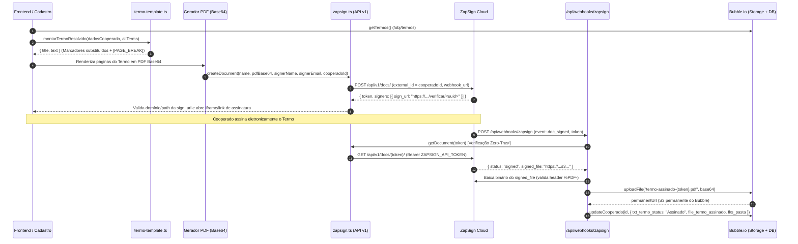
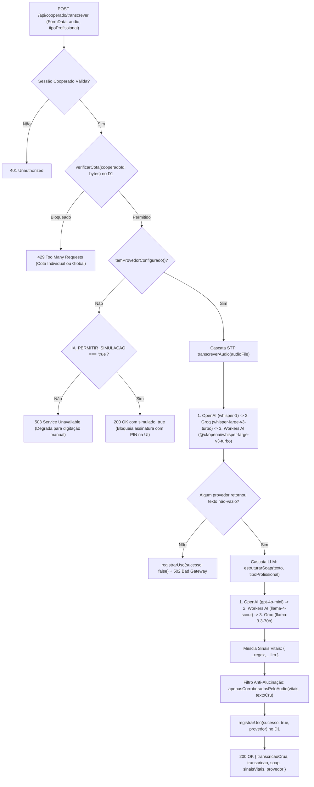

# 03 — Integrações Externas (Bubble.io, ZapSign), Cascata de IA Clínica e Camada de Transporte/Cache

> **Propósito deste Documento**: Servir como manual técnico exaustivo (Handover de Engenharia) das integrações externas do **GestorCoop**, detalhando linha a linha, bloco a bloco e regra de negócio por regra de negócio:
> 1. **Integração com o Bubble.io (`src/lib/bubble.ts`)**: Data API v1.1, autenticação Bearer, proxy lazy para Cloudflare Edge, paginação paralela por cursor, upload binário nativo, máquina de estados com compensação transacional e mapeamento completo das 18 tabelas do Bubble.
> 2. **Assinatura Digital ZapSign (`src/lib/zapsign.ts`, `src/lib/termo-template.ts`, `src/app/api/webhooks/zapsign/route.ts`)**: Resolução de templates jurídicos, geração e validação de URLs de assinatura, webhook com verificação zero-trust e persistência definitiva de PDFs assinados.
> 3. **Cascata de Inteligência Artificial e Transcrição Clínica (`src/lib/ia/provedores.ts`, `src/lib/ia/limites.ts`, `src/app/api/cooperado/transcrever/route.ts`)**: Orquestração multi-provedor (OpenAI, Groq, Cloudflare Workers AI), extração estruturada SOAP, filtro anti-alucinação de sinais vitais corroborados pelo áudio e rate-limiting/cotas diárias no Cloudflare D1.
> 4. **Camada de Fetch Autenticado e Cache Cliente/Servidor (`src/lib/api-cliente.ts`, `src/lib/client-fetch.ts`, `src/lib/cache-memoria.ts`, `src/lib/cache-navegacao.ts`)**: Injeção automática de credenciais em iframes de terceira parte (`#s=`), paginação progressiva client-side, memoização por isolate no Cloudflare Workers (com controle de geração e sem compartilhamento de I/O entre requests) e Stale-While-Revalidate (SWR) no navegador.

---

## Parte 1: Integração com o Bubble.io (`src/lib/bubble.ts`)

### 1.1 Arquitetura da Data API do Bubble.io no GestorCoop

O Bubble.io atua como o **sistema legado e backoffice central (ERP)** da cooperativa, hospedando o cadastro mestre de sócios cooperados, profissões, contas bancárias, termos de adesão, escalas, serviços (plantões), pacientes/locais de trabalho, domicílios e todo o parque de equipamentos hospitalares (locações, manutenções, reservas, conferências, higienizações, baixas e alertas).

#### 1.1.1 Estrutura de Ambientes (`version-test` vs Produção)
A Data API do Bubble expõe endpoints RESTful sob o caminho `/api/1.1/obj/<tipo_de_dado>` para operações CRUD em tabelas e `/fileupload` na raiz do ambiente para armazenamento de arquivos no S3 gerenciado pelo Bubble:

| Ambiente | Exemplo de `BUBBLE_API_URL` | Endpoint de Upload (`/fileupload`) | Comportamento |
| :--- | :--- | :--- | :--- |
| **Homologação / Teste (`version-test`)** | `https://gestorcoop.app/version-test/api/1.1` | `https://gestorcoop.app/version-test/fileupload` | Banco de dados isolado de homologação do Bubble. |
| **Produção (`live`)** | `https://gestorcoop.app/api/1.1` | `https://gestorcoop.app/fileupload` | Banco de dados produtivo oficial da cooperativa. |

> [!IMPORTANT]
> **Derivação da URL de Upload**: Na função `uploadFile` (linha 731), a URL base do aplicativo (`appUrl`) é obtida removendo o sufixo `/api/1.1` via expressão regular (`urlBaseBubble().replace(/\/api\/1\.1\/?$/, '')`), garantindo que tanto o ambiente `version-test` (`.../version-test/fileupload`) quanto o ambiente produtivo (`.../fileupload`) funcionem sem variáveis de ambiente adicionais.

#### 1.1.2 Autenticação Bearer
Todas as chamadas à Data API do Bubble utilizam autenticação via token estático de API administrativa configurado no painel do Bubble (*Settings → API → API Tokens*):
- **Variável de ambiente**: `BUBBLE_API_TOKEN`
- **Cabeçalho HTTP**: `Authorization: Bearer ${process.env.BUBBLE_API_TOKEN}`
- **Content-Type padrão**: `application/json`

#### 1.1.3 Convenção de Nomes de Campos no Bubble
O banco de dados do Bubble segue uma convenção de prefixos tipados herdada da modelagem original no editor visual do Bubble, com nuances importantes de capitalização (ex.: Option Sets ora como `OS_`, ora como `os_`):
- `txt_*` / `text_*`: Campos textuais (`text`).
- `num_*`: Campos numéricos (`number`, valores monetários, quantidades, versões).
- `date_*`: Campos de data/hora (`date`, serializados em ISO 8601).
- `bool_*`: Campos booleanos (`yes/no`).
- `fk_*`: Chaves estrangeiras simples (armazenam o `_id` único do registro referenciado no formato `1700000000000x000000000000000000`).
- `fks_*`: Listas de chaves estrangeiras ou URLs de arquivos (`list of ...`).
- `os_*` / `OS_*`: Campos vinculados a *Option Sets* do Bubble (enumeradores de status, tipos de movimentação, motivos de baixa, tipos de cobrança).
- `geo_*`: Campos de endereço geográfico do Bubble (`geographic address`), que a Data API pode retornar como `string` pura ou como objeto `{ address: string, lat: number, lng: number }`.
- `file_*`: Campos de arquivo (`file`), armazenando a URL pública ou protocolo-relativa (`//s3.amazonaws.com/...`) do arquivo.
- Metadados nativos do Bubble: `_id` (chave primária gerada pelo Bubble) e `'Created Date'` (mapeado nas interfaces TypeScript para `CreatedDate`).

---

### 1.2 Mapeamento Completo das Tabelas do Bubble Consumidas e Escritas

Abaixo está o catálogo exaustivo de todas as **18 tabelas (Data Types)** do Bubble manipuladas em `src/lib/bubble.ts`, seus endpoints REST, métodos que as consomem/escrevem e o mapeamento campo a campo entre o contrato bruto do Bubble e o modelo TypeScript do GestorCoop.

#### 1. Tabela `socioscooperados` (`/obj/socioscooperados`)
Representa o cadastro central do profissional cooperado.
- **Operações em `bubbleApi`**:
  - `createCooperado(data)` (`POST /obj/socioscooperados`)
  - `getCooperado(id)` (`GET /obj/socioscooperados/{id}`)
  - `getCooperados(cursor?, limit?)` (`GET /obj/socioscooperados`)
  - `updateCooperado(id, data)` (`PATCH /obj/socioscooperados/{id}`)
  - `findCooperadoByCPF(cpf)` (`GET /obj/socioscooperados?constraints=...`)
  - `findCooperadoByEmail(email)` (`GET /obj/socioscooperados?constraints=...`)
- **Mapeamento de Campos (`CreateCooperadoInput` e campos adicionais de leitura/atualização)**:

| Campo no Bubble | Tipo TS | Obrigatório no Input | Regra de Negócio / Descrição |
| :--- | :--- | :---: | :--- |
| `_id` | `string` | Gerado | Identificador único do cooperado no Bubble. |
| `txt_nomeCompleto` | `string` | Sim | Nome civil completo do cooperado. |
| `txt_CPF` / `txt_cpf` | `string` | Sim | CPF do cooperado. Na busca (`findCooperadoByCPF`), ambas as grafias (`txt_CPF` e `txt_cpf`) e ambos os formatos (com máscara `000.000.000-00` e apenas 11 dígitos) são testados. |
| `txt_email` | `string` | Sim | E-mail principal do cooperado (usado também para fallback de localização no webhook da ZapSign). |
| `txt_whatsapp` | `string` | Sim | Número de WhatsApp do cooperado. |
| `txt_telefone` | `string` | Não | Telefone secundário/fixo. |
| `txt_rg` | `string` | Sim | Número da cédula de identidade (RG). |
| `txt_orgaoEmissor` | `string` | Sim | Órgão expedidor do RG (ex.: SSP, DETRAN). |
| `txt_orgaoUF` | `string` | Sim | UF do órgão expedidor do RG. |
| `date_dataNascimento` | `string` | Sim | Data de nascimento em formato ISO ou formatado. |
| `date_dataExpedicaoRG` | `string` | Sim | Data de expedição do RG. |
| `txt_sexo` | `string` | Sim | Sexo declarado no cadastro. |
| `txt_estadoCivil` | `string` | Sim | Estado civil (Solteiro, Casado, etc.). |
| `txt_nomeMae` | `string` | Sim | Nome completo da mãe. |
| `txt_nomePai` | `string` | Não | Nome completo do pai. |
| `txt_grauEscolaridade` | `string` | Sim | Grau de instrução/escolaridade. |
| `txt_etinia` | `string` | Sim | Etnia/raça (nota: grafia `txt_etinia` mantida conforme coluna legada no Bubble). |
| `txt_pis` | `string` | Sim | Número do PIS/PASEP/NIT (usado para retenção de INSS conforme ADI RFB nº 5/2015). |
| `txt_endereco` | `string` | Sim | Endereço residencial completo. |
| `fk_Cooperativa` | `string` | Sim | `_id` da cooperativa à qual o sócio está vinculado. |
| `bool_listaNegra` | `boolean` | Não | Flag de restrição administrativa. |
| `bool_BLOQUEADO` | `boolean` | Não | Flag de bloqueio operacional do cooperado. |
| `txt_termo_status` | `string` | Não | Status da assinatura do Termo de Adesão (ex.: `'Pendente'`, `'Assinado'`). |
| `file_termo_assinado` | `string` | Não | URL permanente do PDF do Termo de Adesão assinado via ZapSign e salvo no storage do Bubble. |
| `fks_pasta` | `string[]` | Não | Lista de URLs de arquivos/documentos anexados à pasta digital do cooperado (atualizada via `Set` para evitar duplicatas). |

#### 2. Tabela `profissao_cooperado` (`/obj/profissao_cooperado`)
Armazena as habilitações profissionais e registros de conselho de classe (COREN, CRM, CREFITO, etc.) vinculados a um cooperado.
- **Operações em `bubbleApi`**:
  - `createProfissao(data)` (`POST /obj/profissao_cooperado`)
  - `deleteProfissao(id)` (`DELETE /obj/profissao_cooperado/{id}`)
  - `getProfissoesByCooperado(cooperadoId)` (`GET /obj/profissao_cooperado` com constraint `fk_socio_cooperado equals cooperadoId`)
- **Mapeamento de Campos (`CreateProfissaoInput`)**:

| Campo no Bubble | Tipo TS | Obrigatório | Descrição |
| :--- | :--- | :---: | :--- |
| `_id` | `string` | Gerado | ID do vínculo de profissão. |
| `txt_nome` | `string` | Sim | Nome da profissão/especialidade (ex.: Técnico de Enfermagem, Enfermeiro). |
| `txt_conselho` | `string` | Sim | Número de inscrição no conselho de classe. |
| `date_emissao` | `string` | Não | Data de emissão da carteira profissional. |
| `bool_principal` | `boolean` | Sim | Define se esta é a profissão principal do cooperado. |
| `OS_profissao` | `string` | Não | Option Set correspondente à profissão no Bubble. |
| `fk_socio_cooperado` | `string` | Sim | `_id` do cooperado na tabela `socioscooperados`. |
| `fk_cooperativa` | `string` | Sim | `_id` da cooperativa. |

#### 3. Tabela `conta_cooperado` (`/obj/conta_cooperado`)
Armazena os dados bancários do cooperado para repasse de produção mensal.
- **Operações em `bubbleApi`**:
  - `createContaBancaria(data)` (`POST /obj/conta_cooperado`)
  - `deleteContaBancaria(id)` (`DELETE /obj/conta_cooperado/{id}`)
  - `getContasByCooperado(cooperadoId)` e `getContasBancariasByCooperado(cooperadoId)` (`GET /obj/conta_cooperado` com constraint `fk_cooperado equals cooperadoId`)
- **Mapeamento de Campos (`CreateContaInput`)**:

| Campo no Bubble | Tipo TS | Obrigatório | Descrição |
| :--- | :--- | :---: | :--- |
| `_id` | `string` | Gerado | ID do registro bancário. |
| `txt_agencia` | `string` | Sim | Número da agência bancária. |
| `txt_banco` | `string` | Sim | Nome ou código da instituição bancária. |
| `text_corrente_or_poupanca` | `string` | Sim | Tipo da conta (Corrente ou Poupança — notar prefixo `text_`). |
| `txt_nConta` | `string` | Sim | Número da conta com dígito. |
| `fk_cooperado` | `string` | Sim | `_id` do cooperado (`socioscooperados`). |

#### 4. Tabela `termos` (`/obj/termos`)
Armazena os modelos versionados de Termos de Adesão por profissão ou gerais.
- **Operações em `bubbleApi`**:
  - `createTermo(data)` (`POST /obj/termos`)
  - `getTermos()` (`GET /obj/termos?limit=100` via `fetch` com `cache: 'no-store'` e fallback para `getAllResults`)
  - `updateTermo(id, data)` (`PATCH /obj/termos/{id}`)
- **Mapeamento de Campos (`Termo`)**:

| Campo no Bubble | Tipo TS | Descrição |
| :--- | :--- | :--- |
| `_id` | `string` | ID do template de termo. |
| `txt_titulo` | `string` | Título exibido no cabeçalho do PDF (ex.: `TERMO DE ADESÃO MULTCARE - GERAL`). |
| `txt_conteudo` | `string` | Corpo do texto com marcadores `{nome}`, `{cpf}`, `[PAGE_BREAK]`, etc. |
| `txt_profissao` | `string` | Profissão alvo do termo ou `'Geral'` / `'Todos'`. |
| `num_versao` | `number` | Número sequencial de versão do documento jurídico. |
| `bool_ativo` | `boolean` | Flag indicando se esta versão está ativa para novos cadastros. |

#### 5. Tabela `servicos` (`/obj/servicos`) — Plantões / Ordens de Serviço de Escala
Armazena os plantões/serviços executados ou agendados para os cooperados.
- **Operações em `bubbleApi`**:
  - `getServicosByCooperado(cooperadoId, startDate?, endDate?)` (`GET /obj/servicos`)
  - `updateServico(servicoId, data)` (`PATCH /obj/servicos/{servicoId}`)
- **Campos de Filtro e Manipulação**:
  - `fk_cooperado`: ID do cooperado executor do plantão (`constraint_type: 'equals'`).
  - `date_fixa_entrada`: Data/hora de entrada do plantão, filtrada com `greater than` (`${startDate}T00:00:00.000Z`) e `less than` (`${endDate}T23:59:59.999Z`).

#### 6. Tabela `escalas` (`/obj/escalas`)
Armazena as escalas de trabalho onde os serviços/plantões são alocados.
- **Operações em `bubbleApi`**:
  - `getEscalas(cursor?, limit?)` (`GET /obj/escalas` — suporta paginação manual ou busca integral via `getAllResults`).

#### 7. Tabela `locais_de_trabalho_pacientes` (`/obj/locais_de_trabalho_pacientes`) — Clientes / Pacientes
> [!NOTE]
> **Nota Arquitetural de Vocabulário (Linhas 186–190)**: Na interface de usuário do GestorCoop, esta entidade é apresentada como **"Cliente"** (ou Paciente no módulo clínico). Os identificadores `Paciente`, `fk_paciente` e o nome da tabela `locais_de_trabalho_pacientes` foram preservados no código porque constituem o contrato físico do Bubble em produção — renomeá-los exigiria migração de banco no Bubble e quebraria workflows legados.

- **Operações em `bubbleApi`**:
  - `getPaciente(id)` (`GET /obj/locais_de_trabalho_pacientes/{id}`)
  - `getPacientes(constraints?)` (`GET /obj/locais_de_trabalho_pacientes`)
  - `createPaciente(data)` (`POST /obj/locais_de_trabalho_pacientes` + invalidação de `CHAVE_CACHE_PACIENTES_BUBBLE` + criação automática de domicílio se `equipamentosV2Ativo`)
  - `updatePaciente(id, data)` (`PATCH /obj/locais_de_trabalho_pacientes/{id}` + invalidação de `CHAVE_CACHE_PACIENTES_BUBBLE`)
- **Mapeamento de Campos (`Paciente`)**:

| Campo no Bubble (Raw) | Propriedade TS (`Paciente`) | Transformação / Regra de Mapeamento |
| :--- | :--- | :--- |
| `_id` | `_id` | Mantido como `raw._id`. |
| `txt_nome` | `txt_nome` | `raw.txt_nome \|\| ''` |
| *(não retornado na leitura)* | `txt_cpf`, `txt_whatsapp`, `txt_email` | Inicializados como `''` em `getPaciente`/`getPacientes`. |
| `geo_local` | `txt_endereco` | Na leitura: `typeof raw.geo_local === 'string' ? raw.geo_local : (raw.geo_local?.address \|\| '')`. Na escrita (`createPaciente`/`updatePaciente`), `data.txt_endereco` é gravado em `payload.geo_local`. |
| `os_tipo` | `txt_tipo` | `raw.os_tipo \|\| 'Homecare'` (`'Homecare' \| 'Hospital'`). |
| `fks_equipamentos` | `fks_equipamentos` | `raw.fks_equipamentos \|\| []` (lista de `_id` de equipamentos alocados). |
| `fks_locacoes` | `fks_locacoes` | `raw.fks_locacoes \|\| []` (lista de `_id` de locações). |
| `'Created Date'` | `CreatedDate` | `raw['Created Date']` |

#### 8. Tabela `domicilio` (`/obj/domicilio`)
Representa o endereço físico estruturado de atendimento domiciliar de um paciente (introduzido no Equipamentos v2).
- **Operações em `bubbleApi`**:
  - `getDomicilio(id)` (`GET /obj/domicilio/{id}`)
  - `getDomiciliosPorPaciente(pacienteId)` (`GET /obj/domicilio` com `fk_paciente equals pacienteId`)
  - `obterOuCriarDomicilioAtivo(pacienteId, enderecoLegado)` (`GET` seguido de `POST /obj/domicilio` caso não exista domicílio ativo)
- **Mapeamento de Campos (`mapDomicilio` → `Domicilio`)**:

| Campo no Bubble (Raw) | Propriedade TS (`Domicilio`) | Transformação / Regra |
| :--- | :--- | :--- |
| `_id` | `_id` | `raw._id` |
| `fk_paciente` | `fk_paciente` | `raw.fk_paciente \|\| ''` |
| `geo_endereco` | `geo_endereco` | `typeof raw.geo_endereco === 'string' ? raw.geo_endereco : raw.geo_endereco?.address \|\| ''` (trata retorno polimórfico do Bubble). |
| `txt_cep` | `txt_cep` | `raw.txt_cep \|\| undefined` |
| `txt_numero` | `txt_numero` | `raw.txt_numero \|\| undefined` |
| `txt_complemento` | `txt_complemento` | `raw.txt_complemento \|\| undefined` |
| `txt_bairro` | `txt_bairro` | `raw.txt_bairro \|\| undefined` |
| `txt_cidade` | `txt_cidade` | `raw.txt_cidade \|\| undefined` |
| `txt_estado` | `txt_estado` | `raw.txt_estado \|\| undefined` |
| `txt_ponto_referencia` | `txt_ponto_referencia` | `raw.txt_ponto_referencia \|\| undefined` |
| `txt_contato_local` | `txt_contato_local` | `raw.txt_contato_local \|\| undefined` |
| `txt_instrucoes_acesso` | `txt_instrucoes_acesso` | `raw.txt_instrucoes_acesso \|\| undefined` |
| `bool_ativo` | `bool_ativo` | `raw.bool_ativo !== false` (default `true` se omitido). |
| `'Created Date'` | `CreatedDate` | `raw['Created Date']` |

#### 9. Tabela `equipamento` (`/obj/equipamento`)
Cadastro patrimonial e operacional de equipamentos hospitalares/homecare.
- **Operações em `bubbleApi`**:
  - `getEquipamento(id)` (`GET /obj/equipamento/{id}`)
  - `getEquipamentos(constraints?)` (`GET /obj/equipamento`)
  - `createEquipamento(data)` (`POST /obj/equipamento`)
  - `updateEquipamento(id, data)` (`PATCH /obj/equipamento/{id}`)
  - `deleteEquipamento(id)` (`DELETE /obj/equipamento/{id}`)
- **Mapeamento de Campos (`mapEquipamento` → `Equipamento`)**:

| Campo no Bubble (Raw) | Propriedade TS (`Equipamento`) | Transformação na Leitura (`mapEquipamento`) | Transformação na Escrita (`create`/`update`) |
| :--- | :--- | :--- | :--- |
| `_id` | `_id` | `raw._id` | Gerado no POST (`response.data.id \|\| response.data.response?.id`). |
| `txt_nome` | `txt_nome` | `raw.txt_nome \|\| ''` | `payload.txt_nome` |
| `txt_descricao` | `txt_descricao` | `raw.txt_descricao \|\| ''` | `payload.txt_descricao` |
| `txt_marca` | `txt_marca` | `raw.txt_marca \|\| ''` | `payload.txt_marca` |
| `txt_modelo` | `txt_modelo` | `raw.txt_modelo \|\| ''` | `payload.txt_modelo` |
| `txt_numero_serie` | `txt_numero_serie` | `raw.txt_numero_serie \|\| ''` | `payload.txt_numero_serie` |
| `num_preco_padrao` | `num_preco_padrao` | `raw.num_preco_padrao \|\| 0` | `payload.num_preco_padrao` |
| `OS_status` | `txt_status` | `raw.OS_status \|\| 'Disponível'` (Tipado como `StatusEquipamento` — 18 estados possíveis). | Gravado como `payload.OS_status`. |
| `txt_codigo_interno` | `txt_codigo_interno` | `raw.txt_codigo_interno \|\| ''` | `payload.txt_codigo_interno` |
| `txt_numero_patrimonio` | `txt_numero_patrimonio` | `raw.txt_numero_patrimonio \|\| ''` | `payload.txt_numero_patrimonio` |
| `txt_codigo_barras` | `txt_codigo_barras` | `raw.txt_codigo_barras \|\| ''` | `payload.txt_codigo_barras` |
| `txt_categoria` | `txt_categoria` | `raw.txt_categoria \|\| ''` | `payload.txt_categoria` |
| `txt_fabricante` | `txt_fabricante` | `raw.txt_fabricante \|\| ''` | `payload.txt_fabricante` |
| `txt_origem` | `txt_origem` | `raw.txt_origem \|\| ''` | `payload.txt_origem` |
| `txt_fornecedor` | `txt_fornecedor` | `raw.txt_fornecedor \|\| ''` | `payload.txt_fornecedor` |
| `fk_categoria_equipamento` | `fk_categoria_equipamento` | `raw.fk_categoria_equipamento \|\| undefined` | `payload.fk_categoria_equipamento` |
| `fk_fabricante_equipamento` | `fk_fabricante_equipamento` | `raw.fk_fabricante_equipamento \|\| undefined` | `payload.fk_fabricante_equipamento` |
| `fk_modelo_equipamento` | `fk_modelo_equipamento` | `raw.fk_modelo_equipamento \|\| undefined` | `payload.fk_modelo_equipamento` |
| `fk_fornecedor_equipamento` | `fk_fornecedor_equipamento` | `raw.fk_fornecedor_equipamento \|\| undefined` | `payload.fk_fornecedor_equipamento` |
| `fk_localizacao_atual` | `fk_localizacao_atual` | `raw.fk_localizacao_atual \|\| undefined` | `payload.fk_localizacao_atual` |
| `fk_ultima_movimentacao` | `fk_ultima_movimentacao` | `raw.fk_ultima_movimentacao \|\| undefined` | Atualizado em `updateEquipamento` via `registrarMovimentacao`. |
| `date_aquisicao` | `date_aquisicao` | `raw.date_aquisicao \|\| undefined` | `payload.date_aquisicao` |
| `date_fim_garantia` | `date_fim_garantia` | `raw.date_fim_garantia \|\| undefined` | `payload.date_fim_garantia` |
| `date_proxima_preventiva` | `date_proxima_preventiva` | `raw.date_proxima_preventiva \|\| undefined` | `payload.date_proxima_preventiva` |
| `date_ultima_movimentacao` | `date_ultima_movimentacao` | `raw.date_ultima_movimentacao \|\| undefined` | Atualizado em `updateEquipamento`. |
| `num_valor_aquisicao` | `num_valor_aquisicao` | `raw.num_valor_aquisicao ?? undefined` | `payload.num_valor_aquisicao` |
| `num_valor_diaria_padrao` | `num_valor_diaria_padrao` | `raw.num_valor_diaria_padrao ?? undefined` | `payload.num_valor_diaria_padrao` |
| `num_valor_mensal_padrao` | `num_valor_mensal_padrao` | `raw.num_valor_mensal_padrao ?? undefined` | `payload.num_valor_mensal_padrao` |
| `num_taxa_implantacao_padrao` | `num_taxa_implantacao_padrao` | `raw.num_taxa_implantacao_padrao ?? undefined` | `payload.num_taxa_implantacao_padrao` |
| `num_taxa_recolhimento_padrao` | `num_taxa_recolhimento_padrao` | `raw.num_taxa_recolhimento_padrao ?? undefined` | `payload.num_taxa_recolhimento_padrao` |
| `txt_regra_cobranca_padrao` | `txt_regra_cobranca_padrao` | `raw.txt_regra_cobranca_padrao \|\| undefined` | `payload.txt_regra_cobranca_padrao` |
| `'Created Date'` | `CreatedDate` | `raw['Created Date']` | Somente leitura. |

#### 10. Tabela `locacao_equipamento` (`/obj/locacao_equipamento`)
Contratos de locação/implantação de equipamentos em pacientes/domicílios.
- **Operações em `bubbleApi`**:
  - `getLocacao(id)` (`GET /obj/locacao_equipamento/{id}`)
  - `getLocacoes(constraints?)` (`GET /obj/locacao_equipamento`)
  - `createLocacao(data)` (`POST /obj/locacao_equipamento`)
  - `updateLocacao(id, data)` (`PATCH /obj/locacao_equipamento/{id}`)
- **Mapeamento de Campos (`mapLocacao` → `LocacaoEquipamento`)**:

| Campo no Bubble (Raw) | Propriedade TS (`LocacaoEquipamento`) | Regra de Mapeamento (Leitura / Escrita) |
| :--- | :--- | :--- |
| `_id` | `_id` | `raw._id` |
| `fk_equipamento` | `fk_equipamento` | `raw.fk_equipamento \|\| ''` |
| `fk_paciente` | `fk_paciente` | `raw.fk_paciente \|\| ''` |
| `fk_domicilio` | `fk_domicilio` | `raw.fk_domicilio \|\| undefined` |
| `fk_movimentacao_implantacao` | `fk_movimentacao_implantacao` | `raw.fk_movimentacao_implantacao \|\| undefined` (atualizado via `updateLocacao`). |
| `fk_movimentacao_recolhimento` | `fk_movimentacao_recolhimento` | `raw.fk_movimentacao_recolhimento \|\| undefined` (atualizado via `updateLocacao`). |
| `date_inicio` | `date_inicio` | `raw.date_inicio \|\| ''` |
| `date_fim_previsto` | `date_fim_previsto` | `raw.date_fim_previsto \|\| ''` |
| `date_fim_real` | `date_fim_real` | `raw.date_fim_real \|\| undefined` |
| `num_valor_aluguel` | `num_valor_aluguel` | `raw.num_valor_aluguel \|\| 0` |
| `OS_status` | `txt_status` | Leitura: `raw.OS_status \|\| 'Ativo'` (`'Ativo' \| 'Finalizado' \| 'Cancelado'`). Escrita: `payload.OS_status`. |
| `txt_observacoes` | `txt_observacoes` | `raw.txt_observacoes \|\| ''` |
| `os_tipo_cobranca` | `os_tipo_cobranca` | `raw.os_tipo_cobranca \|\| undefined` |
| `num_valor_diaria_contratada` | `num_valor_diaria_contratada` | `raw.num_valor_diaria_contratada ?? undefined` |
| `num_valor_mensal_contratado` | `num_valor_mensal_contratado` | `raw.num_valor_mensal_contratado ?? undefined` |
| `num_taxa_implantacao_contratada` | `num_taxa_implantacao_contratada` | `raw.num_taxa_implantacao_contratada ?? undefined` |
| `num_taxa_recolhimento_contratada` | `num_taxa_recolhimento_contratada` | `raw.num_taxa_recolhimento_contratada ?? undefined` |
| `num_desconto_contratado` | `num_desconto_contratado` | `raw.num_desconto_contratado ?? undefined` |
| `num_acrescimo_contratado` | `num_acrescimo_contratado` | `raw.num_acrescimo_contratado ?? undefined` |
| `num_total_estimado` | `num_total_estimado` | `raw.num_total_estimado ?? undefined` |

#### 11. Tabela `movimentacao_equipamento` (`/obj/movimentacao_equipamento`)
Trilha de auditoria imutável (com suporte a compensação lógica `bool_cancelado`) de todas as transições de estado de um equipamento (Equipamentos v2).
- **Operações em `bubbleApi`**:
  - `getMovimentacaoPorChave(chave)` (`GET /obj/movimentacao_equipamento` filtrando por `txt_chave_idempotencia`)
  - `getHistoricoEquipamento(equipamentoId)` (`GET /obj/movimentacao_equipamento` filtrando por `fk_equipamento`)
  - `registrarMovimentacao(input)` (`POST /obj/movimentacao_equipamento` + `PATCH` de compensação em caso de falha)
- **Mapeamento de Campos (`MovimentacaoEquipamento`)**:

| Campo no Bubble (Escrita / Leitura) | Propriedade TS (`MovimentacaoEquipamento`) | Observação de Compatibilidade de Nomes |
| :--- | :--- | :--- |
| `fk_equipamento` | `fk_equipamento` | ID do equipamento movimentado. |
| `fk_locacao` / `fk_locacao_equipamento` | `fk_locacao_equipamento` | Escrito como `fk_locacao`; lido com fallback `raw.fk_locacao ?? raw.fk_locacao_equipamento`. |
| `fk_ordem_servico_manutencao` | `fk_ordem_servico_manutencao` | ID da OS de manutenção relacionada. |
| `fk_domicilio` | `fk_domicilio` | ID do domicílio. |
| `fk_localizacao_anterior` | `fk_localizacao_anterior` | Localização anterior do equipamento (`equipamento.fk_localizacao_atual`). |
| `fk_localizacao_nova` / `fk_nova_localizacao` | `fk_nova_localizacao` | Escrito como `fk_localizacao_nova`; lido com fallback `raw.fk_localizacao_nova ?? raw.fk_nova_localizacao`. |
| `os_tipo_evento` / `os_tipo_movimentacao` | `os_tipo_movimentacao` | Escrito como `os_tipo_evento`; lido com fallback `raw.os_tipo_evento ?? raw.os_tipo_movimentacao`. |
| `txt_tipo_evento` / `txt_tipo_movimentacao` | `txt_tipo_movimentacao` | Escrito como `txt_tipo_evento`; lido com fallback `raw.txt_tipo_evento ?? raw.txt_tipo_movimentacao`. |
| `os_status_anterior` / `txt_status_anterior` | `txt_status_anterior` | Status do equipamento antes da transição. |
| `os_status_novo` / `txt_novo_status` | `txt_novo_status` | Novo status do equipamento após a transição. |
| `date_data_hora` | `date_data_hora` | Timestamp ISO da movimentação. |
| `txt_responsavel_operacao` / `txt_responsavel` | `txt_responsavel` | Nome/ID do responsável pela operação. |
| `txt_observacoes` | `txt_observacoes` | Observações livres. |
| `txt_justificativa` | `txt_justificativa` | Justificativa (também preenchida automaticamente na compensação de erro). |
| `txt_chave_idempotencia` | `txt_chave_idempotencia` | Chave única para evitar duplicação de movimentações em retentativas HTTP. |
| `bool_cancelado` | `bool_cancelado` | `true` quando a movimentação foi compensada/estornada por falha no `updateEquipamento`. |

#### 12. Tabela `ordem_servico_manutencao` (`/obj/ordem_servico_manutencao`)
Ordens de Serviço de manutenção preventiva ou corretiva de equipamentos (Equipamentos v2).
- **Operações em `bubbleApi`**:
  - `criarOrdemServicoManutencao(data)` (`POST /obj/ordem_servico_manutencao`)
  - `atualizarOrdemServicoManutencao(id, data)` (`PATCH /obj/ordem_servico_manutencao/{id}`)
  - `getOrdensServicoManutencao(equipamentoId)` (`GET /obj/ordem_servico_manutencao`)
- **Mapeamento de Campos (`OrdemServicoManutencao`)**:
  - `txt_numero_os`, `fk_equipamento`, `fk_movimentacao_entrada`, `date_entrada`, `txt_motivo`, `txt_defeito_relatado`, `txt_responsavel`, `txt_observacoes`.
  - `os_status` (no Bubble) ↔ `txt_status` (no TS).
  - `os_resultado` (no Bubble) ↔ `txt_resultado` (no TS).
  - `date_previsao_conclusao` (no Bubble) ↔ `date_prazo_estimado` (no TS, lido com fallback `raw.date_previsao_conclusao ?? raw.date_prazo_estimado`).
  - Campos de diagnóstico e custos: `date_diagnostico`, `date_conclusao`, `txt_defeito_encontrado`, `txt_causa_provavel`, `txt_servico_recomendado`, `txt_responsavel_tecnico`, `num_orcamento`, `num_custo_pecas`, `num_custo_mao_obra`, `num_custo_frete`, `num_outros_custos`, `num_custo_total`.

#### 13. Tabela `item_manutencao` (`/obj/item_manutencao`)
Peças, mão de obra, frete e outros custos vinculados a uma OS de manutenção.
- **Operações em `bubbleApi`**:
  - `criarItemManutencao(data)` (`POST /obj/item_manutencao`)
  - `getItensManutencao(osId)` (`GET /obj/item_manutencao` com `fk_ordem_servico equals osId`)
  - `deleteItemManutencao(id)` (`DELETE /obj/item_manutencao/{id}`)
- **Mapeamento de Campos (`ItemManutencao`)**:
  - `fk_ordem_servico` (Bubble) ↔ `fk_ordem_servico_manutencao` (TS).
  - `txt_tipo` (`'Peça' | 'Mão de obra' | 'Frete' | 'Outro'`), `txt_descricao`, `num_quantidade`.
  - `num_valor_unitario` (Bubble) ↔ `num_custo_unitario` (TS).
  - `num_valor_total` (Bubble) ↔ `num_custo_total` (TS — calculado com arredondamento monetário `Math.round((quantidade * custoUnitario + Number.EPSILON) * 100) / 100`).
  - `txt_fornecedor`, `txt_responsavel`.

#### 14. Tabela `reserva_equipamento` (`/obj/reserva_equipamento`)
Reservas temporárias de equipamentos para futura implantação em paciente/domicílio.
- **Operações em `bubbleApi`**:
  - `criarReservaEquipamento(data)` (`POST /obj/reserva_equipamento`)
  - `atualizarReservaEquipamento(id, data)` (`PATCH /obj/reserva_equipamento/{id}`)
  - `getReserva(id)` (`GET /obj/reserva_equipamento/{id}`)
  - `getReservasEquipamento(equipamentoId)` (`GET /obj/reserva_equipamento`)
  - `getReservasVencidas(dataReferenciaIso)` (`GET /obj/reserva_equipamento` com `os_status = 'Ativa'` e `date_validade < dataReferenciaIso`)
  - `getReservasPorStatus(status?)` (`GET /obj/reserva_equipamento`)
- **Mapeamento de Campos (`mapReserva` → `ReservaEquipamento`)**:
  - `fk_equipamento`, `fk_paciente`, `fk_domicilio`, `fk_movimentacao_reserva`, `txt_chave_idempotencia`, `txt_responsavel`, `txt_observacoes`, `date_validade`.
  - `date_data_reserva` (Bubble) ↔ `date_reserva` (TS, fallback para `raw.date_reserva` e `raw['Created Date']`).
  - `date_prevista_implantacao` (Bubble) ↔ `date_implantacao_prevista` (TS).
  - `os_status` / `OS_status` (Bubble) ↔ `txt_status` (TS, default `'Ativa'`).
  - No `PATCH` de cancelamento: aceita `date_cancelamento` e `txt_motivo_cancelamento`.

#### 15. Tabela `conferencia_equipamento` (`/obj/conferencia_equipamento`)
Laudos de conferência técnica na entrada ou pós-recolhimento do equipamento.
- **Operações em `bubbleApi`**:
  - `criarConferenciaEquipamento(data)` (`POST /obj/conferencia_equipamento`)
- **Mapeamento de Campos (`ConferenciaEquipamento`)**:
  - `fk_equipamento`, `date_conferencia`, `txt_responsavel`, `txt_estado_conservacao`, `txt_resultado`, `txt_observacoes`.
  - `fk_movimentacao` (Bubble) ↔ `fk_movimentacao_equipamento` (TS).
  - `os_status_destino` (Bubble) ↔ `txt_status_destino` (TS).

#### 16. Tabela `higienizacao_equipamento` (`/obj/higienizacao_equipamento`)
Registros do ciclo de desinfecção e higienização de equipamentos recolhidos.
- **Operações em `bubbleApi`**:
  - `criarHigienizacaoEquipamento(data)` (`POST /obj/higienizacao_equipamento`)
- **Mapeamento de Campos (`HigienizacaoEquipamento`)**:
  - `fk_equipamento`, `date_inicio`, `txt_metodo`, `txt_resultado`, `txt_responsavel`, `txt_observacoes`.
  - `date_conclusao` (Bubble) ↔ `date_fim` (TS).
  - `os_status` (Bubble) ↔ `txt_status` (TS).

#### 17. Tabela `baixa_equipamento` (`/obj/baixa_equipamento`)
Solicitações de baixa patrimonial/condenação de equipamentos, aprovação e reversão excepcional com dupla custódia.
- **Operações em `bubbleApi`**:
  - `criarBaixaEquipamento(data)` (`POST /obj/baixa_equipamento`)
  - `getBaixa(id)`, `getBaixasEquipamento(equipamentoId)`, `getBaixasPorStatus(status?)` (`GET /obj/baixa_equipamento`)
  - `atualizarBaixaEquipamento(id, data)` (`PATCH /obj/baixa_equipamento/{id}`)
- **Mapeamento de Campos (`mapBaixa` → `BaixaEquipamento`)**:
  - `fk_equipamento`, `num_valor_reparo_estimado`, `num_valor_residual`, `txt_destino_final`, `txt_solicitante`, `txt_autorizado_por`, `date_decisao`, `date_baixa_efetiva`.
  - `date_solicitacao` (Bubble) ↔ `date_baixa` (TS).
  - `os_motivo` (Bubble) ↔ `os_motivo_baixa` (TS).
  - `txt_laudo_tecnico` (Bubble) ↔ `txt_laudo` (TS).
  - `os_status` (Bubble) ↔ `txt_status` (TS: `'Pendente de aprovação' | 'Aprovada' | 'Reprovada' | 'Cancelada'`).
  - `txt_observacoes_decisao` (Bubble) ↔ `txt_observacoes` (TS).
  - Auditoria de reversão excepcional: `bool_revertida`, `txt_revertida_por`, `txt_revertida_por_segundo`, `txt_justificativa_reversao`, `date_reversao`.

#### 18. Tabelas Adicionais: `suspensao_locacao`, `alerta_equipamento`, `user`, `cooperativas`, `integraliza__o`, `logs_gerais`
- **`suspensao_locacao` (`/obj/suspensao_locacao`)**: Períodos de suspensão de faturamento dentro de uma locação ativa (`fk_locacao_equipamento`, `date_inicio`, `date_fim`, `txt_motivo`, `txt_responsavel`).
- **`alerta_equipamento` (`/obj/alerta_equipamento`)**: Alertas operacionais idempotentes (`fk_equipamento`, `fk_locacao` ↔ `fk_locacao_equipamento`, `fk_ordem_servico` ↔ `fk_ordem_servico_manutencao`, `os_tipo` ↔ `os_tipo_alerta`, `txt_titulo`, `txt_detalhe` ↔ `txt_descricao`, `date_vencimento` ↔ `date_prazo`, `txt_prioridade`, `txt_responsavel`, `os_status` ↔ `txt_status`, `txt_resolucao`, `date_resolucao`, `txt_chave_idempotencia`).
- **`user` (`/obj/user`)**: Tabela nativa de usuários do Bubble. Usada para busca por ID (`getUser`), busca por vínculo com cooperado (`fk_cooperado` ou `fk_socio_cooperado`), criação (`createUser`) e handshake de SSO (`txt_sso_token_text` ou `sso_token_text`).
- **`cooperativas` (`/obj/cooperativas`)**: Dados cadastrais da cooperativa (`getCooperativa`, `updateCooperativa`).
- **`integraliza__o` (`/obj/integraliza__o`)**: Parcelas de integralização de cota-parte do capital social (`createIntegralizacao` — notar os dois underscores `__` que o Bubble gera ao sanitizar `çã` de "integralização").
- **`logs_gerais` (`/obj/logs_gerais`)**: Registro de auditoria geral no Bubble (`createLogGeral`).

---

### 1.3 Explicação Linha a Linha e Função por Função de `src/lib/bubble.ts`

#### Linhas 1–6: Diretivas e Importações
- **Linha 1**: `/* eslint-disable @typescript-eslint/no-explicit-any */` — Desabilita a regra de `any` explícito no arquivo, necessário porque os payloads brutos retornados pela Data API do Bubble possuem esquema dinâmico e campos polimórficos.
- **Linha 2**: Importa `axios` e o tipo `AxiosInstance` para comunicação HTTP com a Data API.
- **Linha 3**: Importa `validarTransicao` de `./equipamentos-estados`, responsável por validar a máquina de estados determinística antes de persistir qualquer movimentação de equipamento.
- **Linha 4**: Importa `normalizarUrlDocumento` de `./documentos`, que converte URLs protocolo-relativas do S3 do Bubble (`//s3.amazonaws.com/...`) em URLs absolutas `https://`.
- **Linha 5**: Importa `invalidarCacheMemoria` e a constante `CHAVE_CACHE_PACIENTES_BUBBLE` de `./cache-memoria` para invalidar o cache em memória do isolate sempre que um paciente é criado ou atualizado.

#### Linhas 7–50: Inicialização Lazy do Cliente Axios via `Proxy` (`urlBaseBubble`, `obterCliente`, `bubbleClient`)
- **Linhas 18–27 (`urlBaseBubble`)**:
  - Lê `process.env.BUBBLE_API_URL`.
  - Se não estiver definida, lança um `Error` explícito explicando como configurar no `.env.local` e no Cloudflare Pages.
  - **Regra arquitetural crítica**: Essa verificação ocorre apenas dentro da função (em tempo de requisição) e **nunca** no topo do arquivo. Durante a etapa `"Collecting page data"` do `next build` no Cloudflare Pages, as variáveis de ambiente de runtime não existem; se a validação rodasse no top-level do módulo, o build inteiro quebraria ao importar qualquer rota.
- **Linhas 29–42 (`clienteMemo` e `obterCliente`)**:
  - Mantém um singleton `clienteMemo: AxiosInstance | null = null`.
  - Na primeira chamada a `obterCliente()`, instancia `axios.create` com `baseURL: urlBaseBubble()` e headers `Authorization: Bearer ${process.env.BUBBLE_API_TOKEN}` e `Content-Type: application/json`.
- **Linhas 44–50 (`bubbleClient`)**:
  - Cria um `new Proxy({} as AxiosInstance, { get(_alvo, prop) { ... } })`.
  - Toda vez que o código chama `bubbleClient.get(...)`, `bubbleClient.post(...)`, `bubbleClient.patch(...)` ou `bubbleClient.delete(...)`, o trap `get` intercepta o acesso à propriedade, chama `obterCliente()` sob demanda e faz `.bind(cliente)` caso a propriedade seja uma função.

#### Linhas 52–440: Definições de Tipos e Interfaces de Domínio
- **Linhas 52–76 (`CreateCooperadoInput`)**: Contrato de criação de sócio cooperado em `/obj/socioscooperados`.
- **Linhas 78–86 (`CreateProfissaoInput`)**: Contrato de criação de profissão em `/obj/profissao_cooperado`.
- **Linhas 88–94 (`CreateContaInput`)**: Contrato de criação de conta bancária em `/obj/conta_cooperado`.
- **Linhas 96–103 (`Termo`)**: Estrutura de um modelo de Termo de Adesão.
- **Linhas 105–109 (`BubblePageResponse<T>`)**: Envelope de paginação retornado pelo Bubble (`{ results: T[], remaining: number, count: number }`).
- **Linha 111 (`equipamentosV2Ativo`)**: Feature flag booleana lida de `process.env.EQUIPAMENTOS_V2_ENABLED === 'true'`. Quando `false`, bloqueia chamadas de escrita às tabelas novas do módulo de Equipamentos v2 e mantém as leituras em modo de compatibilidade v1.
- **Linhas 113–131 (`StatusEquipamento`)**: Union type com os 18 estados do ciclo de vida do equipamento (`'Aguardando conferência'`, `'Disponível'`, `'Reservado'`, `'Em transporte para implantação'`, `'Implantado no domicílio'`, `'Em transporte para recolhimento'`, `'Recolhido e aguardando conferência'`, `'Aguardando higienização'`, `'Em higienização'`, `'Manutenção'`, `'Aguardando peça'`, `'Liberado pela manutenção'`, `'Bloqueado'`, `'Extraviado'`, `'Condenado'`, `'Baixado'`, `'Alugado'`, `'Inativo'`).
- **Linhas 133–149 (`TipoMovimentacaoEquipamento`)**: Union type com os 16 eventos operacionais que provocam transições de estado.
- **Linhas 151–440**: Interfaces `Equipamento`, `Paciente`, `LocacaoEquipamento`, `Domicilio`, `MovimentacaoEquipamento`, `RegistrarMovimentacaoInput`, `HistoricoEventoEquipamento`, `OrdemServicoManutencao`, `ReservaEquipamento`, `ConferenciaEquipamento`, `HigienizacaoEquipamento`, `ItemManutencao`, `BaixaEquipamento`, `SuspensaoLocacao`, `TipoAlertaEquipamento` e `AlertaEquipamento`.

#### Linhas 443–484: Paginação Paralela por Cursor (`getAllResults<T>`)
A Data API do Bubble limita cada resposta a no máximo 100 registros por página (`limit = 100`), informando no campo `response.remaining` quantos registros ainda restam após a página atual.
- **Linhas 445–449**: Configura `limit = 100` e `cursor = 0`. Se o array `constraints` for passado, serializa-o com `JSON.stringify(constraints)` no query param `constraints`.
- **Linhas 451–458**: Faz o `GET` da primeira página (`cursor: 0`). Extrai `firstPageResults` (`response.data.response.results || []`) e `remaining` (`response.data.response.remaining || 0`). Se `remaining === 0`, retorna imediatamente `firstPageResults` com apenas 1 requisição HTTP.
- **Linhas 460–475**: Se `remaining > 0`, calcula o total de páginas adicionais (`totalPages = Math.ceil(remaining / limit)`) e dispara **todas as páginas subsequentes em paralelo** (`for (let i = 1; i <= totalPages; i++)` com `nextCursor = i * limit`).
- **Linhas 476–483**: Aguarda `Promise.all(promises)` e concatena os arrays `results` na ordem exata dos cursores, devolvendo a coleção completa tipada como `T[]`.

#### Linhas 486–629: Funções Mapeadoras (`mapEquipamento`, `mapLocacao`, `mapReserva`, `mapDomicilio`, `mapBaixa`, `mapAlerta`)
Normalizam as diferenças de nomenclatura entre as colunas brutas do Bubble e o modelo de domínio em TypeScript:
- **`mapEquipamento` (linhas 486–521)**: Converte `raw.OS_status` em `txt_status` (default `'Disponível'`), `raw['Created Date']` em `CreatedDate`, strings vazias `''` para campos textuais principais e `undefined` para FKs e taxas opcionais (usando `?? undefined` para preservar `0` numérico quando existir).
- **`mapLocacao` (linhas 523–547)**: Converte `raw.OS_status` em `txt_status` (default `'Ativo'`), preserva campos financeiros contratados com `?? undefined`.
- **`mapReserva` (linhas 549–565)**: Resolve múltiplos nomes de colunas legadas/v2 com nullish coalescing: `date_data_reserva ?? date_reserva ?? 'Created Date'`, `date_prevista_implantacao ?? date_implantacao_prevista`, `os_status ?? OS_status ?? 'Ativa'`.
- **`mapDomicilio` (linhas 567–585)**: Desempacota `geo_endereco` caso o Bubble retorne um objeto `{ address: string }` ou uma `string` direta, e define `bool_ativo: raw.bool_ativo !== false`.
- **`mapBaixa` (linhas 587–609)**: Normaliza `date_solicitacao ?? date_baixa`, `os_motivo ?? os_motivo_baixa`, `txt_laudo_tecnico ?? txt_laudo`, `os_status ?? OS_status ?? 'Pendente de aprovação'`, `txt_observacoes_decisao ?? txt_observacoes` e converte `bool_revertida` com `Boolean(...)`.
- **`mapAlerta` (linhas 611–629)**: Normaliza `fk_locacao ?? fk_locacao_equipamento`, `fk_ordem_servico ?? fk_ordem_servico_manutencao`, `os_tipo ?? os_tipo_alerta`, `txt_detalhe ?? txt_descricao`, `date_vencimento ?? date_prazo` e `os_status ?? OS_status ?? 'Aberto'`.

#### Linhas 631–840: Métodos de Cooperados, Profissões, Contas Bancárias, Upload, Serviços, Escalas e Termos
- **`createCooperado` (linhas 632–635)**: `POST /obj/socioscooperados`.
- **`createProfissao` / `deleteProfissao` / `getProfissoesByCooperado` (linhas 637–650)**: CRUD de `/obj/profissao_cooperado` filtrado por `fk_socio_cooperado`.
- **`createContaBancaria` / `deleteContaBancaria` / `getContasByCooperado` / `getContasBancariasByCooperado` (linhas 652–665 e 793–802)**: CRUD de `/obj/conta_cooperado` filtrado por `fk_cooperado`.
- **`getCooperado` / `getCooperados` / `updateCooperado` (linhas 667–688)**:
  - `getCooperados(cursor?, limit?)`: Se `cursor` ou `limit` forem informados (usado pelo `fetchFullDataset` no cliente), busca apenas a página solicitada e retorna `response.data.response` (`{ results, remaining, count }`). Caso contrário, busca todas as páginas via `getAllResults`.
- **`findCooperadoByCPF` (linhas 690–716)**:
  - Extrai apenas os dígitos (`digits = cpf.replace(/\D/g, '')`) e gera a versão mascarada (`masked = 000.000.000-00`).
  - Itera sobre as chaves `['txt_CPF', 'txt_cpf']` e sobre os candidatos `[masked, digits]`.
  - Retorna o primeiro registro encontrado ou `null` se todas as 4 combinações não retornarem resultado. Erros individuais em uma tentativa são silenciados no `catch` para permitir testar a próxima chave.
- **`findCooperadoByEmail` (linhas 718–728)**: Busca `/obj/socioscooperados` com constraint `txt_email equals email`.
- **`uploadFile` (linhas 730–753)**:
  - **Por que usa `fetch` nativo em vez de `axios`**: No runtime Cloudflare Edge, passar a opção `timeout` ao `axios` causava o erro fatal `"Illegal invocation: function called with incorrect this reference"`. O `fetch` nativo com `signal: AbortSignal.timeout(60_000)` funciona nativamente no Edge e no Node.
  - Envia `POST ${appUrl}/fileupload` com `{ name: filename, contents: base64Contents, private: false }`.
  - Normaliza a URL retornada (`data?.url || data?.response?.url || data`) usando `normalizarUrlDocumento`.
- **`getServicosByCooperado` e `updateServico` (linhas 755–778 e 804–807)**: Consulta plantões em `/obj/servicos` por `fk_cooperado` e intervalo opcional `date_fixa_entrada`, e atualiza via `PATCH`.
- **`getEscalas` (linhas 780–791)**: Paginação sob demanda ou total de `/obj/escalas`.
- **`createTermo` / `getTermos` / `updateTermo` (linhas 809–840)**:
  - `getTermos()` tenta primeiro um `fetch` direto com `cache: 'no-store'` e `AbortSignal.timeout(15_000)` para garantir leitura sem cache de borda dos termos ativos; se falhar ou vier vazio, cai no fallback `getAllResults<Termo>('/obj/termos')`.

#### Linhas 842–1101: Métodos de Equipamentos, Pacientes, Domicílios e Locações
- **`getEquipamento`, `getEquipamentos`, `createEquipamento`, `updateEquipamento`, `deleteEquipamento` (linhas 843–925)**: CRUD completo de `/obj/equipamento` mapeando `txt_status` ↔ `OS_status`.
- **`getPaciente`, `getPacientes`, `createPaciente`, `updatePaciente` (linhas 928–997)**:
  - `createPaciente` e `updatePaciente` chamam obrigatoriamente `invalidarCacheMemoria(CHAVE_CACHE_PACIENTES_BUBBLE)` após a escrita no Bubble, garantindo que leituras subsequentes no mesmo isolate do Cloudflare Workers não sirvam lista defasada.
  - Em `createPaciente` (linhas 972–978), se `equipamentosV2Ativo` estiver ativo e houver `txt_endereco`, chama `this.obterOuCriarDomicilioAtivo(createdId, data.txt_endereco)` dentro de um bloco `try/catch` não-bloqueante.
- **`getDomicilio`, `getDomiciliosPorPaciente`, `obterOuCriarDomicilioAtivo` (linhas 999–1042)**:
  - `obterOuCriarDomicilioAtivo` verifica se `equipamentosV2Ativo` é `true`; busca domicílios existentes do paciente e retorna o primeiro com `bool_ativo !== false`; se não existir, cria um novo registro em `/obj/domicilio`.
- **`getLocacao`, `getLocacoes`, `createLocacao`, `updateLocacao` (linhas 1045–1101)**: CRUD completo de `/obj/locacao_equipamento`.

#### Linhas 1103–1412: Orquestrador de Movimentações e Compensação Transacional (`registrarMovimentacao`)
Como a Data API do Bubble **não possui transações ACID multi-tabela**, atualizar o status de um equipamento e gravar o histórico de movimentação exige um protocolo rigoroso de idempotência, trava otimista (concorrência) e compensação automática (Saga Pattern):
- **`getMovimentacaoPorChave` (linhas 1106–1139)**: Busca em `/obj/movimentacao_equipamento` pela `txt_chave_idempotencia` ignorando registros onde `bool_cancelado` seja `true`.
- **`getHistoricoEquipamento` (linhas 1141–1185)**:
  - Se `equipamentosV2Ativo` for `false`, reconstrói a linha do tempo a partir das datas de início e fim real das locações (`locacao_equipamento`).
  - Se `equipamentosV2Ativo` for `true`, busca diretamente os eventos auditados em `/obj/movimentacao_equipamento` ordenados do mais recente para o mais antigo.
- **`registrarMovimentacao` (linhas 1318–1412)** — Passo a passo da execução:
  1. **Guarda de Feature Flag (linhas 1319–1321)**: Lança erro se `!equipamentosV2Ativo`.
  2. **Checagem de Idempotência (linhas 1323–1326)**: Consulta `getMovimentacaoPorChave(input.txt_chave_idempotencia)`. Se já existir uma movimentação ativa com essa chave, retorna-a imediatamente sem duplicar escrita.
  3. **Leitura do Estado Atual (linha 1328)**: Carrega o equipamento atual via `this.getEquipamento(input.fk_equipamento)`.
  4. **Guarda de Concorrência Otimista (linhas 1330–1337)**: Se o chamador informou `input.txt_status_esperado` e `equipamento.txt_status !== input.txt_status_esperado`, aborta com `Error` enriquecido com `err.statusHttp = 409` (Conflict).
  5. **Validação da Máquina de Estados (linhas 1339–1345)**: Chama `validarTransicao(equipamento.txt_status, input.os_tipo_movimentacao, input.txt_novo_status)`. Se a transição for ilegal, aborta com `err.statusHttp = 409`.
  6. **Passo 1 da Saga — Escrita do Evento de Auditoria (linhas 1350–1372)**: Insere primeiro o registro em `/obj/movimentacao_equipamento` e obtém `movimentacaoId`.
  7. **Passo 2 da Saga — Atualização do Ativo (linhas 1374–1379)**: Executa `this.updateEquipamento` atualizando `txt_status`, `fk_localizacao_atual`, `fk_ultima_movimentacao: movimentacaoId` e `date_ultima_movimentacao`.
  8. **Compensação Automática em Caso de Falha (linhas 1399–1411)**: Se o `updateEquipamento` falhar após a criação de `movimentacaoId`, o bloco `catch` executa um `PATCH /obj/movimentacao_equipamento/${movimentacaoId}` marcando `bool_cancelado: true` e `txt_justificativa: 'Compensada automaticamente: a atualizacao do equipamento falhou.'`, impedindo registros órfãos na auditoria antes de relançar o erro.

#### Linhas 1414–1608: Manutenção, Reservas, Conferência, Higienização, Baixas, Suspensões e Alertas (Equipamentos v2)
- **Ordens de Serviço de Manutenção (`criarOrdemServicoManutencao`, `atualizarOrdemServicoManutencao`, `getOrdensServicoManutencao` — linhas 1187–1261)** e **Itens de Manutenção (`criarItemManutencao`, `getItensManutencao`, `deleteItemManutencao` — linhas 1498–1536)**.
- **Reservas (`criarReservaEquipamento`, `atualizarReservaEquipamento`, `getReserva`, `getReservasEquipamento`, `getReservasVencidas`, `getReservasPorStatus` — linhas 1263–1291 e 1415–1440)**.
- **Conferência e Higienização (`criarConferenciaEquipamento`, `criarHigienizacaoEquipamento` — linhas 1293–1316)**.
- **Baixas Patrimoniais (`criarBaixaEquipamento`, `getBaixa`, `getBaixasEquipamento`, `getBaixasPorStatus`, `atualizarBaixaEquipamento` — linhas 1443–1495)**.
- **Suspensões de Locação (`criarSuspensaoLocacao`, `getSuspensoesLocacao` — linhas 1539–1564)**.
- **Alertas Operacionais (`criarAlerta`, `getAlertas`, `getAlertaPorChave`, `atualizarAlerta` — linhas 1567–1608)**: Em `getAlertaPorChave` (linhas 1589–1599), busca alertas pela chave de idempotência e retorna apenas aquele cujo status **não** seja `'Resolvido'` nem `'Ignorado'`, permitindo reabrir um alerta caso o problema volte a ocorrer no futuro após ter sido resolvido.

#### Linhas 1610–1700: Usuários, Autenticação SSO, Cooperativas, Integralização e Logs Gerais
- **`getUser`, `findUserByCooperado`, `createUser` (linhas 1610–1639)**:
  - `findUserByCooperado` tenta buscar em `/obj/user` primeiro pela chave `fk_cooperado` e, se não encontrar, tenta `fk_socio_cooperado`.
- **`findUserBySSOToken` e `clearSSOToken` (linhas 1642–1678)**:
  - `findUserBySSOToken(token)` procura o token efêmero de SSO em `/obj/user` primeiro na coluna `txt_sso_token_text` e, caso não encontre, faz fallback para a coluna `sso_token_text`.
  - `clearSSOToken(userId)` invalida o token de uso único fazendo `PATCH /obj/user/${userId}` com `{ txt_sso_token_text: null, sso_token_text: null }`.
- **`getCooperativa`, `updateCooperativa`, `createIntegralizacao`, `createLogGeral` (linhas 1681–1700)**: Operações administrativas de cooperativa, cotas-partes e logs.

---

## Parte 2: Assinatura Digital ZapSign (`zapsign.ts`, `termo-template.ts`, `api/webhooks/zapsign/route.ts`)

### 2.1 Visão Geral e Fluxo Ponta a Ponta do Termo de Adesão

O processo de formalização jurídica do sócio cooperado na **MULTCARE** ocorre integralmente de forma digital durante ou após o cadastro do cooperado, seguindo um fluxo seguro em 6 etapas:



---

### 2.2 Explicação Linha a Linha de `src/lib/termo-template.ts`

#### Linhas 1–134: Constante Jurídica `DEFAULT_TERMO_MULTCARE`
- **Linha 1**: Importa a interface `Termo` de `./bubble`.
- **Linhas 3–134 (`DEFAULT_TERMO_MULTCARE`)**: Texto jurídico integral padrão da **MULTCARE - COOPERATIVA DE TRABALHO DOS PROFISSIONAIS DE SAÚDE (CNPJ 11.426.910/0001-57)**, estruturado em **10 páginas** separadas pelo marcador explícito `[PAGE_BREAK]`:
  1. **Página 1 (Linhas 3–10)**: *Declaração de Partes* — Qualificação completa do `COOPERADO` (`{nome}`, `{rg}`, `{cpf}`, `{endereco}`, `{pis}`, `{matricula}`, `{email}`, `{telefone}`) e da `COOPERATIVA`.
  2. **Página 2 (Linhas 13–41)**: *1 - Dúvidas Frequentes sobre o Cooperativismo* — 9 perguntas e respostas elucidando a natureza societária autônoma (ausência de vínculo CLT, remuneração por produção entre os dias 20 e 25 do mês subsequente, integralização obrigatória de cota-parte conforme Art. 24 da Lei nº 5.764/71, retenção de INSS conforme ADI RFB nº 5/2015, afastamentos até/acima de 30 dias e regras da Lei nº 12.690/2012).
  3. **Página 3 (Linhas 44–55)**: *2 - Proposta de Admissão de Sócio Cooperado* — Subscrição voluntária ao quadro de associados e compromisso de integralização de capital social de **R$ 100,00** dividido em até **4 vezes** descontadas da produção mensal.
  4. **Página 4 (Linhas 58–67)**: *3 - Termo de Responsabilidade* — Cláusulas I a V vedando assunção de compromissos financeiros em nome da cooperativa e estabelecendo responsabilidade técnica, ética e reparação de erros/omissões sem ônus para a cooperativa ou tomador.
  5. **Página 5 (Linhas 70–73)**: *4 - Declaração de Participação em Palestra de Cooperativismo*.
  6. **Página 6 (Linhas 76–79)**: *5 - Termo de Compromisso de Execução de Serviços*.
  7. **Página 7 (Linhas 82–89)**: *6 - Declaração de Conhecimento das Políticas e Normas Legais Aplicadas às Cooperativas de Trabalho* — Ciência expressa das Leis nº 5.764/1971 e 12.690/2012, ausência de solicitação de CTPS e regras de convocação para Assembleias Gerais (pelo menos 2 vezes ao ano, com 10 dias de antecedência).
  8. **Página 8 (Linhas 92–105)**: *7 - Termo de Inequívoco Conhecimento e Compromisso com as Políticas do Cooperativismo* — 9 "Considerandos" legais (incluindo o Art. 442, parágrafo único, da CLT).
  9. **Página 9 (Linhas 108–113)**: *8 - Declaração de Disponibilidade e Recusa de Plantões* — Direito unilateral de recusa de ofertas e dever ético de aviso prévio mínimo de **72 horas** em caso de desistência de plantão já aceito.
  10. **Página 10 (Linhas 116–134)**: *9 - Ciência de Aquisição e Uso de EPI (NR 32)* (distinção entre EPIs permanentes custeados pelo cooperado e EPIs descartáveis fornecidos pela unidade hospitalar) + *Termo de Aceite e Assinatura Eletrônica* datado em `Goiânia - GO, {dataAtual}`.

#### Linhas 136–215: Função `montarTermoResolvido(dados, allTerms)`
- **Linhas 136–154**: Recebe o objeto `dados` cadastrais do cooperado e a lista `allTerms: Termo[]` vinda do Bubble, retornando `{ title: string; text: string }`.
- **Linhas 155–169 (Higienização e Valores Padrão)**:
  - Limpa cada item de `dados.profissoes` com `.trim()` e remove vazios com `.filter(Boolean)`.
  - Junta as profissões com vírgula (`professionsText = profissoesList.join(', ') || 'Cooperado'`).
  - Faz `.trim()` em todos os campos textuais (`nomeCompleto`, `rg`, `cpf`, `estadoCivil`, `endereco`, `nomeMae`, `nomePai`, `pis`, `email`, `matricula`).
  - Prioriza `dados.whatsapp` sobre `dados.telefone` para compor a variável `telefone`.
  - Formata `currentDate = new Date().toLocaleDateString('pt-BR')`.
- **Linhas 171–194 (Cascata de Resolução de Template em 4 Níveis)**:
  1. **Nível 1 — Termo Específico por Profissão (linhas 172–174)**: Procura em `allTerms` um termo onde `t.bool_ativo === true` e `t.txt_profissao` (case-insensitive) coincida com alguma das profissões do cooperado em `profissoesList`.
  2. **Nível 2 — Termo Geral/Todos (linhas 177–181)**: Se não encontrar para a profissão específica, procura um termo com `t.bool_ativo === true` cujo `txt_profissao` seja `'geral'` ou `'todos'`.
  3. **Nível 3 — Qualquer Termo Ativo (linhas 184–186)**: Se ainda não encontrar, seleciona o primeiro termo com `t.bool_ativo === true`.
  4. **Nível 4 — Fallback Hardcoded (linhas 188–194)**: Se o banco do Bubble não retornar nenhum termo ou `txt_conteudo` estiver em branco, usa a constante `DEFAULT_TERMO_MULTCARE` e o título `'TERMO DE ADESÃO MULTCARE - GERAL'`.
- **Linhas 197–214 (Interpolação Case-Insensitive de Marcadores)**:
  - Substitui via regex global case-insensitive (`/.../gi`):
    - `{nome}` e `{nomeCompleto}` → `nomeCompleto.toUpperCase()`
    - `{rg}` → `rg`
    - `{cpf}` → `cpf`
    - `{dataNascimento}` → `new Date(dataNascimento).toLocaleDateString('pt-BR')` (ou `''` se ausente)
    - `{estadoCivil}` → `estadoCivil`
    - `{endereco}` → `endereco`
    - `{profissoes}` → `professionsText`
    - `{nomeMae}` → `nomeMae.toUpperCase()`
    - `{nomePai}` → `nomePai.toUpperCase()`
    - `{pis}` → `pis`
    - `{email}` → `email`
    - `{telefone}` → `telefone`
    - `{matricula}` → `matricula`
    - `{dataAtual}` → `currentDate`

---

### 2.3 Explicação Linha a Linha de `src/lib/zapsign.ts`

#### Linhas 1–15: Interface `ZapSignDocumentResponse`
Modela o payload retornado pela API v1 da ZapSign:
- `token`: UUID único do documento na ZapSign.
- `name`: Nome do documento enviado.
- `status`: Estado do documento (`'pending'`, `'signed'`, `'completed'`).
- `external_id`: ID externo enviado na criação (armazena o `_id` do cooperado no Bubble).
- `signed_file`: URL temporária pré-assinada (expira em 60 minutos) apontando para o PDF final com manifesto de assinatura.
- `deleted`: Flag booleana indicando se o documento foi excluído na plataforma.
- `signers`: Array de signatários com `{ token, name, email, sign_url, status }`.

#### Linhas 18–30: `zapsignApi.getDocument(documentToken)`
- **Linha 19**: Lê `process.env.ZAPSIGN_API_TOKEN`, remove espaços e remove eventual prefixo duplicado `Bearer ` via `.replace(/^Bearer\s+/i, '')`.
- **Linha 20**: Se o token estiver vazio, lança `Error('Integração ZapSign não configurada.')`.
- **Linhas 21–22**: Lê `process.env.ZAPSIGN_BASE_URL` (default `'https://api.zapsign.com.br/api/v1'`), remove barras finais e garante que termine exatamente com `/api/v1`.
- **Linhas 23–27**: Faz `GET ${baseUrl}/docs/${encodeURIComponent(documentToken)}/` com `Authorization: Bearer ${token}`, `signal: AbortSignal.timeout(30_000)` (30s) e `cache: 'no-store'` (impede que o Cloudflare cacheie um status `'pending'` antes da assinatura).
- **Linhas 28–29**: Lança erro se `!response.ok`, ou retorna `response.json()`.

#### Linhas 31–97: `zapsignApi.createDocument(name, pdfBase64, signerName, signerEmail, cooperadoId?)`
- **Linhas 32–38**: Normaliza `ZAPSIGN_API_TOKEN` e `ZAPSIGN_BASE_URL`, montando a URL `POST ${baseUrl}/docs/`.
- **Linhas 40–42 (Resolução Inteligente da URL de Webhook)**:
  - Lê `NEXT_PUBLIC_APP_URL`.
  - Verifica se o ambiente é local ou inseguro (`isLocal = appUrl.includes('localhost') || appUrl.includes('127.0.0.1') || !appUrl.startsWith('https://')`).
  - Define `webhookUrl` priorizando:
    1. `process.env.ZAPSIGN_WEBHOOK_URL` (se configurada explicitamente);
    2. `${appUrl}/api/webhooks/zapsign` (se `appUrl` for HTTPS pública);
    3. `'https://gestorcoop.pages.dev/api/webhooks/zapsign'` (fallback seguro caso o documento seja gerado a partir de `localhost`, pois a ZapSign rejeita ou não alcança URLs `localhost`).
- **Linhas 45–67 (Chamada `POST /api/v1/docs/`)**:
  - Timeout de 60 segundos (`AbortSignal.timeout(60_000)`) devido ao upload do payload `base64_pdf`.
  - Corpo JSON enviado à ZapSign:
    - `name`: Título do documento.
    - `external_id`: `cooperadoId` (permite ao webhook identificar o cooperado mesmo que o e-mail mude).
    - `base64_pdf`: Conteúdo do PDF em Base64 puro.
    - `webhook_url`: URL resolvida para notificação assíncrona.
    - `signers`: Array com 1 signatário (`name: signerName`, `email: signerEmail`, `send_automatic_email: false`, `send_automatic_whatsapp: false`, `blank_signature_log: true` — desativa disparos automáticos da ZapSign porque a assinatura ocorre in-app/redirect imediato).
- **Linhas 73–87 (Validação Estrita de Segurança da `sign_url`)**:
  - Extrai `signUrl = data.signers?.[0]?.sign_url`.
  - Faz o parse com `new URL(signUrl)` e exige **4 condições simultâneas** para considerar o link seguro e válido:
    1. Protocolo estritamente HTTPS (`parsed.protocol === 'https:'`);
    2. Ausência de credenciais embutidas na URL (`!parsed.username && !parsed.password`);
    3. Domínio oficial da ZapSign (`parsed.hostname === 'zapsign.com.br' || parsed.hostname.endsWith('.zapsign.com.br')`);
    4. Caminho começando por `/sign/<uuid>` (formato legado) **ou** `/verificar/<uuid>` (formato atual da ZapSign): `/^\/(sign|verificar)\/[^/]+/.test(parsed.pathname)`.
  - Se `!data.token || !validSignUrl`, lança `'A ZapSign não retornou um link de assinatura válido.'`.
- **Linhas 88–96**: Tratamento de erro preservando `error.response` se existir ou padronizando objeto `{ message }`.

---

### 2.4 Explicação Linha a Linha de `src/app/api/webhooks/zapsign/route.ts`

#### Linhas 1–6: Importações e Runtime
- Importa `NextResponse`, `bubbleApi`, `zapsignApi` e `normalizarUrlDocumento`.
- Declara `export const runtime = 'edge'` para execução nos workers da Cloudflare.

#### Linhas 8–78: Função Core `syncZapSignDocument(token, fallbackCooperadoId?)`
Esta função é compartilhada tanto pelo receptor de webhook (`POST`) quanto pelo endpoint de sincronização ativa (`GET`).
- **Linhas 9–11**: Valida presença do `token`.
- **Linhas 13–18 (Verificação Zero-Trust na API da ZapSign)**:
  - **Regra de Segurança Crítica**: O endpoint `/api/webhooks/zapsign` é público na internet. Um atacante poderia enviar um `POST` forjado dizendo que um documento foi assinado e fornecendo uma URL maliciosa em `signed_file`. Por isso, a rota **ignora todos os dados do corpo do webhook exceto o `token`** e faz uma chamada autenticada servidor-para-servidor via `zapsignApi.getDocument(token.trim())`.
  - Verifica se `document.status === 'signed' || document.status === 'completed'`, se `document.token === token.trim()` e se `!document.deleted`. Caso contrário, retorna `{ success: false, status: document.status, message: 'Documento ainda não concluído' }`.
- **Linhas 20–21**: Normaliza `document.signed_file` com `normalizarUrlDocumento`. Se não houver URL válida, lança erro `'PDF assinado indisponível na ZapSign.'`.
- **Linhas 23–45 (Resolução Resiliente do Cooperado no Bubble)**:
  - Obtém `cooperadoId = document.external_id || fallbackCooperadoId` e `email = document.signers?.[0]?.email`.
  - **Tentativa 1 (por ID)**: Se `cooperadoId` existir, chama `bubbleApi.getCooperado(cooperadoId)`.
  - **Tentativa 2 (Fallback por E-mail)**: Se não encontrou por ID e houver `email` do signatário, chama `bubbleApi.findCooperadoByEmail(email)`.
  - Se ambos falharem, retorna `{ success: false, message: 'Cooperado não encontrado' }`.
- **Linhas 47–63 (Idempotência de Armazenamento e Download Seguro do PDF)**:
  - Monta o nome determinístico do arquivo: `filename = termo-assinado-${token.trim()}.pdf`.
  - Verifica se a pasta do cooperado (`cooperado.fks_pasta || []`) já contém uma URL cujo path (sem query string) termine com `/${filename}`.
  - **Se já existir (`saved`)**: Reaproveita `permanentUrl = saved` sem baixar novamente da ZapSign nem duplicar upload no S3 do Bubble.
  - **Se ainda não existir (`!permanentUrl`)**:
    1. Como o link `signed_file` da ZapSign **expira em 60 minutos**, baixa o binário imediatamente com `fetch(signedUrl, { signal: AbortSignal.timeout(30_000) })`.
    2. Lê os bytes (`new Uint8Array(await response.arrayBuffer())`) e **valida os magic bytes do cabeçalho PDF** (`new TextDecoder().decode(bytes.slice(0, 5)) !== '%PDF-'`). Se não começar com `%PDF-`, aborta com erro `'A ZapSign não retornou um PDF.'`.
    3. Converte os bytes em string binária em blocos de `8192` bytes (`for (let i = 0; i < bytes.length; i += 8192)`) para evitar `RangeError: Maximum call stack size exceeded` no V8 do Cloudflare Workers, e codifica com `btoa(binary)`.
    4. Envia para o storage permanente do Bubble via `bubbleApi.uploadFile(filename, btoa(binary))`.
- **Linhas 65–77 (Atualização do Registro do Cooperado)**:
  - Chama `bubbleApi.updateCooperado(cooperado._id, { txt_termo_status: 'Assinado', file_termo_assinado: permanentUrl, fks_pasta: Array.from(new Set([...currentPasta, permanentUrl])) })`.
  - Retorna `{ success: true, cooperadoId: cooperado._id, status: 'Assinado', fileUrl: permanentUrl, message: 'Termo assinado salvo' }`.

#### Linhas 80–108: Handler `POST(request)` (Receptor de Webhook da ZapSign)
- **Linhas 82–88**: Faz parse defensivo do JSON (`request.json().catch(() => ({}))`), extrai `event` (`payload.event_type || payload.event || payload.action`) e responde `200 OK` imediato para eventos de teste/ping da ZapSign (`payload.ping || event === 'ping' || event === 'test'`).
- **Linhas 90–92**: Se `event` estiver preenchido mas não contiver `'signed'` nem `'completed'` (ex.: `'doc_created'`, `'doc_viewed'`), retorna `200 OK` com `{ success: true, message: 'Evento ignorado' }` para evitar reprocessamento desnecessário.
- **Linhas 94–97**: Extrai `token` de `payload.token || payload.document?.token || payload.doc?.token`. Se ausente, retorna `HTTP 400`.
- **Linhas 99–107**: Chama `syncZapSignDocument(token, payload.external_id || payload.document?.external_id)`. Se o cooperado não for encontrado, retorna `HTTP 404`. Se ocorrer erro de rede/storage no `try`, retorna `HTTP 502` (`'Não foi possível salvar o termo assinado. Reenvie o evento.'`), instruindo a ZapSign a tentar o reenvio automático do webhook mais tarde.

#### Linhas 110–141: Handler `GET(request)` (Polling / Sincronização Ativa pelo Frontend)
- Permite que o frontend consulte ou force a sincronização imediatamente após o cooperado fechar o modal de assinatura, sem precisar esperar o disparo assíncrono do webhook:
  - Se receber `?token=...`, executa `syncZapSignDocument(token, cooperadoId)` ao vivo na ZapSign.
  - Se receber apenas `?cooperadoId=...`, consulta `bubbleApi.getCooperado(cooperadoId)` e devolve `{ success: true, cooperadoId, status: cooperado.txt_termo_status, fileUrl: cooperado.file_termo_assinado || null }`.

---

## Parte 3: Cascata de Inteligência Artificial e Transcrição Clínica (`ia/provedores.ts`, `ia/limites.ts`, `api/cooperado/transcrever/route.ts`)

### 3.1 Arquitetura da Cascata de IA e Segurança Clínica

O módulo de evolução por voz permite que o profissional de saúde em campo (Técnico de Enfermagem, Enfermeiro, Fisioterapeuta, Médico, etc.) grave um relato falado da visita domiciliar/plantão e receba:
1. A transcrição textual (STT — Speech-to-Text);
2. O prontuário estruturado no padrão clínico **SOAP** (*Subjetivo, Objetivo, Avaliação, Plano*);
3. Os **7 sinais vitais** extraídos numericamente (`paSistolica`, `paDiastolica`, `fc`, `fr`, `temp`, `spo2`, `glicemia`).

#### 3.1.1 Matriz Comparativa dos Provedores na Cascata

| Etapa | Ordem Padrão (Env Override) | 1º Provedor: OpenAI | 2º Provedor: Groq | 3º Provedor: Cloudflare Workers AI |
| :--- | :--- | :--- | :--- | :--- |
| **Transcrição (STT)** | `openai, groq, workersai` (`IA_ORDEM_TRANSCRICAO`) | `whisper-1` via `POST https://api.openai.com/v1/audio/transcriptions` (`OPENAI_API_KEY`) | `whisper-large-v3-turbo` (ou `GROQ_MODELO_WHISPER`) via `POST https://api.groq.com/openai/v1/audio/transcriptions` (`GROQ_API_KEY`) | `@cf/openai/whisper-large-v3-turbo` via binding nativo `env.AI.run(...)` |
| **Estruturação SOAP (LLM)** | `openai, workersai, groq` (`IA_ORDEM_SOAP`) | `gpt-4o-mini` com `response_format: { type: 'json_object' }` e `temperature: 0.1` | `llama-3.3-70b-versatile` (ou `GROQ_MODELO_LLM`) com `response_format: { type: 'json_object' }` e `temperature: 0.1` | `@cf/meta/llama-4-scout-17b-16e-instruct` via binding `env.AI.run(...)` com `response_format: { type: 'json_schema', json_schema: SCHEMA_SOAP }` |

> [!NOTE]
> **Nota sobre Modelos do Workers AI**: No código de produção atual (`src/lib/ia/provedores.ts`, linhas 25–26), a transcrição utiliza `@cf/openai/whisper-large-v3-turbo` e a estruturação SOAP utiliza `@cf/meta/llama-4-scout-17b-16e-instruct` (evolução do `@cf/meta/llama-3.1-8b-instruct` com suporte superior a `json_schema` estruturado). A ordem de tentativa entre `openai`, `groq` e `workersai` pode ser invertida instantaneamente via variáveis de ambiente (`IA_ORDEM_TRANSCRICAO` e `IA_ORDEM_SOAP`) sem necessidade de novo deploy.



---

### 3.2 Explicação Linha a Linha de `src/lib/ia/limites.ts`

Este módulo implementa a defesa financeira e operacional contra exaustão de workers e abuso de cotas de IA, utilizando a tabela `uso_transcricao` no banco SQLite serverless **Cloudflare D1**.

#### Linhas 1–43: Importações e Constantes de Tetos Configuráveis por Ambiente
- **Linha 1**: Importa `getDb`, `novoId` e `agoraIso` de `@/lib/db/client`.
- **Linhas 20–21 (Timeouts por Etapa)**:
  - `TIMEOUT_TRANSCRICAO_MS`: Lido de `IA_TIMEOUT_TRANSCRICAO_MS` (padrão: `45_000` ms = 45s).
  - `TIMEOUT_SOAP_MS`: Lido de `IA_TIMEOUT_SOAP_MS` (padrão: `20_000` ms = 20s).
- **Linha 24 (Teto de Tamanho por Arquivo)**:
  - `MAX_BYTES_AUDIO`: Lido de `IA_MAX_BYTES_AUDIO` (padrão: `10 * 1024 * 1024` = **10 MB**, equivalente a ~28 minutos de fala em codec Opus). Corta arquivos gigantes antes de realizar qualquer chamada externa.
- **Linha 31 (Conversão Determinística de Bytes para Minutos)**:
  - `BYTES_POR_MINUTO = 360_000` (~360 KB/min, correspondente ao bitrate de 48 kbps mono do `MediaRecorder` Opus).
  - **Regra de Segurança (Linhas 27–30)**: O servidor **nunca confia** em `durationSeconds` enviado pelo navegador, pois um cliente malicioso poderia enviar `durationSeconds: 1` num áudio de 10 MB para burlar a cota de minutos. O cálculo é feito exclusivamente sobre o tamanho real do buffer (`bytes`) recebido no servidor.
- **Linhas 33–36 (Os 4 Tetos Diários)**:
  - `LIMITE_MINUTOS_DIA_COOPERADO`: `IA_LIMITE_MIN_DIA_COOPERADO` (padrão: **60 minutos/dia** por cooperado).
  - `LIMITE_CHAMADAS_DIA_COOPERADO`: `IA_LIMITE_CHAMADAS_DIA_COOPERADO` (padrão: **25 chamadas/dia** por cooperado).
  - `LIMITE_MINUTOS_DIA_GLOBAL`: `IA_LIMITE_MIN_DIA_GLOBAL` (padrão: **400 minutos/dia** para toda a cooperativa).
  - `LIMITE_CHAMADAS_DIA_GLOBAL`: `IA_LIMITE_CHAMADAS_DIA_GLOBAL` (padrão: **500 chamadas/dia** para toda a cooperativa).
- **Linhas 38–43 (`numeroDeEnv`)**: Helper que lê `process.env[nome]`, converte com `Number(bruto)` e garante que seja finito e `> 0`, retornando `padrao` caso contrário.

#### Linhas 45–64: Funções Auxiliares e Contratos
- **Linhas 45–47 (`minutosEstimados`)**: Calcula `Math.max(0.1, bytes / BYTES_POR_MINUTO)`. Mesmo um áudio minúsculo contabiliza no mínimo `0.1` minuto (6 segundos).
- **Linhas 50–52 (`diaAtual`)**: Retorna `new Date().toISOString().slice(0, 10)` (`YYYY-MM-DD` em UTC), alinhado com a janela diária de faturamento da Cloudflare.
- **Linhas 54–64**: Interfaces `VeredictoCota` (`{ permitido: boolean; motivo?: string; global?: boolean }`) e `LinhaSoma` (`{ chamadas: number | null; minutos: number | null }`).

#### Linhas 74–140: Função `verificarCota(cooperadoId, bytes)`
- **Linhas 75–81 (Validação de Tamanho do Arquivo)**: Se `bytes > MAX_BYTES_AUDIO`, nega imediatamente (`permitido: false`) informando o limite em MB.
- **Linhas 83–87 (Degradação Graciosa sem D1 — Fail-Open Deliberado)**:
  - Obtém a conexão D1 via `getDb()`.
  - Se `db` for `null` (ambiente de desenvolvimento local sem binding D1 ou falha transitória da infraestrutura), loga aviso e retorna `{ permitido: true }`. A decisão de negócio é explícita: falha de banco de telemetria nunca deve impedir um profissional de saúde em campo de documentar um atendimento.
- **Linhas 93–108 (Consultas Agregadas Paralelas no D1)**:
  - Executa `Promise.all` com duas queries SQL parametrizadas na tabela `uso_transcricao`:
    1. Consumo individual do cooperado no dia UTC (`WHERE cooperado_id = ? AND dia = ?`);
    2. Consumo global da cooperativa no dia UTC (`WHERE dia = ?`).
- **Linhas 115–134 (Avaliação Sequencial dos 4 Tetos)**:
  1. `chamadasCoop >= LIMITE_CHAMADAS_DIA_COOPERADO` → bloqueia cooperado (limite de 25 transcrições/dia).
  2. `minutosCoop + minutos > LIMITE_MINUTOS_DIA_COOPERADO` → bloqueia cooperado (limite de 60 min/dia).
  3. `chamadasGlobal >= LIMITE_CHAMADAS_DIA_GLOBAL || minutosGlobal + minutos > LIMITE_MINUTOS_DIA_GLOBAL` → bloqueia globalmente com `global: true`.
  4. Se passar por todos, retorna `{ permitido: true }`.
- **Linhas 136–139**: Se a query SQL falhar, loga warning e libera a chamada (`{ permitido: true }`).

#### Linhas 147–175: Função `registrarUso(dados)`
- Insere um registro na tabela `uso_transcricao`:
  - `id`: `novoId('uso')`
  - `cooperado_id`: `dados.cooperadoId`
  - `dia`: `diaAtual()` (`YYYY-MM-DD`)
  - `criado_em`: `agoraIso()`
  - `bytes`: `dados.bytes`
  - `minutos_estimados`: `minutosEstimados(dados.bytes)`
  - `provedor`: nome do provedor vencedor (`'openai'`, `'groq'`, `'workersai'`) ou `null`
  - `sucesso`: `1` ou `0`
- **Regra Anti-Burla (Linhas 143–145)**: `registrarUso` é chamado **mesmo quando todos os provedores falham** (`sucesso: false`), pois a tentativa já consumiu banda e processamento do Worker; não contabilizar falhas permitiria ataques de negação de serviço/exaustão de cota.

---

### 3.3 Explicação Linha a Linha de `src/lib/ia/provedores.ts`

#### Linhas 1–52: Configuração de Modelos, Ordem Padrão e JSON Schema SOAP
- **Linhas 1–2**: Importa `getRequestContext` de `@cloudflare/next-on-pages` (para acessar o binding `env.AI` no Edge) e os timeouts de `./limites`.
- **Linhas 20–26**:
  - Define `type Provedor = 'workersai' | 'groq' | 'openai'`.
  - `ORDEM_PADRAO_TRANSCRICAO = ['openai', 'groq', 'workersai']`.
  - `ORDEM_PADRAO_SOAP = ['openai', 'workersai', 'groq']`.
  - `MODELO_WHISPER_CF = '@cf/openai/whisper-large-v3-turbo'`.
  - `MODELO_LLM_CF = '@cf/meta/llama-4-scout-17b-16e-instruct'`.
- **Linhas 28–52 (`SCHEMA_SOAP`)**:
  - Define o JSON Schema estrito exigido pelo Workers AI (`response_format: { type: 'json_schema', json_schema: SCHEMA_SOAP }`), com `required: ['subjetivo', 'objetivo', 'avaliacao', 'plano']` e o sub-objeto `sinaisVitais` onde cada um dos 7 campos aceita `{ type: ['number', 'null'] }`.

#### Linhas 54–98: Resolução de Bindings, Variáveis de Ambiente e Codificação Base64 em Blocos
- **Linhas 59–69 (`getAi`)**: Tenta obter o binding `AI` via `getRequestContext().env.AI` (runtime Cloudflare Pages/Workers) e, se lançar exceção (ex.: testes Vitest ou Node local), verifica `process.env.AI`.
- **Linhas 71–79 (`ordemDeEnv`)**: Faz o parse da lista separada por vírgulas em `IA_ORDEM_TRANSCRICAO` ou `IA_ORDEM_SOAP`, filtrando apenas nomes válidos do tipo `Provedor`.
- **Linhas 82–84 (`temProvedorConfigurado`)**: Retorna `true` se existir pelo menos uma credencial ativa (`OPENAI_API_KEY`, `GROQ_API_KEY` ou `getAi()`).
- **Linhas 87–98 (`paraBase64`)**: Converte o `ArrayBuffer` do áudio para string Base64 fatiando em blocos de `8192` bytes (`subarray(i, i + 8192)`). Usar `String.fromCharCode(...bytes)` diretamente em arquivos de múltiplos megabytes estouraria a pilha de chamadas do motor V8 (`Maximum call stack size exceeded`).

#### Linhas 100–173: Etapa 1 — Cascata de Transcrição de Áudio (`transcreverAudio`)
- **Linhas 105–128 (`transcreverWhisperHttp`)**:
  - Constrói um `FormData` com `file` (`audio`), `model` e `language: 'pt'`.
  - Executa `fetch(url)` com `Authorization: Bearer ${chave}` e `signal: AbortSignal.timeout(TIMEOUT_TRANSCRICAO_MS)`.
  - Se `!resposta.ok`, lança erro contendo o status HTTP e os primeiros 300 caracteres do corpo do erro.
  - Retorna `(dados.text || '').trim()`.
- **Linhas 130–158 (`transcreverComProvedor`)**:
  - Se `'openai'`: exige `OPENAI_API_KEY` e chama `transcreverWhisperHttp` para `https://api.openai.com/v1/audio/transcriptions` com modelo `'whisper-1'`.
  - Se `'groq'`: exige `GROQ_API_KEY` e chama `transcreverWhisperHttp` para `https://api.groq.com/openai/v1/audio/transcriptions` com modelo `process.env.GROQ_MODELO_WHISPER || 'whisper-large-v3-turbo'`.
  - Se `'workersai'`: exige `getAi()` e chama `ai.run(MODELO_WHISPER_CF, { audio: paraBase64(await audio.arrayBuffer()), language: 'pt', task: 'transcribe' })`.
- **Linhas 161–173 (`transcreverAudio`)**:
  - Percorre a lista ordenada de provedores.
  - Retorna o primeiro `{ texto, provedor }` cujo `texto` não seja vazio.
  - Se um provedor devolver string vazia ou lançar exceção (timeout, HTTP 429/5xx, falta de chave), registra `console.warn` e avança automaticamente para o próximo provedor da fila. Se todos falharem, retorna `null`.

#### Linhas 175–364: Etapa 2 — Cascata de Estruturação Clínica SOAP (`estruturarSoap`)
- **Linhas 198–215 (`promptSistema`)**:
  - Constrói o System Prompt clínico parametrizado com `tipoProfissional`:
    - Instrui a remoção de vícios de linguagem e hesitações;
    - Determina: *"NUNCA invente dado clínico. Todo sinal vital que não tiver sido dito no relato deve vir como null em 'sinaisVitais'"*;
    - Proíbe escrever a palavra `"null"` no texto das seções;
    - Exige que as 4 seções (`subjetivo`, `objetivo`, `avaliacao`, `plano`) sejam preenchidas;
    - Instrui correção contextual de erros fonéticos do STT (ex.: `"saturacal"` → `"saturação"`) e conversão de pressão arterial coloquial (`"12 por 8"` → `"120 x 80"`).
- **Linhas 218–233 (`parseJsonDefensivo`)**:
  - Modelos menores ocasionalmente envolvem o JSON em blocos Markdown (```` ```json ... ``` ````) ou adicionam texto introdutório.
  - Primeiro remove cercas de código e tenta `JSON.parse(limpo)`.
  - Se falhar, localiza o primeiro `{` (`indexOf('{')`) e o último `}` (`lastIndexOf('}')`) e tenta `JSON.parse(limpo.slice(inicio, fim + 1))`.
- **Linhas 235–255 (`numeroOuIndefinido` e `normalizar`)**:
  - Converte strings numéricas com vírgula decimal (`"36,5"` → `36.5`) em `number` finito.
  - Higieniza as 4 chaves do SOAP e popula `sinaisVitais` apenas com os campos que possuírem números válidos.
- **Linhas 257–331 (`chatJson` e `estruturarComProvedor`)**:
  - Para `'openai'` (`gpt-4o-mini`) e `'groq'` (`llama-3.3-70b-versatile`), usa `chatJson` com `response_format: { type: 'json_object' }`, `temperature: 0.1` e `AbortSignal.timeout(TIMEOUT_SOAP_MS)`.
  - Para `'workersai'` (`@cf/meta/llama-4-scout-17b-16e-instruct`), chama `ai.run` passando `response_format: { type: 'json_schema', json_schema: SCHEMA_SOAP }`. Como o binding com `json_schema` já devolve `saida.response` como objeto JavaScript parseado, converte ou repassa adequadamente (linhas 328–330).
- **Linhas 334–364 (`estruturarSoap`)**:
  - Percorre os provedores de `IA_ORDEM_SOAP`.
  - Faz o parse com `parseJsonDefensivo` e normaliza com `normalizar`.
  - **Validação de Completude Clínica (Linhas 352–356)**: Verifica se alguma das 4 seções obrigatórias (`subjetivo`, `objetivo`, `avaliacao`, `plano`) veio vazia (`!soap[s]`). Se qualquer seção estiver em branco, rejeita a resposta daquele provedor e tenta o próximo da cascata, evitando lacunas em prontuário assinado.

---

### 3.4 Explicação Linha a Linha de `src/app/api/cooperado/transcrever/route.ts`

#### Linhas 1–14: Importações e Configuração da Rota Edge
- Importa `obterSessaoCooperado`, `registrarUso`, `verificarCota` e as funções de `@/lib/ia/provedores`.
- Define `export const dynamic = 'force-dynamic'` e `export const runtime = 'edge'`.

#### Linhas 29–61: Extrator Determinístico por Regex (`extrairSinaisVitaisDoTexto`)
Funciona como rede de segurança complementar ao LLM para extrair sinais vitais diretamente do texto transcrito:
- **Linhas 33–45 (Pressão Arterial — `paSistolica` e `paDiastolica`)**:
  - Regex: `/(\d{1,3})\s*(?:x|\/|\s*por\s*)\s*(\d{1,3})/i` (captura `"12 por 8"`, `"120 por 80"`, `"12/8"`, `"130x80"`).
  - **Escala Coloquial**: Se `sis < 30`, multiplica por 10 (`12` → `120`). Se `dia < 20`, multiplica por 10 (`8` → `80`).
  - **Guarda de Faixa Fisiológica**: Só aceita o par se `sis >= 60 && sis <= 300`, `dia >= 30 && dia <= 200` e `dia < sis`. Isso impede que expressões cotidianas do relato (como *"3 por 4 vezes ao dia"*, que escalaria para `30x40`) sejam confundidas com pressão arterial.
- **Linhas 48–49 (`spo2`)**: Regex `/(?:sat[^\s\d]*|spo2)\s*(?:de\s*)?(\d{2,3})\s*%?/i` (tolera erros do Whisper como `"saturacal 98%"`).
- **Linhas 51–52 (`fc`)**: Regex `/(?:pulso|fc|frequ[^\s\d]*\s*card[^\s\d]*)\s*(?:de\s*)?(\d{2,3})/i`.
- **Linhas 54–55 (`temp`)**: Regex `/(?:temp[^\s\d]*|tax)\s*(?:de\s*)?(\d{2}(?:[.,]\d)?)/i` (converte vírgula em ponto).
- **Linhas 57–58 (`glicemia`)**: Regex `/(?:glicemia|hgt|destro)\s*(?:de\s*)?(\d{2,3})/i`.

#### Linhas 77–119: Barreira Anti-Alucinação de Sinais Vitais (`apenasCorroboradosPeloAudio`)
> [!CAUTION]
> **Por que esta barreira existe (Linhas 66–75)**: Durante testes reais com `gpt-4o-mini`, observou-se que LLMs ocasionalmente alucinam sinais vitais não ditos pelo profissional (ex.: inventando `fr: 18` ou `glicemia: 110` por viés de treinamento). Em um prontuário eletrônico que será assinado com PIN pelo profissional, gravar um sinal vital que nunca foi aferido é um risco médico-legal grave.

- **Linhas 81–86 (`formasDe(valor)`)**: Gera todas as representações textuais legítimas que aquele número poderia ter na transcrição:
  - O próprio número em string (`"120"`);
  - Se decimal, a variante com vírgula (`36.5` → `"36.5"` e `"36,5"`);
  - Se inteiro múltiplo de 10, a forma coloquial dividida por 10 (`120` → `"12"`, `80` → `"8"`).
- **Linhas 88–89 (`aparece(valor)`)**: Verifica com lookbehind e lookahead negativos (`/(?<![\d,.])${forma}(?![\d])/`) se o número exato consta literalmente em `textoCru`.
- **Linhas 98–111 (Validação da PA como Par Indissociável)**:
  - A PA (`paSistolica` e `paDiastolica`) só sobrevive se o **par** `${s}\s*(?:x|\/|por)\s*${d}` aparecer junto na transcrição. Isso evita que um `"8"` isolado de *"8 comprimidos"* valide uma diastólica alucinada de `80`.
- **Linhas 113–118**: Para cada um dos demais sinais vitais (`fc`, `fr`, `temp`, `spo2`, `glicemia`), verifica `aparece(valor)`. Qualquer número retornado pelo LLM que não exista literalmente na transcrição é **descartado** e logado no console (`[transcrever] Sinal vital "campo=valor" descartado: não consta na transcrição.`).

#### Linhas 121–136: Formatação do Texto de Evolução e Trava de Simulação
- **`montarTextoEvolucao` (linhas 121–123)**: Formata o texto unificado com cabeçalho `EVOLUÇÃO CLÍNICA (${tipoProfissional.toUpperCase()}):` e blocos `[SUBJETIVO]`, `[OBJETIVO]`, `[AVALIAÇÃO]` e `[PLANO]`.
- **`simulacaoPermitida` (linhas 134–136)**: Retorna `process.env.IA_PERMITIR_SIMULACAO === 'true'`. Em produção é sempre `false`, impedindo que dados simulados cheguem à tela de assinatura clínica.

#### Linhas 138–253: Handler `POST(request: NextRequest)`
1. **Autenticação (linhas 140–146)**: Valida a sessão via `obterSessaoCooperado()`. Retorna `401` se inválida.
2. **Leitura do Multipart FormData (linhas 148–154)**: Extrai `audio` (`File`) e `tipoProfissional` (default `'Tecnico_Enfermagem'`). Retorna `400` se o áudio estiver ausente ou vazio (`size === 0`).
3. **Verificação de Cota no D1 (linhas 156–162)**: Chama `verificarCota(sessao.cooperadoId, audioFile.size)`. Se excedido, retorna `HTTP 429` com `{ success: false, error: veredicto.motivo, limiteAtingido: true, limiteGlobal: veredicto.global === true }`.
4. **Verificação de Provedores Configurados (linhas 164–194)**:
   - Se `!temProvedorConfigurado()` e `!simulacaoPermitida()`, retorna `HTTP 503` orientando a redigir manualmente.
   - Se `simulacaoPermitida()` for `true`, devolve payload de desenvolvimento marcado com `simulado: true` e prefixos `[SIMULAÇÃO]` em cada seção SOAP.
5. **Execução da Transcrição (linhas 196–209)**:
   - Chama `transcreverAudio(audioFile)`.
   - Se retornar `null` (todos os provedores STT falharam), chama `registrarUso({ ..., provedor: null, sucesso: false })` e retorna `HTTP 502`.
6. **Execução do SOAP e Fallback Gracioso (linhas 211–220)**:
   - Chama `estruturarSoap(transcricao.texto, tipoProfissional)`.
   - **Degradação Graciosa do SOAP**: Se todos os provedores de LLM falharem (`estruturado === null`), a transcrição de voz **não é perdida**: monta um objeto SOAP de contingência colocando a transcrição íntegra dentro de `objetivo: transcricao.texto` e preenchendo textos padrões seguros nas demais seções para revisão do cooperado.
7. **Fusão e Corroboração de Sinais Vitais (linhas 222–226)**:
   - Combina `{ ...porRegex, ...(estruturado?.sinaisVitais ?? {}) }` (onde o LLM tem precedência e o regex preenche o que o LLM omitiu) e passa o resultado por `apenasCorroboradosPeloAudio(..., transcricao.texto)`.
8. **Registro de Uso e Resposta (linhas 228–242)**:
   - Registra o sucesso no D1 (`registrarUso`) e retorna `HTTP 200` com `{ success: true, transcricaoCrua, transcricao, soap, sinaisVitais, provedor: { transcricao, soap } }`.

---

## Parte 4: Camada de Fetch Autenticado e Cache no Cliente/Servidor (`api-cliente.ts`, `client-fetch.ts`, `cache-memoria.ts`, `cache-navegacao.ts`)

### 4.1 Visão Geral da Arquitetura de Transporte e Cache

O GestorCoop opera sob condições desafiadoras de rede e plataforma:
1. **Execução em Iframe Cross-Site dentro do Bubble**: O módulo de prontuário e portal do cooperado frequentemente roda embutido em um `<iframe>` dentro do domínio do Bubble (`gestorcoop.app`), enquanto a aplicação Next.js responde em outro domínio. Navegadores modernos (especialmente Safari com ITP e Chrome com Third-Party Cookie Blocking) bloqueiam cookies `SameSite` em iframes de terceira parte.
2. **Listagens Volumosas na Data API do Bubble**: Consultas como cooperados, escalas e pacientes exigem múltiplas páginas de 100 itens.
3. **Isolamento de Contexto de I/O no Cloudflare Workers**: O runtime Edge do Cloudflare proíbe compartilhar objetos de I/O (como uma `Promise` de `fetch` em voo) entre duas requisições HTTP distintas.

Para resolver esses três desafios, o repositório divide a responsabilidade em **4 módulos especializados**:

| Arquivo | Ambiente | Responsabilidade Principal |
| :--- | :--- | :--- |
| `src/lib/api-cliente.ts` | Cliente (`'use client'`) | Captura token SSO do fragmento `#s=...`, persiste em 3 camadas (memória, `sessionStorage`, `localStorage`), limpa a barra de endereços e injeta `Authorization: Bearer` em `/api/cooperado/*`. |
| `src/lib/client-fetch.ts` | Cliente | Paginação progressiva (`cursor` + `limit=100`): renderiza a 1ª página imediatamente e carrega o restante em paralelo em background (`Promise.all`). |
| `src/lib/cache-memoria.ts` | Servidor (Cloudflare Worker Isolate) | Memoização com TTL em `globalThis` de valores já resolvidos, com contador de geração (`geracoes`) para evitar race conditions em invalidações concorrentes e **sem** deduplicação de Promises in-flight para respeitar o isolamento de I/O do Cloudflare Workers. |
| `src/lib/cache-navegacao.ts` | Cliente (`Map` + `sessionStorage`) | Cache Stale-While-Revalidate (SWR) de navegação entre listagem e detalhes de prontuários (`ttlFrescoMs = 45s`, `ttlMaximoMs = 5min`). |

---

### 4.2 Explicação Linha a Linha de `src/lib/api-cliente.ts`

#### Linhas 1–23: Diretiva `'use client'` e Constante de Armazenamento
- **Linha 1**: `'use client'` — Garante que o módulo seja empacotado exclusivamente para o navegador.
- **Linha 3**: Importa a instância global do `axios`.
- **Linha 23**: `const CHAVE = 'gc_sessao'` — Chave utilizada tanto no `sessionStorage` quanto no `localStorage`.

#### Linhas 32–70: Armazenamento Triplo Resiliente (`tokenEmMemoria`, `guardar`, `lerToken`, `descartarToken`)
- **Linha 32 (`tokenEmMemoria`)**: Variável no escopo do módulo (`let tokenEmMemoria: string | null = null`).
  - **Justificativa Técnica (Linhas 25–31)**: Em iframes cross-origin ou no modo de navegação privada de versões do Safari/iOS, o simples acesso a `window.sessionStorage.setItem` ou `window.localStorage.setItem` pode lançar `SecurityError` / `QuotaExceededError`. Manter a cópia primária em `tokenEmMemoria` garante que o profissional em campo mantenha sua sessão ativa durante toda a navegação SPA (client-side routing) mesmo que o Web Storage esteja completamente bloqueado pelo navegador.
- **Linhas 34–44 (`guardar(token)`)**:
  - Salva imediatamente em `tokenEmMemoria = token`.
  - Tenta gravar em `window.sessionStorage.setItem(CHAVE, token)` dentro de `try/catch` silencioso.
  - Tenta gravar em `window.localStorage.setItem(CHAVE, token)` dentro de `try/catch` silencioso.
- **Linhas 46–58 (`lerToken()`)**:
  - Se `tokenEmMemoria` já estiver preenchido, retorna-o em $O(1)$ sem tocar no DOM Storage.
  - Se `typeof window === 'undefined'` (SSR), retorna `null`.
  - Caso contrário, tenta hidratar `tokenEmMemoria` lendo primeiro de `sessionStorage.getItem(CHAVE)` e, se vazio, de `localStorage.getItem(CHAVE)`.
- **Linhas 60–70 (`descartarToken()`)**:
  - Zera `tokenEmMemoria = null` e remove `CHAVE` de `sessionStorage` e `localStorage` (usado no logout ou expiração de sessão).

#### Linhas 75–94: Captura e Higienização da URL (`capturarTokenDoFragmento`)
- **Como o token chega ao cliente**: Quando o cooperado entra via Single Sign-On (`/api/auth/sso`), o servidor emite tanto o cookie HTTP-only quanto um redirecionamento contendo o token assinado no **fragmento (hash)** da URL (`#s=<token>`). O fragmento nunca é enviado em requisições HTTP para servidores intermediários nem aparece em cabeçalhos `Referer`.
- **Linhas 76–83**: Lê `window.location.hash`. Se tiver pelo menos 2 caracteres, instancia `new URLSearchParams(hash.slice(1))` e extrai `params.get('s')`.
- **Linha 85**: Se encontrar o token, persiste-o via `guardar(token)`.
- **Linhas 87–93 (Higienização do Histórico com `replaceState`)**:
  - Remove o parâmetro `s` (`params.delete('s')`), preservando quaisquer outros parâmetros eventualmente presentes no hash (`resto`).
  - Chama `window.history.replaceState(window.history.state, '', window.location.pathname + window.location.search + (resto ? '#' + resto : ''))`.
  - **Por que `replaceState` e não `pushState`**: Substitui a entrada atual do histórico do navegador para que o token desapareça da barra de endereços e para que o botão "Voltar" não devolva o usuário a uma URL contendo a credencial.

#### Linhas 97–131: Interceptador Global Axios, `fetchAutenticado` e Auto-Inicialização no Import
- **Linhas 97–99 (`precisaDeToken`)**: Retorna `true` apenas se a URL começar com `'/api/cooperado'` ou contiver `'/api/cooperado'`. Evita vazar o Bearer token do cooperado para chamadas a outras rotas ou domínios externos.
- **Linhas 101–116 (`instalarInterceptador`)**:
  - Controlado pela flag idempotente `interceptadorInstalado`.
  - Registra um interceptor global no `axios.interceptors.request.use(...)` que verifica `precisaDeToken(config.url)` e, se houver token em `lerToken()`, injeta `config.headers.set('Authorization', 'Bearer ' + token)`.
- **Linhas 119–126 (`fetchAutenticado`)**:
  - Wrapper sobre a API nativa `fetch(entrada, init)` para os módulos que não utilizam `axios`. Se `precisaDeToken(entrada)` for verdadeiro e `lerToken()` retornar credencial, clona os cabeçalhos com `new Headers(init.headers)` e define `Authorization: Bearer ${token}`.
- **Linhas 128–131 (Execução Imediata na Avaliação do Módulo)**:
  - `if (typeof window !== 'undefined') { capturarTokenDoFragmento(); instalarInterceptador(); }`
  - **Por que roda no top-level do módulo e não num `useEffect`**: Em React, os `useEffect` dos componentes filhos rodam *depois* da montagem inicial, e se algum componente ou serviço disparar uma chamada no topo do ciclo de montagem, o interceptador ainda não estaria instalado ou o hash ainda não teria sido lido. Executar na importação do módulo garante que o token seja capturado e o interceptador registrado no exato milissegundo em que o bundle JS é avaliado.

---

### 4.3 Explicação Linha a Linha de `src/lib/client-fetch.ts`

#### Linhas 11–59: Paginação Progressiva em Dois Estágios (`fetchFullDataset<T>`)
Projetado para alimentar listagens administrativas (ex.: `/api/gestor/cooperados`, `/api/gestor/escalas`) sem bloquear a interface do usuário até que milhares de registros sejam transferidos:
- **Linhas 15–19 (Estágio 1 — Primeira Página Síncrona para First Paint Rápido)**:
  - Define `limit = 100`.
  - Executa `await axios.get('${url}?cursor=0&limit=100')`.
  - Se `!initialRes.data.success`, lança erro imediatamente.
- **Linhas 21–29 (Normalização Polimórfica e Primeiro Callback)**:
  - Verifica se `initialRes.data.data` já é um array plano (`Array.isArray(rawData)`) ou um envelope paginado do Bubble (`{ results, remaining }`).
  - Inicializa `accumulated: T[] = [...results]`.
  - Se o componente React forneceu o callback `onUpdate`, invoca `onUpdate(accumulated)` imediatamente com os primeiros 100 registros, permitindo que a tabela renderize na tela em ~200ms enquanto o restante continua carregando em segundo plano.
- **Linhas 31–56 (Estágio 2 — Carregamento Paralelo do Restante em Background)**:
  - Se `remaining > 0`, calcula quantas páginas adicionais existem (`totalPages = Math.ceil(remaining / limit)`).
  - Cria um array de `promises` disparando em paralelo `axios.get('${url}?cursor=${i * limit}&limit=100')` para todas as páginas de `1` até `totalPages`.
  - Quando `await Promise.all(promises)` resolve, concatena todas as páginas em `accumulated` na ordem correta e invoca `onUpdate(accumulated)` pela segunda vez com o dataset completo.
  - Se ocorrer erro nas páginas de background (linhas 53–55), loga no `console.error` sem destruir os dados da primeira página já exibidos ao usuário, e retorna `accumulated` (linha 58).

---

### 4.4 Explicação Linha a Linha de `src/lib/cache-memoria.ts`

Este módulo implementa o cache de servidor em memória por isolate do **Cloudflare Workers**.

#### 4.4.1 Decisão Arquitetural Crítica: Por que NÃO deduplicar Promises In-Flight no Cloudflare Workers (Linhas 8–15)
> [!WARNING]
> **Isolamento de Contexto de I/O no Cloudflare Workers**: Em servidores Node.js tradicionais, é comum implementar *in-flight request deduplication* guardando a `Promise` pendente no cache para que duas requisições simultâneas `A` e `B` aguardem o mesmo `fetch`. **No Cloudflare Workers isso é estritamente proibido e perigoso**:
> 1. Cada requisição HTTP recebida pelo Worker possui seu próprio contexto de I/O isolado (`RequestContext`).
> 2. Se a requisição `A` iniciar um `fetch` externo e guardar a `Promise` em `globalThis`, e a requisição `B` fizer `await` nessa mesma `Promise`: caso o cliente da requisição `A` feche a aba ou sofra timeout, o runtime do Cloudflare aborta os recursos de I/O de `A`, deixando a requisição `B` **permanentemente pendurada (hung)** ou lançando o erro de runtime `"Cannot perform I/O on behalf of a different request"` / `"A promise was resolved or rejected from a different request context"`.
> 3. Por essa razão, `cache-memoria.ts` armazena **exclusivamente valores JavaScript puros já resolvidos** (`Entrada = { expiraEm: number; valor: unknown }`), nunca Promises em voo.

#### 4.4.2 Explicação Linha a Linha de `src/lib/cache-memoria.ts`
- **Linhas 25–31 (Estado Singleton em `globalThis`)**:
  - Define `type Entrada = { expiraEm: number; valor: unknown }` e `type Estado = { valores: Map<string, Entrada>; geracoes: Map<string, number> }`.
  - Armazena a estrutura em `globalThis.__gestorcoop_cacheMemoriaV2`, sobrevivendo entre requisições que caem na mesma instância quente (isolate) do Worker.
- **Linhas 33–43 (`memoizarComTtl<T>(chave, ttlMs, carregar)`)**:
  - **Linhas 34–35 (Cache Hit)**: Busca `atual = estado.valores.get(chave)`. Se existir e `atual.expiraEm > Date.now()`, retorna imediatamente `atual.valor as T`.
  - **Linha 37 (Captura da Geração Antes do I/O)**: Lê o contador monotônico `geracao = estado.geracoes.get(chave) ?? 0` **antes** de chamar `await carregar()`.
  - **Linha 38**: Executa `const valor = await carregar()` no contexto de I/O da própria requisição. No caso de exceção em `carregar()`, a exceção se propaga e **nada é gravado no cache** (falhas nunca são cacheadas).
  - **Linhas 39–41 (Proteção contra Escrita Obsoleta / Stale Write Protection)**:
    - Verifica se `(estado.geracoes.get(chave) ?? 0) === geracao`.
    - **Como funciona**: Imagine que a Requisição 1 iniciou uma leitura lenta de pacientes (`geracao = 0`). Enquanto ela ainda estava aguardando a resposta do Bubble, a Requisição 2 criou um paciente novo e chamou `invalidarCacheMemoria('bubble:pacientes')`, que incrementou `geracoes` para `1`. Quando a Requisição 1 finalmente termina, ela percebe que a geração mudou (`1 !== 0`) e **não sobrescreve o cache** com a lista antiga que ela leu antes da criação do paciente!
  - **Linha 42**: Retorna `valor`.
- **Linhas 45–48 (`invalidarCacheMemoria(chave)`)**:
  - Remove o valor atual (`estado.valores.delete(chave)`) e incrementa atomicamente a geração da chave (`estado.geracoes.set(chave, (estado.geracoes.get(chave) ?? 0) + 1)`).
- **Linhas 51–72 (Constantes e Helpers de Domínio)**:
  - `CHAVE_CACHE_PACIENTES_BUBBLE = 'bubble:pacientes'` com `TTL_PACIENTES_BUBBLE_MS = 60_000` (60 segundos — evita paginar toda a tabela de pacientes do Bubble a cada abertura da listagem de prontuários, sendo invalidado imediatamente em `createPaciente` e `updatePaciente`).
  - `TTL_SESSAO_MS = 30_000` (30 segundos — cacheia a verificação de sessão ativa no D1 por isolate para evitar 1 query SQL em cada request autenticada).
  - `chaveCacheSessao(sessionId)` retorna `` `sessao:${sessionId}` `` e `invalidarSessaoMemoria(sessionId)` invalida a sessão imediatamente no logout/revogação.

---

### 4.5 Explicação Linha a Linha de `src/lib/cache-navegacao.ts`

Este módulo implementa um cache **Stale-While-Revalidate (SWR)** de dois níveis (Memória RAM do JS + `window.sessionStorage`) no cliente para tornar instantânea a navegação entre a listagem de prontuários (`/gestor/prontuarios`) e as páginas de detalhes/auditoria de pacientes.

#### Linhas 10–20: Estruturas de Dados e Camada L1 (`memoriaNavegacao`)
- **Linhas 10–13 (`EntradaCacheNavegacao<T>`)**: `{ timestamp: number; data: T }`.
- **Linha 15 (`memoriaNavegacao`)**: `new Map<string, EntradaCacheNavegacao<unknown>>()` — Camada L1 em memória (zero custo de desserialização `JSON.parse` durante navegação SPA).
- **Linhas 17–20 (`RespostaCacheNavegacao<T>`)**: `{ data: T; isStale: boolean }`.

#### Linhas 28–59: Leitura SWR com Duplo Limiar de TTL (`lerCacheNavegacao<T>`)
Recebe `(chave, ttlFrescoMs = 45_000, ttlMaximoMs = 300_000)`:
- **Linhas 33–45 (Busca L1 → Fallback L2)**:
  - Procura primeiro no `Map` em memória (`memoriaNavegacao.get(chave)`).
  - Se não estiver na memória (ex.: usuário deu F5/reload na página) e estiver no browser (`typeof window !== 'undefined'`), tenta ler de `window.sessionStorage.getItem(chave)`, faz `JSON.parse` e promove para `memoriaNavegacao`.
  - Se não existir em nenhum dos dois, retorna `null`.
- **Linhas 49–58 (Política de Idade em 3 Zonas de Tempo)**:
  - Calcula `idadeMs = Date.now() - entrada.timestamp`.
  - **Zona 1 — Expirado (`idadeMs > ttlMaximoMs`, padrão > 5 minutos)**: Chama `invalidarCacheNavegacao(chave)` e retorna `null` (força carregamento com skeleton).
  - **Zona 2 — Stale / Obsoleto mas Utilizável (`ttlFrescoMs <= idadeMs <= ttlMaximoMs`, padrão entre 45s e 5 min)**: Retorna `{ data: entrada.data, isStale: true }`. A tela renderiza os dados em cache instantaneamente (sem flash de loading) e dispara um re-fetch silencioso em background para atualizar a tela.
  - **Zona 3 — Fresco (`idadeMs < ttlFrescoMs`, padrão < 45s)**: Retorna `{ data: entrada.data, isStale: false }`. A tela renderiza instantaneamente e **não** dispara requisição de rede.

#### Linhas 61–112: Escrita, Invalidação Pontual, Invalidação por Prefixo e Chaves Padronizadas
- **`gravarCacheNavegacao<T>(chave, data)` (linhas 61–71)**: Grava `{ timestamp: Date.now(), data }` simultaneamente em `memoriaNavegacao` e (serializado em JSON) no `window.sessionStorage`, protegendo contra erros de quota com `try/catch`.
- **`invalidarCacheNavegacao(chave)` (linhas 73–82)**: Remove uma chave específica de `memoriaNavegacao` e `sessionStorage`.
- **`invalidarCacheNavegacaoPorPrefixo(prefixo)` (linhas 84–106)**:
  - Varre todas as chaves de `memoriaNavegacao` e de `window.sessionStorage` que começam com `prefixo` (`chave.startsWith(prefixo)`) e as remove.
  - Nota de implementação (linhas 92–101): No `sessionStorage`, primeiro coleta as chaves em um array auxiliar `chavesParaRemover` e só depois chama `removeItem`, pois mutar o `sessionStorage` durante um loop indexado por `sessionStorage.length` e `sessionStorage.key(i)` alteraria os índices em tempo de execução e pularia chaves.
- **Chaves Compartilhadas (linhas 109–112)**:
  - `CHAVE_CACHE_LISTAGEM_PACIENTES = 'gc_cache_prontuarios_pacientes_v1'`.
  - `chaveCacheListagemEvolucoes(especialidade?)` retorna `` `gc_cache_prontuarios_evolucoes_v1_${especialidade || 'todas'}` ``, permitindo invalidar todas as abas de especialidade de uma vez usando `invalidarCacheNavegacaoPorPrefixo('gc_cache_prontuarios_evolucoes_v1_')`.
