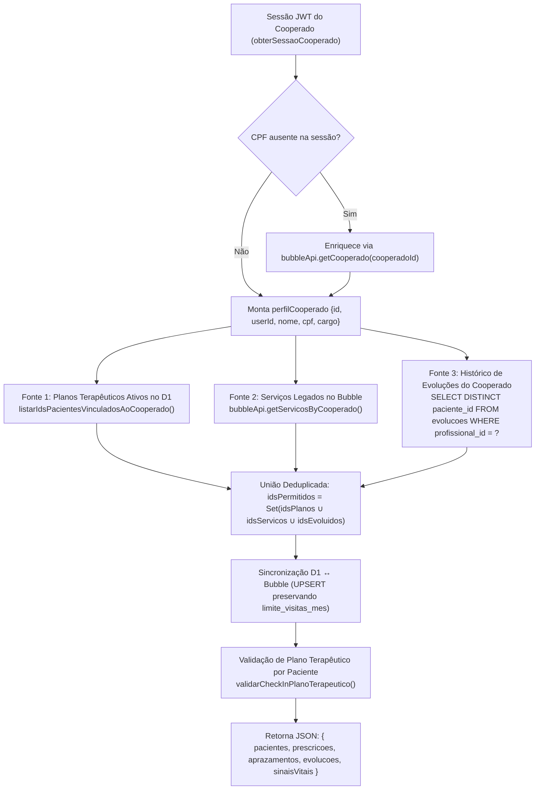
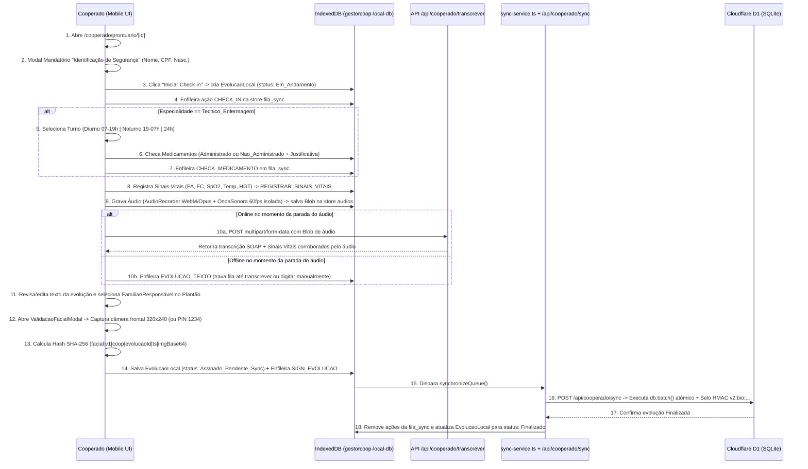

# Manual de Handover Técnico — 05: Módulo de Prontuário Clínico do Cooperado & Arquitetura Offline-First

> **Escopo deste Documento**: Documentação técnica exaustiva, regra de negócio por regra de negócio e linha a linha / bloco a bloco, de todo o ecossistema de atendimento domiciliar (Home Care) utilizado pelos profissionais cooperados em campo (`Tecnico_Enfermagem`, `Enfermeiro`, `Medico`, `Fisioterapeuta`, `Fonoaudiologo`, `Nutricionista`, `Psicologo`, `Terapeuta_Ocupacional`, `Dentista`), abrangendo o motor de aprazamento de medicamentos, banco de dados local IndexedDB, fila de sincronização idempotente, gravação e transcrição de áudio por IA, aferição de sinais vitais e assinatura biométrica facial com selo criptográfico HMAC-SHA256.

---

## Sumário Executivo e Mapa de Arquivos Documentados

| # | Caminho do Arquivo | Linhas | Responsabilidade Primária |
|---|---|---|---|
| **01** | `temp-app/src/lib/tipos-clinicos.ts` | 1–343 | Tipagens clínicas canônicas, cálculo de vigência mensal do Plano Terapêutico, normalização de especialidades e algoritmo de correspondência nominal/fonética/CPF de cooperados. |
| **02** | `temp-app/src/lib/aprazamento-engine.ts` | 1–260 | Motor puro (zero dependências de DOM/DB) para cálculo de janelas de plantão (`Diurno`, `Noturno`, `24h`) no fuso `-03:00` e geração/filtragem determinística de slots de aprazamento. |
| **03** | `temp-app/src/lib/indexeddb.ts` | 1–550 | Wrapper client-side do IndexedDB (`gestorcoop-local-db` v1) com 6 object stores (`pacientes`, `prescricoes`, `aprazamentos`, `evolucoes`, `fila_sync`, `audios`), deduplicação determinística e resolução de conflitos offline/online. |
| **04** | `temp-app/src/lib/sync-service.ts` | 1–231 | Orquestrador da fila de sincronização offline (`fila_sync`), monitoramento de eventos `online`/`offline`, bloqueio preventivo de áudio não transcrito e invalidação de cache de navegação após sync. |
| **05** | `temp-app/src/lib/audio-recorder.ts` | 1–147 | Classe `AudioRecorder` encapsulando `MediaRecorder` (com fallback de codecs Opus/WebM, Ogg e MP4/Safari) e `Web Audio API` (`AnalyserNode` FFT 64) para ondas sonoras em tempo real. |
| **06** | `temp-app/src/app/api/cooperado/agenda/route.ts` | 1–578 | Endpoint `GET /api/cooperado/agenda` (Edge Runtime) que autentica a sessão, mescla vínculos do D1 (Planos Terapêuticos + Evoluções) com serviços legados do Bubble, provisiona pacientes e calcula cotas e bloqueios do Plano Terapêutico. |
| **07** | `temp-app/src/app/api/cooperado/sync/route.ts` | 1–879 | Endpoint `POST /api/cooperado/sync` (Edge Runtime) que processa lotes de ações offline (`CHECK_IN`, `CHECK_MEDICAMENTO`, `REGISTRAR_SINAIS_VITAIS`, `SIGN_EVOLUCAO`) em transação `db.batch()`, gerando selos criptográficos HMAC-SHA256 `v2:bio:...`. |
| **08** | `temp-app/src/app/cooperado/layout.tsx` | 1–221 | Shell visual mobile-first (`max-w-md`) da área do cooperado, barra de status de sincronização em tempo real, indicador de rede, alternador de tema e bypass para rotas `/adesao`. |
| **09** | `temp-app/src/app/cooperado/cooperado-context.tsx` | 1–192 | Contexto global `CooperadoProvider` que hidrata sessão a partir de `localStorage` (`cooperado_session`) + `/api/cooperado/me`, assina o `sync-service` e oferece alternância de perfil (`toggleCargo`) para homologação/teste. |
| **10** | `temp-app/src/app/cooperado/page.tsx` | 1–936 | Dashboard/Agenda do Cooperado com prefetch para IndexedDB, banner de atendimento ativo e divisão em 3 abas (`Próximos`, `De hoje`, `Finalizados`). |
| **11** | `temp-app/src/app/cooperado/_components/AreaDoUsuarioModal.tsx` | 1–339 | Modal da Área do Cooperado com cartão de identidade, CPF mascarado, status da fila offline, botão de sincronização imediata, alternador de tema/cargo e confirmação de logout em duas etapas. |
| **12** | `temp-app/src/app/cooperado/prontuario/[id]/page.tsx` | 1–13 | Casca Server Component com declaração `export const runtime = 'edge'` para compatibilidade com Cloudflare Pages (`next-on-pages`). |
| **13** | `temp-app/src/app/cooperado/prontuario/[id]/prontuario-atendimento.tsx` | 1–2260 | Aplicação completa de Prontuário de Atendimento em Campo: confirmação de identidade, timer isolado, plantão e aprazamento de enfermagem, sinais vitais no leito, gravação de voz + IA SOAP, seleção de responsável familiar e assinatura biométrica. |
| **14** | `temp-app/src/app/cooperado/prontuario/[id]/validacao-facial-modal.tsx` | 1–768 | Modal de captura facial WebRTC (`facingMode: 'user'`), espelhamento em canvas `320x240`, fallback gráfico para ambientes headless/E2E, contingência por PIN e geração de hash SHA-256 (WebCrypto + fallback JS puro). |

---

## Parte 1: Arquitetura e Regras de Negócio em Profundidade

### 1.1. Carga e Mesclagem da Agenda do Cooperado (Bubble + Cloudflare D1 + Memória)

Quando o cooperado acessa `/cooperado` e aciona **"Carregar Agenda"** (ou quando o prefetch automático dispara ao autenticar), a rota `GET /api/cooperado/agenda` executa um pipeline de unificação de 4 estágios para determinar quais pacientes pertencem à escala daquele profissional:

#### Regras de Negócio da Mesclagem Híbrida:
1. **Identidade Soberana da Sessão**: O `cooperadoId` **nunca** é lido de query string (`?cooperadoId=...`). Ele vem exclusivamente do token/cookie validado por `obterSessaoCooperado(request)`. Se o token não trouxer o CPF ou cargo, a rota consulta `bubbleApi.getCooperado(cooperadoId)` em modo *best-effort* (falhas do Bubble apenas geram `console.warn` e não derrubam a rota).
2. **Três Fontes de Vínculo de Pacientes**:
   - **Fonte 1 — Planos Terapêuticos (`idsPlanos`)**: Chama `listarIdsPacientesVinculadosAoCooperado(perfilCooperado)`. Um paciente é vinculado se possuir um Plano Terapêutico com `status = 'Ativo'` (e data fim não expirada ou plano mensal renovável) cuja meta (`plano_terapeutico_metas`) satisfaça uma das duas condições:
     - Possui `profissionais_designados` preenchido e o cooperado logado corresponde a um dos designados via `cooperadoCorresponde()` (que compara ID exato, `userId`, CPF de 11 dígitos limpos, nome normalizado sem acentos, equivalência fonética brasileira `y <-> i` como *Gabryel/Gabriel* ou *Ely/Eli*, prefixo de nome ou interseção de tokens significativos $\ge 3$ letras ignorando preposições `de, da, do, dos, das, e`).
     - Não possui `profissionais_designados` restritos (cota aberta para a especialidade) e a `especialidade` da meta normalizada coincide com o `cargo` normalizado do cooperado.
   - **Fonte 2 — Escala Legada do Bubble (`idsServicos`)**: Consulta `bubbleApi.getServicosByCooperado(sessao.cooperadoId)` e extrai `s.fk_paciente`. Envolvido em `try/catch` isolado para que instabilidades no Bubble jamais impeçam o cooperado de trabalhar com os vínculos do D1.
   - **Fonte 3 — Evoluções Pré-existentes (`idsEvoluidos`)**: Consulta `SELECT DISTINCT paciente_id FROM evolucoes WHERE profissional_id = ?` no D1 (e no mapa em memória `inMemoryEvolucoes`). Garante que pacientes atendidos via link direto (`/cooperado/prontuario/[id]`) continuem visíveis na aba **Finalizados** e **De hoje** do cooperado.
3. **Filtro Direcionado (`?paciente_id=`)**: Quando a tela de atendimento `/cooperado/prontuario/[id]` chama `/api/cooperado/agenda?paciente_id=X`, `idsAlvo` passa a ser `[X]` para carregar/sincronizar imediatamente aquele prontuário específico, mesmo que o cooperado tenha acabado de receber o link direto do plantão.
4. **UPSERT Não-Destrutivo de Pacientes do Bubble no D1**:
   - O cache global de pacientes do Bubble (`memoizarComTtl` com `CHAVE_CACHE_PACIENTES_BUBBLE`) é iterado para os IDs em `idsAlvo`.
   - Se o paciente no Bubble possuir `fks_equipamentos.length > 0`, é adicionado automaticamente o alerta `['Possui equipamentos em casa']` em `warnings`.
   - O `INSERT INTO pacientes ... ON CONFLICT(id) DO UPDATE` protege os dados clínicos já enriquecidos no D1: só sobrescreve `nome` se o novo nome não for vazio nem `'Paciente Sem Nome'`, só sobrescreve `cpf` e `endereco` se não forem vazios, e **preserva intocado** o campo `limite_visitas_mes` e `responsaveis_json` configurados no D1.
   - Caso um ID de `idsAlvo` ainda não exista na tabela `pacientes` após o loop do cache, a rota faz auto-provisionamento individual via `bubbleApi.getPaciente(id)`.

---

### 1.2. Cooperado de Plantão (12h / 24h) vs. Cooperado Visitante / Especialista (Multiprofissional)

O sistema distingue rigorosamente o fluxo operacional e as travas clínicas conforme a especialidade (`cargo` / `tipo_profissional`) do cooperado:

| Dimensão | Cooperado de Plantão (`Tecnico_Enfermagem`) | Cooperado Visitante / Especialista (`Medico`, `Enfermeiro`, `Fisioterapeuta`, `Fonoaudiologo`, `Nutricionista`, `Psicologo`, `Terapeuta_Ocupacional`, `Dentista`) |
|---|---|---|
| **Natureza do Atendimento** | Plantão de longa permanência no domicílio (`Diurno` 12h: 07h–19h, `Noturno` 12h: 19h–07h, ou `24h`: 07h–07h). | Visita pontual / sessão multiprofissional (ex: sessão de fisioterapia, consulta médica domiciliar, avaliação nutricional). |
| **Seletor de Turno (`Diurno` / `Noturno` / `24h`)** | **Visível e Obrigatório**. Define a janela temporal `[inicio, fim)` que filtra quais horários de medicamentos aparecem na tela e grava `turno` na evolução. | **Oculto** na UI de atendimento (`sessionCargo === 'Tecnico_Enfermagem'`). No banco, `turno` fica `undefined`/`null` (ou `'Visita Pontual'` quando aplicável). |
| **Painel de Aprazamento & Checagem Digital de Medicamentos** | **Exibido e Mandatório**. Lista todos os slots previstos dentro da janela do turno. Cada slot deve ser marcado como `Administrado` ou `Nao_Administrado` (com modal de justificativa obrigatória). | **Oculto**. Especialistas/visitantes não executam checagem de aprazamento de rotina de enfermagem na tela de evolução. |
| **Trava de Assinatura / Check-out por Medicação Pendente** | **Bloqueio Rígido (`validarPreRequisitosAssinatura`)**: Se houver $\ge 1$ slot com `status === 'Pendente'` na janela de 12h/24h do turno, o sistema **impede** a assinatura e exibe: *"Atenção: Existem N horário(s) de medicação pendente(s) de checagem digital neste plantão de 12h."* | **Sem trava de aprazamento**. O especialista pode assinar e encerrar sua visita assim que preencher a evolução clínica (texto ou voz transcrita) e selecionar o responsável. |
| **Sinais Vitais à Beira do Leito** | Disponível (PA Sistólica/Diastólica, FC, SpO2, Temperatura, Glicemia HGT). Captura automática no momento da assinatura caso o profissional tenha digitado valores nos campos sem clicar em "Registrar Sinais Vitais". | Disponível com o mesmo comportamento de auto-captura no fechamento e preenchimento automático por IA caso ditado no áudio. |
| **Controle de Cota no Plano Terapêutico (`validarCheckInPlanoTerapeutico`)** | Validado contra a meta da especialidade `Tecnico_Enfermagem` no Plano Terapêutico vigente do mês (`01` ao último dia do mês), ou contra `limite_visitas_mes` legado se não houver plano. | Validado especificamente contra a meta da respectiva especialidade normalizada (`Fisioterapeuta`, `Medico`, `Fonoaudiologo`, etc.) no Plano Terapêutico vigente, além de validar se o profissional consta em `profissionais_designados`. |

#### Regras do Plano Terapêutico e Limites de Visitas (`validarCheckInPlanoTerapeutico`):
1. **Vigência Mensal Automática (`obterPeriodoMesVigencia` e `selecionarPlanoVigente`)**:
   - Todo Plano Terapêutico vigora do dia `YYYY-MM-01` até o último dia do mês (`28`, `29`, `30` ou `31`, calculado via `new Date(Date.UTC(ano, mes, 0)).getUTCDate()`).
   - Se o plano ativo no banco era de um mês anterior mas possui estrutura mensal (`01` ao dia $\ge 28$ do mesmo mês) e o mês calendário virou (`dataRef > p.data_fim`), `selecionarPlanoVigente` **renova virtualmente** a janela para o mês atual e recalcula `quantidade_realizada` contando apenas as evoluções cujo `check_in` ocorreu dentro do novo mês vigente.
2. **Três Níveis de Bloqueio no Check-in e na Agenda**:
   - **Regra 1 (Especialidade Não Contemplada)**: Se o paciente possui Plano Terapêutico ativo com metas, mas nenhuma meta corresponde à especialidade normalizada do cooperado (`normalizarEspecialidade(tipoProfissional)`), retorna `permitido: false`, `bloqueio_plano: true`, motivo: *"A especialidade 'X' não está contemplada no Plano Terapêutico vigente deste paciente."*
   - **Regra 2 (Cooperado Não Escalado Nominalmente)**: Se a meta da especialidade possui `profissionais_designados` não vazio e o cooperado logado não passa em `cooperadoCorresponde()`, retorna `permitido: false`, `bloqueio_plano: true`, motivo: *"Você não está escalado no Plano Terapêutico deste paciente para X. Profissionais designados: ..."*
   - **Regra 3 (Cota da Especialidade Esgotada)**: Se `realizadas >= previstas` na meta da especialidade (ou `visitas_realizadas_mes >= limite_visitas_mes` no modelo legado sem plano), retorna `permitido: false`, `cotaAtingida: true`, `limite_atingido: true`, bloqueando o botão **Iniciar Check-in** e o botão **Novo Atendimento** na UI, além de rejeitar ações `CHECK_IN` na API `/api/cooperado/sync` com HTTP `403`.

---

### 1.3. Ciclo Completo do Atendimento em Campo (Passo a Passo)

#### Detalhamento de Cada Etapa do Fluxo Clínico:
1. **Confirmação Visual de Identidade (Barreira de Segurança do Paciente)**:
   - Ao abrir `/cooperado/prontuario/[id]` sem um atendimento já iniciado, o estado `showIdentificacaoModal = true` e `identificado = false` renderiza um modal bloqueante (`z-50`) exibindo Nome Completo, CPF e Data de Nascimento do paciente.
   - O cooperado deve clicar em **Confirmar** (`setIdentificado(true)`) ou **Voltar à Agenda**. Sem isso, `handleCheckIn` recusa a abertura do atendimento.
2. **Check-in (`handleCheckIn`)**:
   - Verifica se `identificado === true` e se o paciente não está bloqueado por cota/Plano Terapêutico (`paciente.limite_atingido || paciente.bloqueio_plano`).
   - Gera `newEv` com `id: "ev_" + Date.now()`, `check_in: new Date().toISOString()`, `status: 'Em_Andamento'`, `turno` (se `Tecnico_Enfermagem`) e persiste em `localDB.saveEvolucao(newEv)`.
   - Enfileira `CHECK_IN` na store `fila_sync` e, se `navigator.onLine`, dispara `synchronizeQueue()` em background.
   - Nota arquitetural sobre geolocalização e presença física: a comprovação de presença no domicílio combina o timestamp ISO do `CHECK_IN`, a identificação visual obrigatória do paciente na abertura, a seleção obrigatória do Familiar/Responsável presente no domicílio no encerramento e a captura biométrica da câmera frontal com timestamp e metadados de dispositivo (`navigator.userAgent`).
3. **Motor de Aprazamentos e Checagem Digital (`aprazamento-engine.ts` + `prontuario-atendimento.tsx`)**:
   - Calcula a janela exata do turno no fuso `-03:00` via `obterJanelaTurno(refData, turno)`:
     - **Diurno**: `07:00:00-03:00` às `19:00:00-03:00` do mesmo dia.
     - **Noturno**: se a hora de referência for `< 7` (madrugada), a janela vai das `19:00:00-03:00` do dia anterior até `07:00:00-03:00` do dia atual; caso contrário, das `19:00:00-03:00` de hoje até `07:00:00-03:00` de amanhã.
     - **24h**: se `hora < 7`, das `07:00` de ontem às `07:00` de hoje; senão, das `07:00` de hoje às `07:00` de amanhã.
   - Um `useEffect` (`assegurarSlotsTurno`) garante que toda prescrição ativa do paciente tenha seus slots determinísticos (`apraz_${prescricao.id}_${YYYY-MM-DD}_${HHMM}`) gerados para a janela ativa no IndexedDB.
   - Na checagem:
     - **Botão "Administrado"**: Atualiza o slot localmente para `status: 'Administrado'` com `horario_executado: new Date().toISOString()` e enfileira `CHECK_MEDICAMENTO` na `fila_sync`.
     - **Botão "Não deu"**: Abre o modal **Justificativa de Omissão**, exigindo um motivo padronizado (`Paciente recusou`, `Medicamento ausente`, `Condições clínicas desfavoráveis`, `Paciente dormindo`, `Outros`) e uma descrição textual obrigatória (`justificativaTexto.trim()`), gravando `status: 'Nao_Administrado'` e `justificativa: "[Motivo] Texto"`.
4. **Aferição de Sinais Vitais e Extração Segura por IA**:
   - Permite registrar Pressão Arterial Sistólica (`mmHg`), Pressão Arterial Diastólica (`mmHg`), Frequência Cardíaca (`bpm`), Saturação de O2 (`SpO2 %`), Temperatura (`°C`) e Glicemia Capilar (`HGT mg/dL`).
   - Cada aferição gera um registro `sv_${pacienteId}_${timestamp}` na sessão, persiste dentro do array `evolucao.sinais_vitais` no IndexedDB e enfileira `REGISTRAR_SINAIS_VITAIS` na `fila_sync`.
   - **Auto-captura no Fechamento**: Se o cooperado digitou valores nos inputs de sinais vitais mas esqueceu de clicar em **"Registrar Sinais Vitais"** antes de assinar o prontuário, `finalizarComDadosBiometricos` detecta os campos preenchidos e enfileira automaticamente a ação `REGISTRAR_SINAIS_VITAIS` antes do `SIGN_EVOLUCAO`.
   - **Extração por IA Corroborada pelo Áudio (`/api/cooperado/transcrever`)**: Quando o cooperado dita os sinais vitais no áudio (ex: *"pressão 12 por 8, saturação 98, pulso 76"*), o servidor extrai os valores via LLM + Regex de segurança (com validação de faixa fisiológica: PA Sistólica `60..300`, PA Diastólica `30..200` e `dia < sis`, convertendo forma coloquial `12 por 8` $\rightarrow$ `120x80`) e aplica o filtro anti-alucinação `apenasCorroboradosPeloAudio()`, que descarta qualquer número inventado pelo LLM que não apareça literalmente na transcrição crua. Os valores validados preenchem automaticamente os inputs de sinais vitais na tela do cooperado.
5. **Gravação de Voz, Transcrição IA e Trava Anti-Simulação**:
   - O áudio é capturado via `AudioRecorder` em chunks de `250ms` e salvo como `Blob` na store `audios` do IndexedDB com a chave `evolucao.id`.
   - **Se Online**: Envia `multipart/form-data` para `POST /api/cooperado/transcrever`, que transcreve com Whisper, estrutura no formato clínico **SOAP** (`[SUBJETIVO]`, `[OBJETIVO]`, `[AVALIAÇÃO]`, `[PLANO]`) e devolve para revisão.
   - **Se Offline**: Enfileira `EVOLUCAO_TEXTO` na `fila_sync` e escreve o placeholder `"[Áudio salvo offline. Reconecte e toque em Transcrever áudio.]"`. Enquanto esse placeholder existir (ou enquanto o cooperado não transcrever o áudio ou redigir um texto real), tanto a assinatura quanto o envio de ações posteriores na `fila_sync` ficam retidos naquele ponto para evitar que uma evolução suba vazia sem o áudio.
   - **Trava Anti-Simulação (`transcricaoSimulada`)**: Se o ambiente de desenvolvimento estiver com `IA_PERMITIR_SIMULACAO=true` e sem chave de API de IA configurada, a rota devolve `simulado: true` com trechos marcados com `[SIMULAÇÃO]`. O componente `ProntuarioAtendimento` ativa `transcricaoSimulada = true`, exibe um alerta crítico vermelho e **bloqueia a assinatura** até que o profissional remova todos os trechos `[SIMULAÇÃO]` e redija a evolução real.
6. **Seleção do Familiar / Responsável e Assinatura Biométrica + Check-out**:
   - O cooperado seleciona qual familiar/responsável acompanhou a finalização do plantão (lista vinda do cadastro do paciente no D1 ou opção **"Outro Familiar / Acompanhante"** com digitação manual de Nome e Parentesco).
   - Ao clicar em **"Assinar com Reconhecimento Facial (Câmera)"**, abre `ValidacaoFacialModal`:
     - Captura frame da câmera frontal WebRTC (`320x240`, JPEG qualidade `0.65`) ou utiliza PIN de contingência (`1234` ou 4–6 dígitos).
     - Gera o hash biométrico SHA-256 no cliente sobre o payload canônico:
       `facial:v1|${cooperadoIdentificador}|${evolucaoId}|${timestampIso}|${imagemBase64OuTokenPin}`
   - Ao confirmar, `finalizarComDadosBiometricos`:
     - Define `check_out = checkOutTime`, `status = 'Assinado_Pendente_Sync'`, `isLocked = true`, `checkedOut = true`.
     - Enfileira `SIGN_EVOLUCAO` na `fila_sync`.
     - Incrementa localmente `visitas_realizadas_mes` do paciente no IndexedDB (bloqueando novas visitas imediatamente se atingiu `limite_visitas_mes`).
     - Aciona `synchronizeQueue()` para sincronizar com o servidor.

---

### 1.4. Arquitetura Offline-First, Resolução de Conflitos e Sincronização Idempotente

#### Estrutura do Banco Local IndexedDB (`gestorcoop-local-db`, versão 1)
Definido em `temp-app/src/lib/indexeddb.ts`, possui 6 *Object Stores*:
1. `pacientes` (`keyPath: 'id'`): Cache dos pacientes da escala com cotas mensais, alertas (`warnings`), responsáveis e flags de bloqueio do Plano Terapêutico.
2. `prescricoes` (`keyPath: 'id'`): Prescrições médicas ativas dos pacientes.
3. `aprazamentos` (`keyPath: 'id'`): Slots de checagem de medicação. Possui algoritmo de **deduplicação determinística e proteção de estado local** em `saveAprazamentos()` e `getAprazamentos()`:
   - Descarta slots pendentes com IDs não determinísticos (aceita apenas `apraz_${prescricao_id}_...` ou `ap_...`).
   - Agrupa por chave composta `${prescricao_id}__${horario_previsto}`.
   - **Regra de Ouro Offline**: Se o servidor enviar um slot com `status: 'Pendente'`, mas no IndexedDB local aquele mesmo slot já estiver marcado pelo cooperado como `'Administrado'` ou `'Nao_Administrado'`, o `saveAprazamentos()` **preserva o status, horário executado, justificativa e assinatura locais**, impedindo que um refresh da agenda sobrescreva checagens feitas offline ainda não sincronizadas.
4. `evolucoes` (`keyPath: 'id'`): Evoluções clínicas (em andamento e finalizadas). Em `saveEvolucoes()`:
   - Se a evolução local estiver como `'Assinado_Pendente_Sync'` ou `'Finalizado'` e o servidor ainda reportar `'Em_Andamento'`, preserva o status local mais avançado.
   - Quando o servidor confirma `'Finalizado'` ou `'Auditado'`, mescla preservando metadados locais ricos (`assinatura_biometrica`, `sinais_vitais`, `responsavel_*`).
5. `fila_sync` (`keyPath: 'id', autoIncrement: true`): Fila FIFO persistente de mutações (`SyncAction`) aguardando envio para `/api/cooperado/sync`.
6. `audios` (`keyPath: 'id'`): Armazena os objetos binários `Blob` de áudio gravados em campo associados ao `id` da evolução.

#### Máquina de Estados do `sync-service.ts`
- **Single-Flight Concurrency Control**: A variável `activeSyncPromise` garante que nunca existam duas requisições `POST /api/cooperado/sync` concorrentes. Se `synchronizeQueue()` for chamada enquanto uma sincronização já está em voo, ela marca `pendingResync = true` e aguarda a promessa ativa, executando uma nova passada imediatamente após o término da primeira.
- **Limpeza Inteligente de `EVOLUCAO_TEXTO` Obsoletos**: Antes de enviar a fila, `executeSyncPass()` verifica se existem ações `EVOLUCAO_TEXTO` (áudio gravado offline) cujas evoluções já receberam texto revisado manual ou já possuem `SIGN_EVOLUCAO` na fila. Caso positivo, remove a trava `EVOLUCAO_TEXTO` automaticamente via `localDB.dequeueAction()`.
- **Corte Parcial até Pendência de Áudio**: Se ainda houver um `EVOLUCAO_TEXTO` genuinamente pendente no índice `pendenciaAudio`, o serviço envia todas as ações anteriores (`queue.slice(0, pendenciaAudio)`) para não atrasar check-ins ou checagens de medicamentos, e alerta o usuário sobre o áudio pendente.
- **Invalidação Cruzada de Cache**: Assim que uma ação `SIGN_EVOLUCAO`, `CHECK_OUT` ou `SALVAR_EVOLUCAO` é confirmada pelo servidor, o `sync-service` atualiza o status local da evolução para `'Finalizado'` e chama `invalidarCacheNavegacao(CHAVE_CACHE_LISTAGEM_PACIENTES)` e `invalidarCacheNavegacaoPorPrefixo('gc_cache_prontuarios_evolucoes_v1_')`, garantindo atualização instantânea nas telas de gestão caso abertas no mesmo navegador.

#### Processamento Idempotente e Transacional em `/api/cooperado/sync`
- **Proteção contra Perda de Dados em Produção**: Se `db` (binding do Cloudflare D1) estiver ausente e `process.env.NODE_ENV === 'production'`, a rota retorna imediatamente HTTP `503` (*"Banco de dados indisponível no servidor. Seus registros seguem salvos no aparelho."*), mantendo os itens intactos na `fila_sync` do celular do cooperado.
- **Idempotência de Lote e Proteção do Trigger `evolucao_finalizada_imutavel`**:
  - No D1, evoluções com `status = 'Finalizado'` ou `'Auditado'` são protegidas por trigger de imutabilidade no SQLite.
  - Se o celular reenviar um lote contendo `SIGN_EVOLUCAO` de uma evolução que já consta como `'Finalizado'`/`'Auditado'` no D1 (ou se houver duas ações de assinatura para a mesma evolução no mesmo lote), o servidor detecta via `evolucoesAssinadasNoLote` e `evolucaoDb.status`, ignora o `UPDATE` redundante e retorna sucesso idempotente.
- **Execução Atômica via `db.batch(statements)`**: Todas as instruções SQL preparadas (`PROVISIONAR_PACIENTE`, `CHECK_IN`, `CHECK_MEDICAMENTO`, `REGISTRAR_SINAIS_VITAIS`, `SIGN_EVOLUCAO` / `SIGN_EVOLUCAO_INSERT`) são enviadas em uma única transação `db.batch()`. Se qualquer operação crítica tiver `resultado.success === false` ou `resultado.meta.changes === 0` (exceto `INSERT OR IGNORE` de `CHECK_IN` e `PROVISIONAR_PACIENTE`), a rota retorna HTTP `409` para que o cliente não remova os itens da fila.

---

## Parte 2: Análise Exaustiva Linha a Linha / Bloco a Bloco dos 14 Arquivos

---

### Arquivo 01: `temp-app/src/lib/tipos-clinicos.ts` (Linhas 1 a 343)

#### Linhas 1–10: Tipo `EspecialidadeProfissional`
- Define a união literal das 9 especialidades clínicas canônicas suportadas pelo GestorCoop:
  `'Tecnico_Enfermagem' | 'Enfermeiro' | 'Medico' | 'Dentista' | 'Fisioterapeuta' | 'Fonoaudiologo' | 'Nutricionista' | 'Psicologo' | 'Terapeuta_Ocupacional'`.

#### Linhas 12–61: Interfaces de Domínio do Plano Terapêutico e Responsáveis
- **Linhas 12–19 (`ResponsavelPaciente`)**: Representa um familiar ou responsável legal vinculado ao paciente (`id`, `nome`, `parentesco`, `telefone?`, `cpf?`, `principal?: boolean`).
- **Linhas 21–27 (`ProfissionalDesignado`)**: Representa um cooperado nominalmente escalado em uma meta do Plano Terapêutico (`id`, `nome`, `cargo?`, `cpf?`, `crm_coren?`).
- **Linhas 29–40 (`MetaPlanoTerapeutico`)**: Define a cota de uma especialidade dentro de um plano (`id`, `plano_id`, `especialidade`, `quantidade_prevista`, `profissionais_designados?`, `created_at?`) e seus campos computados em tempo de consulta (`quantidade_realizada?`, `quantidade_restante?`, `status_meta?: 'Em_Andamento' | 'Concluido' | 'Pendente' | 'Excedido'`).
- **Linhas 42–61 (`StatusPlanoTerapeutico` e `PlanoTerapeutico`)**: Modela o plano mensal completo do paciente, onde `data_inicio` é sempre `YYYY-MM-01` e `data_fim` é sempre o último dia do mês (`YYYY-MM-28|29|30|31`), além de totalizadores (`total_previsto`, `total_realizado`, `total_restante`, `tem_pendencias`, `pendencias_alertas`).

#### Linhas 63–130: `PeriodoMesVigencia` e função `obterPeriodoMesVigencia(dataRef)`
- **Linhas 63–70**: Interface de retorno com `data_inicio`, `data_fim`, `mes_referencia` (`YYYY-MM`), `ultimo_dia`, `ano` e `mes`.
- **Linhas 80–82**: Se `dataRef` for instância válida de `Date`, extrai `ano = dataRef.getUTCFullYear()` e `mes = dataRef.getUTCMonth() + 1`.
- **Linhas 83–103**: Se `dataRef` for `string`, aplica regex para formato ISO `^(\d{4})-(\d{2})` (linhas 85–89) ou formato brasileiro `^(\d{2})\/(\d{2})\/(\d{4})` (linhas 90–92). Caso não case com nenhum, tenta `new Date(limpo)` em UTC ou faz fallback para a data atual (`new Date()`).
- **Linhas 104–115**: Fallback para data atual se `dataRef` for nula/vazia e sanitização de segurança (`ano` entre `1970` e `2100`, `mes` entre `1` e `12`).
- **Linhas 117–129**: Calcula o último dia exato do mês (incluindo anos bissextos) usando o truque do dia zero do mês seguinte em UTC: `new Date(Date.UTC(ano, mes, 0)).getUTCDate()`. Retorna `data_inicio: "${ano}-${mesStr}-01"` e `data_fim: "${ano}-${mesStr}-${ultimoDiaStr}"`.

#### Linhas 132–147: Utilitários de Formatação de Data e Normalização de Nome
- **Linhas 132–137 (`formatarDataIsoParaBr`)**: Converte `YYYY-MM-DD...` para `DD/MM/YYYY` via regex `^(\d{4})-(\d{2})-(\d{2})`. Se vazio, retorna `'--/--/----'`.
- **Linhas 139–147 (`normalizarNome`)**: Converte para minúsculas, decompõe acentos via Unicode `normalize('NFD')`, remove diacríticos `[\u0300-\u036f]`, substitui qualquer caractere não alfanumérico `[^a-z0-9]` por espaço e colapsa múltiplos espaços em um único.

#### Linhas 149–210: `ObjetoDesignadoFlexivel` e `parseProfissionaisDesignados(raw)`
- **Linhas 149–159**: Interface flexível que aceita tanto propriedades do D1 (`id`, `nome`, `cargo`, `cpf`) quanto propriedades vindas de objetos legados do Bubble (`_id`, `txt_nome`, `txt_nomeCompleto`, `txt_profissao`, `txt_CPF`).
- **Linhas 163–186**: Se `raw` já for um `Array`, mapeia cada item: se for `string`, cria `{ id: '', nome: item.trim() }`; se for `object`, extrai `id`, `nome`, `cargo` e `cpf` usando os fallbacks de `ObjetoDesignadoFlexivel` e filtra itens que tenham ao menos `nome` ou `id` não vazios.
- **Linhas 187–208**: Se `raw` for `string`:
  - Se começar com `[` ou `{`, faz `JSON.parse` recursivo chamando `parseProfissionaisDesignados`.
  - Caso contrário, trata como lista de nomes separados por vírgula ou ponto-e-vírgula (`.split(/[,;]+/)`), gerando `{ id: '', nome }`.

#### Linhas 212–285: Algoritmo `cooperadoCorresponde(designado, cooperado)`
- Verifica se um cooperado logado corresponde a um profissional designado em uma meta do Plano Terapêutico através de 3 camadas progressivas:
  1. **Camada 1 — Identificador Exato (Linhas 223–229)**: Compara `desigObj.id` com `cooperado.id` (`cooperadoId`) ou `cooperado.userId`. Se bater, retorna `true`.
  2. **Camada 2 — CPF (Linhas 231–238)**: Limpa caracteres não numéricos (`replace(/\D/g, '')`) de ambos os CPFs. Se ambos tiverem 11 dígitos e forem idênticos, retorna `true`.
  3. **Camada 3 — Correspondência Nominal e Fonética Brasileira (Linhas 240–282)**:
     - Normaliza ambos os nomes com `normalizarNome()`. Se idênticos, retorna `true` (linha 246).
     - Aplica equivalência fonética `y -> i` (`replace(/y/g, 'i')`) para capturar grafias como *Gabryel* vs *Gabriel* ou *Thays* vs *Thais* (linhas 249–251).
     - Verifica correspondência de prefixo com limite de palavra (`startsWith(norm + ' ')`) para nomes abreviados como `"Maria Silva"` vs `"Maria Silva Santos"` (linhas 254–261).
     - Tokeniza palavras significativas ($\ge 3$ letras, excluindo `stopWords`: `'de', 'da', 'do', 'dos', 'das', 'e'`). Se todos os tokens de um forem subconjunto do outro (`desigSubsetCoop || coopSubsetDesig`), ou se o primeiro nome for igual e houver ao menos mais um sobrenome coincidente (`outrosCoincidentes`), retorna `true` (linhas 264–281).

#### Linhas 287–343: `normalizarEspecialidade(esp)` e `formatarNomeEspecialidade(esp)`
- **Linhas 287–327 (`normalizarEspecialidade`)**: Remove acentos e converte qualquer variação textual (ex: `"Técnico de Enfermagem"`, `"fisioterapia"`, `"odontologia"`, `"fono"`, `"terapeuta ocupacional"`) para o identificador canônico de `EspecialidadeProfissional`.
- **Linhas 329–342 (`formatarNomeEspecialidade`)**: Converte a chave canônica de volta para o rótulo amigável acentuado em português para exibição na interface.

---

### Arquivo 02: `temp-app/src/lib/aprazamento-engine.ts` (Linhas 1 a 260)

#### Linhas 1–14: Constantes e Tipos de Turno
- **Linha 6 (`FUSO_CLINICO`)**: Define o offset padrão de Brasília `process.env.APRAZAMENTO_UTC_OFFSET || '-03:00'`, garantindo que cálculos de janela de plantão no Edge ou no navegador respeitem o horário local da operação clínica.
- **Linhas 8–13**: Define `JanelaTurno` (`{ inicio: Date; fim: Date }`) e `TipoTurno` (`'Diurno' | 'Noturno' | '24h'`).

#### Linhas 18–52: Função `parseHorariosPadrao(horariosPadrao, frequenciaHoras)`
- **Linhas 19–30**: Extrai os horários previstos da prescrição: aceita `string[]`, JSON serializado (`'["08:00","20:00"]'`) ou string separada por vírgula ou bullet (`split(/[,•]/)`).
- **Linhas 32–40**: Se nenhum horário explícito foi informado na prescrição, deriva a grade padrão hospitalar a partir de `frequenciaHoras` (default `12`):
  - `24h` $\rightarrow$ `['08:00']`
  - `12h` $\rightarrow$ `['08:00', '20:00']`
  - `8h` $\rightarrow$ `['08:00', '16:00', '00:00']`
  - `6h` $\rightarrow$ `['06:00', '12:00', '18:00', '00:00']`
  - `4h` $\rightarrow$ `['04:00', '08:00', '12:00', '16:00', '20:00', '00:00']`
- **Linhas 42–51**: Normaliza cada horário para o formato `HH:MM` com `padStart(2, '0')`, deduplica via `Set<string>` e retorna ordenado alfabeticamente (`.sort()`).

#### Linhas 60–119: Função `obterJanelaTurno(referencia, turno)`
- Calcula o intervalo semiaberto `[inicio, fim)` do plantão:
  - **Linhas 64–70**: Converte `referencia` para `Date` válida e extrai `ano`, `mes`, `dia` e `hora = ref.getHours()`.
  - **Linhas 72–91 (`turno === 'Noturno'`)**:
    - Se `hora < 7` (plantonista abriu o prontuário de madrugada, entre 00:00 e 06:59): recua 1 dia (`ref.getTime() - 86400000`) para definir `inicio` às `19:00:00-03:00` de ontem e `fim` às `07:00:00-03:00` de hoje.
    - Se `hora >= 7`: define `inicio` às `19:00:00-03:00` de hoje e `fim` às `07:00:00-03:00` de amanhã (`+ 86400000`).
  - **Linhas 93–112 (`turno === '24h'`)**:
    - Se `hora < 7`: janela das `07:00:00-03:00` de ontem às `07:00:00-03:00` de hoje.
    - Se `hora >= 7`: janela das `07:00:00-03:00` de hoje às `07:00:00-03:00` de amanhã.
  - **Linhas 114–118 (Padrão `'Diurno'`)**: Janela de 12 horas das `07:00:00-03:00` às `19:00:00-03:00` do mesmo dia.

#### Linhas 121–241: Interfaces de Slot e Função `gerarSlotsParaTurno(prescricao, janela)`
- **Linhas 121–143**: Define `PrescricaoBaseParaSlot` e `SlotAprazamentoGerado`.
- **Linhas 154–156**: **Regra de Segurança Clínica**: Se `prescricao.status` estiver definido e for diferente de `'ativa'` (case-insensitive), retorna `[]` imediatamente para jamais gerar horários de medicamentos suspensos ou cancelados.
- **Linhas 158–186**: Faz o parse de `prescricao.data_inicio` e `prescricao.data_fim` (suportando `DD/MM/YYYY`, `YYYY-MM-DD` e ISO completo). Quando `data_fim` é informada apenas como data calendário, estende `fimPrescComMargem` até `T23:59:59.999-03:00` daquele dia para não cortar doses noturnas do último dia de tratamento.
- **Linhas 188–238**: Itera dia a dia desde `janela.inicio` até `janela.fim` e, para cada horário `h` de `parseHorariosPadrao`:
  - Constrói `instante = new Date("${dataIso}T${horaPad}:${minPad}:00${FUSO_CLINICO}")`.
  - Verifica se `tInstante >= janela.inicio.getTime() && tInstante < janela.fim.getTime()` (intervalo fechado no início e aberto no fim, garantindo que um plantão Diurno 07h–19h inclua `07:00` mas deixe `19:00` para o plantão Noturno).
  - Verifica se `tInstante` respeita `inicioPresc` e `fimPrescComMargem`.
  - Cria o slot com ID determinístico `apraz_${prescricao.id}_${dataIso}_${HHMM}` e `status: 'Pendente'`.

#### Linhas 246–259: Função `filtrarSlotsPorJanela(slots, janela)`
- Filtra qualquer lista de objetos que possuam `horario_previsto` mantendo apenas aqueles cujo timestamp caia estritamente em `[janela.inicio.getTime(), janela.fim.getTime())`.

---

### Arquivo 03: `temp-app/src/lib/indexeddb.ts` (Linhas 1 a 550)

#### Linhas 3–119: Interfaces de Persistência Offline
- **Linhas 3–10 (`ResponsavelPacienteLocal`)**: Estrutura de responsável local no dispositivo.
- **Linhas 12–32 (`PacienteLocal`)**: Dados cadastrais do paciente + alertas (`warnings`) + contadores de cota (`limite_visitas_mes`, `visitas_realizadas_mes`, `visitas_restantes_mes`, `limite_atingido`) + metadados do Plano Terapêutico (`bloqueio_plano`, `bloqueio_plano_motivo`, `especialidade_prevista`, `especialidade_realizada`, `especialidade_restante`).
- **Linhas 34–49 (`PrescricaoLocal`)**: Dados da prescrição médica armazenados offline.
- **Linhas 51–67 (`AprazamentoLocal`)**: Slot de checagem com campos clonados da prescrição (`medicamento`, `dosagem`, `via_administracao`, `medico_nome`, `medico_crm`) para permitir renderização 100% offline mesmo sem JOIN relacional.
- **Linhas 69–84 (`SinalVitalLocal`)**: Parâmetros vitais aferidos à beira do leito.
- **Linhas 86–112 (`EvolucaoLocal`)**: Registro completo da evolução com campos SOAP, transcrições, selos de assinatura (`assinatura_digital`, `assinatura_biometrica`), dados do responsável familiar no plantão e array embutido `sinais_vitais`.
- **Linhas 114–119 (`SyncAction`)**: Item da fila `fila_sync` com `id?: number`, `type` (`'CHECK_IN' | 'CHECK_OUT' | 'CHECK_MEDICAMENTO' | 'EVOLUCAO_TEXTO' | 'SIGN_EVOLUCAO' | 'REGISTRAR_SINAIS_VITAIS'`), `payload: any` e `timestamp: string`.

#### Linhas 121–168: Inicialização do Banco (`initDB`) e Helper de Transação (`getStore`)
- **Linhas 121–159 (`initDB`)**: Abre `window.indexedDB.open('gestorcoop-local-db', 1)`. Se executado em SSR (`typeof window === 'undefined'`), rejeita a Promise com erro explícito. No evento `onupgradeneeded` (linhas 136–157), cria as 6 stores caso não existam:
  - `pacientes` (`keyPath: 'id'`)
  - `prescricoes` (`keyPath: 'id'`)
  - `aprazamentos` (`keyPath: 'id'`)
  - `evolucoes` (`keyPath: 'id'`)
  - `fila_sync` (`keyPath: 'id', autoIncrement: true`)
  - `audios` (`keyPath: 'id'`)
- **Linhas 162–168 (`getStore`)**: Abre o banco e retorna `{ store, transaction }` no modo solicitado (`'readonly'` ou `'readwrite'`).

#### Linhas 170–228: Operações de `pacientes` e `prescricoes` em `localDB`
- **Linhas 172–199**: `savePacientes` (faz `store.put(p)` em lote na transação), `getPaciente(id)` e `getPacientes()`.
- **Linhas 202–228**: `savePrescricoes` e `getPrescricoes(pacienteId?)` (quando `pacienteId` é informado, filtra comparando `String(p.paciente_id).trim() === String(pacienteId).trim()`).

#### Linhas 231–331: Operações de `aprazamentos` com Deduplicação e Proteção de Checagem Offline
- **Linhas 231–294 (`saveAprazamentos`)**:
  - Lê todos os aprazamentos já existentes na store (`store.getAll()`).
  - **Linhas 242–262**: Varre os itens existentes: se um item tiver `status === 'Pendente'` e seu `id` **não** for determinístico (não começa com `apraz_${prescricao_id}_` nem `ap_`), deleta-o da store (`store.delete(item.id)`) para eliminar lixo legado. Para itens com a mesma chave `${prescricao_id}__${horario_previsto}`, mantém sempre aquele cujo `status !== 'Pendente'` (já checado) e deleta a duplicata pendente.
  - **Linhas 264–289**: Ao inserir os novos aprazamentos recebidos:
    - Ignora pendentes não determinísticos.
    - Se já existir no IndexedDB um registro para o mesmo `${prescricao_id}__${horario_previsto}` com `status !== 'Pendente'` (ex: cooperado já checou como `Administrado` offline) e o novo item vindo da nuvem estiver como `'Pendente'`, **preserva o estado checado local** (`status`, `horario_executado`, `justificativa`, `profissional_id`, `assinatura_digital`).
- **Linhas 296–331 (`getAprazamento` e `getAprazamentos`)**: `getAprazamentos(prescricaoId?)` aplica a mesma deduplicação em memória por `${prescricao_id}__${horario_previsto}` priorizando itens já checados antes de retornar para a UI.

#### Linhas 334–409: Operações de `evolucoes` com Merge Inteligente Local/Servidor
- **Linhas 334–341 (`saveEvolucao`)**: Salva ou atualiza uma única evolução.
- **Linhas 343–391 (`saveEvolucoes`)**: Ao mesclar evoluções vindas da API (`/api/cooperado/agenda`) com as evoluções locais:
  - Calcula `statusFinal`: se o servidor já marcou como `'Finalizado'` ou `'Auditado'`, prevalece o status do servidor; caso contrário, se a versão local estiver como `'Assinado_Pendente_Sync'` ou `'Finalizado'`, **mantém o status local** para que a evolução recém-assinada offline nunca volte a aparecer como "Em andamento".
  - Preserva campos preenchidos localmente (`transcricao_revisada`, `check_out`, `data_assinatura`, `assinatura_digital`, `assinatura_biometrica`, `responsavel_*`, `sinais_vitais`) usando fallback `ev.campo || local.campo`.
- **Linhas 393–409**: `getEvolucao(id)` e `getEvolucoes()`.

#### Linhas 411–471: Fila de Sincronização (`fila_sync`) e Store de Áudios (`audios`)
- **Linhas 412–442**:
  - `enqueueAction(type, payload)`: Adiciona um `SyncAction` com `timestamp: new Date().toISOString()` na store auto-incrementada `fila_sync`.
  - `getSyncQueue()`: Retorna todas as ações pendentes na ordem de inserção.
  - `dequeueAction(id)`: Remove a ação sincronizada pelo seu ID numérico.
- **Linhas 445–470**:
  - `saveAudio(id, audioBlob)`, `getAudio(id)` e `deleteAudio(id)`: Persistência binária de `Blob` de áudio gravado no prontuário.

#### Linhas 477–548: Função `gerarSlotsAprazamentoLocal(prescricao)`
- Gerador client-side de slots a partir de uma `PrescricaoLocal`: extrai `horarios_padrao` (ou calcula pela `frequencia_horas`), limita a até 12 horários diários (`.slice(0, 12)`), formata `dataIso` a partir de `prescricao.data_inicio` e cria objetos `AprazamentoLocal` no fuso `-03:00` clonando `medicamento`, `dosagem`, `via_administracao`, `medico_nome` e `medico_crm`.

---

### Arquivo 04: `temp-app/src/lib/sync-service.ts` (Linhas 1 a 231)

#### Linhas 1–62: Estado do Módulo e Padrão Pub/Sub (`subscribeToSync`)
- **Linhas 11–17 (`SyncStatus`)**: Interface com `{ isOnline, pendingCount, isSyncing, lastSyncedAt, error }`.
- **Linhas 21–26**: Variáveis singleton de controle no cliente: `listeners`, `isSyncing`, `pendingResync`, `activeSyncPromise`, `lastSyncedAt` e `syncError`.
- **Linhas 28–40**: `getNetworkStatus()` lê `navigator.onLine` e `getPendingCount()` conta os registros de `localDB.getSyncQueue()`.
- **Linhas 42–62 (`subscribeToSync` e `emitState`)**: Registra um listener React, emite imediatamente o estado atual e retorna a função de cleanup `unsubscribe`.

#### Linhas 64–189: Função `executeSyncPass()`
- **Linhas 65–69**: Se `!getNetworkStatus()`, define `syncError = 'Sem conexão de internet no momento.'`, emite estado e retorna `false`.
- **Linhas 79–109 (Auto-limpeza de `EVOLUCAO_TEXTO`)**:
  - Filtra ações `type === 'EVOLUCAO_TEXTO'` na fila.
  - Se a evolução associada já possuir um `SIGN_EVOLUCAO` na fila, ou já estiver com status `'Assinado_Pendente_Sync'` / `'Finalizado'`, ou já possuir `transcricao_revisada` válida (que não comece com `'[Áudio gravado offline'`), remove a ação `EVOLUCAO_TEXTO` obsoleta da fila via `localDB.dequeueAction` e recarrega a fila.
- **Linhas 123–127 (Barreira de Áudio Pendente)**:
  - Procura o primeiro índice de `EVOLUCAO_TEXTO` (`pendenciaAudio`).
  - Faz `actions = pendenciaAudio < 0 ? queue : queue.slice(0, pendenciaAudio)`.
  - Se `actions.length === 0` (o primeiro item da fila é um áudio offline ainda não transcrito), lança erro orientando o cooperado: `'Há um áudio pendente. Abra o atendimento e toque em Transcrever áudio.'`.
- **Linhas 129–176 (Envio ao Servidor e Pós-Processamento)**:
  - Envia `axios.post('/api/cooperado/sync', { actions })`.
  - Se `response.data.success === true`:
    - Remove cada ação enviada da `fila_sync` via `localDB.dequeueAction(action.id)` (linhas 132–136).
    - Para ações de fechamento (`SIGN_EVOLUCAO`, `CHECK_OUT`, `SALVAR_EVOLUCAO`), atualiza a evolução correspondente no IndexedDB para `status: 'Finalizado'`, incorporando a `assinatura_digital` oficial HMAC gerada pelo servidor (linhas 139–168).
    - Invalida os caches de navegação (`invalidarCacheNavegacao(CHAVE_CACHE_LISTAGEM_PACIENTES)` e `invalidarCacheNavegacaoPorPrefixo('gc_cache_prontuarios_evolucoes_v1_')`) nas linhas 170–171.
    - Atualiza `lastSyncedAt` e limpa `syncError` (ou mantém o aviso caso reste um áudio pendente na fila).

#### Linhas 192–230: Coordenação de Concorrência (`synchronizeQueue`) e Listeners Globais `window`
- **Linhas 192–212 (`synchronizeQueue`)**: Se `activeSyncPromise` já estiver ativa, apenas sinaliza `pendingResync = true` e retorna a promessa em andamento. O loop `while (pendingResync)` garante que novas ações enfileiradas durante uma requisição de rede sejam sincronizadas na sequência imediata.
- **Linhas 215–230**: Registra listeners globais em `window` para os eventos `'online'` (emite estado e dispara `synchronizeQueue()`) e `'offline'` (emite estado), além de um `setTimeout(..., 1000)` inicial que sincroniza resíduos pendentes ao abrir o app.

---

### Arquivo 05: `temp-app/src/lib/audio-recorder.ts` (Linhas 1 a 147)

#### Linhas 3–17: Estrutura da Classe `AudioRecorder`
- Encapsula `mediaRecorder`, `stream`, `audioChunks: Blob[]`, `audioContext`, `analyser`, `dataArray`, marcadores de tempo (`startTime`, `pauseTime`, `totalPausedDuration`, `isPaused`), `animationFrameId` e o callback `onWaveformUpdate: ((waveData: number[]) => void) | null`.

#### Linhas 18–66: Método `start()`
- **Linha 24**: Solicita permissão de microfone via `navigator.mediaDevices.getUserMedia({ audio: true })`.
- **Linhas 27–39 (Negociação de Codec Multi-Browser)**:
  - Tenta primeiramente `'audio/webm;codecs=opus'` (padrão Chrome/Android/Edge).
  - Fallback 1: `'audio/ogg;codecs=opus'` (Firefox).
  - Fallback 2: `'audio/mp4'` (Safari / iOS WebKit).
  - Fallback 3: `new MediaRecorder(this.stream)` sem `mimeType` forçado.
- **Linhas 41–45**: Acumula cada chunk de áudio recebido em `ondataavailable` quando `event.data.size > 0`.
- **Linhas 48–65**: Instancia `AudioContext` (com fallback `webkitAudioContext`), conecta o `MediaStream` a um `AnalyserNode` com `fftSize = 64` (`frequencyBinCount = 32`), inicia o `mediaRecorder.start(250)` (emitindo pacotes a cada 250ms) e aciona `this.startAnalyzing()`. Se a Web Audio API falhar no aparelho, captura a exceção e mantém a gravação de voz funcionando normalmente.

#### Linhas 68–104: Visualização de Onda (`startAnalyzing`) e Controle `pause()` / `resume()`
- **Linhas 68–84 (`startAnalyzing`)**: Loop `requestAnimationFrame` que lê `this.analyser.getByteFrequencyData(this.dataArray)`, normaliza os valores de `0..255` para `0..1` (`val / 255`) e invoca `this.onWaveformUpdate(normalizedData)`.
- **Linhas 86–104 (`pause` e `resume`)**: Pausa/retoma o `MediaRecorder`, cancela/reinicia o `requestAnimationFrame` e contabiliza `this.totalPausedDuration += Date.now() - this.pauseTime` para que o tempo pausado não infle a duração clínica do áudio.

#### Linhas 106–146: Métodos `stop()` e `getRecordingDuration()`
- **Linhas 106–137 (`stop`)**: No callback `onstop`, empacota `this.audioChunks` em um `Blob` final, calcula `durationSeconds = Math.max(1, Math.round((endTime - startTime - totalPausedDuration) / 1000))`, fecha o `AudioContext`, executa `track.stop()` em todas as trilhas do microfone (apagando o indicador de microfone ativo do celular) e resolve `{ blob, durationSeconds }`.
- **Linhas 139–145 (`getRecordingDuration`)**: Retorna a duração líquida em segundos a qualquer momento da gravação.

---

### Arquivo 06: `temp-app/src/app/api/cooperado/agenda/route.ts` (Linhas 1 a 578)

#### Linhas 1–25: Imports e Configuração Edge Runtime
- Declara `export const dynamic = 'force-dynamic'` e `export const runtime = 'edge'` para execução serverless na borda da Cloudflare.

#### Linhas 26–70: Autenticação da Sessão e Enriquecimento via Bubble
- **Linhas 28–31**: Obtém instância do D1 (`getDb()`) e executa `garantirSchemaD1(db)`.
- **Linhas 34–40**: Valida a sessão do cooperado com `obterSessaoCooperado(request)`. Retorna `401` se ausente.
- **Linhas 46–62**: Se o CPF não estiver presente no token de sessão e houver `cooperadoId`, busca `bubbleApi.getCooperado(cooperadoId)` para recuperar `txt_CPF`, `txt_nomeCompleto` e `txt_profissao`.
- **Linhas 64–70**: Monta `perfilCooperado = { id, userId, nome, cpf, cargo }`.

#### Linhas 72–132: Descoberta e União dos Pacientes Autorizados
- **Linha 74**: `idsPlanos = await listarIdsPacientesVinculadosAoCooperado(perfilCooperado)`.
- **Linhas 77–85**: Busca `bubbleApi.getServicosByCooperado(sessao.cooperadoId)` e extrai `fk_paciente` em `idsServicos`.
- **Linhas 88–106**: Busca `SELECT DISTINCT paciente_id FROM evolucoes WHERE profissional_id = ?` no D1 e em `inMemoryEvolucoes`, populando `idsEvoluidos`.
- **Linhas 109–132**: Unifica `idsPermitidos = Array.from(new Set([...idsPlanos, ...idsServicos, ...idsEvoluidos]))`. Se a URL contiver `?paciente_id=...`, define `idsAlvo = [queryPacienteId]`; caso contrário, `idsAlvo = idsPermitidos`. Se `idsAlvo` for vazio, retorna listas vazias imediatamente.

#### Linhas 140–271: Sincronização Bubble $\rightarrow$ D1, Auto-Provisionamento e Cálculo de Cotas Mensais
- **Linhas 142–150**: Busca lista de pacientes do Bubble com cache em memória (`memoizarComTtl` por `TTL_PACIENTES_BUBBLE_MS`).
- **Linhas 154–171**: Faz UPSERT no D1 dos pacientes do Bubble presentes em `idsAlvo`, preservando nomes/CPFs/endereços válidos já existentes e convertendo `fks_equipamentos` em `warnings`.
- **Linhas 174–194**: Para cada ID em `idsAlvo` ainda ausente na tabela `pacientes`, busca individualmente `bubbleApi.getPaciente(id)` e insere no D1.
- **Linhas 196–231**: Consulta `SELECT * FROM pacientes WHERE id IN (...)` e, para cada paciente, conta quantas evoluções existem no mês atual (`strftime('%Y-%m', check_in) = ?`), calculando `limite_visitas_mes`, `visitas_realizadas_mes`, `visitas_restantes_mes`, `limite_atingido` e normalizando `responsaveis` via `normalizarResponsaveisPaciente()`.
- **Linhas 234–271**: Fallback caso algum paciente de `idsAlvo` não tenha retornado do `SELECT`: monta o objeto a partir de `bubblePacientes` ou `obterPacienteClinico(id)`.

#### Linhas 273–416: Carga de Prescrições, Geração Automática de Aprazamentos e Histórico de Evoluções/Sinais Vitais no D1
- **Linhas 273–305**: Carrega `prescricoes` dos pacientes alvo e normaliza `horarios_padrao` (garantindo fallback por `frequencia_horas` se vazio).
- **Linhas 307–320**: Carrega `aprazamentos` fazendo `JOIN prescricoes` e deduplica via `deduplicarAprazamentosClinicos()`.
- **Linhas 323–370**: Identifica prescrições ativas que ainda não possuem nenhum slot de aprazamento no D1 (`prescricoesSemApraz`), gera os slots via `gerarSlotsAprazamento()`, persiste em lote com `db.batch()` (`INSERT OR IGNORE INTO aprazamentos`) e mescla ao resultado.
- **Linhas 372–416**: Busca todas as `evolucoes` e os últimos 100 `sinais_vitais` dos pacientes alvo, vinculando cada aferição de sinal vital à sua evolução correspondente (por `evolucao_id` explícito ou por janela temporal `sv.data_hora >= ev.check_in && sv.data_hora <= ev.check_out`).

#### Linhas 417–505: Fallback em Memória (Desenvolvimento / Testes sem Binding D1)
- Espelha toda a lógica de pacientes, prescrições, aprazamentos, sinais vitais e evoluções utilizando os mapas `inMemoryPacientes`, `inMemoryAprazamentos`, `inMemorySinaisVitais` e `inMemoryEvolucoes`.

#### Linhas 507–577: Enriquecimento Final com Validação do Plano Terapêutico e Resposta JSON
- **Linhas 507–560**: Para cada paciente de `dbPacientes`, executa `validarCheckInPlanoTerapeutico({ pacienteId: p.id, tipoProfissional: cooperadoCargo || 'Tecnico_Enfermagem', cooperadoId, cooperadoNome, cooperadoCpf, userId: sessao.userId })`.
  - Injeta `tem_plano_terapeutico`, `plano_vigente`, `especialidade_prevista`, `especialidade_realizada`, `especialidade_restante`.
  - Se o paciente não tinha `limite_visitas_mes` legado definido, adota a cota da meta da especialidade (`previstas`, `realizadas`, `restantes`).
  - Se `!validacao.permitido`, marca `bloqueio_plano = true`, `bloqueio_plano_motivo = validacao.motivo` e, se `validacao.cotaAtingida`, define `limite_atingido = true`.
- **Linhas 562–577**: Retorna `{ success: true, pacientes, prescricoes, aprazamentos, evolucoes, sinaisVitais }` (ou HTTP `500` em caso de erro não tratado).

---

### Arquivo 07: `temp-app/src/app/api/cooperado/sync/route.ts` (Linhas 1 a 879)

#### Linhas 23–66: Funções Criptográficas (`gerarSha256Hex`, `gerarSeloSeguro`) e Reuso do `GET`
- **Linhas 23–29 (`gerarSha256Hex`)**: Calcula o digest SHA-256 hexadecimal usando `crypto.subtle.digest('SHA-256', ...)`.
- **Linhas 31–62 (`gerarSeloSeguro`)**:
  - Se `process.env.ASSINATURA_SECRET` ($\ge 32$ chars) estiver configurado, delega para `gerarSeloAssinatura(dados)`.
  - Caso contrário, importa a chave `AUTH_JWT_SECRET` (ou chave default de fallback em dev) no WebCrypto HMAC-SHA256 e assina a tupla serializada `JSON.stringify(['evolucao:v2', dados.evolucaoId, dados.cooperadoId, dados.instante, dados.conteudo])`, retornando `v2:<hex_hmac>`.
- **Linhas 64–66 (`GET`)**: Redireciona chamadas `GET /api/cooperado/sync` para o `GET` de `../agenda/route`, funcionando como rota espelho de fallback para o cliente.

#### Linhas 68–210: Autenticação do `POST`, Guard de Produção D1 e Helpers de Validação/Provisionamento
- **Linhas 70–83**: Valida sessão (`obterSessaoCooperado`) e garante que `actions` é um `Array`.
- **Linhas 86–95**: **Guard Crítico de Produção**: Se `!db && process.env.NODE_ENV === 'production'`, recusa a sincronização com HTTP `503` para que o dispositivo móvel mantenha os registros na `fila_sync` até o banco estar disponível.
- **Linhas 101–140 (`garantirPacienteExistente`)**: Prepara um `INSERT OR IGNORE INTO pacientes` no lote caso o paciente atendido em campo ainda não exista na tabela `pacientes` do D1 (evitando violação de Foreign Key `REFERENCES pacientes(id)` ao inserir evolução ou sinal vital).
- **Linhas 142–177 (`validarPacientePermitido`)**: Verifica se o `pacId` pertence ao conjunto de pacientes autorizados do cooperado ou se existe no D1/Bubble, armazenando em `cachePacientesValidados` para evitar queries repetidas no mesmo lote.
- **Linhas 184–209 (`extrairCamposSoap`)**: Extrai `soap_subjetivo`, `soap_objetivo`, `soap_avaliacao` e `soap_plano` diretamente do payload ou faz parse automático do texto estruturado via expressão regular `/\[([SOAP])(?:\s*-\s*[^\]]+)?\]\s*\n?([\s\S]*?)(?=\n*\[[SOAP](?:\s*-\s*[^\]]+)?\]|$)/gi`.

#### Linhas 215–328: Processamento da Ação `CHECK_IN`
- **Linhas 216–237**: Valida `evolucaoId` e `pacienteId`. Se o paciente não estiver pré-vinculado, consulta `validarCheckInPlanoTerapeutico()` preliminarmente; se bloqueado, retorna HTTP `403`.
- **Linhas 244–250**: Verifica se a evolução já existe no D1 (`SELECT id, paciente_id, profissional_id, status FROM evolucoes WHERE id = ?`). Se pertencer a outro paciente ou outro cooperado, retorna HTTP `403`.
- **Linhas 252–277**: Se a evolução ainda não existe no banco, executa a validação completa do Plano Terapêutico (`validarCheckInPlanoTerapeutico`). Se `!validacao.permitido` (ex: cota mensal esgotada), retorna HTTP `403` com detalhes da meta e do plano.
- **Linhas 279–327**: Provisiona o paciente se necessário, registra em `checkInsNoLote` (para que ações subsequentes no mesmo lote, como `REGISTRAR_SINAIS_VITAIS` ou `SIGN_EVOLUCAO`, saibam que o check-in acabou de acontecer), atualiza `inMemoryEvolucoes` e adiciona `INSERT OR IGNORE INTO evolucoes (...) VALUES (..., 'Em_Andamento')` em `operacoesBatch`.

#### Linhas 330–433: Processamento da Ação `CHECK_MEDICAMENTO`
- **Linhas 331–357**: Localiza o aprazamento no D1 (`JOIN prescricoes`) ou extrai o `prescricaoId` do próprio ID determinístico `apraz_<prescricaoId>_...` caso o slot tenha sido gerado offline no celular do técnico.
- **Linhas 359–361**: Valida se o paciente pertence aos pacientes autorizados do cooperado (HTTP `403` se não autorizado).
- **Linhas 363–371**: Se `status === 'Administrado'`, gera um selo criptográfico HMAC (`gerarSeloSeguro`) atestando o horário executado e o cooperado responsável.
- **Linhas 387–432**: Se o slot já existia na tabela `aprazamentos`, agenda um `UPDATE aprazamentos SET status = ?, horario_executado = ?, profissional_id = ?, justificativa = ?, assinatura_digital = ? WHERE id = ?`. Se o slot foi gerado offline e ainda não existia no D1, executa um `INSERT INTO aprazamentos ... ON CONFLICT(id) DO UPDATE`.

#### Linhas 435–558: Processamento da Ação `REGISTRAR_SINAIS_VITAIS`
- **Linhas 454–486**: Autoriza o paciente e valida se `evolucaoId` pertence ao paciente/cooperado (aceitando tanto evolução já gravada no D1 quanto `CHECK_IN` ou `SIGN_EVOLUCAO` presente no mesmo lote de sincronização).
- **Linhas 488–557**: Garante a existência do paciente e adiciona à `operacoesBatch` o `INSERT INTO sinais_vitais (...) VALUES (...) ON CONFLICT(id) DO UPDATE ... WHERE sinais_vitais.profissional_id = excluded.profissional_id`, convertendo todos os parâmetros numéricos (`pa_sistolica`, `pa_diastolica`, `fc_bpm`, `fr_rpm`, `temp_celsius`, `spo2_percent`, `glicemia_mg_dl`, `dor_escala`) com segurança.

#### Linhas 560–832: Processamento da Ação `SIGN_EVOLUCAO` / `CHECK_OUT` / `SALVAR_EVOLUCAO`
- **Linhas 567–623**: Busca a evolução existente no D1 (`evolucaoDb`) ou no lote (`checkInLote`), resolve `pacienteIdResolvido` e valida permissão e propriedade (`evolucaoDb.profissional_id === sessao.cooperadoId`).
- **Linhas 625–637 (Proteção de Imutabilidade e Idempotência)**: Se a evolução já estiver `'Finalizado'` ou `'Auditado'` no banco, ou se já tiver sido assinada neste mesmo lote (`evolucoesAssinadasNoLote.has(evolucaoId)`), pula o `UPDATE` para não disparar o trigger SQLite `evolucao_finalizada_imutavel` e adiciona aos confirmados.
- **Linhas 639–722 (Construção do Selo Biométrico Composto `v2:bio:...`)**:
  - Extrai `metodoAssinatura` (`'FACIAL'` ou `'PIN_FALLBACK'`), `biometriaTimestamp`, `cooperadoIdentificador` e os dados do familiar responsável (`responsavelId`, `responsavelNome`, `responsavelParentesco`).
  - Monta `transcricaoFinal` e extrai os 4 campos SOAP (`extrairCamposSoap`).
  - Valida se `biometriaHashRaw` já é um SHA-256 hex de 64 caracteres (`/^[a-f0-9]{64}$/i`); caso não seja, calcula `gerarSha256Hex(...)` no servidor.
  - Assina via HMAC-SHA256 (`gerarSeloSeguro`) a string concatenada `conteudoComBiometria` e formata o selo definitivo:
    `v2:bio:${metodoAssinatura.toLowerCase()}:sha256=${biometriaHashFinal}:coop=${cooperadoIdentificador}:ts=${biometriaTimestamp}:${seloHmacSemPrefixo}` (linha 722).
- **Linhas 766–829**:
  - Se a evolução já existia no D1 ou teve `CHECK_IN` no lote, agenda `UPDATE evolucoes SET check_out = ?, transcricao_revisada = ?, soap_subjetivo = COALESCE(?, soap_subjetivo), ..., status = 'Finalizado', data_assinatura = ?, assinatura_digital = ?, ... WHERE id = ? AND profissional_id = ?`.
  - Caso o atendimento completo tenha sido feito offline e enviado apenas como `SIGN_EVOLUCAO` direto, agenda `INSERT INTO evolucoes (...) VALUES (..., 'Finalizado', ...)` (`SIGN_EVOLUCAO_INSERT`).

#### Linhas 835–878: Execução do `db.batch()` e Verificação de Integridade
- Executa `const resultados = await db.batch(statements)`.
- Verifica se alguma instrução falhou (`!resultado.success`) ou se algum `UPDATE`/`INSERT` obrigatório teve `changes === 0`. Se houve falha, retorna HTTP `409` preservando a fila no aparelho; caso contrário, retorna HTTP `200` com `{ success: true, syncedCount: actions.length, evolucoes: evolucoesSincronizadas }`.

---

### Arquivo 08: `temp-app/src/app/cooperado/layout.tsx` (Linhas 1 a 221)

#### Linhas 1–23: Componente `CooperadoShell` e Helpers de Avatar
- **Linhas 12–15**: Consome `useCooperado()` (`user`, `isAutenticado`, `syncStatus`, `manualSync`, `setIsUserModalOpen`, `toggleCargo`) e `useTema()` (`tema`, `alternar`), além do estado `imgError` para fallback caso a foto do perfil falhe ao carregar.
- **Linhas 17–22 (`getInitials`)**: Extrai as iniciais do primeiro e último nome do cooperado (ou as 2 primeiras letras se houver apenas um nome, ou `'CO'` se vazio).

#### Linhas 24–147: Container Mobile-First (`max-w-md`) e Cabeçalho Superior (`header`)
- **Linhas 25–27**: Centraliza o shell em uma moldura mobile (`max-w-md`, `min-h-screen sm:min-h-[850px]`, `sm:rounded-3xl`, `sm:shadow-float`) simulando a viewport de um smartphone quando aberto em desktop e ocupando 100% da tela em celulares reais.
- **Linhas 33–36**: Logo `GestorCoop` com ícone `Shield` e link para `/cooperado`.
- **Linhas 41–60 (Badge de Conectividade Rápida)**: Exibe `Online` (com ícone `Wifi`, fundo `bg-accent-deeper text-pos-on-accent`) quando `syncStatus.isOnline === true`, ou `Offline` pulsante (`WifiOff`, `animate-pulse`) quando sem rede.
- **Linhas 63–76 (Alternador de Tema)**: Botão circular acessível (`aria-pressed={tema === 'escuro'}`) que alterna entre modo claro (`Sun`) e modo escuro (`Moon`).
- **Linhas 79–114 (Botão de Perfil / Login)**:
  - Se `isAutenticado === true`: exibe avatar (foto ou iniciais) com ponto verde de presença, primeiro nome truncado e seta `ChevronDown`, abrindo `AreaDoUsuarioModal` ao clicar (`setIsUserModalOpen(true)`).
  - Se `isAutenticado === false`: exibe link `Entrar` apontando para `/login?area=cooperado`.
- **Linhas 119–146 (Sub-bar de Identificação Profissional)**: Mostra o nome completo do cooperado, bolinha de status de autenticação (`bg-pos-solid` vs `bg-warn-solid`), sua profissão (`user?.profissao || 'Profissional de Saúde'`) e botão rápido `Minha Conta` / `Fazer Login`.

#### Linhas 149–185: Barra de Status da Fila de Sincronização (`Sync Status Bar`)
- Muda dinamicamente de cor e ícone conforme os 3 estados do `sync-service`:
  1. **Sincronizando (`syncStatus.isSyncing === true`)**: Fundo azul informativo (`bg-info-soft`), ícone `RotateCw` girando (`animate-spin`) e texto `"Sincronizando alterações locais..."`.
  2. **Pendências na Fila (`syncStatus.pendingCount > 0`)**: Fundo âmbar de alerta (`bg-warn-soft`), ícone `AlertCircle` com `animate-bounce` e contador `"N pendente(s) de envio local"`. Se estiver online e não estiver sincronizando no momento, exibe o botão de ação manual **"Sync Agora"** (`onClick={manualSync}`, linhas 177–184).
  3. **Sincronizado (`pendingCount === 0`)**: Fundo verde positivo (`bg-pos-soft`), ícone `Check` e texto `"Todos os dados salvos na nuvem"`.

#### Linhas 187–220: Área `<main>`, Modal de Usuário e Bypass de Adesão em `CooperadoLayout`
- **Linhas 188–193**: Renderiza `{children}` dentro de `<main className="flex-1 overflow-y-auto p-4 flex flex-col gap-4 pb-20">` e monta `<AreaDoUsuarioModal />`.
- **Linhas 199–220 (`CooperadoLayout`)**: Verifica `pathname` e `window.location`. Se a rota pertencer ao funil público de adesão/cooperação online (`/cooperado/adesao`, `/adesao` ou hostname contendo `cooperacao`), retorna `<>{children}</>` puro em tela cheia sem o shell mobile; caso contrário, envolve em `<CooperadoProvider><CooperadoShell>{children}</CooperadoShell></CooperadoProvider>`.

---

### Arquivo 09: `temp-app/src/app/cooperado/cooperado-context.tsx` (Linhas 1 a 192)

#### Linhas 7–40: Interfaces `CooperadoUser`, `CooperadoContextType` e Helper `formatarProfissao`
- **Linhas 7–16 (`CooperadoUser`)**: `{ id, nome, email, cpf?, foto?, cargo, profissao, autenticado }`.
- **Linhas 33–39 (`formatarProfissao`)**: Traduz códigos de cargo (`'Tecnico_Enfermagem'`, `'Medico'`, `'Terapeuta'`) para títulos legíveis (`'Técnico(a) de Enfermagem'`, `'Médico(a)'`, `'Terapeuta Ocupacional'`).

#### Linhas 41–126: `CooperadoProvider`, Assinatura do Sync e Hidratação Offline-First da Sessão (`carregarPerfil`)
- **Linhas 54–59**: Subscreve `subscribeToSync` no mount para manter `syncStatus` reativo em todo o app do cooperado.
- **Linhas 62–122 (`carregarPerfil`)**:
  - **Passo 1 — Hidratação Imediata via `localStorage` (Linhas 64–86)**: Lê `window.localStorage.getItem('cooperado_session')`. Se existir um JSON válido com `id` ou `nome`, popula `setUser(...)` e define `setCarregandoSessao(false)` imediatamente. Isso garante que o cooperado em campo sem sinal de internet consiga abrir o app e ver sua identidade e prontuários locais sem tela branca ou bloqueio de rede.
  - **Passo 2 — Revalidação Online via `/api/cooperado/me` (Linhas 88–121)**: Chama `fetchAutenticado('/api/cooperado/me')`.
    - Se retornar HTTP `401` (token expirado ou revogado): limpa `cooperado_session` do `localStorage`, chama `descartarToken()` e zera `setUser(null)`.
    - Se retornar `200 OK` com `{ success: true, autenticado: true }`: atualiza o estado `user` e grava o JSON atualizado em `localStorage.setItem('cooperado_session', ...)`.
    - Se lançar exceção de rede (modo offline): o bloco `catch` (linha 117) silencia o erro e **preserva a sessão hidratada do cache local**.

#### Linhas 128–191: `logout`, `toggleCargo`, `manualSync` e Hook `useCooperado`
- **Linhas 128–143 (`logout`)**: Dispara `POST /api/auth/logout`, remove `cooperado_session` do `localStorage`, descarta o token em memória (`descartarToken()`), fecha o modal e redireciona para `/login?area=cooperado`.
- **Linhas 145–159 (`toggleCargo`)**: Alterna ciclicamente o cargo do usuário na sessão local entre `['Tecnico_Enfermagem', 'Medico', 'Terapeuta']`, atualizando `localStorage`. Essa função permite validar em homologação e testes E2E como a interface do prontuário se adapta instantaneamente entre um plantonista de enfermagem (com turno e checagem de aprazamentos) e um médico/terapeuta visitante (sem painel de aprazamentos).
- **Linhas 161–163 (`manualSync`)**: Chama `await synchronizeQueue()`.

---

### Arquivo 10: `temp-app/src/app/cooperado/page.tsx` (Linhas 1 a 936)

#### Linhas 31–84: Interface `ProntuarioItem`, Estados e Listeners Iniciais
- **Linhas 31–55 (`ProntuarioItem`)**: Estrutura de visão unificada de cada card de atendimento na agenda, combinando dados do paciente, cota mensal, alertas (`warnings`), status calculado (`'Pendente' | 'Em_Andamento' | 'Concluído'`), horários de check-in/out, preview da transcrição/SOAP, contagem de medicamentos administrados e flag `syncPendente`.
- **Linhas 70–83**: Subscreve `subscribeToSync` para atualizar `isOnline` e recarregar os dados locais (`loadLocalData()`) sempre que a fila de sincronização mudar de estado.

#### Linhas 85–269: Função `loadLocalData()` — Construção Offline da Escala e Histórico
- **Linhas 87–91**: Carrega em paralelo `localDB.getPacientes()`, `localDB.getEvolucoes()` e `localDB.getAprazamentos()`.
- **Linhas 93–112 (Resgate de Pacientes Atendidos via Link Direto)**: Cria `mapaPacientes` com todos os pacientes salvos e adiciona também qualquer paciente referenciado em `evolucoes` que ainda não estivesse na store `pacientes` (usando `ev.paciente_nome` e `ev.paciente_cpf`), garantindo que atendimentos avulsos apareçam na listagem.
- **Linhas 117–189 (Mapeamento da Escala Ativa — `mapped`)**:
  - Para cada paciente, filtra suas evoluções ordenadas da mais recente para a mais antiga (`data_assinatura || check_out || check_in`).
  - Prioriza qualquer evolução com `status === 'Em_Andamento'`; se não houver, pega a mais recente (`pacEvolucoes[0]`).
  - Calcula quantos aprazamentos daquele paciente já têm `status === 'Administrado'`.
  - Define o status do card: `'Concluído'` se a evolução estiver `'Finalizado'`, `'Assinado_Pendente_Sync'`, `'Auditado'` ou `'Concluído'`; `'Em_Andamento'` se houver evolução aberta; `'Pendente'` se ainda não iniciado.
  - Monta `resumoTexto` com `transcricao_revisada`, `transcricao_crua` ou a concatenação dos 4 campos SOAP separados por `' • '`.
- **Linhas 191–244 (Lista Dedicada de Evoluções Finalizadas — `evolsFinalizadas`)**:
  - Mapeia diretamente todas as evoluções concluídas (permitindo exibir múltiplos atendimentos históricos do mesmo paciente na aba **Finalizados**, mesmo quando um novo check-in já foi aberto para ele).
- **Linhas 258–264**: Se o IndexedDB estiver completamente vazio e o cooperado estiver autenticado e online, dispara automaticamente `handlePrefetch()`.

#### Linhas 278–314: Função `handlePrefetch()` — Download da Agenda para o IndexedDB
- Requer `isOnline` e `isAutenticado`.
- Faz `axios.get('/api/cooperado/agenda')`.
- Persiste no IndexedDB: `savePacientes`, `savePrescricoes`, `saveAprazamentos` e `saveEvolucoes`.
- Grava o timestamp da carga em `localStorage.setItem('gc_last_prefetch', now)` e chama `loadLocalData()`.

#### Linhas 323–502: Filtros das 3 Abas, Cartão de Perfil e Destaque de Atendimento em Andamento
- **Linhas 325–338**:
  - `itensFinalizados`: todas as evoluções concluídas (`finalizadosItems`).
  - `itensDeHoje`: itens da escala do dia (`dataLabel` inclui `'hoje'`, ou `status === 'Em_Andamento'`, ou `'Concluído'`).
  - `itensProximos`: itens ainda não iniciados (`status === 'Pendente'`).
  - `itensEmAndamento`: itens com `status === 'Em_Andamento'`.
- **Linhas 345–451 (Seção 1 — Cartão de Perfil do Cooperado)**: Exibe foto/iniciais, indicador online/offline, saudação `"Olá, bom plantão!"`, nome, badge de profissão, botões `"Meu Perfil"` / `"Deslogar"` e barra de status da sessão com os 4 últimos dígitos do CPF (`CPF final XXXX`).
- **Linhas 470–502 (Banner de Atendimento em Andamento Agora)**: Se `itensEmAndamento.length > 0`, destaca no topo da página um card azul pulsante com botão rápido **"Continuar"** apontando para `/cooperado/prontuario/${item.pacienteId}`.

#### Linhas 507–935: Navegação e Painéis das 3 Abas (`Próximos`, `De hoje`, `Finalizados`)
- **Linhas 544–626**: `tablist` acessível com 3 botões (`Próximos`, `De hoje`, `Finalizados`) e contadores numéricos em pílulas.
- **Linhas 631–727 (Aba 1 — `Próximos`)**: Lista os cards agendados (`Pendente`) com horário previsto, endereço, badges amarelos de `warnings` (alergias/equipamentos), cota mensal (`Cota mês: realizadas/limite`) e CTA `"Iniciar Prontuário"`.
- **Linhas 733–842 (Aba 2 — `De hoje`)**: Lista toda a escala do dia, exibindo badge colorido de cota mensal (vermelho `⚠️ Cota atingida` se `limite_atingido`, âmbar se restarem $\le 2$ visitas, ou verde/accent se normal) e CTA contextual (`"Continuar"`, `"Ver Prontuário"` ou `"Iniciar Atendimento"`).
- **Linhas 847–931 (Aba 3 — `Finalizados`)**: Lista o histórico de evoluções assinadas, indicando se já está `"Salvo na Nuvem"` ou `"Pendente de envio"` (`item.syncPendente`), exibindo preview de 2 linhas (`line-clamp-2`) da evolução clínica e a hora exata da assinatura.

---

### Arquivo 11: `temp-app/src/app/cooperado/_components/AreaDoUsuarioModal.tsx` (Linhas 1 a 339)

#### Linhas 27–74: Hooks, Tratamento de Tecla `Escape` e Mascaramento de CPF
- **Linhas 44–53**: Listener de teclado que fecha o modal ao pressionar `Escape` (desde que não esteja em processo de saída `!saindo`).
- **Linhas 69–74 (`mascararCpf`)**: Formata CPFs de 11 dígitos no padrão LGPD `***.XXX.XXX-**`, ocultando os 3 primeiros e os 2 últimos dígitos.

#### Linhas 76–240: Estrutura do Modal, Identidade, Dados Cadastrais e Painel de Sincronização Offline
- **Linhas 110–161**: Cartão de identidade com avatar `80x80` (`w-20 h-20`), badge de conexão (`Wifi`/`WifiOff`), nome completo, profissão e status `"Sessão Ativa"` vs `"Desconectado"`.
- **Linhas 164–204**: Bloco **Dados Cadastrais** listando CPF mascarado, E-mail, Atuação (`Home Care / Domiciliar`) e ID do Cooperado truncado em 14 caracteres.
- **Linhas 207–239**: Bloco **Sincronização Offline** informando se todos os registros estão na nuvem ou quantos registros aguardam envio, com botão **"Enviar Dados Pendentes Agora"** (`onClick={manualSync}`).

#### Linhas 241–338: Ajustes de Visualização (`alternarTema`, `toggleCargo`) e Confirmação de Logout
- **Linhas 247–275**: Dois botões lado a lado: **Tema Claro/Escuro** e **Trocar Perfil** (`onClick={toggleCargo}`).
- **Linhas 279–333**: Quando autenticado, clicar em **"Deslogar da Conta"** abre uma caixa de confirmação vermelha (`confirmandoLogout = true`) tranquilizando o cooperado: *"Seus prontuários salvos localmente continuarão armazenados com segurança no aparelho."* antes de executar `handleLogout()`.

---

### Arquivo 12: `temp-app/src/app/cooperado/prontuario/[id]/page.tsx` (Linhas 1 a 13)

- **Linhas 1–13**: Server Component minimalista que exporta `export const runtime = 'edge'` (exigência do `@cloudflare/next-on-pages` para rotas dinâmicas `[id]`, já que arquivos `'use client'` não podem exportar configurações de runtime do Next.js) e renderiza `<ProntuarioAtendimento />`.

---

### Arquivo 13: `temp-app/src/app/cooperado/prontuario/[id]/prontuario-atendimento.tsx` (Linhas 1 a 2260)

#### Linhas 16–98: Componentes Isolados de Alta Performance (`OndaSonora` e `TempoDeSessao`)
- **Linhas 29–58 (`OndaSonora` com `React.memo`)**:
  - Recebe a instância de `AudioRecorder` e a flag `pausado`.
  - Registra `recorder.onWaveformUpdate` localmente para atualizar apenas o array de 16 barras verticais (`barras`) a ~60 quadros por segundo (`requestAnimationFrame`).
  - **Decisão Arquitetural Crítica**: Ao isolar esse estado dentro de `OndaSonora`, o componente pai `ProntuarioAtendimento` (que contém mais de 2.000 linhas de JSX, listas de medicamentos, inputs de sinais vitais e histórico) **não sofre nenhum re-render** durante a gravação de voz, evitando travamentos e aquecimento em aparelhos Android de entrada no campo.
- **Linhas 65–98 (`TempoDeSessao` com `React.memo`)**:
  - Recebe `inicioMs` (`check_in`) e `congeladoEm` (`check_out`).
  - Executa o `setInterval` de 1 segundo de forma autônoma e formata `HH:MM:SS`, impedindo que o tick do relógio re-renderize a página inteira a cada segundo durante um plantão de 12h.

#### Linhas 100–135: Re-exportação do Motor de Aprazamento e Helpers de Evolução/Biometria
- **Linhas 100–111**: Importa e re-exporta `parseHorariosPadrao`, `obterJanelaTurno`, `gerarSlotsParaTurno` e `filtrarSlotsPorJanela` de `@/lib/aprazamento-engine`.
- **Linhas 113–119 (`ordenarEvolucoesRecentes`)**: Ordena evoluções em ordem decrescente pelo timestamp mais relevante (`data_assinatura || check_out || check_in`).
- **Linhas 121–135 (`extrairHashBiometricoDeSelo`)**: Extrai o método (`FACIAL` ou `PIN_FALLBACK`) e o hash SHA-256 de 64 caracteres de selos no formato `v2:bio:(facial|pin_fallback):sha256=<hex>` ou `SHA256:<hex>`.

#### Linhas 137–282: Estados do Componente e Resolução de Responsáveis Familiares
- **Linhas 138–190**: Declara os estados do prontuário: `paciente`, `prescricoes`, `aprazamentos`, `evolucao`, `historicoEvolucoes`, `sinaisRegistradosSessao`, dados da sessão do cooperado (`sessionCargo`, `cooperadoId`, `cooperadoNome`, `cooperadoCpf`), flags de fluxo (`isOnline`, `checkedIn`, `checkedOut`, `showIdentificacaoModal`, `identificado`, `isLocked`), `turno` (`'Diurno' | 'Noturno' | '24h'`), estados de áudio/IA (`recorder`, `isRecording`, `isRecordingPaused`, `audioRecorded`, `transcribing`, `transcriptionText`, `durationSecs`, `transcricaoSimulada`), estados de checagem de medicação (`checkingAprazamento`, `justificativaTexto`, `justificativaMotivo`) e estados de assinatura/responsável (`pinCode`, `showFacialModal`, `dadosBiometricos`, `responsavelSelecionadoId`, `outroResponsavelNome`, `outroResponsavelParentesco`).
- **Linhas 191–270 (`responsaveisPaciente` e `responsavelEfetivo`)**:
  - Resolve a lista de familiares responsáveis cadastrados para o paciente (`paciente.responsaveis` ou `paciente.responsavel_nome`, com fallback seguro para familiares padrão caso o registro não possua array explícito).
  - Pré-seleciona automaticamente o responsável marcado como `principal: true`.
  - Se o cooperado selecionar `'outro'`, monta `responsavelEfetivo` com o nome e parentesco digitados manualmente em campo (`outroResponsavelNome` e `outroResponsavelParentesco`).
- **Linhas 272–282**: Estados dos 6 inputs de sinais vitais no leito (`paSistolica`, `paDiastolica`, `fcBpm`, `spo2`, `tempCelsius`, `glicemia`).

#### Linhas 283–576: Inicialização, Hidratação Offline (`loadLocalDetails`) e Sincronização Online (`syncOnlinePaciente`)
- **Linhas 283–304 (`atualizarHistoricoLocal`)**: Recarrega as evoluções do paciente no IndexedDB, separa as finalizadas para `historicoEvolucoes` e atualiza a evolução ativa.
- **Linhas 307–389 (`useEffect` de Inicialização)**:
  - Recupera `cooperado_session` do `localStorage` ou consulta `/api/cooperado/me` (redirecionando para `/login?redirect=...` apenas se estiver online e receber 401).
  - Assina `subscribeToSync`: sempre que a fila terminar de sincronizar online (`status.isOnline && status.pendingCount === 0 && !status.isSyncing`), chama `syncOnlinePaciente()`.
  - Executa `loadLocalDetails()` imediatamente (0ms de espera de rede) e, se `navigator.onLine`, chama `syncOnlinePaciente()` seguido de novo `loadLocalDetails()`.
- **Linhas 391–497 (`loadLocalDetails`)**:
  - Busca o paciente no IndexedDB (`localDB.getPaciente(cleanId)`); se ainda não existir localmente, cria um placeholder provisório para não quebrar a renderização.
  - Carrega prescrições e aprazamentos locais; se alguma prescrição não tiver slots locais, gera via `gerarSlotsAprazamentoLocal(pr)` e salva.
  - Carrega evoluções do paciente: prioriza `emAndamento` (`status === 'Em_Andamento'`); se não houver, carrega `finalizadas[0]` em modo bloqueado (`isLocked = true`, `checkedOut = true`) para consulta ou abertura de novo atendimento.
- **Linhas 499–576 (`syncOnlinePaciente`)**:
  - Consulta `GET /api/cooperado/agenda?paciente_id=${cleanId}` (com fallback para `/api/cooperado/sync?paciente_id=${cleanId}`).
  - Atualiza `paciente`, `prescricoes` ativas, `aprazamentos` e `evolucoes` no IndexedDB preservando checagens e assinaturas locais pendentes.

#### Linhas 580–655: Cálculo da Janela do Turno e Geração Garantida de Slots (`aprazamentosTurno`)
- **Linhas 584–610**: Calcula `janelaTurno = obterJanelaTurno(refData, turno)` e filtra `aprazamentos` mantendo apenas os slots dentro de `[janelaTurno.inicio, janelaTurno.fim)`, deduplicando por `${prescricao_id}__${horario_previsto}` e priorizando slots já checados.
- **Linhas 612–655 (`useEffect` `assegurarSlotsTurno`)**: Garante que, ao trocar o seletor de turno (`Diurno`, `Noturno`, `24h`) ou receber novas prescrições, os slots esperados por `gerarSlotsParaTurno(pr, janelaTurno)` existam no IndexedDB e no estado React.

#### Linhas 658–844: Handlers de Novo Atendimento, Check-in, Gravação de Áudio e Transcrição IA
- **Linhas 658–677 (`handleIniciarNovoAtendimento`)**: Verifica se `paciente.limite_atingido || paciente.bloqueio_plano`. Se bloqueado, exibe o motivo; se permitido, limpa o estado da evolução anterior para permitir um novo check-in.
- **Linhas 680–740 (`handleCheckIn`)**: Valida `identificado`, valida bloqueio de cota/Plano Terapêutico, cria a nova `EvolucaoLocal` (`status: 'Em_Andamento'`), salva no IndexedDB, enfileira `CHECK_IN` na `fila_sync` e dispara `synchronizeQueue()`.
- **Linhas 743–785 (`handleStartRecord`, `handlePauseRecord`, `handleResumeRecord`, `handleStopRecord`)**: Controla o ciclo do `AudioRecorder`. Ao parar a gravação (`handleStopRecord`), salva o `Blob` em `localDB.saveAudio(evolucao.id, blob)`. Se `isOnline`, chama `transcreverAudio(evolucao.id, blob)` imediatamente; se offline, enfileira `EVOLUCAO_TEXTO` e define o placeholder de áudio salvo offline.
- **Linhas 787–844 (`transcreverAudio`)**:
  - Envia o `Blob` via `FormData` para `POST /api/cooperado/transcrever`.
  - Atualiza `transcriptionText` e a flag `transcricaoSimulada = response.data.simulado === true`.
  - Se a IA retornou `sinaisVitais` reais (`!response.data.simulado`), preenche automaticamente os estados `paSistolica`, `paDiastolica`, `fcBpm`, `spo2`, `tempCelsius` e `glicemia` (linhas 803–811).
  - Salva `transcricao_crua` e `transcricao_revisada` na evolução local no IndexedDB e remove qualquer ação `EVOLUCAO_TEXTO` pendente para esta evolução na `fila_sync`.

#### Linhas 847–976: Checagem de Medicamentos e Registro de Sinais Vitais
- **Linhas 847–877 (`handleCheckMedicação`)**: Se `status === 'Administrado'`, atualiza o slot no IndexedDB com `horario_executado: new Date().toISOString()` e enfileira `CHECK_MEDICAMENTO`. Se for `'Nao_Administrado'`, armazena o slot em `checkingAprazamento` para abrir o modal de justificativa.
- **Linhas 879–911 (`handleJustificarNaoAdministrado`)**: Grava `status: 'Nao_Administrado'` com `justificativa: "[${justificativaMotivo}] ${justificativaTexto}"` no IndexedDB e enfileira `CHECK_MEDICAMENTO`.
- **Linhas 913–976 (`handleSalvarSinaisVitais`)**: Valida que ao menos 1 parâmetro foi preenchido, cria o objeto `SinalVitalLocal`, enfileira `REGISTRAR_SINAIS_VITAIS`, anexa ao array `sinais_vitais` da evolução no IndexedDB e exibe feedback `"Registrado!"` por 3,5 segundos.

#### Linhas 978–1211: Validação de Pré-Requisitos e Finalização Biométrica (`finalizarComDadosBiometricos`)
- **Linhas 978–1004 (`validarPreRequisitosAssinatura`)**:
  1. Se `sessionCargo === 'Tecnico_Enfermagem'`, verifica se existem slots com `status === 'Pendente'` em `aprazamentosTurno`. Se houver, bloqueia com mensagem informando a quantidade exata.
  2. Verifica se `transcriptionText.trim()` não está vazio e não começa com `'[Áudio salvo offline'`.
  3. Verifica se `!transcricaoSimulada` (impedindo assinatura de texto de simulação `[SIMULAÇÃO]`).
- **Linhas 1006–1162 (`finalizarComDadosBiometricos`)**:
  - Auto-captura sinais vitais digitados nos inputs que ainda não tinham sido salvos (linhas 1031–1067).
  - Monta o selo local preliminar `v2:bio:${metodo}:sha256=${biometriaHash}:coop=${cooperadoIdentificador}:ts=${checkOutTime}`.
  - Atualiza a evolução no IndexedDB para `status: 'Assinado_Pendente_Sync'`, trava a tela (`setIsLocked(true)`, `setCheckedOut(true)`), atualiza `historicoEvolucoes` e enfileira `SIGN_EVOLUCAO` com todos os metadados biométricos e do responsável familiar.
  - Atualiza os contadores locais de cota mensal do paciente (`visitas_realizadas_mes + 1`) e dispara `synchronizeQueue()` + `syncOnlinePaciente()`.
- **Linhas 1171–1211 (`handleAssinarProntuario`)**: Se ainda não houver captura facial nem PIN digitado, abre o modal de Reconhecimento Facial (`setShowFacialModal(true)`). Se o cooperado digitou um PIN válido (`1234` ou 4–6 dígitos) diretamente no campo de contingência, gera o hash SHA-256 com `gerarHashBiometricoSha256` e chama `finalizarComDadosBiometricos`.

#### Linhas 1218–2259: Renderização JSX Completa da Tela de Atendimento
- **Linhas 1221–1272**: Modal Mandatório de Identificação de Segurança do Paciente.
- **Linhas 1275–1329**: Cabeçalho Clínico com nome, CPF, nascimento, modalidade (`Homecare` / `Hospital`), Banner de Cota Mensal Contratada / Esgotada (`data-testid="banner-cota-plano-cooperado"`) e caixa vermelha de `Alertas Críticos` (`warnings`).
- **Linhas 1331–1386**: Barra de Tempo de Sessão (`<TempoDeSessao />`) e botão `Iniciar Check-in` (ou badge `Visitas Bloqueadas` / botão `Novo Atendimento`).
- **Linhas 1392–1537**: Bloco exclusivo de `Tecnico_Enfermagem`: Seletor de Turno (`Diurno`, `Noturno`, `24h`) e lista de cards de `Aprazamento & Checagem Digital` com médico prescritor, CRM e botões `Não deu` / `Administrado`.
- **Linhas 1540–1677**: Card de `Aferição de Sinais Vitais (Leito)` com resumo dos sinais já aferidos na sessão e grid de 6 inputs numéricos.
- **Linhas 1680–1750**: Modal `Justificativa de Omissão` para medicamentos não administrados.
- **Linhas 1753–1876**: Card `Evolução por Comando de Voz` com `<OndaSonora />`, controles de gravar/pausar/parar, botão de retranscrição offline e `<textarea id="revisaoEvolucao">` para revisão e edição do texto SOAP.
- **Linhas 1879–2091**: Card `Validação de Assinatura Eletrônica` com seletor de Familiar/Responsável pela finalização do plantão (incluindo opção `"Outro Familiar / Acompanhante"`), botão principal `"Assinar com Reconhecimento Facial (Câmera)"`, campo de PIN de contingência e card de confirmação quando já assinado.
- **Linhas 2097–2230**: Seção `Histórico de Evoluções Realizadas` (`data-testid="secao-historico-evolucoes"`) listando cada evolução concluída do paciente com profissional, data/hora, turno, responsável familiar, pílulas de sinais vitais, texto clínico e hash biométrico SHA-256.
- **Linhas 2233–2257**: Componente `<ValidacaoFacialModal />` e botão de rodapé `"Voltar para a Agenda"`.

---

### Arquivo 14: `temp-app/src/app/cooperado/prontuario/[id]/validacao-facial-modal.tsx` (Linhas 1 a 768)

#### Linhas 7–26: Interfaces `DadosAssinaturaBiometrica` e `InputHashBiometrico`
- Define o contrato exato de saída da assinatura biométrica (`metodo: 'FACIAL' | 'PIN_FALLBACK'`, `biometriaHash`, `timestamp`, `fotoBase64?`, `cooperadoIdentificador`, `evolucaoId`, `dispositivoInfo?`, `pinFallback?`, `responsavelId?`, `responsavelNome?`, `responsavelParentesco?`).

#### Linhas 32–153: Motor SHA-256 Dual (`sha256FallbackHex` + `gerarHashBiometricoSha256`)
- **Linhas 32–126 (`sha256FallbackHex`)**: Implementação pura em TypeScript/JavaScript do algoritmo criptográfico SHA-256 (FIPS 180-4) com codificação UTF-8 via `TextEncoder`. Serve como fallback determinístico quando o navegador está rodando em contexto HTTP local não-seguro onde `window.crypto.subtle` é `undefined`.
- **Linhas 132–153 (`gerarHashBiometricoSha256`)**:
  - Constrói a string canônica de vinculação:
    `const payload = "facial:v1|" + cooperadoRef + "|" + evolucaoRef + "|" + timestampRef + "|" + imagemRef;`
  - Utiliza `globalThis.crypto.subtle.digest('SHA-256', encoded)` em produção (HTTPS) e cai para `sha256FallbackHex(payload)` caso `crypto.subtle` não esteja disponível.

#### Linhas 155–319: Gerenciamento de Ciclo de Vida da Câmera WebRTC (`iniciarCameraFrontal` e `encerrarStream`)
- **Linhas 214–228 (`encerrarStream`)**: Incrementa o contador de requisição `requisicaoCameraIdRef.current += 1` (evitando *race conditions* se o usuário abrir e fechar o modal rapidamente enquanto a permissão da câmera ainda está pendente), executa `track.stop()` em todas as trilhas do `MediaStream` e limpa `videoRef.current.srcObject = null`.
- **Linhas 230–301 (`iniciarCameraFrontal`)**:
  - Se `navigator.mediaDevices.getUserMedia` não existir no dispositivo, ativa automaticamente o modo de contingência por PIN (`setModoContingenciaPin(true)`) com aviso amigável.
  - Solicita stream de vídeo frontal: `video: { facingMode: 'user', width: { ideal: 480 }, height: { ideal: 640 } }, audio: false`.
  - Se o modal foi fechado enquanto aguardava a resposta do usuário (`!modalAbertoRef.current || requisicaoCameraIdRef.current !== reqId`), interrompe imediatamente as tracks recém-abertas para não deixar a luz da câmera acesa.
  - Em caso de erro (`NotAllowedError`, `PermissionDeniedError` ou ausência física de webcam), exibe instrução clara e abre automaticamente a seção de PIN de contingência (`setModoContingenciaPin(true)`).

#### Linhas 321–490: Captura e Compactação do Frame (`handleCapturarFace`) e Confirmação
- **Linhas 321–418 (`handleCapturarFace`)**:
  - Renderiza em um `<canvas>` compacto de `320x240` pixels (`larguraCompacta = 320`, `alturaCompacta = 240`).
  - **Caminho 1 — Câmera Real Ativa (`!isHeadlessAutomated && video.readyState >= 2 && video.videoWidth > 0`)**: Espelha horizontalmente o contexto 2D (`ctx.translate(320, 0); ctx.scale(-1, 1)`) e desenha o frame real da câmera do cooperado (`ctx.drawImage(video, 0, 0, 320, 240)`).
  - **Caminho 2 — Ambiente Automatizado Headless / WebDriver ou Sem Frames Físicos (Linhas 347–390)**: Desenha no canvas uma silhueta biométrica vetorial com malha de 10 pontos faciais verdes (`#34d399`), guia oval tracejada e carimbo identificador do cooperado, permitindo validação visual e criptográfica consistente em suítes Playwright/E2E.
  - Exporta o canvas como JPEG compactado (`canvas.toDataURL('image/jpeg', 0.65)`) para ocupar poucos kilobytes em memória, calcula o `hash` SHA-256 via `gerarHashBiometricoSha256()`, salva `fotoCapturada`, `hashGerado` e `timestampCaptura` e desliga a câmera (`encerrarStream()`).
- **Linhas 436–489 (`handleConfirmarFacial` e `handleConfirmarPinFallback`)**:
  - `handleConfirmarFacial`: Dispara `onConfirmar` com `metodo: 'FACIAL'`, `biometriaHash`, `fotoBase64`, `timestamp` e os dados do familiar responsável selecionado.
  - `handleConfirmarPinFallback`: Valida o PIN (`'1234'` ou `/^\d{4,6}$/`), gera o hash SHA-256 sobre `"PIN_FALLBACK:" + pinLimpo` e dispara `onConfirmar` com `metodo: 'PIN_FALLBACK'`.

#### Linhas 491–767: Interface Visual do Modal de Validação Facial
- **Linhas 530–577**: Seletor interativo do **Familiar / Responsável pela Finalização do Plantão** dentro do próprio modal (`data-testid="modal-facial-seletor-responsavel"`), permitindo trocar ou confirmar o familiar antes do disparo da assinatura.
- **Linhas 583–648**: Visor de câmera ao vivo com guia oval tracejada (`data-testid="guia-oval-facial"`) e botão `"Capturar Rosto e Gerar Hash"` (`data-testid="btn-capturar-rosto"`).
- **Linhas 650–708**: Tela de revisão pós-captura exibindo a foto capturada (`data-testid="img-captura-facial"`), o selo verde com o hash SHA-256 completo (`data-testid="hash-biometrico-sha256"`), botão `"Refazer"` e botão `"Confirmar Assinatura Facial"` (`data-testid="btn-confirmar-assinatura-facial"`).
- **Linhas 711–764**: Acordeão de contingência sem câmera (`data-testid="input-pin-contingencia"` e `data-testid="btn-confirmar-pin-contingencia"`).
