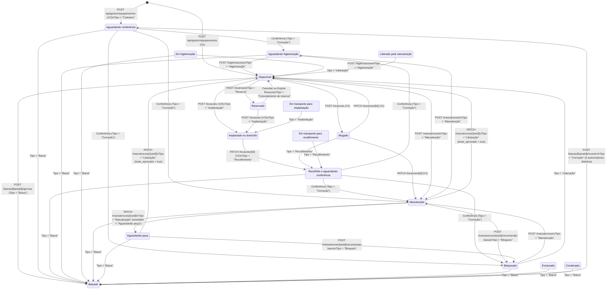

# 07 — Módulo de Equipamentos, Locações, Manutenção, Conferência, Higienização, Reservas, Alertas e Baixas Patrimoniais

Este documento entrega a especificação técnica e arquitetural exaustiva — linha a linha, bloco a bloco e regra de negócio por regra de negócio — de todo o ecossistema de **Gestão do Parque de Equipamentos Médicos e Hospitalares** do **GestorCoop**. O módulo opera sobre o banco de dados do **Bubble Data API v1.1** com camada de orquestração transacional compensatória em **Cloudflare Pages Edge Runtime** (Next.js App Router), governado pela feature flag `EQUIPAMENTOS_V2_ENABLED`.

---

## Sumário Executivo e Arquitetura Operacional (V1 vs. V2)

O módulo possui dois modos de operação controlados pela variável de ambiente `EQUIPAMENTOS_V2_ENABLED` (exportada como `equipamentosV2Ativo` em [`src/lib/bubble.ts`](file:///c:/Users/admin/Documents/projetos/gestorcoop/temp-app/src/lib/bubble.ts#L111)):

1. **Modo Legado (V1 — `EQUIPAMENTOS_V2_ENABLED !== 'true'`)**:
   - Cadastro de equipamentos nasce imediatamente como `'Disponível'`.
   - O campo `txt_status` (`OS_status` no Bubble) pode ser editado manualmente via `PATCH /api/gestor/equipamentos/[id]` entre `'Disponível'`, `'Alugado'`, `'Manutenção'` e `'Inativo'`.
   - Ao criar locação (`POST /api/gestor/locacoes`), o equipamento muda diretamente para `'Alugado'`.
   - Ao devolver locação (`PATCH /api/gestor/locacoes/[id]`), o gestor escolhe se o equipamento volta para `'Disponível'` ou `'Manutenção'`.
   - Subfluxos avançados (Conferência, Higienização, Reservas, Ordens de Serviço de Manutenção, Baixas Patrimoniais, Suspensões, Demonstrativo Financeiro, Rentabilidade, Relatórios V2 e Alertas) permanecem bloqueados com HTTP `503 Service Unavailable` (ou retornam listas vazias com `fluxoV2Ativo: false`).

2. **Modo Operacional Auditado (V2 — `EQUIPAMENTOS_V2_ENABLED === 'true'`)**:
   - **Imutabilidade direta de status**: `PATCH /api/gestor/equipamentos/[id]` proíbe qualquer envio de `txt_status` (HTTP `409 Conflict`). Toda mudança de estado do ativo exige obrigatoriamente uma **Movimentação Operacional** (`bubbleApi.registrarMovimentacao`), que valida a máquina de estados (`validarTransicao`), verifica guarda de concorrência (`txt_status_esperado`), garante idempotência (`txt_chave_idempotencia`) e executa compensação automática caso a atualização do ativo falhe após gravar o evento de auditoria.
   - **Ciclo de Vida Completo**: Cadastro → Aguardando conferência → Conferência pós-cadastro/recolhimento → Aguardando higienização / Manutenção / Bloqueado → Higienização / Liberação Técnica → Disponível → Reserva / Implantação no domicílio → Recolhimento → Conferência pós-recolhimento.
   - **Governança de Baixa Patrimonial**: Solicitação de baixa não altera o status do ativo imediatamente; entra em fila `'Pendente de aprovação'`. Somente a aprovação move para `'Baixado'` (estado terminal). A reversão de um ativo `'Baixado'` exige **dupla autorização distinta** (`txt_revertida_por !== txt_revertida_por_segundo`) e justificativa reforçada, retornando o ativo para `'Aguardando conferência'` via movimentação do tipo `'Correção'`.

---

## 1. Máquina de Estados Completa dos Equipamentos (`src/lib/equipamentos-estados.ts`)

### 1.1. Universo de Estados (`StatusEquipamento`) e Tipos de Movimentação (`TipoMovimentacaoEquipamento`)

Definidos em [`src/lib/bubble.ts`](file:///c:/Users/admin/Documents/projetos/gestorcoop/temp-app/src/lib/bubble.ts#L113-L150):

- **`StatusEquipamento` (18 estados possíveis)**:
  1. `'Aguardando conferência'` — Estado inicial de todo equipamento recém-cadastrado no V2 ou recém-revertido de uma baixa patrimonial.
  2. `'Disponível'` — Em estoque, higienizado, inspecionado e pronto para reserva ou implantação imediata.
  3. `'Reservado'` — Bloqueado preventivamente para um cliente (`fk_paciente`) com data de implantação prevista e data de validade.
  4. `'Em transporte para implantação'` — Em trânsito logístico rumo ao domicílio do cliente.
  5. `'Implantado no domicílio'` — Em uso ativo no domicílio do cliente (equivalente V2 ao status `'Alugado'`).
  6. `'Em transporte para recolhimento'` — Em trânsito de retorno do domicílio para a base.
  7. `'Recolhido e aguardando conferência'` — Devolvido pelo cliente após encerramento da locação; exige triagem física obrigatória antes de higienizar ou liberar.
  8. `'Aguardando higienização'` — Aprovado na conferência física; aguarda desinfecção/limpeza química e troca de consumíveis.
  9. `'Em higienização'` — Processo de limpeza em andamento.
  10. `'Manutenção'` — Em Ordem de Serviço (OS) ativa para diagnóstico, reparo corretivo, preventiva ou calibração.
  11. `'Aguardando peça'` — OS de manutenção pausada aguardando chegada de componente/insumo de fornecedor.
  12. `'Liberado pela manutenção'` — Estado técnico intermediário de conclusão de reparo.
  13. `'Bloqueado'` — Impedido de uso operacional (ex.: encaminhado pela conferência por avaria ou bloqueado automaticamente quando uma OS recomenda baixa patrimonial).
  14. `'Extraviado'` — Ativo desaparecido ou não localizado em posse de terceiros/transporte; gera alerta operacional de prioridade `'Crítica'`.
  15. `'Condenado'` — Estado terminal técnico (sem reparo viável).
  16. `'Baixado'` — Estado terminal patrimonial após aprovação formal de baixa.
  17. `'Alugado'` — Status de locação ativa utilizado pelo fluxo legado (V1).
  18. `'Inativo'` — Status administrativo legado (V1).

- **`TipoMovimentacaoEquipamento` (16 tipos de evento)**:
  - `'Cadastro'`, `'Entrada no estoque'`, `'Alteração cadastral'`, `'Reserva'`, `'Cancelamento de reserva'`, `'Implantação'`, `'Recolhimento'`, `'Transferência'`, `'Higienização'`, `'Manutenção'`, `'Calibração'`, `'Bloqueio'`, `'Liberação'`, `'Extravio'`, `'Baixa'`, `'Correção'`.

---

### 1.2. Diagrama Completo da Máquina de Estados (`stateDiagram-v2`)

---

### 1.3. Tabela Exaustiva de Transições Permitidas e Bloqueadas (`ORIGENS_PERMITIDAS`)

| Tipo de Movimentação (`os_tipo_movimentacao`) | Status de Origem Permitidos (`statusAtual`) | Status de Destino Típico (`novoStatus`) | Regra de Bloqueio / Exceção |
|---|---|---|---|
| `'Reserva'` | `['Disponível']` | `'Reservado'` | Bloqueia qualquer ativo que não esteja estritamente `'Disponível'`. |
| `'Cancelamento de reserva'` | `['Reservado']` | `'Disponível'` | Só pode cancelar/expirar se o ativo estiver `'Reservado'`. |
| `'Implantação'` | `['Disponível', 'Reservado', 'Em transporte para implantação']` | `'Implantado no domicílio'` | Na rota `POST /api/gestor/locacoes`, o filtro aceita `['Disponível', 'Reservado']` em V2 e `['Disponível']` em V1. |
| `'Recolhimento'` | `['Implantado no domicílio', 'Alugado', 'Em transporte para recolhimento']` | `'Recolhido e aguardando conferência'` | Usado no encerramento (`Finalizado`) da locação no V2. |
| `'Higienização'` | `['Aguardando higienização', 'Em higienização']` | `'Disponível'` | Libera o equipamento diretamente para o estoque disponível após aprovação da limpeza. |
| `'Liberação'` | `['Manutenção', 'Aguardando peça', 'Liberado pela manutenção', 'Bloqueado']` | `'Disponível'` | Usado ao concluir OS com `'Reparado e liberado'` + `teste_aprovado === true`. |
| `'Baixa'` | `['Disponível', 'Aguardando conferência', 'Recolhido e aguardando conferência', 'Aguardando higienização', 'Em higienização', 'Manutenção', 'Aguardando peça', 'Bloqueado', 'Extraviado', 'Condenado']` | `'Baixado'` | **Proíbe** baixar equipamento que esteja `'Reservado'`, `'Em transporte para implantação'`, `'Implantado no domicílio'`, `'Alugado'` ou `'Em transporte para recolhimento'` (ou seja, nunca baixa ativo em posse de cliente ou reservado). |
| `'Transferência'` | Qualquer status não-terminal | **Mesmo `statusAtual`** | `TIPOS_SEM_MUDANCA_STATUS`: se `novoStatus !== statusAtual`, bloqueia com `"Transferência não pode alterar a situação do equipamento."`. |
| `'Manutenção'`, `'Bloqueio'`, `'Cadastro'`, `'Extravio'`, `'Calibração'`, `'Entrada no estoque'`, `'Alteração cadastral'` | Qualquer status **exceto** estados terminais (`'Baixado'`, `'Condenado'`) | `'Manutenção'`, `'Aguardando peça'`, `'Bloqueado'`, etc. | Na rota `POST /manutencoes`, também bloqueia abertura de OS se o ativo estiver em `['Baixado', 'Condenado', 'Extraviado']`. |
| `'Correção'` | **Qualquer status** (inclusive `'Baixado'` e `'Condenado'`) | `'Aguardando conferência'`, `'Aguardando higienização'`, `'Manutenção'`, `'Bloqueado'` | Válvula de escape auditada (`TIPO_CORRECAO`). Única forma de tirar um equipamento de `'Baixado'` ou `'Condenado'` (reversão excepcional) ou encaminhar a partir de conferência. |

---

### 1.4. Equipamentos Próprios vs. de Terceiros e Identificação Patrimonial

No modelo de dados `Equipamento` ([`src/lib/bubble.ts`](file:///c:/Users/admin/Documents/projetos/gestorcoop/temp-app/src/lib/bubble.ts#L151-L184)) e na rota [`POST /api/gestor/equipamentos`](file:///c:/Users/admin/Documents/projetos/gestorcoop/temp-app/src/app/api/gestor/equipamentos/route.ts#L34-L60):

- **Origem e Propriedade (`txt_origem` e `txt_fornecedor` / `fk_fornecedor_equipamento`)**:
  - O campo `txt_origem` diferencia ativos **próprios** (adquiridos pela cooperativa, com `date_aquisicao`, `num_valor_aquisicao` e `date_fim_garantia`) de ativos **de terceiros / comodato / sublocados** (vinculados a `txt_fornecedor` e `fk_fornecedor_equipamento`).
  - No cálculo de ROI/Rentabilidade (`calcularRentabilidadeEquipamento`), quando um ativo é de terceiro ou não possui `num_valor_aquisicao` (`valorAquisicao === 0`), o sistema define `percentualRecuperacaoAquisicao = 0` e `aquisicaoRecuperada = false` (pois `valorAquisicao > 0` é exigido para considerar aquisição recuperada), mas continua apurando `resultadoRealizado = receitaRealizada - custoManutencaoTotal` e `resultadoProjetado`.
- **Três Identificadores Únicos por Ativo**:
  1. `txt_numero_serie`: Número de série físico do fabricante ou gerado pelo helper `generateSerialNumber(marca, modelo)`.
  2. `txt_codigo_interno`: Gerado automaticamente no `POST /api/gestor/equipamentos` se não informado no payload, seguindo o padrão `EQP-<ANO>-<16_CHARS_HEX_UUID>` (ex.: `EQP-2026-4F8A9C12E3B4D5A6`).
  3. `txt_numero_patrimonio` e `txt_codigo_barras`: Plaqueta patrimonial física e código de barras para leitura óptica.

---

### 1.5. Análise Linha a Linha: [`src/lib/equipamentos-estados.ts`](file:///c:/Users/admin/Documents/projetos/gestorcoop/temp-app/src/lib/equipamentos-estados.ts)

- **Linhas 1–6**: Importa os tipos `StatusEquipamento` e `TipoMovimentacaoEquipamento` de `./bubble`. Documenta o princípio arquitetural: nenhuma rota altera status sem passar por `registrarMovimentacao`, que invoca `validarTransicao`.
- **Linhas 8–9**: `export const STATUS_TERMINAIS: StatusEquipamento[] = ['Baixado', 'Condenado'];` — Define os dois estados terminais do ciclo de vida. Uma vez neles, qualquer movimentação comum é rejeitada.
- **Linhas 11–29**: `export const STATUS_INDISPONIVEIS: StatusEquipamento[]` — Lista os 15 status operacionais que impedem o início imediato de uma nova operação comercial. Note que apenas `'Disponível'` (e no legado/transição `'Liberado pela manutenção'`) não consta na lista de bloqueio operacional.
- **Linhas 31–45**: `const ORIGENS_PERMITIDAS: Partial<Record<TipoMovimentacaoEquipamento, StatusEquipamento[]>>` — Mapa declarativo estrito de origens aceitas para `'Reserva'`, `'Cancelamento de reserva'`, `'Implantação'`, `'Recolhimento'`, `'Higienização'`, `'Liberação'` e `'Baixa'`.
- **Linhas 47–50**: Interface `ResultadoValidacaoTransicao` (`{ ok: boolean; motivo?: string }`).
- **Linhas 52–57**:
  - Linha 54: `const TIPO_CORRECAO: TipoMovimentacaoEquipamento = 'Correção';`
  - Linha 57: `const TIPOS_SEM_MUDANCA_STATUS: TipoMovimentacaoEquipamento[] = ['Transferência'];`
- **Linhas 59–93**: Função `validarTransicao(statusAtual, tipo, novoStatus)`:
  - **Linhas 65–67**: Se `tipo === 'Correção'`, retorna imediatamente `{ ok: true }`, ignorando travas de origem e de estados terminais.
  - **Linhas 69–74**: Se `tipo` está em `TIPOS_SEM_MUDANCA_STATUS` (`'Transferência'`) e `statusAtual` existe e `novoStatus !== statusAtual`, retorna `{ ok: false, motivo: 'Transferência não pode alterar a situação do equipamento.' }`. Caso mantenha o mesmo status, retorna `{ ok: true }`.
  - **Linhas 77–82**: Se `statusAtual` pertence a `STATUS_TERMINAIS` (`'Baixado'` ou `'Condenado'`), bloqueia com `{ ok: false, motivo: 'Equipamento em "<statusAtual>" só pode ser alterado por reversão excepcional autorizada.' }`.
  - **Linhas 84–90**: Busca `origens = ORIGENS_PERMITIDAS[tipo]`. Se a lista existir para aquele `tipo`, e `statusAtual` não estiver contido em `origens`, retorna `{ ok: false, motivo: 'Não é possível "<tipo>" a partir de "<statusAtual>". Origens válidas: ...' }`.
  - **Linha 92**: Retorna `{ ok: true }` se todas as guardas passarem.
- **Linhas 95–98**: Função `podeOperar(statusAtual)`:
  - Retorna `false` se `!statusAtual`; caso contrário, retorna `!STATUS_INDISPONIVEIS.includes(statusAtual)`.

---

### 1.6. Análise Linha a Linha: [`src/lib/equipamentos-helpers.ts`](file:///c:/Users/admin/Documents/projetos/gestorcoop/temp-app/src/lib/equipamentos-helpers.ts)

- **Linhas 1–6**: Assinatura `export function generateSerialNumber(marca?: string, modelo?: string): string`.
- **Linhas 7–12**: Função interna `sanitize(str)`:
  - `.normalize('NFD')` decompõe caracteres acentuados em letra base + diacrítico.
  - `.replace(/[\u0300-\u036f]/g, '')` remove os diacríticos (acentos, cedilha).
  - `.replace(/[^a-zA-Z0-9]/g, '')` remove espaços, hifens e símbolos especiais.
  - `.toUpperCase()` converte tudo para maiúsculas.
- **Linhas 14–15**: Sanitiza `marca` (`cleanMarca`) e `modelo` (`cleanModelo`).
- **Linhas 17–27**: Constrói o `prefix`:
  - Se houver `cleanMarca` e `cleanModelo`: usa os 4 primeiros caracteres de cada separados por hífen (`${cleanMarca.slice(0, 4)}-${cleanModelo.slice(0, 4)}`, ex.: `"Philips"` + `"EverFlo"` → `"PHIL-EVER"`).
  - Se houver apenas `cleanMarca`: `${cleanMarca.slice(0, 4)}`.
  - Se houver apenas `cleanModelo`: `${cleanModelo.slice(0, 4)}`.
  - Se ambos estiverem vazios/ausentes: `'EQP'`.
- **Linhas 29–30**: Gera um inteiro aleatório de 4 dígitos entre `1000` e `9999` (`Math.floor(1000 + Math.random() * 9000)`) e retorna `${prefix}-${randomNum}` (ex.: `PHIL-EVER-4821` ou `EQP-7392`).

---

## 2. Regras Financeiras, Cálculo de Locação, Suspensões e ROI (`src/lib/equipamentos-financeiro.ts`)

### 2.1. Modalidades de Cobrança (`TipoCobrancaLocacao`) e Fórmulas Matemáticas

O motor financeiro em [`src/lib/equipamentos-financeiro.ts`](file:///c:/Users/admin/Documents/projetos/gestorcoop/temp-app/src/lib/equipamentos-financeiro.ts) opera sempre em **datas UTC puras** (`Date.UTC(ano, mes - 1, dia)`) para eliminar desvios de fuso horário ou horário de verão, e arredonda todos os valores monetários com `moeda(valor) = Math.round((valor + Number.EPSILON) * 100) / 100`.

#### A. Contagem de Dias e Normalização de Suspensões Temporárias
1. **Dias Corridos Inclusivos (`diasCorridos`)**:
   $$\text{diasCorridos} = \max\left(1, \left\lfloor \frac{\text{fim}_{\text{UTC}} - \text{inicio}_{\text{UTC}}}{86.400.000} \right\rfloor + 1\right)$$
   - Exemplo: Locação de `2026-05-01` a `2026-05-10` possui $10 - 1 + 1 = 10$ dias corridos.
2. **Fusão de Intervalos de Suspensão (`normalizarSuspensoes`)**:
   - Quando um paciente em Homecare sofre internação hospitalar ou suspensão temporária do atendimento, são registrados períodos `[inicio, fim]` em `suspensao_locacao`.
   - Para evitar que duas suspensões sobrepostas ou adjacentes descontem o mesmo dia duas vezes, `normalizarSuspensoes` filtra intervalos inválidos (`fim < inicio` ou `NaN`), ordena por `inicio` crescente e funde intervalos onde `atual.inicio <= ultimo.fim + 86_400_000` (isto é, intervalos que se sobrepõem ou são imediatamente contíguos no calendário).
3. **Dias Suspensos na Janela (`diasSuspensos`) e Dias Faturáveis (`diasCobrados`)**:
   - Para cada intervalo fundido $s = [s_{\text{inicio}}, s_{\text{fim}}]$, calcula-se a interseção com a janela $[J_{\text{inicio}}, J_{\text{fim}}]$:
     $$I_{\text{inicio}} = \max(s_{\text{inicio}}, J_{\text{inicio}}), \quad I_{\text{fim}} = \min(s_{\text{fim}}, J_{\text{fim}})$$
   - Se $I_{\text{fim}} \ge I_{\text{inicio}}$, soma-se $\lfloor (I_{\text{fim}} - I_{\text{inicio}}) / 86.400.000 \rfloor + 1$.
   - Por fim:
     $$\text{diasSuspensos} = \min(\text{diasCorridos}, \text{diasSuspensosNaJanela})$$
     $$\text{diasCobrados} = \max(0, \text{diasCorridos} - \text{diasSuspensos})$$

#### B. Regras de Cálculo do `valorBase` por `TipoCobrancaLocacao`

| `tipoCobranca` | Fórmula do `valorBase` | Fórmula de `mesesCobrados` | Comportamento de Suspensões |
|---|---|---|---|
| `'Somente diária'` | $\text{valorDiaria} \times \text{diasCobrados}$ | $0$ | Desconta cada dia suspenso diretamente do multiplicador de diárias. |
| `'Mensalidade proporcional'` | Soma pró-rata mês a mês calendário: $\sum_{m} \left(\frac{\text{valorMensal}}{\text{diasNoMes}_m} \times \text{diasCobrados}_m\right)$ | Quantidade de competências (meses-calendário) atravessadas pelo intervalo | Desconta os dias suspensos especificamente dentro do mês-calendário $m$ em que ocorreram, dividindo a mensalidade pelo número exato de dias daquele mês ($28, 29, 30$ ou $31$). |
| `'Somente mensalidade'` | $\text{valorMensal} \times \left\lceil \frac{\text{diasCobrados}}{30} \right\rceil$ | $\left\lceil \frac{\text{diasCobrados}}{30} \right\rceil$ | Reduz `diasCobrados` antes de calcular os blocos de 30 dias. |
| `'Mensalidade fechada'` | $\text{valorMensal} \times \left\lceil \frac{\text{diasCobrados}}{30} \right\rceil$ | $\left\lceil \frac{\text{diasCobrados}}{30} \right\rceil$ | Idêntico a `'Somente mensalidade'` (ciclos fechados de 30 dias cobrados). |
| `'Valor personalizado'` | $\text{valorPersonalizado} \text{ (fallback: } \text{valorMensal}\text{)}$ | $1$ | Valor fixo acordado para o contrato, independente do número de dias. |
| `'Sem cobrança'` | $0$ | $0$ | Cortesia / comodato isento de aluguel base (taxas extras ainda podem incidir se informadas). |

#### C. Fórmula do Total da Locação (`total`)
$$\text{total} = \max\big(0,\; \text{valorBase} + \text{taxaImplantacao} + \text{taxaRecolhimento} - \text{desconto} + \text{acrescimo}\big)$$
Onde `taxaImplantacao`, `taxaRecolhimento`, `desconto` e `acrescimo` sofrem clamp em $\max(0, \text{valor})$ para impedir valores negativos acidentais.

#### D. Cálculo de Rentabilidade e ROI por Ativo (`calcularRentabilidadeEquipamento`)
- **Entradas**:
  - `valorAquisicao`: Custo de compra do equipamento (`num_valor_aquisicao`, mínimo `0`).
  - `custosManutencao`: Array com `num_custo_total` de todas as Ordens de Serviço do equipamento.
  - `receitaRealizada`: Array com valores finais das locações com `txt_status === 'Finalizado'`.
  - `receitaEstimada`: Array com valores estimados das locações em andamento (`txt_status === 'Ativo'`).
- **Indicadores Calculados**:
  - $\text{custoManutencaoTotal} = \sum \text{custosManutencao}$
  - $\text{receitaRealizada} = \sum \text{receitaRealizada}$
  - $\text{receitaEstimada} = \sum \text{receitaEstimada}$
  - $\text{resultadoRealizado} = \text{receitaRealizada} - \text{valorAquisicao} - \text{custoManutencaoTotal}$
  - $\text{resultadoProjetado} = \text{receitaRealizada} + \text{receitaEstimada} - \text{valorAquisicao} - \text{custoManutencaoTotal}$
  - $\text{percentualRecuperacaoAquisicao} = \begin{cases} \text{moeda}\left(\frac{\text{receitaRealizada}}{\text{valorAquisicao}} \times 100\right), & \text{se } \text{valorAquisicao} > 0 \\ 0, & \text{caso contrário} \end{cases}$
  - $\text{aquisicaoRecuperada} = (\text{valorAquisicao} > 0) \land (\text{receitaRealizada} \ge \text{valorAquisicao})$

---

### 2.2. Análise Linha a Linha: [`src/lib/equipamentos-financeiro.ts`](file:///c:/Users/admin/Documents/projetos/gestorcoop/temp-app/src/lib/equipamentos-financeiro.ts)

- **Linhas 1–40**: Declaração dos tipos exportados:
  - `TipoCobrancaLocacao` (linhas 1–7).
  - `PeriodoSuspenso` (linhas 9–13): `{ inicio: string; fim: string; motivo?: string }`.
  - `CalculoLocacaoInput` (linhas 15–27) e `CalculoLocacaoResultado` (linhas 29–40).
- **Linhas 42–45**: `paraDataUtc(valor: string)` — Faz `.slice(0, 10).split('-').map(Number)` na string ISO e retorna `new Date(Date.UTC(ano, mes - 1, dia))`.
- **Linha 47**: `moeda(valor: number)` — Arredondamento financeiro para 2 casas decimais com `Number.EPSILON`.
- **Linhas 49–52**: `diasInclusivos(inicio: Date, fim: Date)` — Diferença em dias inteiros (`86_400_000` ms) somada de `1`, com piso `Math.max(1, ...)`.
- **Linhas 56–73**: `normalizarSuspensoes(periodos)`:
  - Converte cada período para `Date` UTC (linha 59).
  - Filtra datas válidas onde `fim >= inicio` (linha 60) e ordena por `inicio` ascendente (linha 61).
  - Percorre os intervalos fazendo merge em `merged` quando `atual.inicio.getTime() <= ultimo.fim.getTime() + 86_400_000` (linhas 63–72).
- **Linhas 76–90**: `diasSuspensosNaJanela(janelaInicio, janelaFim, suspensoes)` — Soma os dias inclusivos de interseção entre cada suspensão normalizada e a janela `[janelaInicio, janelaFim]`.
- **Linhas 92–115**: `mensalidadeProporcional(inicio, fim, valorMensal, suspensoes)`:
  - Inicializa `cursor = new Date(inicio)`, `total = 0`, `meses = 0` (linhas 98–100).
  - Enquanto `cursor <= fim` (linha 102):
    - Obtém o último dia do mês UTC atual: `fimDoMes = new Date(Date.UTC(cursor.getUTCFullYear(), cursor.getUTCMonth() + 1, 0))` (linha 103).
    - Define `fimDoTrecho = fimDoMes < fim ? fimDoMes : fim` (linha 104).
    - Obtém `diasNoMes = fimDoMes.getUTCDate()` (linha 105).
    - Calcula `diasNoTrecho = diasInclusivos(cursor, fimDoTrecho)` (linha 106) e `diasSuspensosNoTrecho = diasSuspensosNaJanela(cursor, fimDoTrecho, suspensoes)` (linha 107).
    - Calcula `diasCobrados = Math.max(0, diasNoTrecho - diasSuspensosNoTrecho)` (linha 108).
    - Acumula `total += (valorMensal / diasNoMes) * diasCobrados` e incrementa `meses += 1` (linhas 109–110).
    - Avança `cursor` para o dia 1º do mês seguinte UTC (linha 111).
- **Linhas 117–174**: `export function calcularLocacao(input: CalculoLocacaoInput): CalculoLocacaoResultado`:
  - Valida `inicio` e `fim` (linhas 118–122); se inválidos ou `fim < inicio`, lança `Error('O período da locação é inválido.')`.
  - Normaliza suspensões e apura `diasCorridos`, `diasSuspensos` e `diasCobrados` (linhas 124–129).
  - Executa o `switch (input.tipoCobranca)` (linhas 133–154) conforme detalhado na tabela da seção 2.1.
  - Aplica taxas de implantação/recolhimento, desconto e acréscimo, e retorna o objeto `CalculoLocacaoResultado` com todos os valores monetários formatados por `moeda(...)` (linhas 156–173).
- **Linhas 176–230**: `export function montarDemonstrativoLocacao(...)`:
  - Determina `dataFimEfetiva = input.dataFim || input.dataReferencia || input.dataInicio` (linha 196).
  - Invoca `calcularLocacao({ ...input, dataFim: dataFimEfetiva })` (linha 197).
  - Constrói o array `linhas: Array<{ descricao: string; valor: number }>` (linhas 199–215):
    - Linha de valor base (se `calculo.valorBase > 0`) com rótulo específico para diárias, mensalidade proporcional ou mensalidade.
    - Linhas condicionais para `'Taxa de implantação'`, `'Taxa de recolhimento'`, `'Acréscimo'`, `'Desconto'` (com valor negativo `-calculo.desconto`) e `'Dias suspensos (não cobrados: X)'` (com valor `0`).
  - Retorna `DemonstrativoLocacao` marcando `projetado: Boolean(input.locacaoAberta)` e `aberta: Boolean(input.locacaoAberta)` (linhas 217–229).
- **Linhas 232–288**: `export function calcularRentabilidadeEquipamento(input: RentabilidadeInput): RentabilidadeResultado`:
  - Soma os arrays com a função auxiliar `somar` (linha 258).
  - Calcula `resultadoRealizado`, `resultadoProjetado`, `percentualRecuperacaoAquisicao` e `aquisicaoRecuperada` (linhas 263–287).

---

## 3. Motor de Jobs Operacionais e Romaneio de Entrega

### 3.1. Análise Linha a Linha: [`src/lib/equipamentos-jobs.ts`](file:///c:/Users/admin/Documents/projetos/gestorcoop/temp-app/src/lib/equipamentos-jobs.ts)

Este módulo centraliza a lógica de varredura operacional compartilhada entre os endpoints acionados manualmente pelo gestor na UI (`/api/gestor/equipamentos/...`) e os jobs automatizados via Cron (`/api/cron/...`).

- **Linhas 17–159**: `export async function gerarAlertas(): Promise<ResultadoGerarAlertas>`:
  - **Linhas 18–21**: Captura `agora = new Date()`, `hojeIso = agora.toISOString()`, `hojeData = hojeIso.slice(0, 10)` (`YYYY-MM-DD`) e `em30diasIso = new Date(agora.getTime() + 30 * 86_400_000).toISOString().slice(0, 10)`.
  - **Linhas 27–38**: Helper interno `criarSeInexistente(chave, alerta)`:
    - Consulta `bubbleApi.getAlertaPorChave(chave)`. No adaptador Bubble ([`bubble.ts` linhas 1589–1599](file:///c:/Users/admin/Documents/projetos/gestorcoop/temp-app/src/lib/bubble.ts#L1589-L1599)), `getAlertaPorChave` retorna qualquer alerta com aquela `txt_chave_idempotencia` cujo status **não** seja `'Resolvido'` nem `'Ignorado'`.
    - Se já existir alerta ativo (`'Aberto'` ou `'Em tratamento'`), retorna sem duplicar (idempotência).
    - Caso contrário, chama `bubbleApi.criarAlerta(alerta)`, incrementa `criados += 1` e contabiliza em `porTipo[alerta.os_tipo_alerta]`. Erros individuais são capturados e adicionados ao array `falhas` sem interromper o lote.
  - **Bloco 1 — Reservas Vencidas (linhas 40–60)**:
    - Busca `bubbleApi.getReservasVencidas(hojeIso)` (reservas com `os_status == 'Ativa'` e `date_validade < hojeIso`).
    - Para cada reserva, gera alerta com chave `alerta-reserva-vencida-${reserva._id}`, tipo `'Reserva vencida'`, prioridade `'Média'`, status `'Aberto'`.
  - **Bloco 2 — Recolhimentos Atrasados (linhas 62–87)**:
    - Busca locações com `OS_status == 'Ativo'`.
    - Filtra aquelas onde `fimPrevisto < hojeData` e `!locacao.date_fim_real`.
    - Gera alerta com chave `alerta-recolhimento-${locacao._id}`, tipo `'Recolhimento atrasado'`, prioridade `'Alta'`, vinculando `fk_equipamento` e `fk_locacao_equipamento`.
  - **Bloco 3 — Inspeção do Parque de Equipamentos (linhas 89–156)**:
    - Percorre todos os equipamentos (`bubbleApi.getEquipamentos()`) e verifica 4 condições independentes para cada ativo:
      1. **Preventiva vencida (linhas 97–110)**: Se `proximaPreventiva < hojeData` → chave `alerta-preventiva-${equipId}`, tipo `'Preventiva vencida'`, prioridade `'Média'`.
      2. **Garantia próxima do vencimento (linhas 112–125)**: Se `fimGarantia >= hojeData && fimGarantia <= em30diasIso` (vence nos próximos 30 dias) → chave `alerta-garantia-${equipId}`, tipo `'Garantia próxima do vencimento'`, prioridade `'Baixa'`.
      3. **Conferência pendente (linhas 127–138)**: Se `equipamento.txt_status === 'Recolhido e aguardando conferência'` → chave `alerta-conferencia-${equipId}`, tipo `'Conferência pendente'`, prioridade `'Média'`.
      4. **Equipamento extraviado (linhas 140–151)**: Se `equipamento.txt_status === 'Extraviado'` → chave `alerta-extravio-${equipId}`, tipo `'Equipamento extraviado'`, prioridade `'Crítica'`.
- **Linhas 168–194**: `export async function expirarReservas(): Promise<ResultadoExpirarReservas>`:
  - Busca todas as reservas ativas com validade vencida (`bubbleApi.getReservasVencidas(new Date().toISOString())`).
  - Para cada reserva vencida:
    1. Atualiza o status da reserva para `'Expirada'` (`bubbleApi.atualizarReservaEquipamento(reservaId, { txt_status: 'Expirada' })`, linha 177).
    2. Registra movimentação de `'Cancelamento de reserva'` devolvendo o equipamento para `'Disponível'`, com guarda de concorrência `txt_status_esperado: 'Reservado'` e chave de idempotência `reserva-expirar-${reservaId}` (linhas 178–185).
    3. Incrementa `expiradas += 1`. Falhas individuais são capturadas em `falhas` sem abortar as demais reservas.
- **Linhas 198–203**: `export function cronAutorizado(request: Request): boolean`:
  - Lê `process.env.CRON_SECRET`. Se ausente/vazio, retorna `false` (fail-closed: sem segredo configurado no ambiente, nenhuma requisição passa).
  - Compara o header `authorization` estritamente com `` `Bearer ${secret}` ``.

---

### 3.2. Análise Linha a Linha: [`src/lib/romaneio-entrega.ts`](file:///c:/Users/admin/Documents/projetos/gestorcoop/temp-app/src/lib/romaneio-entrega.ts)

Utilitário puro responsável pelas regras de negócio do documento impresso **Romaneio de Entrega de Equipamentos**.

- **Linhas 6–25**: Interfaces `ItemRomaneio` e `DadosRomaneio`.
- **Linhas 31–35**: `export function gerarNumeroRomaneio(clienteId: string, data = new Date()): string`:
  - Extrai `ymd = data.toISOString().slice(0, 10).replace(/-/g, '')` (`AAAAMMDD`).
  - Extrai os últimos 4 caracteres de `clienteId` em maiúsculas com padding de zeros à esquerda (`sufixo`).
  - Retorna `ROM-${ymd}-${sufixo}` (ex.: `ROM-20261019-4A9F`), garantindo numeração determinística para reimpressões no mesmo dia.
- **Linhas 42–64**: `export function montarItens(locacoes, equipamentos, preSelecionados?)`:
  - Filtra apenas locações com `l.txt_status === 'Ativo'` e `l._id` presente (linha 48).
  - Faz join em memória com `equipamentos` via `e._id === l.fk_equipamento`; se o equipamento não existir no catálogo, descarta a linha retornando `null` (linhas 50–51).
  - Monta `marcaModelo` concatenando `[eq.txt_marca, eq.txt_modelo].filter(Boolean).join(' ') || '—'` (linha 56).
  - Define `numeroSerie` com fallback `eq.txt_numero_serie || eq.txt_numero_patrimonio || '—'` (linha 57).
  - Define `selecionado`: se `preSelecionados` (oriundo da query string `?itens=id1,id2`) não for passado ou estiver vazio, marca todos os itens ativos como `true`; caso contrário, marca `true` apenas para os `locacaoId` presentes em `preSelecionados` (linha 59).
- **Linhas 67–69**: `export function resolverEnderecoEntrega(cliente: Paciente, domicilio?: Domicilio): string`:
  - Dá prioridade ao endereço estruturado do domicílio V2 (`domicilio?.geo_endereco`) com fallback para o endereço legado do cadastro do cliente (`cliente.txt_endereco || ''`).
- **Linhas 72–77**: `export function formatarData(iso?: string): string`:
  - Converte string ISO para `dd/mm/aaaa` usando `toLocaleDateString('pt-BR', { timeZone: 'UTC' })`, ou retorna `'—'` se ausente/inválida.

---

## 4. Documentação Exaustiva das Rotas de API (`src/app/api/**`)

Todas as rotas abaixo rodam em **Edge Runtime** (`export const runtime = 'edge'; export const dynamic = 'force-dynamic';`).

### 4.1. Catálogo e CRUD de Equipamentos

#### 1. [`src/app/api/gestor/equipamentos/route.ts`](file:///c:/Users/admin/Documents/projetos/gestorcoop/temp-app/src/app/api/gestor/equipamentos/route.ts)
- **`GET /api/gestor/equipamentos` (linhas 7–20)**:
  - Invoca `bubbleApi.getEquipamentos()` (paginação paralela em blocos de 100 no Bubble `/obj/equipamento`).
  - Retorna `{ success: true, data: list, fluxoV2Ativo: equipamentosV2Ativo }`. É através deste campo `fluxoV2Ativo` que todas as telas do frontend descobrem se o modo V2 está ativo no servidor.
- **`POST /api/gestor/equipamentos` (linhas 22–83)**:
  - **Validação (linhas 27–32)**: Exige `txt_nome`, `txt_numero_serie` e `num_preco_padrao !== undefined`. Caso falte algum, retorna HTTP `400`.
  - **Código Interno e Status Inicial (linhas 34–35)**:
    - Gera `codigoInterno` no formato `EQP-<ANO>-<16_HEX>` caso `body.txt_codigo_interno` não seja enviado.
    - Define `statusInicial = equipamentosV2Ativo ? 'Aguardando conferência' : 'Disponível'`.
  - **Persistência e Auditoria Inicial (linhas 36–74)**:
    - Cria o equipamento via `bubbleApi.createEquipamento(newEquip)`.
    - Se `equipamentosV2Ativo && created._id`, registra imediatamente a movimentação inaugural (`os_tipo_movimentacao: 'Cadastro'`, `txt_novo_status: 'Aguardando conferência'`, `txt_chave_idempotencia: 'cadastro-' + created._id`) e vincula `created.fk_ultima_movimentacao = movimentacao._id`.

#### 2. [`src/app/api/gestor/equipamentos/[id]/route.ts`](file:///c:/Users/admin/Documents/projetos/gestorcoop/temp-app/src/app/api/gestor/equipamentos/%5Bid%5D/route.ts)
- **`PATCH /api/gestor/equipamentos/[id]` (linhas 7–65)**:
  - **Trava de Segurança V2 (linhas 14–19)**: Se `equipamentosV2Ativo && body.txt_status !== undefined`, rejeita imediatamente com HTTP `409 Conflict` (`"A situação do equipamento só pode ser alterada por uma movimentação operacional."`).
  - **Whitelist de Campos Editáveis (linhas 21–54)**: Permite atualizar apenas os 27 atributos cadastrais/financeiros listados em `camposEditaveis` (e adiciona `'txt_status'` somente quando `!equipamentosV2Ativo`).
  - Chama `bubbleApi.updateEquipamento(id, atualizacao)` e retorna `{ success: true }`.

---

### 4.2. Conferência, Higienização, Histórico e Rentabilidade do Ativo

#### 3. [`src/app/api/gestor/equipamentos/[id]/conferencias/route.ts`](file:///c:/Users/admin/Documents/projetos/gestorcoop/temp-app/src/app/api/gestor/equipamentos/%5Bid%5D/conferencias/route.ts)
- **`POST /api/gestor/equipamentos/[id]/conferencias` (linhas 9–44)**:
  - Exige `equipamentosV2Ativo` (senão HTTP `503`).
  - **Destinos Permitidos (linha 7)**: `const destinosPermitidos: StatusEquipamento[] = ['Aguardando higienização', 'Manutenção', 'Bloqueado'];`. Note que a conferência **nunca** encaminha direto para `'Disponível'` — o equipamento precisa obrigatoriamente passar por higienização ou manutenção antes de voltar ao estoque.
  - **Validação de Entrada (linhas 13–16)**: Exige `body.txt_resultado` e que `body.txt_status_destino` pertença a `destinosPermitidos` (senão HTTP `400`).
  - **Validação de Origem do Equipamento (linhas 17–20)**: Busca o ativo no Bubble e exige que `equipamento.txt_status` seja `'Recolhido e aguardando conferência'` ou `'Aguardando conferência'` (senão HTTP `409`).
  - **Execução (linhas 21–39)**:
    1. Grava o registro em `/obj/conferencia_equipamento` via `bubbleApi.criarConferenciaEquipamento` vinculando `fk_movimentacao_equipamento: equipamento.fk_ultima_movimentacao`.
    2. Registra movimentação com `os_tipo_movimentacao: 'Correção'`, `txt_novo_status: destino` e chave `conferencia-${criada._id}`.

#### 4. [`src/app/api/gestor/equipamentos/[id]/higienizacoes/route.ts`](file:///c:/Users/admin/Documents/projetos/gestorcoop/temp-app/src/app/api/gestor/equipamentos/%5Bid%5D/higienizacoes/route.ts)
- **`POST /api/gestor/equipamentos/[id]/higienizacoes` (linhas 7–19)**:
  - Exige `equipamentosV2Ativo` (HTTP `503`), `body.txt_metodo` e `body.txt_resultado` (HTTP `400`).
  - Verifica se `equipamento.txt_status` está em `['Aguardando higienização', 'Em higienização']` (senão HTTP `409`).
  - Cria o registro em `/obj/higienizacao_equipamento` com `txt_status: 'Aprovada'`, `date_inicio: body.date_inicio || agora` e `date_fim: agora`.
  - Registra movimentação `os_tipo_movimentacao: 'Higienização'` mudando `txt_novo_status` para `'Disponível'`, chave `higienizacao-${registro._id}`.

#### 5. [`src/app/api/gestor/equipamentos/[id]/historico/route.ts`](file:///c:/Users/admin/Documents/projetos/gestorcoop/temp-app/src/app/api/gestor/equipamentos/%5Bid%5D/historico/route.ts)
- **`GET /api/gestor/equipamentos/[id]/historico` (linhas 7–30)**:
  - Executa `Promise.all` buscando simultaneamente:
    1. `bubbleApi.getEquipamento(params.id)`
    2. `bubbleApi.getHistoricoEquipamento(params.id)` (em V1 deriva eventos das datas de início/fim das locações; em V2 lê diretamente a tabela auditada `/obj/movimentacao_equipamento` ordenada por data decrescente).
    3. `bubbleApi.getOrdensServicoManutencao(params.id)`
  - Retorna `{ success: true, data: { equipamento, eventos, ordensServico }, fluxoV2Ativo }`.

#### 6. [`src/app/api/gestor/equipamentos/[id]/rentabilidade/route.ts`](file:///c:/Users/admin/Documents/projetos/gestorcoop/temp-app/src/app/api/gestor/equipamentos/%5Bid%5D/rentabilidade/route.ts)
- **`GET /api/gestor/equipamentos/[id]/rentabilidade` (linhas 8–58)**:
  - Exige `equipamentosV2Ativo` (HTTP `503`).
  - Carrega o equipamento, todas as suas locações (`fk_equipamento == params.id`) e todas as suas OS de manutenção.
  - **Agrupamento de Receitas e Dias Implantado (linhas 20–40)**:
    - Para cada locação: extrai `valor = Number(locacao.num_total_estimado ?? locacao.num_valor_aluguel ?? 0)`.
    - Se `txt_status === 'Finalizado'`, adiciona a `receitaRealizada`.
    - Se `txt_status === 'Ativo'`, adiciona a `receitaEstimada`.
    - Se `txt_status !== 'Cancelado'` e houver `date_inicio`, soma em `diasImplantado` os dias decorridos entre `date_inicio` e `date_fim_real || Date.now()`.
  - Extrai `custosManutencao = ordens.map((os) => Number(os.num_custo_total || 0))`.
  - Invoca `calcularRentabilidadeEquipamento(...)` e retorna `{ success: true, data: { rentabilidade } }`.

---

### 4.3. Ciclo Completo de Manutenção (Ordens de Serviço, Itens e Recomendação de Baixa)

#### 7. [`src/app/api/gestor/equipamentos/[id]/manutencoes/route.ts`](file:///c:/Users/admin/Documents/projetos/gestorcoop/temp-app/src/app/api/gestor/equipamentos/%5Bid%5D/manutencoes/route.ts)
- **`GET /api/gestor/equipamentos/[id]/manutencoes` (linhas 7–28)**:
  - Exige `equipamentosV2Ativo` (HTTP `503`). Retorna todas as OS do equipamento ordenadas por `date_entrada` decrescente.
- **`POST /api/gestor/equipamentos/[id]/manutencoes` (linhas 30–97)**:
  - Exige `equipamentosV2Ativo` (HTTP `503`) e `body.txt_motivo` (HTTP `400`).
  - **Bloqueio de Estados Incompatíveis (linhas 47–53)**: Se `equipamento.txt_status` estiver em `['Baixado', 'Condenado', 'Extraviado']`, rejeita com HTTP `409`.
  - **Criação da OS (linhas 55–67)**:
    - Gera `txt_numero_os` automático no formato `OS-<ANO>-<10_HEX>` caso não informado.
    - Cria a OS com `txt_status: 'Aberta'` e `num_custo_total: 0`.
  - **Movimentação e Compensação Transacional (linhas 69–89)**:
    - Registra movimentação `os_tipo_movimentacao: 'Manutenção'`, `txt_novo_status: 'Manutenção'`, chave `os-entrada-${criada._id}`.
    - Atualiza a OS recém-criada gravando `fk_movimentacao_entrada: movimentacao._id`.
    - **Rollback compensatório (linhas 84–88)**: Se `registrarMovimentacao` falhar, marca imediatamente a OS recém-criada como `txt_status: 'Cancelada'` antes de relançar o erro.

#### 8. [`src/app/api/gestor/equipamentos/[id]/manutencoes/[osId]/route.ts`](file:///c:/Users/admin/Documents/projetos/gestorcoop/temp-app/src/app/api/gestor/equipamentos/%5Bid%5D/manutencoes/%5BosId%5D/route.ts)
- **`PATCH /api/gestor/equipamentos/[id]/manutencoes/[osId]` (linhas 7–82)**:
  - Permite atualizar os 15 campos técnicos e orçamentários da OS (`campos`, linhas 17–22).
  - Se qualquer um dos campos de custo (`num_custo_pecas`, `num_custo_mao_obra`, `num_custo_frete`, `num_outros_custos`) for enviado e a soma for `> 0`, recalcula `atualizacao.num_custo_total` (linhas 28–31).
  - **Ramo 1 — `'Aguardando peça'` (linhas 34–46)**:
    - Se `body.txt_resultado === 'Aguardando peça'`, define `atualizacao.txt_status = 'Aguardando peça'`, atualiza a OS e registra movimentação `os_tipo_movimentacao: 'Manutenção'` mudando o status do equipamento para `'Aguardando peça'`.
  - **Ramo 2 — `'Reparado e liberado'` (linhas 48–67)**:
    - Exige obrigatoriamente `body.teste_aprovado === true`; caso contrário, retorna HTTP `400` (`"A liberação exige o registro de teste técnico aprovado."`).
    - Define `atualizacao.txt_status = 'Liberada'` e `atualizacao.date_conclusao = body.date_conclusao || new Date().toISOString()`.
    - Atualiza a OS e registra movimentação `os_tipo_movimentacao: 'Liberação'` mudando o equipamento para `'Disponível'`.
  - **Ramo 3 — Evolução de Diagnóstico (linhas 69–74)**:
    - Define `atualizacao.txt_status = body.txt_status || 'Em diagnóstico'`. Se for `'Em diagnóstico'` e não houver `date_diagnostico`, preenche com o timestamp atual.

#### 9. [`src/app/api/gestor/equipamentos/[id]/manutencoes/[osId]/itens/route.ts`](file:///c:/Users/admin/Documents/projetos/gestorcoop/temp-app/src/app/api/gestor/equipamentos/%5Bid%5D/manutencoes/%5BosId%5D/itens/route.ts)
- **Função auxiliar `recalcularCustoTotal(osId)` (linhas 16–21)**: Busca todos os itens vigentes da OS (`bubbleApi.getItensManutencao(osId)`), soma `Number(item.num_custo_total || 0)` e persiste `num_custo_total` na OS pai (`atualizarOrdemServicoManutencao`).
- **`GET` (linhas 23–39)**: Lista os itens (`Peça`, `Mão de obra`, `Frete`, `Outro`) vinculados à OS.
- **`POST` (linhas 41–78)**:
  - Valida `txt_tipo` contra `TIPOS_VALIDOS` (`['Peça', 'Mão de obra', 'Frete', 'Outro']`) e exige `txt_descricao` (HTTP `400`).
  - Cria o item via `bubbleApi.criarItemManutencao` (que calcula `custoTotal = Math.round((quantidade * custoUnitario + Number.EPSILON) * 100) / 100`).
  - Chama `recalcularCustoTotal(params.osId)` e retorna `{ success: true, data: { item, num_custo_total: custoTotal } }`.
- **`DELETE` (linhas 80–107)**:
  - Aceita `itemId` via query param `?itemId=...` ou no corpo JSON `{ itemId }`.
  - Deleta o item no Bubble (`bubbleApi.deleteItemManutencao(itemId)`), recalcula o custo total da OS pai e retorna o novo `num_custo_total`.

#### 10. [`src/app/api/gestor/equipamentos/[id]/manutencoes/[osId]/recomendar-baixa/route.ts`](file:///c:/Users/admin/Documents/projetos/gestorcoop/temp-app/src/app/api/gestor/equipamentos/%5Bid%5D/manutencoes/%5BosId%5D/recomendar-baixa/route.ts)
- **`POST /api/gestor/equipamentos/[id]/manutencoes/[osId]/recomendar-baixa` (linhas 7–53)**:
  - Exige `equipamentosV2Ativo` (HTTP `503`) e `body.txt_justificativa` (HTTP `400`).
  - **Passo 1 (linhas 28–32)**: Atualiza a OS com `txt_resultado: 'Recomendado para baixa'` e `txt_status: 'Baixa recomendada'`.
  - **Passo 2 (linhas 35–43)**: Registra movimentação `os_tipo_movimentacao: 'Bloqueio'` mudando o status do equipamento para `'Bloqueado'` com chave `os-recomenda-baixa-${params.osId}`. Isso impede que o equipamento seja alugado ou reservado enquanto a solicitação formal de baixa aguarda deliberação na tela de Baixas.

---

### 4.4. Governança de Baixas Patrimoniais (Solicitação, Aprovação, Reprovação e Reversão)

#### 11. [`src/app/api/gestor/equipamentos/baixas/route.ts`](file:///c:/Users/admin/Documents/projetos/gestorcoop/temp-app/src/app/api/gestor/equipamentos/baixas/route.ts)
- **`GET /api/gestor/equipamentos/baixas` (linhas 7–19)**:
  - Se `!equipamentosV2Ativo`, retorna `{ success: true, data: [], fluxoV2Ativo: false }`.
  - Caso contrário, lê `?status=` opcional e chama `bubbleApi.getBaixasPorStatus(status)`, retornando a fila ordenada por data decrescente.

#### 12. [`src/app/api/gestor/equipamentos/[id]/baixas/route.ts`](file:///c:/Users/admin/Documents/projetos/gestorcoop/temp-app/src/app/api/gestor/equipamentos/%5Bid%5D/baixas/route.ts)
- **`POST /api/gestor/equipamentos/[id]/baixas` (linhas 7–29)**:
  - Exige `equipamentosV2Ativo` (HTTP `503`), `body.os_motivo_baixa` e `solicitante` (`body.txt_solicitante || body.txt_autorizado_por`) (HTTP `400`).
  - Verifica se o equipamento já está `'Baixado'` (se sim, HTTP `409`).
  - Cria o registro em `/obj/baixa_equipamento` com `txt_status: 'Pendente de aprovação'`, sem alterar o status do equipamento ainda (`pendingApproval: true`).

#### 13. [`src/app/api/gestor/equipamentos/[id]/baixas/[baixaId]/aprovar/route.ts`](file:///c:/Users/admin/Documents/projetos/gestorcoop/temp-app/src/app/api/gestor/equipamentos/%5Bid%5D/baixas/%5BbaixaId%5D/aprovar/route.ts)
- **`POST /api/gestor/equipamentos/[id]/baixas/[baixaId]/aprovar` (linhas 7–36)**:
  - Exige `body.txt_autorizado_por` (HTTP `400`).
  - Busca a baixa; se não existir, retorna HTTP `404`. Se `baixa.txt_status !== 'Pendente de aprovação'`, retorna HTTP `409`.
  - Atualiza a baixa para `txt_status: 'Aprovada'`, gravando `txt_autorizado_por`, `date_decisao` e `date_baixa_efetiva`.
  - Registra movimentação `os_tipo_movimentacao: 'Baixa'`, mudando o equipamento para o estado terminal `'Baixado'` (validando na máquina de estados que o ativo não está implantado/reservado).

#### 14. [`src/app/api/gestor/equipamentos/[id]/baixas/[baixaId]/reprovar/route.ts`](file:///c:/Users/admin/Documents/projetos/gestorcoop/temp-app/src/app/api/gestor/equipamentos/%5Bid%5D/baixas/%5BbaixaId%5D/reprovar/route.ts)
- **`POST /api/gestor/equipamentos/[id]/baixas/[baixaId]/reprovar` (linhas 7–41)**:
  - Exige `body.txt_autorizado_por` (HTTP `400`) e que a baixa esteja `'Pendente de aprovação'` (HTTP `409`).
  - Atualiza a baixa para `txt_status: 'Reprovada'` com `date_decisao` e `txt_observacoes`, **sem gerar movimentação no equipamento** (o ativo permanece no estado operacional em que estava).

#### 15. [`src/app/api/gestor/equipamentos/[id]/baixas/[baixaId]/reverter/route.ts`](file:///c:/Users/admin/Documents/projetos/gestorcoop/temp-app/src/app/api/gestor/equipamentos/%5Bid%5D/baixas/%5BbaixaId%5D/reverter/route.ts)
- **`POST /api/gestor/equipamentos/[id]/baixas/[baixaId]/reverter` (linhas 7–72)**:
  - **Regra de Dupla Autorização Obrigatória (linhas 13–18)**:
    - Exige `txt_revertida_por`, `txt_revertida_por_segundo` e `txt_justificativa_reversao` (HTTP `400`).
    - Exige que `body.txt_revertida_por !== body.txt_revertida_por_segundo` (HTTP `400`: `"Os dois autorizadores da reversão devem ser diferentes."`).
  - **Validação de Estado da Baixa e do Ativo (linhas 20–31)**:
    - A baixa deve existir (`404`), ter `txt_status === 'Aprovada'` e `!baixa.bool_revertida` (`409`).
    - O equipamento deve estar atualmente em `'Baixado'` (`409`).
  - **Execução e Retorno para Conferência (linhas 33–51)**:
    - Atualiza o registro da baixa para `txt_status: 'Cancelada'`, `bool_revertida: true`, registrando os dois autorizadores, a justificativa e `date_reversao`.
    - Registra movimentação do tipo `'Correção'` (único tipo autorizado pela máquina de estados a sair de `'Baixado'`), com `txt_status_esperado: 'Baixado'` e `txt_novo_status: 'Aguardando conferência'`, forçando nova inspeção física antes que o ativo possa ser higienizado e disponibilizado.

---

### 4.5. Reservas de Equipamentos

#### 16. [`src/app/api/gestor/equipamentos/reservas/route.ts`](file:///c:/Users/admin/Documents/projetos/gestorcoop/temp-app/src/app/api/gestor/equipamentos/reservas/route.ts)
- **`GET /api/gestor/equipamentos/reservas`**: Lista reservas filtradas opcionalmente por `?status=` (ex.: `Ativa`).

#### 17. [`src/app/api/gestor/equipamentos/[id]/reservas/route.ts`](file:///c:/Users/admin/Documents/projetos/gestorcoop/temp-app/src/app/api/gestor/equipamentos/%5Bid%5D/reservas/route.ts)
- **`POST /api/gestor/equipamentos/[id]/reservas` (linhas 7–58)**:
  - Exige `fk_paciente`, `date_implantacao_prevista` e `date_validade` (HTTP `400`).
  - Valida coerência cronológica: `new Date(body.date_validade) < new Date(body.date_implantacao_prevista)` retorna HTTP `400` (`"A validade não pode ser anterior à implantação prevista."`).
  - Verifica se `equipamento.txt_status === 'Disponível'` (senão HTTP `409`).
  - Cria a reserva com `txt_status: 'Ativa'` e registra a movimentação `os_tipo_movimentacao: 'Reserva'` → `txt_novo_status: 'Reservado'`. Se a movimentação falhar, compensa marcando a reserva como `'Cancelada'` (linha 51).

#### 18. [`src/app/api/gestor/equipamentos/[id]/reservas/[reservaId]/cancelar/route.ts`](file:///c:/Users/admin/Documents/projetos/gestorcoop/temp-app/src/app/api/gestor/equipamentos/%5Bid%5D/reservas/%5BreservaId%5D/cancelar/route.ts)
- **`POST /api/gestor/equipamentos/[id]/reservas/[reservaId]/cancelar` (linhas 7–46)**:
  - Exige `body.txt_motivo` (HTTP `400`) e que a reserva esteja `'Ativa'` (HTTP `409`).
  - Atualiza a reserva para `'Cancelada'` com `date_cancelamento` e `txt_motivo_cancelamento`.
  - Registra movimentação `'Cancelamento de reserva'` retornando o equipamento para `'Disponível'` (com guarda `txt_status_esperado: 'Reservado'`).

#### 19. [`src/app/api/gestor/equipamentos/reservas/expirar/route.ts`](file:///c:/Users/admin/Documents/projetos/gestorcoop/temp-app/src/app/api/gestor/equipamentos/reservas/expirar/route.ts)
- **`POST /api/gestor/equipamentos/reservas/expirar`**: Aciona `expirarReservas()` de `equipamentos-jobs.ts` a partir de sessão autenticada do gestor.

---

### 4.6. Alertas Operacionais e Relatórios Gerenciais

#### 20. [`src/app/api/gestor/equipamentos/alertas/route.ts`](file:///c:/Users/admin/Documents/projetos/gestorcoop/temp-app/src/app/api/gestor/equipamentos/alertas/route.ts)
- **`GET /api/gestor/equipamentos/alertas`**: Lista alertas filtrando opcionalmente por `?status=`, `?prioridade=` e `?tipo=`.

#### 21. [`src/app/api/gestor/equipamentos/alertas/gerar/route.ts`](file:///c:/Users/admin/Documents/projetos/gestorcoop/temp-app/src/app/api/gestor/equipamentos/alertas/gerar/route.ts)
- **`POST /api/gestor/equipamentos/alertas/gerar`**: Executa `gerarAlertas()` de `equipamentos-jobs.ts` sob demanda pela UI do gestor.

#### 22. [`src/app/api/gestor/equipamentos/alertas/[alertaId]/route.ts`](file:///c:/Users/admin/Documents/projetos/gestorcoop/temp-app/src/app/api/gestor/equipamentos/alertas/%5BalertaId%5D/route.ts)
- **`PATCH /api/gestor/equipamentos/alertas/[alertaId]`**:
  - Valida `body.txt_status` contra `['Resolvido', 'Ignorado', 'Em tratamento']` (HTTP `400`).
  - Quando `status === 'Resolvido'`, preenche automaticamente `patch.date_resolucao = new Date().toISOString()`.

#### 23. [`src/app/api/gestor/equipamentos/relatorios/inventario/route.ts`](file:///c:/Users/admin/Documents/projetos/gestorcoop/temp-app/src/app/api/gestor/equipamentos/relatorios/inventario/route.ts)
- **`GET /api/gestor/equipamentos/relatorios/inventario`**:
  - Filtra equipamentos por `?status=`, `?categoria=` e `?fabricante=`.
  - Mapeia os itens para o formato enxuto de relatório e agrega a contagem `porStatus: Record<string, number>`.

#### 24. [`src/app/api/gestor/equipamentos/relatorios/manutencoes/route.ts`](file:///c:/Users/admin/Documents/projetos/gestorcoop/temp-app/src/app/api/gestor/equipamentos/relatorios/manutencoes/route.ts)
- **`GET /api/gestor/equipamentos/relatorios/manutencoes`**:
  - Se `?equipamentoId=` for informado, agrega o nº de ordens e o custo total apenas daquele ativo.
  - Sem parâmetro, varre até `LIMITE_VARREDURA = 100` equipamentos em paralelo (`Promise.all`), filtra os que possuem `numOrdens > 0`, ordena por `custoTotal` decrescente e sinaliza `truncado: equipamentos.length > 100`.

#### 25. [`src/app/api/gestor/equipamentos/relatorios/movimentacoes/route.ts`](file:///c:/Users/admin/Documents/projetos/gestorcoop/temp-app/src/app/api/gestor/equipamentos/relatorios/movimentacoes/route.ts)
- **`GET /api/gestor/equipamentos/relatorios/movimentacoes`**:
  - Recebe `?inicio=YYYY-MM-DD` e `?fim=YYYY-MM-DD`.
  - Deriva os eventos de `'Implantação'` (`locacao.date_inicio`) e `'Recolhimento'` (`locacao.date_fim_real`) ocorridos dentro do período, ordena do mais recente para o mais antigo e totaliza `{ implantacoes, recolhimentos, total }`.

---

### 4.7. Locações, Recolhimento, Demonstrativo e Suspensões (`src/app/api/gestor/locacoes/**`)

#### 26. [`src/app/api/gestor/locacoes/route.ts`](file:///c:/Users/admin/Documents/projetos/gestorcoop/temp-app/src/app/api/gestor/locacoes/route.ts)
- **`GET /api/gestor/locacoes` (linhas 8–21)**: Retorna todas as locações cadastradas no Bubble (`bubbleApi.getLocacoes()`).
- **`POST /api/gestor/locacoes` (linhas 23–164)**:
  - **Validações (linhas 38–51)**: Exige `fk_equipamento`, `fk_paciente`, `date_inicio`, `date_fim_previsto` e `num_valor_aluguel`. Verifica se `valorAluguel >= 0` e `date_fim_previsto >= date_inicio` (HTTP `400`).
  - **Verificação de Disponibilidade do Equipamento (linhas 53–60)**:
    - Em V2 aceita `['Disponível', 'Reservado']`; em V1 aceita apenas `['Disponível']`. Se o equipamento estiver em outro status, retorna HTTP `409`.
  - **Resolução Automática de Domicílio no V2 (linhas 62–73)**:
    - Se `equipamentosV2Ativo` e `fk_domicilio` não foi enviado, busca o cadastro do cliente (`getPaciente(fk_paciente)`). Se o cliente não tiver `txt_endereco`, retorna HTTP `400`. Caso tenha, chama `bubbleApi.obterOuCriarDomicilioAtivo(fk_paciente, paciente.txt_endereco)` para vincular `domicilioId`.
  - **Idempotência de Implantação (linhas 75–82)**:
    - Gera `chaveOperacao = idempotency_key || 'implantacao-' + fk_equipamento + '-' + date_inicio + '-' + fk_paciente`.
    - Se já existir movimentação não-cancelada com essa chave ligada a uma locação, retorna a locação existente com `idempotent: true`.
  - **Cálculo Financeiro Inicial (linhas 84–98)**:
    - Determina `tipoCobranca` (default `'Somente mensalidade'`), `valorDiaria`, `valorMensal`, `desconto`, `acrescimo` e executa `calcularLocacao(...)` para gravar `num_total_estimado: calculo.total`.
  - **Criação e Movimentação com Rollback Compensatório (linhas 100–148)**:
    - Cria a locação com `txt_status: 'Ativo'`.
    - Em V2: chama `bubbleApi.registrarMovimentacao` (`os_tipo_movimentacao: 'Implantação'`, `txt_novo_status: 'Implantado no domicílio'`) e grava `fk_movimentacao_implantacao` na locação. Se a movimentação falhar, cancela automaticamente a locação recém-criada (`txt_status: 'Cancelado'`) antes de propagar o erro.
    - Em V1: atualiza diretamente o equipamento para `txt_status: 'Alugado'`.
  - **Extração de Erros do Bubble (linhas 149–163)**: Extrai `error.response.data.body.message` do Axios para devolver a mensagem real de rejeição do Bubble ao invés de um erro genérico.

#### 27. [`src/app/api/gestor/locacoes/[id]/route.ts`](file:///c:/Users/admin/Documents/projetos/gestorcoop/temp-app/src/app/api/gestor/locacoes/%5Bid%5D/route.ts)
- **`PATCH /api/gestor/locacoes/[id]` (linhas 8–112)**:
  - **Fluxo V2 de Encerramento/Recolhimento (`equipamentosV2Ativo && txt_status === 'Finalizado'`, linhas 20–69)**:
    1. Carrega a locação atual e valida `equipamentoId`.
    2. Verifica idempotência pela chave `recolhimento-${id}-${date_fim_real}`.
    3. Registra movimentação `os_tipo_movimentacao: 'Recolhimento'` mudando o equipamento para `'Recolhido e aguardando conferência'`.
    4. Recalcula o valor definitivo da locação (`calcularLocacao`) usando a `dataFimReal` efetiva.
    5. Atualiza a locação com `txt_status: 'Finalizado'`, `date_fim_real: dataFimReal`, `fk_movimentacao_recolhimento: movimentacao._id` e `num_total_estimado: calculoFinal.total`.
  - **Fluxo V1 ou Edição de Observações (linhas 71–103)**:
    - Permite atualizar `txt_observacoes` sem alterar status.
    - Se `txt_status === 'Finalizado'` em V1, recalcula `num_total_estimado` com `dataFimReal` e muda o status do equipamento para `txt_status_equipamento || 'Disponível'`.

#### 28. [`src/app/api/gestor/locacoes/[id]/demonstrativo/route.ts`](file:///c:/Users/admin/Documents/projetos/gestorcoop/temp-app/src/app/api/gestor/locacoes/%5Bid%5D/demonstrativo/route.ts)
- **`GET /api/gestor/locacoes/[id]/demonstrativo` (linhas 8–45)**:
  - Busca a locação e todas as suas suspensões (`getSuspensoesLocacao(params.id)`).
  - Verifica se a locação está aberta (`locacaoAberta = locacao.txt_status === 'Ativo' && !locacao.date_fim_real`).
  - Invoca `montarDemonstrativoLocacao` passando `dataReferencia: new Date().toISOString()` para projetar o valor até a data presente caso ainda esteja aberta.

#### 29. [`src/app/api/gestor/locacoes/[id]/suspensoes/route.ts`](file:///c:/Users/admin/Documents/projetos/gestorcoop/temp-app/src/app/api/gestor/locacoes/%5Bid%5D/suspensoes/route.ts)
- **`GET` (linhas 7–18)**: Lista todos os períodos suspensos da locação.
- **`POST` (linhas 20–46)**: Valida `date_inicio` e `date_fim` (`date_fim >= date_inicio`, HTTP `400`) e cria o registro em `/obj/suspensao_locacao`.

---

### 4.8. Rotas de Cron Automatizado (`src/app/api/cron/**`)

#### 30. [`src/app/api/cron/alertas-gerar/route.ts`](file:///c:/Users/admin/Documents/projetos/gestorcoop/temp-app/src/app/api/cron/alertas-gerar/route.ts)
- **`POST /api/cron/alertas-gerar` (linhas 10–19)**:
  - Fora do escopo de `/api/gestor`, portanto isento de cookie de sessão de usuário e protegido por `cronAutorizado(request)` (`Authorization: Bearer <CRON_SECRET>`, HTTP `401` se inválido).
  - Se `!equipamentosV2Ativo`, retorna HTTP `503`.
  - Executa `gerarAlertas()` e retorna `{ success: true, data: resultado }`.

#### 31. [`src/app/api/cron/reservas-expirar/route.ts`](file:///c:/Users/admin/Documents/projetos/gestorcoop/temp-app/src/app/api/cron/reservas-expirar/route.ts)
- **`POST /api/cron/reservas-expirar` (linhas 9–18)**:
  - Valida `cronAutorizado(request)` (`401`) e `equipamentosV2Ativo` (`503`).
  - Executa `expirarReservas()` e retorna `{ success: true, data: resultado }`.

---

## 5. Documentação Bloco a Bloco das Telas do Gestor (`src/app/gestor/**`)

### 5.1. Central de Equipamentos, Locações, Reservas e Clientes: [`src/app/gestor/equipamentos/page.tsx`](file:///c:/Users/admin/Documents/projetos/gestorcoop/temp-app/src/app/gestor/equipamentos/page.tsx)

Arquivo com **2.360 linhas** que concentra a operação diária do gestor:

- **Linhas 1–40 (`Imports & ModalErrorBanner`)**:
  - Importa ícones Lucide, tipos do Bubble, tipos financeiros e `generateSerialNumber`.
  - Declara `ModalErrorBanner` (linhas 31–39): componente dedicado a exibir erros de validação/conflito (ex.: `409 Conflict` da máquina de estados) dentro do próprio modal onde a ação ocorreu, sem poluir o banner global da listagem.
- **Linhas 41–133 (`Estados do Componente GestorEquipamentos`)**:
  - Estados de dados principais (`equipamentos`, `pacientes`, `locacoes`, `reservas`, `fluxoV2Ativo`).
  - Navegação de abas (`activeTab`: `'locacoes' | 'equipamentos' | 'reservas' | 'pacientes'`). Note que a aba `'reservas'` só é renderizada quando `fluxoV2Ativo === true` (linha 862).
  - Controle de 9 modais operacionais: Cadastro/Edição de Equipamento, Cadastro de Cliente, Nova Locação, Devolução/Recolhimento, Abertura de OS de Manutenção, Reserva, Conferência Pós-Recolhimento, Higienização, Cancelamento de Reserva, Prontuário/Histórico/Rentabilidade e Edição de Observações da Locação.
- **Linhas 135–169 (`fetchData`)**:
  - Dispara `Promise.all` para `/api/gestor/equipamentos`, `/api/gestor/pacientes`, `/api/gestor/locacoes` e `/api/gestor/equipamentos/reservas?status=Ativa` (este último com `.catch(() => null)` para degradação graciosa).
- **Linhas 188–245 (`Métricas Memoizadas e Índices O(1)`)**:
  - `useMemo` calcula os 5 KPIs do topo (`totalEquips`, `availableEquips`, `rentedEquips`, `maintenanceEquips`, `estimatedRevenue`) e os 3 contadores do painel de **Ações Operacionais Pendentes** (`recolhimentosAtrasados`, `aguardandoConferencia`, `aguardandoTratativaTecnica`).
  - Cria mapas indexados em memória (`equipamentosById`, `pacientesById`, `locacoesAtivasByPaciente`) para joins $O(1)$ na renderização das tabelas.
- **Linhas 247–318 (`Filtros de Busca e Cálculo de Validade de Reserva`)**:
  - Filtra equipamentos por nome, série, marca ou modelo; clientes por nome, CPF, WhatsApp e subfiltro (`todos`, `homecare`, `hospital`, `com_equipamento`); locações e reservas por nome do equipamento, cliente ou número de série.
  - `diasAteValidade(dataIso)` (linhas 312–318): calcula quantos dias faltam para uma reserva vencer (valores negativos indicam reserva vencida).
- **Linhas 320–516 (`Handlers de Submissão Operacional V2`)**:
  - `handleOpenHistorico` (linhas 358–390): abre o modal de Prontuário do Equipamento e dispara em paralelo `/api/gestor/equipamentos/${id}/rentabilidade` (se `fluxoV2Ativo`) e `/api/gestor/equipamentos/${id}/historico`.
  - `handleSubmitCancelReserva` (linhas 392–411), `handleSubmitReserve` (linhas 430–449), `handleSubmitInspection` (linhas 459–472), `handleSubmitHygiene` (linhas 482–495) e `handleSubmitMaintenance` (linhas 497–516).
- **Linhas 518–558 (`Exportação CSV UTF-8 com BOM`)**:
  - `handleExportarInventario` e `handleExportarLocacoes` geram arquivos `.csv` separados por `;` com prefixo `\uFEFF` (UTF-8 BOM para abertura correta de acentos no Microsoft Excel).
- **Linhas 560–737 (`Handlers de Equipamento, Cliente, Locação, Devolução e Notas`)**:
  - `handleSubmitEquipamento` (linhas 561–597): se o campo `equipSerie` estiver em branco no momento do submit, chama automaticamente `generateSerialNumber(equipMarca, equipModelo)` antes de enviar ao backend.
  - `handleSubmitRental` (linhas 634–662): envia a regra de cobrança selecionada (`os_tipo_cobranca`) e preenche `num_valor_diaria_contratada` ou `num_valor_mensal_contratado`.
- **Linhas 739–1373 (`Renderização do Layout, KPIs, Backlog e 4 Tabelas`)**:
  - Renderiza os cards de métricas, a barra de backlog operacional e as 4 abas:
    1. **Aba Locações Ativas (linhas 947–1067)**: Exibe cliente, equipamento, botão inline para editar observações, valor estimado, datas, status e botões de ação (**Romaneio** individual `/gestor/equipamentos/romaneio?cliente=...&itens=...`, **Editar Obs** e **Devolver**).
    2. **Aba Catálogo de Equipamentos (linhas 1070–1169)**: Exibe botões contextuais dinâmicos conforme o estado do equipamento no V2:
       - Se `'Aguardando higienização'` → botão **Higienizar** (teal).
       - Se `'Recolhido e aguardando conferência'` ou `'Aguardando conferência'` → botão **Conferir** (roxo).
       - Se `'Disponível'` → botão **Reservar** (azul).
       - Se não estiver em `['Baixado', 'Condenado', 'Extraviado']` → botão **OS** (âmbar).
       - Sempre visíveis: **Histórico** (abre Prontuário + ROI) e **Editar**.
    3. **Aba Reservas (linhas 1172–1253)**: Lista reservas ativas com badge colorido de vencimento (`Vencida há Xd` em vermelho, `Vence em <= 3d` em âmbar) e botão **Cancelar**.
    4. **Aba Cadastro de Clientes (linhas 1256–1370)**: Lista clientes com filtro rápido (`Todos`, `Homecare`, `Hospital`, `Com Equipamento Enviado`), exibe a lista de equipamentos atualmente implantados naquele cliente e o botão **Romaneio** consolidado do cliente (`/gestor/equipamentos/romaneio?cliente=${p._id}`).
- **Linhas 1375–2358 (`Modais Operacionais`)**:
  - Modal de **Prontuário do Equipamento** (linhas 1376–1506): exibe o card completo de **Rentabilidade do Ativo** (Aquisição, Receita realizada, Receita em aberto, Custo manutenção, Resultado realizado, Resultado projetado, Quantidade de implantações, Dias implantado e barra de progresso de Recuperação da aquisição), seguido pelas Ordens de Serviço e Linha do Tempo auditada.
  - Modais de **Cancelar Reserva** (1509–1549), **Higienizar** (1552–1582), **Conferência Pós-Recolhimento** (1585–1619), **Reservar Equipamento** (1622–1661), **Abrir Ordem de Serviço** (1664–1703), **Cadastrar/Editar Equipamento** (1706–1871), **Cadastrar Cliente** (1874–1986), **Registrar Nova Locação** (1989–2148), **Registrar Devolução** (2151–2252) e **Editar Observações da Locação com Tags Rápidas** (2255–2356).

---

### 5.2. Impressão de Romaneio de Entrega: [`src/app/gestor/equipamentos/romaneio/page.tsx`](file:///c:/Users/admin/Documents/projetos/gestorcoop/temp-app/src/app/gestor/equipamentos/romaneio/page.tsx)

- **Linhas 17–82 (`RomaneioContent` e Carregamento Paralelo)**:
  - Lê `?cliente=` e `?itens=` (IDs de locação pré-selecionados) via `useSearchParams()`.
  - Dispara `Promise.all` buscando pacientes, locações, equipamentos e `/api/gestor/domicilios?cliente=${clienteId}` (com `.catch(() => null)` para fallback no endereço legado).
  - Invoca `montarItens(locacoes, equipamentos, preSelecionados)` de `romaneio-entrega.ts`.
  - Seleciona o domicílio vinculado à locação (`idDoDomicilioDaLocacao`) ou o domicílio ativo do cliente (`d.bool_ativo`).
- **Linhas 84–90 (`Seleção Interativa de Itens da Viagem`)**:
  - Permite marcar/desmarcar checkboxes dos equipamentos que irão efetivamente na viagem antes de acionar `window.print()`.
- **Linhas 122–154 (`CSS @media print A4 Portrait`)**:
  - Configura página A4 retrato com margem de `12mm`, oculta toda a interface do sistema (`body * { visibility: hidden; }`) e exibe exclusivamente `#print-area` posicionado no topo, com proteção contra quebra de linha de tabela no meio da página (`page-break-inside: avoid`).
- **Linhas 228–332 (`Área de Impressão #print-area`)**:
  - Cabeçalho oficial com número determinístico (`gerarNumeroRomaneio(clienteId)`), dados do cliente, endereço resolvido (`resolverEnderecoEntrega`), ponto de referência, instruções de acesso e contato no local.
  - Tabela numerada dos equipamentos selecionados com coluna de conferência física (`[ ] Entregue`).
  - Termo de responsabilidade de guarda e conservação com blocos de assinatura para **Entregue por** (pré-preenchido com o input `entregador`) e **Recebido por** (com campos para Documento, Data e Hora).

---

### 5.3. Central de Relatórios e Alertas: [`src/app/gestor/equipamentos-relatorios/page.tsx`](file:///c:/Users/admin/Documents/projetos/gestorcoop/temp-app/src/app/gestor/equipamentos-relatorios/page.tsx)

- **Linhas 21–133 (`Tipos e Estados por Aba`)**:
  - Organizado em 4 abas: `'alertas'`, `'inventario'`, `'movimentacoes'` e `'manutencoes'`.
- **Linhas 134–180 (`Fluxo de Alertas Operacionais`)**:
  - `fetchAlertas`: consulta `/api/gestor/equipamentos/alertas` com filtros combinados de `status` (default `'Aberto'`), `prioridade` e `tipo`.
  - `handleGerarAlertas`: dispara `POST /api/gestor/equipamentos/alertas/gerar` e exibe banner informativo com a quantidade de novos alertas gerados e eventuais falhas por item.
  - `handleResolverAlerta`: dispara `PATCH /api/gestor/equipamentos/alertas/${alerta._id}` marcando como `'Resolvido'` ou `'Ignorado'`.
- **Linhas 181–225 (`Fluxo de Relatório de Inventário`)**:
  - Consulta `/api/gestor/equipamentos/relatorios/inventario`, renderiza badges totalizadores por situação (`inventarioPorStatus`) e permite exportar a visão filtrada para CSV.
- **Linhas 226–245 (`Fluxo de Relatório de Movimentações`)**:
  - Consulta `/api/gestor/equipamentos/relatorios/movimentacoes` por intervalo de datas (`movInicio`, `movFim`), exibindo contadores separados de **Implantações** e **Recolhimentos**.
- **Linhas 246–262 (`Fluxo de Ranking de Custos de Manutenção`)**:
  - Consulta `/api/gestor/equipamentos/relatorios/manutencoes`, exibe alerta caso o parque tenha excedido o limite de varredura de 100 ativos (`manutTruncado`) e lista o ranking ordenado pelo maior custo acumulado de OS.

---

### 5.4. Gestão de Ordens de Serviço de Manutenção: [`src/app/gestor/manutencao/page.tsx`](file:///c:/Users/admin/Documents/projetos/gestorcoop/temp-app/src/app/gestor/manutencao/page.tsx)

- **Linhas 24–138 (`Seleção de Equipamento e Carregamento de OS`)**:
  - Carrega o catálogo de equipamentos e permite selecionar um ativo clicando nas pílulas filtráveis por busca textual (`searchQuery`) ou digitando diretamente o ID do equipamento (`manualId`).
  - Ao selecionar um equipamento, chama `fetchOrdens(equip._id)` (`GET /api/gestor/equipamentos/${equipId}/manutencoes`).
- **Linhas 140–213 (`Expansão Acordeão de OS e Gestão de Itens/Custos`)**:
  - `toggleExpand(osId)`: expande os detalhes da OS e carrega seus itens (`GET /api/gestor/equipamentos/${selectedEquipId}/manutencoes/${osId}/itens`).
  - `handleAddItem`: adiciona item (`Peça`, `Mão de obra`, `Frete`, `Outro`) com quantidade, custo unitário e fornecedor (`POST .../itens`), atualizando imediatamente o custo total da OS.
  - `handleDeleteItem`: remove um item (`DELETE .../itens?itemId=...`) e recalcula o total da OS.
- **Linhas 215–257 (`Recomendação de Baixa Técnica e Registro de Evidências`)**:
  - `handleRecomendarBaixa`: envia `POST /api/gestor/equipamentos/${selectedEquipId}/manutencoes/${osId}/recomendar-baixa` com justificativa obrigatória, mudando a OS para `'Baixa recomendada'` e bloqueando o ativo (`'Bloqueado'`).
  - `handleAnexarEvidencia`: concatena um carimbo de data/hora `[Evidência DD/MM/AAAA HH:MM:SS] <URL/descrição>` no campo `txt_observacoes` da OS via `PATCH`.

---

### 5.5. Governança e Fila de Baixas Patrimoniais: [`src/app/gestor/baixas/page.tsx`](file:///c:/Users/admin/Documents/projetos/gestorcoop/temp-app/src/app/gestor/baixas/page.tsx)

- **Linhas 20–124 (`KPIs e Filtros de Governança`)**:
  - Define os motivos padronizados `MOTIVOS_BAIXA = ['Sem reparo', 'Custo inviável', 'Obsolescência', 'Extravio', 'Outro']`.
  - Calcula em tempo real os 4 KPIs de governança patrimonial (`pendentes`, `aprovadas` não-revertidas, `reprovadas` e `revertidas`).
  - Permite filtrar a tabela entre `Pendentes`, `Aprovadas`, `Reprovadas` e `Todas`, além de busca por nome/série do equipamento, motivo ou solicitante.
- **Linhas 150–221 (`Três Fluxos Formais de Decisão`)**:
  1. **Solicitar Baixa (`handleSubmitSolicitar`, linhas 150–174)**:
     - Envia `POST /api/gestor/equipamentos/${solEquipId}/baixas` com motivo, solicitante, laudo técnico, valor de reparo estimado, valor residual e destino final (descarte, doação, sucata, devolução ao fornecedor). O equipamento **não** muda de status neste momento.
  2. **Aprovar ou Reprovar Baixa (`handleSubmitDecisao`, linhas 176–197)**:
     - Abre modal de decisão exigindo o nome do `Autorizador *` (`decisorNome`) e observações.
     - Dispara `POST /api/gestor/equipamentos/${baixa.fk_equipamento}/baixas/${baixa._id}/${tipo}` (`aprovar` ou `reprovar`).
  3. **Reversão Excepcional com Dupla Autorização (`handleSubmitReversao`, linhas 199–221)**:
     - Disponível exclusivamente para baixas com `txt_status === 'Aprovada'` e `!b.bool_revertida`.
     - Exige o preenchimento de **Autorizador 1**, **Autorizador 2** (distintos) e **Justificativa reforçada**, disparando `POST .../reverter`, o que cancela a baixa, grava trilha de auditoria dupla e devolve o ativo para `'Aguardando conferência'`.
