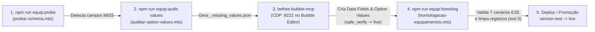

# 08 — Scripts de Diagnóstico/Homologação, Arquitetura de Testes Automatizados e Subprojeto `befree-bubble-mcp`

> **Manual de Handover Técnico — GestorCoop (`temp-app` & `befree-bubble-mcp`)**
> Este volume documenta integralmente:
> 1. **Todos os scripts operacionais, de sondagem de schema e de homologação** em [`temp-app/scripts/`](file:///c:/Users/admin/Documents/projetos/gestorcoop/temp-app/scripts), explicados **linha por linha e bloco por bloco**.
> 2. **A Arquitetura Completa de Testes Automatizados**: o motor SQLite/D1 em memória (`node:sqlite`), o interceptador CJS de `@cloudflare/next-on-pages`, todas as suítes de integração em [`temp-app/tests/api/`](file:///c:/Users/admin/Documents/projetos/gestorcoop/temp-app/tests/api) (com cada asserção e regra de negócio verificada) e o catálogo completo das **25 especificações E2E Playwright** em [`temp-app/tests/e2e/`](file:///c:/Users/admin/Documents/projetos/gestorcoop/temp-app/tests/e2e).
> 3. **O Subprojeto `befree-bubble-mcp`**: arquitetura híbrida Python 3.11+ / Node.js 18+, servidor MCP (`stdio`), CLI (`bubble-mcp`), compilador de mutações para o editor visual do Bubble.io, importador de estilos Figma/HTML, motor de transferência cruzada (`transfer`), auditoria visual (`harness`) e todos os 22 pacotes internos em [`befree-bubble-mcp/src/bubble_mcp/`](file:///c:/Users/admin/Documents/projetos/gestorcoop/befree-bubble-mcp/src/bubble_mcp).

---

## Sumário

1. [Parte I — Scripts de Diagnóstico, Sondagem e Homologação (`temp-app/scripts/*`)](#parte-i--scripts-de-diagnóstico-sondagem-e-homologação-temp-appscripts)
   - [1.1 Visão Geral e Scripts NPM Registrados](#11-visão-geral-e-scripts-npm-registrados)
   - [1.2 `scripts/README.md` — Guia Operacional de Homologação V2](#12-scriptsreadmemd--guia-operacional-de-homologação-v2)
   - [1.3 `scripts/_env.mts` — Bootstrap de Ambiente e Guardas de Segurança (Linha por Linha)](#13-scripts_envmts--bootstrap-de-ambiente-e-guardas-de-segurança-linha-por-linha)
   - [1.4 `scripts/probar-schema.mts` — Sondagem Read-Only do Contrato Bubble (Linha por Linha)](#14-scriptsprobar-schemamts--sondagem-read-only-do-contrato-bubble-linha-por-linha)
   - [1.5 `scripts/auditar-option-values.mts` — Auditoria de Option Sets por Injeção Descartável (Linha por Linha)](#15-scriptsauditar-option-valuesmts--auditoria-de-option-sets-por-injeção-descartável-linha-por-linha)
   - [1.6 `scripts/homologacao-equipamentos.mts` — Homologação Ponta a Ponta do Módulo de Equipamentos V2 (Linha por Linha)](#16-scriptshomologacao-equipamentosmts--homologação-ponta-a-ponta-do-módulo-de-equipamentos-v2-linha-por-linha)
   - [1.7 `scripts/inspecionar-adesao.mts` — Diagnóstico Forense de Vínculos de Adesão (Linha por Linha)](#17-scriptsinspecionar-adesaomts--diagnóstico-forense-de-vínculos-de-adesão-linha-por-linha)
   - [1.8 `scripts/probar-os-profissao.mts` — Sondagem de Rótulos do Option Set `OS_profissao` (Linha por Linha)](#18-scriptsprobar-os-profissaomts--sondagem-de-rótulos-do-option-set-os_profissao-linha-por-linha)
   - [1.9 `scripts/probar-user-fields.mts` — Inspeção de Campos da Tabela `user` no Bubble (Linha por Linha)](#19-scriptsprobar-user-fieldsmts--inspeção-de-campos-da-tabela-user-no-bubble-linha-por-linha)
   - [1.10 `scripts/validar-zapsign.mts` — Validação Ponta a Ponta Bubble + jsPDF + ZapSign (Linha por Linha)](#110-scriptsvalidar-zapsignmts--validação-ponta-a-ponta-bubble--jspdf--zapsign-linha-por-linha)
2. [Parte II — Arquitetura de Testes Automatizados (`temp-app/tests/`)](#parte-ii--arquitetura-de-testes-automatizados-temp-apptests)
   - [2.1 Pipeline de Execução e Gates de CI/CD](#21-pipeline-de-execução-e-gates-de-cicd)
   - [2.2 Infraestrutura de Stubs e Emulação Cloudflare Edge/D1 (`tests/api/stubs/`)](#22-infraestrutura-de-stubs-e-emulação-cloudflare-edged1-testsapistubs)
   - [2.3 `tests/api/prontuarios-schema.test.ts` — Auto-Healing e Migração Incremental D1](#23-testsapiprontuarios-schematestts--auto-healing-e-migração-incremental-d1)
   - [2.4 `tests/api/adesao-documentos.test.ts` — Regras de Documentação Obrigatória, Conselhos Profissionais, PIS e Vínculo de Empresa](#24-testsapiadesao-documentostestts--regras-de-documentação-obrigatória-conselhos-profissionais-pis-e-vínculo-de-empresa)
   - [2.5 `tests/api/cooperado-profile.test.ts` — Sessão Autenticada, Enriquecimento de Cargo e Logout Cross-Subdomain](#25-testsapicooperado-profiletestts--sessão-autenticada-enriquecimento-de-cargo-e-logout-cross-subdomain)
   - [2.6 `tests/api/documentacao.test.ts` — Comprovantes HMAC de Upload, Proxy Bubble, ZapSign e Webhook Server-to-Server](#26-testsapidocumentacaotestts--comprovantes-hmac-de-upload-proxy-bubble-zapsign-e-webhook-server-to-server)
   - [2.7 `tests/api/prontuarios-rpc.test.ts` — Suíte Master do Prontuário Eletrônico, Agenda, Sincronização e Planos Terapêuticos (37 Testes)](#27-testsapiprontuarios-rpctestts--suíte-master-do-prontuário-eletrônico-agenda-sincronização-e-planos-terapêuticos-37-testes)
   - [2.8 Suíte E2E Playwright (`playwright.config.ts` e `tests/e2e/*`)](#28-suíte-e2e-playwright-playwrightconfigts-e-testse2e)
3. [Parte III — Subprojeto `befree-bubble-mcp` (Motor de Automação Bubble.io via MCP + Playwright)](#parte-iii--subprojeto-befree-bubble-mcp-motor-de-automação-bubbleio-via-mcp--playwright)
   - [3.1 Propósito Arquitetural e Quando Utilizar](#31-propósito-arquitetural-e-quando-utilizar)
   - [3.2 Estrutura de Diretórios e Configuração (`pyproject.toml` & `package.json`)](#32-estrutura-de-diretórios-e-configuração-pyprojecttoml--packagejson)
   - [3.3 Anatomia dos 22 Módulos Python em `src/bubble_mcp/`](#33-anatomia-dos-22-módulos-python-em-srcbubble_mcp)
   - [3.4 Servidor MCP (`stdio.py` e `tools.py`) — Catálogo Completo das 36 Tools MCP](#34-servidor-mcp-stdiopy-e-toolspy--catálogo-completo-das-36-tools-mcp)
   - [3.5 CLI Oficial (`bubble-mcp`) e Fluxos Operacionais](#35-cli-oficial-bubble-mcp-e-fluxos-operacionais)

---

## Parte I — Scripts de Diagnóstico, Sondagem e Homologação (`temp-app/scripts/*`)

### 1.1 Visão Geral e Scripts NPM Registrados

O diretório [`temp-app/scripts/`](file:///c:/Users/admin/Documents/projetos/gestorcoop/temp-app/scripts) reúne utilitários TypeScript ESM (`.mts`) executados diretamente via `npx tsx` para diagnosticar contratos de banco de dados do Bubble.io, auditar rótulos de *Option Sets*, inspecionar vínculos relacionais de cooperados e validar integrações externas (ZapSign + geração de PDF).

Em [`temp-app/package.json`](file:///c:/Users/admin/Documents/projetos/gestorcoop/temp-app/package.json#L5-L18), três comandos oficiais de homologação de equipamentos estão expostos:

| Script NPM | Comando Executado | Finalidade |
|---|---|---|
| `npm run equip:probe` | `tsx scripts/probar-schema.mts` | Sondagem *read-only* de **8 tabelas** e **107 campos** do módulo de Equipamentos V2 no Bubble Data API. |
| `npm run equip:audit-values` | `tsx scripts/auditar-option-values.mts` | Auditoria ativa de **12 Option Sets** criando e removendo registros descartáveis para detectar divergências de grafia. |
| `npm run equip:homolog` | `tsx scripts/homologacao-equipamentos.mts` | Homologação transacional completa (*end-to-end*) de **7 cenários de negócio** com limpeza automática reversa (`finally`). |

Os demais scripts (`inspecionar-adesao.mts`, `probar-os-profissao.mts`, `probar-user-fields.mts`, `validar-zapsign.mts`) são executados sob demanda via `npx tsx scripts/<nome-do-script>.mts`.

---

### 1.2 `scripts/README.md` — Guia Operacional de Homologação V2

O arquivo [`temp-app/scripts/README.md`](file:///c:/Users/admin/Documents/projetos/gestorcoop/temp-app/scripts/README.md#L1-L43) documenta o protocolo de validação do módulo de Equipamentos V2 contra o Bubble Data API:

- **Linhas 1–19 (Comandos e Códigos de Saída)**:
  - Define os 3 comandos (`equip:probe`, `equip:audit-values`, `equip:homolog`).
  - Documenta o padrão de saída: `exit 0` quando 100% do contrato passa e `exit 1` quando há qualquer divergência (`MISS` ou falha de asserção), permitindo uso direto em pipelines de CI/CD ou scripts de pré-deploy.
- **Linhas 21–37 (Alternância `version-test` vs `live`)**:
  - Por padrão, os scripts leem `temp-app/.env.local`, que aponta `BUBBLE_API_URL` para `https://gestorcoop.app/version-test/api/1.1`.
  - Para validar o ambiente produtivo (`live`) após publicar o schema no Bubble, sobrescreve-se a variável na linha de comando sem alterar `.env.local`:
    ```bash
    BUBBLE_API_URL=https://gestorcoop.app/api/1.1 npm run equip:probe
    BUBBLE_API_URL=https://gestorcoop.app/api/1.1 npm run equip:audit-values
    BUBBLE_API_URL=https://gestorcoop.app/api/1.1 npm run equip:homolog
    ```
  - Ressalta que `equip:audit-values` e `equip:homolog` criam registros temporários identificados pelo prefixo `HOMOLOG <timestamp>` e os apagam via `DELETE` imediatamente após cada teste.
- **Linhas 39–43 (Histórico Arquitetural)**:
  - Referencia os planos de reconstrução de schema (`docs/superpowers/plans/2026-07-16-correcao-schema-equipamentos.md`) e notas de correção do MCP (`2026-07-16-mcp-fix-notes.md`).

---

### 1.3 `scripts/_env.mts` — Bootstrap de Ambiente e Guardas de Segurança (Linha por Linha)

O arquivo [`temp-app/scripts/_env.mts`](file:///c:/Users/admin/Documents/projetos/gestorcoop/temp-app/scripts/_env.mts#L1-L31) é o módulo de inicialização compartilhado por todos os scripts de sondagem e homologação. Sua existência resolve um detalhe crítico do ciclo de vida de módulos ES: como [`src/lib/bubble.ts`](file:///c:/Users/admin/Documents/projetos/gestorcoop/temp-app/src/lib/bubble.ts) captura `process.env.BUBBLE_API_URL`, `process.env.BUBBLE_API_TOKEN` e `process.env.EQUIPAMENTOS_V2_ENABLED` no momento da importação top-level, `_env.mts` **precisa** popular `process.env` antes que `bubble.ts` seja carregado.

#### Explicação Linha por Linha de [`scripts/_env.mts`](file:///c:/Users/admin/Documents/projetos/gestorcoop/temp-app/scripts/_env.mts#L1-L31):

- **Linhas 1–5**:
  ```ts
  import { readFileSync, existsSync } from 'node:fs';
  import { resolve, dirname } from 'node:path';
  import { fileURLToPath } from 'node:url';
  ```
  Importa primitivos nativos do Node.js para leitura síncrona de arquivo e resolução de caminho compatível com ESM (`import.meta.url`).
- **Linhas 7–17 (Parser Manual de `.env.local` com Precedência para o Shell)**:
  ```ts
  const envPath = resolve(dirname(fileURLToPath(import.meta.url)), '..', '.env.local');
  if (existsSync(envPath)) {
    for (const line of readFileSync(envPath, 'utf8').split(/\r?\n/)) {
      const m = line.match(/^\s*([A-Z0-9_]+)\s*=\s*(.*)\s*$/);
      if (m && !process.env[m[1]]) {
        process.env[m[1]] = m[2].replace(/^['"]|['"]$/g, '');
      }
    }
  }
  ```
  - **Linha 7**: Resolve o caminho absoluto de `temp-app/.env.local` subindo um nível (`..`) a partir de `temp-app/scripts/`.
  - **Linhas 8–9**: Verifica se `.env.local` existe e itera sobre cada linha suportando tanto quebras `LF` (`\n`) quanto `CRLF` (`\r\n`) do Windows.
  - **Linha 10**: Faz match apenas de variáveis válidas em caixa alta (`[A-Z0-9_]+`), ignorando comentários (`#`) e linhas em branco.
  - **Linhas 11–13**: Só atribui `process.env[m[1]]` se a variável **ainda não estiver definida** no ambiente (`!process.env[m[1]]`). Isso garante que overrides passados inline pelo operador (como `BUBBLE_API_URL=https://gestorcoop.app/api/1.1 npm run equip:probe`) tenham prioridade sobre o `.env.local`. Além disso, remove aspas simples ou duplas envolventes (`replace(/^['"]|['"]$/g, '')`).
- **Linha 20 (Ativação Forçada da Feature Flag V2)**:
  ```ts
  process.env.EQUIPAMENTOS_V2_ENABLED = 'true';
  ```
  Garante que todas as funções de [`src/lib/bubble.ts`](file:///c:/Users/admin/Documents/projetos/gestorcoop/temp-app/src/lib/bubble.ts) operem no modo V2 completo (gravando e lendo as novas tabelas relacionais e Option Sets de equipamentos).
- **Linhas 22–28 (Exportação e Fail-Fast com Exit Code 2)**:
  ```ts
  export const API = process.env.BUBBLE_API_URL!;
  export const TOKEN = process.env.BUBBLE_API_TOKEN!;

  if (!API || !TOKEN) {
    console.error('ERRO: BUBBLE_API_URL e BUBBLE_API_TOKEN precisam estar em .env.local ou no ambiente.');
    process.exit(2);
  }
  ```
  Exporta as constantes `API` e `TOKEN`. Caso qualquer uma esteja ausente, encerra imediatamente o processo com código de saída `2` (erro de configuração/ambiente, diferenciando de `1` que indica falha de contrato/homologação).
- **Linha 30 (Detecção de Ambiente Produtivo vs Teste)**:
  ```ts
  export const isLive = !/version-test/.test(API);
  ```
  Exporta a flag booleana `isLive` inspecionando se a URL da API **não** contém `/version-test/`. Usada no cabeçalho de logs dos scripts para alertar visualmente o operador quando está rodando contra `LIVE`.

---

### 1.4 `scripts/probar-schema.mts` — Sondagem Read-Only do Contrato Bubble (Linha por Linha)

O arquivo [`temp-app/scripts/probar-schema.mts`](file:///c:/Users/admin/Documents/projetos/gestorcoop/temp-app/scripts/probar-schema.mts#L1-L47) verifica de forma **100% não destrutiva (somente leitura)** se todas as **8 tabelas** e **107 colunas** exigidas pelo módulo de Equipamentos V2 existem e estão expostas na Data API do Bubble.io.

#### Explicação Linha por Linha de [`scripts/probar-schema.mts`](file:///c:/Users/admin/Documents/projetos/gestorcoop/temp-app/scripts/probar-schema.mts#L1-L47):

- **Linhas 1–10**: Comentário de cabeçalho e importação de `{ API, TOKEN, isLive } from './_env.mts'`.
- **Linhas 12–21 (Mapa Declarativo `CONTRATO: Record<string, string[]>`)**:
  Define exatamente os **8 Data Types** do Bubble e a lista de campos esperados em cada um:
  1. **`movimentacao_equipamento` (16 campos)**:
     `fk_equipamento`, `fk_locacao`, `fk_ordem_servico_manutencao`, `fk_domicilio`, `fk_localizacao_anterior`, `fk_localizacao_nova`, `os_tipo_evento`, `txt_tipo_evento`, `os_status_anterior`, `os_status_novo`, `date_data_hora`, `txt_responsavel_operacao`, `txt_observacoes`, `txt_justificativa`, `txt_chave_idempotencia`, `bool_cancelado`.
  2. **`reserva_equipamento` (13 campos)**:
     `fk_equipamento`, `fk_paciente`, `fk_domicilio`, `fk_locacao_gerada`, `os_status`, `date_inicio_reserva`, `date_expiracao`, `date_cancelamento`, `txt_reservado_por`, `txt_cancelado_por`, `txt_motivo_cancelamento`, `txt_observacoes`, `txt_chave_idempotencia`.
  3. **`ordem_servico_manutencao` (23 campos)**:
     `txt_codigo`, `fk_equipamento`, `fk_fornecedor_oficina`, `os_tipo`, `os_origem`, `os_severidade`, `os_status`, `os_resultado`, `txt_defeito_relatado`, `txt_diagnostico_tecnico`, `txt_servico_executado`, `txt_causa_raiz`, `txt_motivo_cancelamento`, `date_abertura`, `date_envio_oficina`, `date_previsao_retorno`, `date_retorno_real`, `date_liberacao`, `num_custo_estimado`, `num_custo_real`, `bool_Em_garantia`, `txt_responsavel_abertura`, `txt_responsavel_liberacao`.
  4. **`conferencia_equipamento` (8 campos)**:
     `fk_equipamento`, `fk_locacao_origem`, `fk_movimentacao`, `fk_os_gerada`, `os_condicao_geral`, `os_decisao`, `date_conferencia`, `txt_conferente`.
  5. **`higienizacao_equipamento` (8 campos)**:
     `fk_equipamento`, `fk_conferencia_origem`, `os_status`, `date_inicio`, `date_conclusao`, `txt_protocolo_utilizado`, `txt_lote_insumo`, `txt_responsavel`.
  6. **`baixa_equipamento` (18 campos)**:
     `fk_equipamento`, `fk_os_avaliacao`, `os_status`, `os_motivo`, `txt_laudo_tecnico`, `txt_justificativa`, `txt_destino_final`, `txt_documento_descarte_url`, `num_valor_residual`, `date_solicitacao`, `date_aprovacao`, `date_baixa_efetiva`, `date_reversao`, `txt_solicitado_por`, `txt_aprovado_por`, `bool_revertida`, `txt_revertida_por`, `txt_revertida_por_segundo`.
  7. **`item_manutencao` (8 campos)**:
     `fk_ordem_servico`, `os_tipo`, `txt_descricao`, `txt_fornecedor`, `txt_nota_fiscal`, `num_quantidade`, `num_valor_unitario`, `num_valor_total`.
  8. **`alerta_equipamento` (13 campos)**:
     `fk_equipamento`, `fk_locacao`, `fk_ordem_servico`, `fk_reserva`, `os_tipo`, `os_severidade`, `os_status`, `txt_titulo`, `txt_descricao`, `txt_chave_idempotencia`, `date_geracao`, `date_resolucao`, `txt_resolvido_por`.
- **Linhas 23–27 (Função `probe(tipo, campo)`)**:
  ```ts
  async function probe(tipo: string, campo: string): Promise<boolean> {
    const c = encodeURIComponent(JSON.stringify([{ key: campo, constraint_type: 'is_not_empty' }]));
    const r = await fetch(`${API}/obj/${tipo}?constraints=${c}&limit=1`, { headers: { Authorization: `Bearer ${TOKEN}` } });
    return r.status === 200;
  }
  ```
  **Mecanismo técnico**: O Bubble Data API não possui um endpoint de introspecção de schema por tabela que liste colunas vazias, mas valida rigorosamente qualquer campo passado no parâmetro `constraints`. Quando se envia `[{"key": campo, "constraint_type": "is_not_empty"}]` com `limit=1`:
  - Se a coluna existe na tabela (mesmo que a tabela tenha 0 registros), o Bubble responde **`HTTP 200 OK`**.
  - Se a coluna não existe ou foi digitada com nome diferente no Bubble Editor, o Bubble responde **`HTTP 400`** ou **`HTTP 404`** (`Field not found`).
- **Linhas 29–46 (Loop de Execução e Relatório Consolidado)**:
  - Imprime o alvo (`TEST` ou `LIVE`).
  - Contabiliza `ok` e `miss` iterando sobre cada par `(tipo, campos)` em `CONTRATO`.
  - Para cada tabela, imprime a contagem parcial (`✓ movimentacao_equipamento: 16/16` ou `✗ ...`) e lista explicitamente quaisquer campos ausentes (`MISS: ...`).
  - Finaliza na linha 46 com `process.exit(miss ? 1 : 0)`.

---

### 1.5 `scripts/auditar-option-values.mts` — Auditoria de Option Sets por Injeção Descartável (Linha por Linha)

O arquivo [`temp-app/scripts/auditar-option-values.mts`](file:///c:/Users/admin/Documents/projetos/gestorcoop/temp-app/scripts/auditar-option-values.mts#L1-L77) resolve outro desafio clássico do Bubble.io: saber se cada **rótulo textual (Display)** esperado pelo TypeScript existe exatamente com a mesma acentuação, capitalização e espaçamento dentro do respectivo **Option Set** no Bubble.

#### Explicação Linha por Linha de [`scripts/auditar-option-values.mts`](file:///c:/Users/admin/Documents/projetos/gestorcoop/temp-app/scripts/auditar-option-values.mts#L1-L77):

- **Linhas 1–12**: Importa `writeFileSync` de `node:fs` e `{ API, TOKEN, isLive } from './_env.mts'`.
- **Linhas 14–20 (Helpers HTTP `post` e `del`)**:
  - `post(tipo, body)`: envia `POST ${API}/obj/${tipo}` com JSON e Bearer Token, retornando `{ status, text }`.
  - `del(tipo, id)`: envia `DELETE ${API}/obj/${tipo}/${id}` para remover imediatamente o registro de teste criado.
- **Linhas 23–55 (Mapa `SETS` — 12 Option Sets Auditados)**:
  Associa o nome lógico do Option Set ao par `[tabela_hospedeira, coluna_option_set, lista_de_rotulos]`:
  1. **`os_status_equipamento`** (testado em `equipamento.os_status` — **18 rótulos**):
     `Disponível`, `Reservado`, `Em trânsito para entrega`, `Alocado em domicílio`, `Em uso sem cobrança`, `Cobrança suspensa`, `Aguardando retirada`, `Em trânsito de recolhimento`, `Recolhido e aguardando conferência`, `Em higienização / triagem`, `Em manutenção preventiva`, `Em manutenção corretiva`, `Em orçamento externo`, `Aguardando peça`, `Bloqueado / interditado`, `Extraviado / sinistrado`, `Aguardando aprovação de baixa`, `Baixado / inativo`.
  2. **`os_status_locacao_equipamento`** (`locacao_equipamento.os_status_locacao` — **3 rótulos**):
     `Ativa`, `Suspensa`, `Encerrada`.
  3. **`os_tipo_cobranca_locacao_equipamento`** (`locacao_equipamento.os_tipo_cobranca` — **6 rótulos**):
     `Cobrado`, `Cortesia`, `Incluso no pacote`, `Garantia / substituição`, `Teste / avaliação`, `Suspenso temporariamente`.
  4. **`os_os_tipo_movimentacao_equipamento`** (`movimentacao_equipamento.os_tipo_evento` — **16 rótulos**):
     `Cadastro inicial`, `Reserva criada`, `Reserva cancelada`, `Saída para entrega`, `Alocação em domicílio`, `Transferência entre domicílios`, `Substituição em domicílio`, `Suspensão de cobrança`, `Retomada de cobrança`, `Solicitação de recolhimento`, `Recolhimento confirmado`, `Conferência de retorno`, `Higienização concluída`, `Envio para manutenção`, `Retorno de manutenção`, `Baixa patrimonial`.
  5. **`os_status_reserva_equipamento`** (`reserva_equipamento.os_status` — **4 rótulos**):
     `Ativa`, `Convertida em locação`, `Expirada`, `Cancelada`.
  6. **`os_status_ordem_servico_manutencao`** (`ordem_servico_manutencao.os_status` — **11 rótulos**):
     `Aberta`, `Aguardando triagem`, `Aguardando orçamento`, `Aguardando aprovação do orçamento`, `Orçamento aprovado`, `Em execução`, `Aguardando peça`, `Em teste pós-reparo`, `Concluída`, `Cancelada`, `Irreparável — encaminhada para baixa`.
  7. **`os_resultado_ordem_servico_manutencao`** (`ordem_servico_manutencao.os_resultado` — **7 rótulos**):
     `Reparado e liberado`, `Reparado com restrição`, `Sem defeito constatado`, `Aprovado na preventiva`, `Reprovado na preventiva`, `Custo inviável — sugerir baixa`, `Sem reparo — sugerir baixa`.
  8. **`os_status_baixa_equipamento`** (`baixa_equipamento.os_status` — **4 rótulos**):
     `Pendente de aprovação`, `Aprovada`, `Rejeitada`, `Revertida`.
  9. **`os_motivo_baixa_equipamento`** (`baixa_equipamento.os_motivo` — **5 rótulos**):
     `Sem reparo`, `Custo inviável`, `Obsolescência`, `Extravio definitivo`, `Sinistro total`.
  10. **`os_status_higienizacao_equipamento`** (`higienizacao_equipamento.os_status` — **3 rótulos**):
      `Em andamento`, `Aprovada`, `Reprovada — encaminhar manutenção`.
  11. **`os_tipo_alerta_equipamento`** (`alerta_equipamento.os_tipo` — **12 rótulos**):
      `Preventiva vencida`, `Preventiva próxima`, `Calibração vencida`, `Reserva prestes a expirar`, `Reserva expirada`, `Locação vencida sem devolução`, `Conferência pendente`, `OS atrasada`, `Orçamento aguardando aprovação`, `Custo acumulado acima do limiar`, `Reincidência de corretiva`, `Inconsistência de status`.
  12. **`os_status_alerta_equipamento`** (`alerta_equipamento.os_status` — **4 rótulos**):
      `Ativo`, `Reconhecido`, `Resolvido`, `Ignorado justificadamente`.
- **Linhas 57–76 (Execução da Sondagem e Geração de `_missing_values.json`)**:
  - Para cada rótulo `v`, executa `await post(tipo, { [campo]: v })`.
  - Se `r.status === 201`, extrai o `id` retornado em `JSON.parse(r.text).id` e chama `await del(tipo, id)` dentro de um bloco `try/catch` para não deixar lixo no banco.
  - Se `r.status === 400 && /could not parse/i.test(r.text)`, o Bubble rejeitou o valor porque o rótulo não existe no Option Set: adiciona `v` à lista `faltando`.
  - Caso `totalMissing > 0` ao final, grava `scripts/_missing_values.json` com o mapa de Option Sets e valores faltantes (insumo consumido pela automação `befree-bubble-mcp` para cadastrar os itens faltantes no editor do Bubble) e encerra com `process.exit(1)`.

---

### 1.6 `scripts/homologacao-equipamentos.mts` — Homologação Ponta a Ponta do Módulo de Equipamentos V2 (Linha por Linha)

O arquivo [`temp-app/scripts/homologacao-equipamentos.mts`](file:///c:/Users/admin/Documents/projetos/gestorcoop/temp-app/scripts/homologacao-equipamentos.mts#L1-L218) executa uma bateria de integração real contra o Bubble Data API exercitando diretamente as funções de [`src/lib/bubble.ts`](file:///c:/Users/admin/Documents/projetos/gestorcoop/temp-app/src/lib/bubble.ts).

#### Explicação Linha por Linha de [`scripts/homologacao-equipamentos.mts`](file:///c:/Users/admin/Documents/projetos/gestorcoop/temp-app/scripts/homologacao-equipamentos.mts#L1-L218):

- **Linhas 1–10 (Bootstrap e Import Dinâmico)**:
  Importa `{ API, TOKEN, isLive } from './_env.mts'` primeiro e, na linha 10, faz `const bubble = await import('../src/lib/bubble.ts')` via *top-level await*. Isso garante que `bubble.ts` leia `EQUIPAMENTOS_V2_ENABLED = 'true'` configurado por `_env.mts`.
- **Linhas 12–21 (Rastreamento de Registros Criados e Helpers `del` / `getRaw`)**:
  - `criados: Array<[string, string]> = []`: pilha que armazena cada `[tipo, id]` criado durante o teste para deleção garantida no final.
  - `del(tipo, id)`: executa `DELETE ${API}/obj/${tipo}/${id}`.
  - `getRaw(tipo, id)`: executa `GET ${API}/obj/${tipo}/${id}` retornando o `response` bruto do Bubble para inspecionar campos que não são expostos na camada de domínio ou para auditar persistência física no banco.
- **Linhas 23–36 (Runner de Asserções `check(nome, cond, detalhe)`)**:
  Incrementa `pass` ou `fail` e imprime `✓` ou `✗` com diagnóstico opcional.
- **Linhas 38–50 (Setup — Criação de Equipamento Descartável)**:
  Cria um equipamento com `txt_nome: 'HOMOLOG <ts>'`, `txt_patrimonio: 'PAT-H-<ts>'`, `txt_status: 'Disponível'` e `num_custo_aquisicao: 1000`. Registra `['equipamento', eq._id]` em `criados` e valida se `eq._id` foi retornado.
- **Linhas 51–71 (Cenário 1 — Reserva: Criar -> Cancelar com Motivo e Data)**:
  - Chama `bubble.criarReservaEquipamento` com `txt_status: 'Ativa'`, `txt_reservado_por: 'Homolog Bot'` e chave de idempotência `res-${ts}`.
  - Chama `bubble.atualizarReservaEquipamento(reserva._id, { txt_status: 'Cancelada', txt_cancelado_por: 'Homolog Bot', txt_motivo_cancelamento: 'Teste de cancelamento' })`.
  - Consulta `getRaw('reserva_equipamento', reserva._id)` e valida 3 asserções: criação da reserva, presença de `date_cancelamento` preenchido e `txt_motivo_cancelamento === 'Teste de cancelamento'`.
- **Linhas 72–100 (Cenário 2 — Movimentação + Máquina de Estados + Idempotência)**:
  - Chama `bubble.registrarMovimentacao` transicionando o equipamento de `'Disponível'` para `'Reservado'` com `txt_tipo_evento: 'Reserva criada'` e `txt_chave_idempotencia: 'mov-<ts>'`.
  - Inspeciona o registro bruto em `movimentacao_equipamento` e o equipamento atualizado via `bubble.getEquipamentoById(eq._id)`:
    1. Confirma criação da movimentação.
    2. Confirma que `eqDepois.txt_status === 'Reservado'`.
    3. Confirma gravação de `os_status_anterior`, `os_status_novo` e `os_tipo_evento`.
  - **Teste de Idempotência**: Repete a chamada `bubble.registrarMovimentacao` com a mesma `chaveMov` tentando mudar para `'Disponível'` e confirma que a função retorna exatamente o mesmo `mov._id` sem duplicar o evento.
  - **Teste da Máquina de Estados**: Tenta uma transição ilegal (`'Reservado' -> 'Recolhido e aguardando conferência'`) e valida que `bubble.registrarMovimentacao` lança exceção (`bloqueouTransicaoInvalida === true`).
- **Linhas 101–123 (Cenário 3 — Ordem de Serviço de Manutenção + Itens + Atualização)**:
  - Cria OS via `bubble.criarOrdemServicoManutencao` (`txt_tipo: 'Corretiva'`, `txt_severidade: 'Média'`, `txt_status: 'Aberta'`, `num_custo_estimado: 150`).
  - Cria item de peça via `bubble.criarItemManutencao` com `num_quantidade: 2` e `num_valor_unitario: 30` (validando o cálculo automático `num_valor_total === 60`).
  - Lista itens via `bubble.getItensManutencao(os._id)`.
  - Atualiza a OS via `bubble.atualizarOrdemServicoManutencao` com `txt_status: 'Em execução'`, `txt_resultado: 'Reparado e liberado'` e `txt_causa_raiz: 'Desgaste natural'`, confirmando persistência no Bubble via `getRaw`.
- **Linhas 124–148 (Cenário 4 — Baixa Patrimonial: Criar -> Aprovar -> Reverter com Dupla Autorização)**:
  - Cria solicitação de baixa (`bubble.criarBaixaEquipamento`) com `txt_status: 'Pendente de aprovação'` e `txt_motivo: 'Sem reparo'`.
  - Aprova a baixa (`bubble.atualizarBaixaEquipamento`) preenchendo `date_baixa_efetiva`.
  - Reverte a baixa enviando dupla assinatura (`bool_revertida: true`, `txt_revertida_por: 'Gestor A'`, `txt_revertida_por_segundo: 'Gestor B'`) e confirma a gravação física das duas assinaturas e `date_reversao` no Bubble.
- **Linhas 149–163 (Cenário 5 — Alerta Operacional + Idempotência por Chave)**:
  - Cria alerta via `bubble.criarAlerta` (`txt_tipo: 'Conferência pendente'`, `txt_severidade: 'Alta'`, `txt_status: 'Ativo'`, `txt_chave_idempotencia: 'alr-<ts>'`).
  - Busca via `bubble.getAlertaPorChave('alr-<ts>')` e confirma que retorna o mesmo `_id`.
- **Linhas 164–179 (Cenário 6 — Suspensão de Locação Condicional)**:
  - Consulta `bubble.getLocacoes()`. Caso exista ao menos uma locação na base, cria um registro em `suspensao_locacao` via `bubble.criarSuspensaoLocacao`, valida a listagem em `bubble.getSuspensoesLocacao(locId)` e agenda a limpeza; caso não haja locações na base de teste, exibe `(skip) Nenhuma locacao_equipamento existente`.
- **Linhas 180–205 (Cenário 7 — Paciente + Domicílio V2)**:
  - Chama `bubble.createPaciente` com endereço `'Av Paulista, 1500 - Bela Vista, São Paulo - SP'`.
  - Verifica se o Bubble populou o campo geográfico `geo_local` e se o fluxo V2 criou automaticamente um registro de `domicilio` ativo vinculado ao paciente (`bubble.getDomiciliosPorPaciente(pac._id)`).
- **Linhas 207–217 (Teardown Reverso Garantido em `.finally()`)**:
  ```ts
  } finally {
    console.log(`\nLimpando ${criados.length} registros de homologacao...`);
    for (const [tipo, id] of criados.reverse()) {
      await del(tipo, id);
    }
  }
  ```
  Desfaz todos os registros criados na ordem inversa de dependência (`reverse()`), garantindo que filhos (`item_manutencao`, `domicilio`, `movimentacao_equipamento`, etc.) sejam removidos antes do pai (`equipamento`, `paciente`).

---

### 1.7 `scripts/inspecionar-adesao.mts` — Diagnóstico Forense de Vínculos de Adesão (Linha por Linha)

O arquivo [`temp-app/scripts/inspecionar-adesao.mts`](file:///c:/Users/admin/Documents/projetos/gestorcoop/temp-app/scripts/inspecionar-adesao.mts#L1-L55) é um script forense somente-leitura criado para investigar como o Bubble armazena os relacionamentos de profissões, contas bancárias e documentos nos registros de `socioscooperados` recém-cadastrados.

#### Explicação Linha por Linha de [`scripts/inspecionar-adesao.mts`](file:///c:/Users/admin/Documents/projetos/gestorcoop/temp-app/scripts/inspecionar-adesao.mts#L1-L55):

- **Linhas 1–6**: Importa `{ API, TOKEN, isLive } from './_env.mts'` e exibe o ambiente alvo.
- **Linhas 8–13 (Helper `get(path)`)**: Executa `GET ${API}${path}` autenticado com `Bearer ${TOKEN}` e retorna `{ status: r.status, body: await r.json() }`.
- **Linhas 15–24 (Filtro Temporal dos Últimos 3 Dias)**:
  - Calcula `desde = new Date(Date.now() - 3 * 24 * 3600 * 1000).toISOString()`.
  - Monta a constraint `[{ key: 'Created Date', constraint_type: 'greater than', value: desde }]` e busca até 10 cooperados em `/obj/socioscooperados`.
- **Linhas 26–54 (Inspeção Cruzada Pai <-> Filhos)**:
  Para cada cooperado retornado:
  - **Linhas 27–38**: Imprime `_id`, `Created Date`, `txt_nome`, `txt_cpf` e todas as chaves do objeto que contenham `profiss|conta|pasta|conselho|registro`. Imprime especificamente tanto `s['fks_Profissões ']` (com espaço final, peculiaridade histórica do schema Bubble) quanto `s['fks_Profissões']` e `s['fks_profissoes']`, além de `fks_ContasBancarias` e `fks_pasta`.
  - **Linhas 40–46**: Consulta diretamente a tabela filha `/obj/profissao_cooperado` filtrando por `fk_socio_cooperado equals s._id` para verificar se os registros filhos foram criados mesmo quando a lista reversa no pai estiver vazia.
  - **Linhas 48–53**: Consulta `/obj/conta_cooperado` filtrando por `fk_cooperado equals s._id` e exibe o banco, agência, conta e chave PIX vinculados.

---

### 1.8 `scripts/probar-os-profissao.mts` — Sondagem de Rótulos do Option Set `OS_profissao` (Linha por Linha)

O arquivo [`temp-app/scripts/probar-os-profissao.mts`](file:///c:/Users/admin/Documents/projetos/gestorcoop/temp-app/scripts/probar-os-profissao.mts#L1-L49) testa especificamente uma armadilha do Bubble.io no Option Set `OS_profissao` da tabela `profissao_cooperado`: rótulos cadastrados no Bubble Editor com um **espaço em branco invisível no final** (ex.: `"Enfermeiro (a) "`).

#### Explicação Linha por Linha de [`scripts/probar-os-profissao.mts`](file:///c:/Users/admin/Documents/projetos/gestorcoop/temp-app/scripts/probar-os-profissao.mts#L1-L49):

- **Linhas 1–13**: Importa `API` e `TOKEN` de `./_env.mts` e define a lista `CANDIDATOS` com as 8 profissões do domínio (`Enfermeiro (a)`, `Técnico (a) de Enfermagem`, `Médico (a)`, `Fisioterapeuta`, `Nutricionista`, `Psicólogo (a)`, `Técnico (a) de Laboratório`, `Outros`).
- **Linhas 15–29 (Função `testar(valor)`)**:
  - Envia `POST ${API}/obj/profissao_cooperado` com `{ OS_profissao: valor }`.
  - Se retornar `201`, extrai o `id` criado e envia `DELETE ${API}/obj/profissao_cooperado/${id}` imediatamente, retornando `'OK'`.
  - Caso contrário, retorna `HTTP <status>: <primeiros 160 caracteres do erro>`.
- **Linhas 31–48 (Teste Duplo: Sem Espaço vs Com Espaço Final)**:
  - **Bloco 1 (Linhas 31–38)**: Testa cada rótulo exatamente como escrito (`c`).
  - **Bloco 2 (Linhas 40–48)**: Testa cada rótulo concatenado com um espaço no final (`c + ' '`), permitindo identificar exatamente quais itens do Option Set no Bubble possuem *trailing space*.

---

### 1.9 `scripts/probar-user-fields.mts` — Inspeção de Campos da Tabela `user` no Bubble (Linha por Linha)

O arquivo [`temp-app/scripts/probar-user-fields.mts`](file:///c:/Users/admin/Documents/projetos/gestorcoop/temp-app/scripts/probar-user-fields.mts#L1-L19) é um utilitário enxuto para inspecionar a estrutura real de objetos `user` no Bubble (usados na autenticação e cabeçalho do Painel do Gestor).

#### Explicação Linha por Linha de [`scripts/probar-user-fields.mts`](file:///c:/Users/admin/Documents/projetos/gestorcoop/temp-app/scripts/probar-user-fields.mts#L1-L19):

- **Linhas 1–6**: Importa `{ API, TOKEN } from './_env.mts'`.
- **Linhas 8–10**: Faz `GET ${API}/obj/user?limit=3` autenticado com Bearer Token e extrai `results`.
- **Linhas 11–18**: Itera sobre os até 3 usuários retornados, listando `Object.keys(u)` ordenadas alfabeticamente e imprimindo o JSON formatado (truncado em 1.200 caracteres) para conferência rápida dos nomes exatos dos campos (`txt_nome`, `authentication`, `OS_Cargo`, `imagem_perfil`, etc.).

---

### 1.10 `scripts/validar-zapsign.mts` — Validação Ponta a Ponta Bubble + jsPDF + ZapSign (Linha por Linha)

O arquivo [`temp-app/scripts/validar-zapsign.mts`](file:///c:/Users/admin/Documents/projetos/gestorcoop/temp-app/scripts/validar-zapsign.mts#L1-L271) valida todo o pipeline de assinatura eletrônica do Termo de Adesão Cooperativista antes ou depois de mudanças de credenciais/templates.

#### Explicação Linha por Linha de [`scripts/validar-zapsign.mts`](file:///c:/Users/admin/Documents/projetos/gestorcoop/temp-app/scripts/validar-zapsign.mts#L1-L271):

- **Linhas 1–26 (Bootstrap e Normalização de Credenciais)**:
  - Carrega `.env.local` manualmente.
  - Lê `BUBBLE_API_URL`, `BUBBLE_API_TOKEN`, `ZAPSIGN_API_TOKEN` (removendo eventual prefixo `Bearer ` duplicado com `.replace(/^Bearer\s+/i, '').trim()`) e `ZAPSIGN_BASE_URL` (padrão `https://api.zapsign.com.br/api/v1`, sem barra final).
- **Linhas 28–54 (Etapa 1 — `testarBubble()`)**:
  - Consulta `GET ${bubbleUrl}/obj/termos` para listar todos os modelos de Termo de Adesão cadastrados no Bubble (`txt_titulo`, `bool_ativo`, `os_profissao` e tamanho de `txt_conteudo`).
- **Linhas 56–99 (Etapa 2 — `testarZapSignAuth()`)**:
  - Testa 3 formatos de autenticação contra a API da ZapSign para diagnosticar problemas de token:
    1. `GET ${zapsignBaseUrl}/docs/` com header `Authorization: Bearer ${zapsignToken}`.
    2. `GET ${zapsignBaseUrl}/docs/?api_token=${zapsignToken}` (formato query param usado pela ZapSign v1).
    3. `GET ${zapsignBaseUrl}/user/?api_token=${zapsignToken}`.
- **Linhas 101–262 (Etapa 3 — `gerarEEnviarTermoTeste()`)**:
  - **Linhas 110–149 (Seleção de Template e Fallback)**: Busca em `/obj/termos` um termo com `bool_ativo !== false` cujo `os_profissao` ou `txt_titulo` contenha a profissão de teste (`Enfermeiro(a)`) ou `'geral'`. Caso não encontre no Bubble, utiliza um template cooperativista padrão de 5 cláusulas (Lei Federal nº 5.764/71).
  - **Linhas 151–186 (Interpolação de 14 Variáveis Dinâmicas)**: Substitui no texto do termo os placeholders `{nome}`, `{cpf}`, `{rg}`, `{pis}`, `{estado_civil}`, `{nacionalidade}`, `{data_nascimento}`, `{email}`, `{telefone}`, `{endereco}`, `{profissoes}`, `{conselho}`, `{registro_conselho}` e `{data_atual}`.
  - **Linhas 188–225 (Renderização Multi-Página em `jsPDF`)**:
    - Instancia `new jsPDF()` (A4 retrato), configura fonte Helvetica 14pt em negrito centralizada no topo, linha divisória e corpo em 10pt.
    - Processa quebras explícitas `[PAGE_BREAK]` e faz paginação automática sempre que a coordenada vertical `y > 275`, adicionando rodapé numerado (`Página i de totalPaginas — Documento gerado eletronicamente via GestorCoop`) em todas as páginas.
    - Salva uma cópia física em `~/Downloads/termo_adesao_validacao_zapsign.pdf` para inspeção visual humana e converte o buffer para `base64`.
  - **Linhas 227–262 (Criação do Envelope na ZapSign)**:
    - Envia `POST ${zapsignBaseUrl}/docs/?api_token=${zapsignToken}` com `base64_pdf`, `lang: 'pt-br'`, `disable_signer_emails: true` e o signatário de teste (`auth_mode: 'assinaturaTela'`).
    - Valida o retorno `HTTP 200` e imprime o `token` do documento e a URL de assinatura (`signers[0].sign_url`).

---

## Parte II — Arquitetura de Testes Automatizados (`temp-app/tests/`)

### 2.1 Pipeline de Execução e Gates de CI/CD

Em [`temp-app/package.json`](file:///c:/Users/admin/Documents/projetos/gestorcoop/temp-app/package.json#L5-L18), a suíte de testes é dividida em duas camadas complementares:

1. **Testes Unitários e de Integração de API/RPC (`node --test`)**:
   - **`npm run test:documentacao`**:
     ```bash
     node --require ./tests/api/stubs/next-on-pages.cjs --import tsx --test tests/api/documentacao.test.ts tests/api/adesao-documentos.test.ts tests/api/cooperado-profile.test.ts
     ```
   - **`npm run test:prontuarios`**:
     ```bash
     node --require ./tests/api/stubs/next-on-pages.cjs --import tsx --test tests/api/prontuarios-rpc.test.ts tests/api/prontuarios-schema.test.ts
     ```
2. **Testes End-to-End com Navegador Real (`@playwright/test`)**:
   - Configurados em [`temp-app/playwright.config.ts`](file:///c:/Users/admin/Documents/projetos/gestorcoop/temp-app/playwright.config.ts) e localizados em [`temp-app/tests/e2e/`](file:///c:/Users/admin/Documents/projetos/gestorcoop/temp-app/tests/e2e).

> [!IMPORTANT]
> Conforme definido nas regras de CI/CD do repositório (`AGENTS.md`), **antes de qualquer push ou abertura de Pull Request para `homolog`**, é obrigatório executar localmente dentro de `temp-app/`:
> ```bash
> npm run lint && npx tsc --noEmit && npm run test:documentacao && npm run test:prontuarios
> ```

---

### 2.2 Infraestrutura de Stubs e Emulação Cloudflare Edge/D1 (`tests/api/stubs/`)

Para testar rotas Next.js configuradas com `export const runtime = 'edge'` e queries SQL do Cloudflare D1 localmente sem depender do `wrangler` em cada teste unitário, o projeto implementa três arquivos de infraestrutura em [`temp-app/tests/api/stubs/`](file:///c:/Users/admin/Documents/projetos/gestorcoop/temp-app/tests/api/stubs):

#### 2.2.1 `tests/api/stubs/next-on-pages.cjs` e `next-on-pages-stub.cjs`

- **[`tests/api/stubs/next-on-pages.cjs`](file:///c:/Users/admin/Documents/projetos/gestorcoop/temp-app/tests/api/stubs/next-on-pages.cjs#L1-L19)**:
  Carregado via flag `--require` do Node antes de qualquer módulo TypeScript. Sobrescreve `Module._resolveFilename` do módulo nativo `node:module`: sempre que o código da aplicação faz `import { getOptionalRequestContext } from '@cloudflare/next-on-pages'`, o resolvedor desvia a importação para [`next-on-pages-stub.cjs`](file:///c:/Users/admin/Documents/projetos/gestorcoop/temp-app/tests/api/stubs/next-on-pages-stub.cjs) em vez do pacote original (que lançaria erro fora do runtime workerd da Cloudflare).
- **[`tests/api/stubs/next-on-pages-stub.cjs`](file:///c:/Users/admin/Documents/projetos/gestorcoop/temp-app/tests/api/stubs/next-on-pages-stub.cjs#L1-L9)**:
  Lê o símbolo global `Symbol.for('__cloudflare-request-context__')` em `globalThis`, expondo `getOptionalRequestContext()` e `getRequestContext()` idênticos ao runtime Cloudflare Pages.

#### 2.2.2 `tests/api/stubs/d1-teste.ts` — Emulador Cloudflare D1 sobre `node:sqlite`

O arquivo [`temp-app/tests/api/stubs/d1-teste.ts`](file:///c:/Users/admin/Documents/projetos/gestorcoop/temp-app/tests/api/stubs/d1-teste.ts#L1-L106) constrói um banco SQLite em memória (`new DatabaseSync(':memory:')` do módulo nativo `node:sqlite` introduzido no Node 22.13+) que implementa a interface `D1Database` e `D1PreparedStatement` da Cloudflare:

- **Aplicação Automática de Migrations (`Linhas 25–35`)**:
  Quando `criarD1EmMemoria()` é chamado (com `aplicarMigrations !== false`), ele lê todos os arquivos `.sql` de [`temp-app/migrations/`](file:///c:/Users/admin/Documents/projetos/gestorcoop/temp-app/migrations) em ordem alfabética (`0001_prontuarios.sql` até a última migration) e os executa via `raw.exec(sql)`. Assim, todo teste roda contra o schema real de produção.
- **Contador de Round-Trips de Rede (`d1.idas`, `Linhas 11, 56–95`)**:
  Uma propriedade especial `idas: number` é incrementada em `+1` a cada chamada a `.first()`, `.all()`, `.run()`, `.exec()` ou `.batch()`.
  - **Por que isso é fundamental?** No Cloudflare Workers + D1, cada chamada individual ao banco cruza a rede até a réplica primária do D1. O GestorCoop foi arquitetado para consolidar leituras e escritas em um único `db.batch([...])` (1 round-trip por requisição). O contador `db.idas` permite que os testes afirmem matematicamente `assert.equal(db.idas, 1)`.
- **Transacionalidade de `.batch(stmts)` (`Linhas 76–90`)**:
  Incrementa `d1.idas += 1` uma única vez para todo o lote, abre `BEGIN`, executa cada `InternalStmt._exec()` sequencialmente e faz `COMMIT` (ou `ROLLBACK` em caso de erro SQL, como violação de trigger de imutabilidade).
- **Injeção de Contexto (`instalarContextoCloudflare(db)`, `Linhas 99–105`)**:
  Registra `{ env: { DB: db } }` em `globalThis[Symbol.for('__cloudflare-request-context__')]`, fazendo com que `obterBancoD1()` em [`src/lib/d1/prontuarios.ts`](file:///c:/Users/admin/Documents/projetos/gestorcoop/temp-app/src/lib/d1/prontuarios.ts) enxergue o banco em memória transparentemente.

---

### 2.3 `tests/api/prontuarios-schema.test.ts` — Auto-Healing e Migração Incremental D1

O arquivo [`temp-app/tests/api/prontuarios-schema.test.ts`](file:///c:/Users/admin/Documents/projetos/gestorcoop/temp-app/tests/api/prontuarios-schema.test.ts#L1-L37) valida o mecanismo de *auto-healing* de schema (`garantirSchemaD1` e `resetarCacheSchemaD1ParaTestes` de [`src/lib/d1/prontuarios.ts`](file:///c:/Users/admin/Documents/projetos/gestorcoop/temp-app/src/lib/d1/prontuarios.ts)):

| Teste | O que é validado |
|---|---|
| **`garantirSchemaD1 executa fallback completo de DDL quando o banco possui schema antigo`** | 1. Cria um banco D1 em memória **sem** aplicar as migrations (`criarD1EmMemoria({ aplicarMigrations: false })`) e cria manualmente apenas as 3 tabelas legadas da migration `0001` (`pacientes`, `prescricoes`, `evolucoes` sem colunas modernas como `bubble_unique_id`, `status_ativo`, `empresa_contratante` ou `planos_terapeuticos`).<br>2. Executa `await garantirSchemaD1(db)` e verifica que o detector de schema percebe a ausência das tabelas/colunas recentes e roda o fallback completo de DDL (`assert.ok(db.idas > 10)`).<br>3. Executa um `db.batch` consultando todas as colunas modernas em `pacientes`, `prescricoes`, `evolucoes`, `planos_terapeuticos`, `plano_terapeutico_metas`, `aprazamentos`, `sinais_vitais`, `pareceres_auditoria` e `auth_sessions`, provando que todas foram criadas sem erro.<br>4. Reseta `db.idas = 0`, chama `await garantirSchemaD1(db)` novamente e comprova que o cache por isolate evita qualquer query adicional (`assert.equal(db.idas, 0)`). |

---

### 2.4 `tests/api/adesao-documentos.test.ts` — Regras de Documentação Obrigatória, Conselhos Profissionais, PIS e Vínculo de Empresa

O arquivo [`temp-app/tests/api/adesao-documentos.test.ts`](file:///c:/Users/admin/Documents/projetos/gestorcoop/temp-app/tests/api/adesao-documentos.test.ts#L1-L431) contém **9 testes** cobrindo as regras de validação de cadastro de cooperados, conselhos de classe, PIS/NIT e identificação de operadoras/empresas contratantes:

| # | Nome do Teste | Regras de Negócio e Asserções Verificadas |
|---|---|---|
| 1 | **`validarDocumentosObrigatoriosAdesao exige os 6 documentos obrigatórios e aceita os opcionais`** | Verifica que `DOCUMENTOS_OBRIGATORIOS_ADESAO` contém exatamente 6 chaves (`identificacao`, `conselho`, `certidao_regularidade`, `certidao_negativa_criminal`, `residencia`, `cartao_vacinacao`) e `DOCUMENTOS_OPCIONAIS_ADESAO` contém 2 (`cartao_sus_pis`, `outro`). Confirma aprovação quando os 6 obrigatórios têm URL válida, rejeição quando `certidao_negativa_criminal` está vazia e rejeição antifraude quando a mesma URL de arquivo é reutilizada em dois documentos distintos (`"Cada documento enviado deve possuir um arquivo próprio"`). |
| 2 | **`validarRegistroConselho valida COREN, CRM, CREFITO, CRBM e UF com links de consulta pública`** | Testa `validarRegistroConselho` de [`src/lib/validacao-conselho.ts`](file:///c:/Users/admin/Documents/projetos/gestorcoop/temp-app/src/lib/validacao-conselho.ts):<br>- Aprova `COREN-GO 248591-ENF` para `Enfermeiro (a)`, retornando link oficial `https://www.cofen.gov.br/servicos-cofen/consulta-de-inscritos/`.<br>- Rejeita dígitos sequenciais (`123456`) ou repetidos (`111111`).<br>- Rejeita UF inexistente (`XX`).<br>- Rejeita incompatibilidade entre profissão e conselho (`CRM` para `Enfermeiro (a)`).<br>- Rejeita sufixo de categoria incompatível (`-TE` de Técnico para `Enfermeiro (a)`).<br>- Aprova `CRM-SP 148293` para `Médico (a)` retornando portal do CFM. |
| 3 | **`GET e POST /api/cooperado/validar-conselho retornam validação estruturada e links oficiais`** | Invoca os handlers `GET` e `POST` de [`src/app/api/cooperado/validar-conselho/route.ts`](file:///c:/Users/admin/Documents/projetos/gestorcoop/temp-app/src/app/api/cooperado/validar-conselho/route.ts):<br>- `GET` sem parâmetros retorna `200` com catálogo `portaisPorConselho` e `ufsValidas` (incluindo `GO`, `SP`).<br>- `POST` com registro válido retorna `200`, `valido: true` e `registroFormatado: 'COREN-GO 248591-ENF'`.<br>- `POST` com sequência inválida (`123456`) retorna `422` e `valido: false`. |
| 4 | **`validarPIS valida dígito verificador Módulo 11 e rejeita sequências inválidas`** | Testa `isValidPIS` e `validarPIS` de [`src/lib/validators.ts`](file:///c:/Users/admin/Documents/projetos/gestorcoop/temp-app/src/lib/validators.ts): aprova PIS real válido (`120.5687.412-7` / `12056874127`), rejeita dígito verificador trocado (`120.5687.412-0`), sequência repetida (`11111111111`) e tamanho incorreto (`123`). |
| 5 | **`POST /api/cooperado/adesao bloqueia envio quando falta qualquer um dos 6 documentos obrigatórios`** | Envia `POST` para [`src/app/api/cooperado/adesao/route.ts`](file:///c:/Users/admin/Documents/projetos/gestorcoop/temp-app/src/app/api/cooperado/adesao/route.ts) omitindo `certidao_negativa_criminal` e `cartao_vacinacao`. Confirma resposta `HTTP 400`, mensagem listando os documentos pendentes e que `bubble.createCooperado` **não** foi chamado (`createCalled === false`). |
| 6 | **`POST /api/cooperado/adesao bloqueia envio quando o registro de conselho é inválido`** | Envia os 6 documentos obrigatórios com comprovantes HMAC válidos, porém com `numero_conselho: '123456'`. Confirma `HTTP 400`, erro mencionando `COREN` e bloqueio de escrita no Bubble. |
| 7 | **`POST /api/cooperado/adesao bloqueia envio quando o PIS/NIT é inválido`** | Envia payload com `pis: '12056874120'` (DV incorreto). Confirma `HTTP 400` com mensagem `"PIS/NIT inválido"` e zero chamadas ao Bubble. |
| 8 | **`POST /api/cooperado/adesao conclui cadastro quando os 6 obrigatórios estão presentes e anexa opcionais informados`** | Testa o fluxo completo de sucesso: envia os 6 documentos obrigatórios + `cartao_sus_pis` opcional, todos assinados com `criarComprovanteUpload`. Verifica retorno `HTTP 200`, criação de **7 documentos** via `bubble.createDocumento`, gravação de `numero_conselho: 'COREN-GO 248591-ENF'` na profissão e vinculação das 7 FKs em `fks_pasta`. |
| 9 | **`identificarEmpresaContratante reconhece Verdes Mares, Multcare e ISA e calcularIdadePaciente calcula idade`** | Testa `identificarEmpresaContratante` e `calcularIdadePaciente` de [`src/lib/empresas-contratantes.ts`](file:///c:/Users/admin/Documents/projetos/gestorcoop/temp-app/src/lib/empresas-contratantes.ts): mapeia `'Verdes Mares Home Care'` -> `verdes-mares`, `'Multcare Atenção Domiciliar'` -> `multi` (nome curto `'Multcare'`), `'ISA Saúde'` -> `isa`, e calcula a idade exata para paciente nascido há 65 anos. |

---

### 2.5 `tests/api/cooperado-profile.test.ts` — Sessão Autenticada, Enriquecimento de Cargo e Logout Cross-Subdomain

O arquivo [`temp-app/tests/api/cooperado-profile.test.ts`](file:///c:/Users/admin/Documents/projetos/gestorcoop/temp-app/tests/api/cooperado-profile.test.ts#L1-L116) contém **4 testes** cobrindo autenticação JWT + sessão D1 em [`/api/cooperado/me`](file:///c:/Users/admin/Documents/projetos/gestorcoop/temp-app/src/app/api/cooperado/me/route.ts) e encerramento de sessão em [`/api/auth/logout`](file:///c:/Users/admin/Documents/projetos/gestorcoop/temp-app/src/app/api/auth/logout/route.ts):

| # | Nome do Teste | Regras de Negócio e Asserções Verificadas |
|---|---|---|
| 1 | **`GET /api/cooperado/me returns 401 when no token is provided`** | Requisição sem cookie nem header `Authorization` retorna `HTTP 401` (`{ error: 'Não autenticado.' }`). |
| 2 | **`GET /api/cooperado/me returns enriched cooperado profile when authenticated`** | Cria sessão ativa em `auth_sessions` no D1 em memória (`registrarSessaoAtiva`), assina token JWT (`signSessionToken`) com `cargo: 'Tecnico_Enfermagem'` e mocka `bubble.getCooperadoById`. Verifica retorno `HTTP 200`, normalização de `cargo` para `'Técnico(a) de Enfermagem'`, preenchimento automático de `profissao` a partir do cargo quando `fks_profissoes` está vazio e preservação de `fks_pasta`. |
| 3 | **`POST /api/auth/logout clears session cookies for local and shared domain requests`** | Valida que o logout em `http://localhost:3000/api/auth/logout` expira `cooperado_session=` e `gc_user_id=` com `Max-Age=0` sem atributo `Domain`, enquanto em `https://cooperado.gestorcoop.app/api/auth/logout` adiciona `Domain=.gestorcoop.app` para limpar o cookie compartilhado entre subdomínios. |
| 4 | **`POST /api/auth/logout clears both host-only and shared-domain cookies on production subdomains`** | Verifica via `response.headers.getSetCookie()` que em subdomínios de produção (`cooperado.gestorcoop.app`) são emitidos headers `Set-Cookie` duplos (tanto *host-only* quanto `Domain=.gestorcoop.app`) para `cooperado_session` e `gc_user_id`, prevenindo cookies órfãos no navegador. |

---

### 2.6 `tests/api/documentacao.test.ts` — Comprovantes HMAC de Upload, Proxy Bubble, ZapSign e Webhook Server-to-Server

O arquivo [`temp-app/tests/api/documentacao.test.ts`](file:///c:/Users/admin/Documents/projetos/gestorcoop/temp-app/tests/api/documentacao.test.ts#L1-L192) contém **11 testes** focados em segurança criptográfica de uploads, resiliência da integração Bubble/ZapSign e validação server-to-server de webhooks:

| # | Nome do Teste | Regras de Negócio e Asserções Verificadas |
|---|---|---|
| 1 | **`comprovante de upload valida correspondência exata de arquivo e URL`** | Testa `criarComprovanteUpload` e `verificarComprovanteUpload` de [`src/lib/upload-comprovante.ts`](file:///c:/Users/admin/Documents/projetos/gestorcoop/temp-app/src/lib/upload-comprovante.ts): garante que um comprovante HMAC emitido para `rg.pdf` é invalidado se o atacante tentar alterar o `nome` para `outro.pdf`. |
| 2 | **`bubble.uploadFile usa fetch compatível com runtime edge e propaga falha HTTP`** | Testa `bubble.uploadFile`: verifica que uma falha `HTTP 502` do Bubble File Uploader é propagada com erro descritivo (`502`) e que URLs protocol-relative retornadas pelo Bubble (`"//cdn.bubble.io/f123/teste.pdf"`) são normalizadas para `"https://cdn.bubble.io/f123/teste.pdf"`. |
| 3 | **`POST /api/cooperado/termo retorna 502 quando ZapSign falha em vez de fingir assinatura`** | Garante que se a API da ZapSign responder `HTTP 401`, a rota [`/api/cooperado/termo`](file:///c:/Users/admin/Documents/projetos/gestorcoop/temp-app/src/app/api/cooperado/termo/route.ts) retorna `HTTP 502` em vez de silenciar o erro. |
| 4 | **`POST /api/cooperado/termo retorna 502 quando ZapSign não devolve sign_url`** | Garante que se a ZapSign responder `200 OK` mas com `signers: []` (sem URL de assinatura), a rota retorna `HTTP 502` (`"ZapSign não retornou URL de assinatura"`). |
| 5 | **`POST /api/cooperado/termo gera PDF válido com cabeçalho %PDF-`** | Intercepta o payload enviado para a ZapSign, decodifica o campo `base64_pdf` e verifica que os primeiros 5 bytes correspondem à assinatura binária `%PDF-`. |
| 6 | **`POST /api/webhooks/zapsign exige doc_token e confirma status na API da ZapSign antes de aprovar`** | Testa [`src/app/api/webhooks/zapsign/route.ts`](file:///c:/Users/admin/Documents/projetos/gestorcoop/temp-app/src/app/api/webhooks/zapsign/route.ts):<br>- Sem `token` retorna `HTTP 400`.<br>- Se o webhook afirma `doc_Signed` mas a consulta server-to-server em `GET /api/v1/docs/<token>/` na ZapSign diz `status: 'pending'`, bloqueia com `HTTP 409` sem alterar o status no Bubble.<br>- Quando a API da ZapSign confirma `status: 'signed'` e entrega `signed_file`, baixa o PDF assinado, faz upload permanente para o storage do Bubble e atualiza o documento para `Assinado`. |
| 7 | **`nomeDocumento reconhece todos os tipos do fluxo de adesão`** | Verifica o mapeamento de rótulos amigáveis em `nomeDocumento` (`residencia` -> `'Comprovante de Residência'`, `cartao_sus_pis` -> `'Cartão SUS / PIS'`, etc.). |
| 8 | **`normalizarUrlDocumento corrige URLs relativas ao protocolo do Bubble`** | Verifica conversão de `//s3.amazonaws.com/appforest_uf/f123/doc.pdf` para `https://...`. |
| 9 | **`filtro de termos não quebra quando os_profissao ou txt_titulo são nulos`** | Garante segurança contra `TypeError` ao filtrar registros de termos vindos do Bubble com campos `null`/`undefined`. |
| 10 | **`POST /api/cooperado/upload rejeita requisição sem arquivo válido`** | Envia `FormData` vazio para [`/api/cooperado/upload`](file:///c:/Users/admin/Documents/projetos/gestorcoop/temp-app/src/app/api/cooperado/upload/route.ts) e valida retorno `HTTP 400`. |
| 11 | **`GET /api/gestor/cooperados retorna lista vazia sem erro quando Bubble está vazio e 502 quando falha`** | Valida tratamento de lista vazia (`200`, `cooperados: []`) e propagação de erro de upstream (`502`) em [`/api/gestor/cooperados`](file:///c:/Users/admin/Documents/projetos/gestorcoop/temp-app/src/app/api/gestor/cooperados/route.ts). |

---

### 2.7 `tests/api/prontuarios-rpc.test.ts` — Suíte Master do Prontuário Eletrônico, Agenda, Sincronização e Planos Terapêuticos (37 Testes)

O arquivo [`temp-app/tests/api/prontuarios-rpc.test.ts`](file:///c:/Users/admin/Documents/projetos/gestorcoop/temp-app/tests/api/prontuarios-rpc.test.ts#L1-L2549) (2.549 linhas) é a maior suíte de integração do repositório, validando performance de queries SQLite/D1, planos de execução de índices (`EXPLAIN QUERY PLAN`), imutabilidade clínica, aprazamento de prescrições, janelas de plantão de 12h e versionamento mensal de planos terapêuticos.

#### Catálogo Completo dos 37 Testes de `prontuarios-rpc.test.ts`:

| # | Linhas | Nome do Teste | Regras de Negócio, Índices e Invariantes Verificados |
|---|---|---|---|
| 1 | 33–77 | **`listarPacientesComResumoClinico executa exatamente 1 ida ao D1 (db.batch)`** | Insere 2 pacientes, prescrições, evoluções e planos terapêuticos; zera `db.idas = 0`; chama `listarPacientesComResumoClinico` e valida `db.idas === 1` e contadores agregados (`prescricoes_ativas`, `total_evolucoes`, `tem_plano_ativo`). |
| 2 | 79–162 | **`carregarProntuario360 executa 1 ida ao D1 e retorna todas as coleções do paciente`** | Popula paciente, prescrição, aprazamento, evolução, sinais vitais, plano terapêutico, metas e parecer de auditoria. Valida que `carregarProntuario360` carrega as **8 coleções** em **exatamente 1 round-trip (`db.idas === 1`)**. |
| 3 | 164–200 | **`EXPLAIN QUERY PLAN usa índices compostos sem TEMP B-TREE em evolucoes, sinais_vitais e prescricoes`** | Executa `EXPLAIN QUERY PLAN` nas 3 queries críticas e comprova o uso de `SEARCH ... USING INDEX idx_evolucoes_paciente`, `idx_sinais_vitais_paciente` e `USING COVERING INDEX idx_prescricoes_paciente_status`, garantindo ausência total de `USE TEMP B-TREE FOR ORDER BY`. |
| 4 | 202–245 | **`listarEvolucoesResumo omite texto_clinico pesado e preserva flag tem_sinais_vitais em 1 ida`** | Insere evolução com `texto_clinico` de 5.000 caracteres e comprova que `listarEvolucoesResumo` retorna `resumo_clinico` truncado em `<= 180` caracteres, omitindo o payload pesado na listagem e executando em `db.idas === 1`. |
| 5 | 247–281 | **`memoizarComTtl evita chamadas duplicadas dentro do TTL e deduplica chamadas concorrentes`** | Testa `memoizarComTtl` e `invalidarCacheMemoria`: `Promise.all` concorrente dispara o loader apenas 1 vez (`chamadas === 1`), respeita invalidação por prefixo e expira após o TTL. |
| 6 | 283–315 | **`validarSessaoAtiva usa cache em memória para evitar hit repetido no D1 e invalida na revogação`** | Verifica que duas chamadas seguidas a `validarSessaoAtiva(db, jti)` consultam o D1 apenas na primeira vez (`db.idas === 0` na segunda) e que `revogarSessao(db, jti)` limpa o cache imediatamente. |
| 7 | 317–394 | **`listarAprazamentosParaAuditoria filtra por atraso e calcula desvio em minutos em 1 ida ao D1`** | Testa `calcularDesvioAprazamento` e `listarAprazamentosParaAuditoria`: checagem com `+42 min` de atraso é classificada como `status_auditoria: 'atrasado'`, filtrada por `apenasComAtraso: true` em `db.idas === 1`. |
| 8 | 396–435 | **`cache-navegacao serve leitura imediata dentro do TTL, expira após o TTL e invalida por prefixo`** | Testa o utilitário SWR client-side [`src/lib/cache-navegacao.ts`](file:///c:/Users/admin/Documents/projetos/gestorcoop/temp-app/src/lib/cache-navegacao.ts) (`escreverCacheNavegacao`, `lerCacheNavegacao`, `invalidarCacheNavegacao`). |
| 9 | 437–510 | **`sincronizarPacientesBubbleParaD1 importa pacientes ativos do Bubble em lote único e preserva dados clínicos`** | Valida que `sincronizarPacientesBubbleParaD1` importa apenas pacientes com `bool_ativo !== false`, faz upsert em `1 único db.batch` (`db.idas === 1`) e preserva prescrições existentes no D1 em re-sincronizações. |
| 10 | 512–561 | **`sincronizarPacientesBubbleParaD1 funciona também no fallback em memória quando D1 não está disponível`** | Valida o fallback em memória (`obterBancoD1() === null`) populando o store local sem D1. |
| 11 | 563–644 | **`sincronizarPacientesBubbleParaD1 pagina automaticamente resultados do Bubble acima de 100 registros`** | Simula 150 pacientes no Bubble (2 páginas de 100 e 50) e confirma paginação automática com `cursor=0` e `cursor=100` e persistência em 1 único `db.batch`. |
| 12 | 646–738 | **`GET /api/cron/sync-pacientes-bubble exige CRON_SECRET e sincroniza pacientes do Bubble para o D1`** | Testa [`src/app/api/cron/sync-pacientes-bubble/route.ts`](file:///c:/Users/admin/Documents/projetos/gestorcoop/temp-app/src/app/api/cron/sync-pacientes-bubble/route.ts): bloqueia com `401` sem secret e executa sync com `Bearer segredo-cron-teste`. |
| 13 | 740–818 | **`GET /api/gestor/prontuarios/pacientes dispara auto-sync com Bubble quando D1 ainda não possui pacientes`** | Verifica que se a tabela `pacientes` do D1 estiver vazia, o primeiro `GET` sincroniza automaticamente os pacientes ativos do Bubble antes de responder. |
| 14 | 820–930 | **`GET /api/gestor/prontuarios/pacientes sincroniza novos pacientes criados no Bubble mesmo quando D1 já possui registros`** | Limpa o cache de TTL de sincronização e comprova que um novo paciente recém-criado no Bubble aparece na listagem mesmo quando o D1 já tinha outros pacientes. |
| 15 | 932–989 | **`listarPacientesComResumoClinico pagina com tiebreaker determinístico sem duplicar pacientes com mesmo nome`** | Insere 3 pacientes homônimos (`Maria Homônima`) com IDs distintos e pagina de 1 em 1 (`limit: 1, offset: 0..2`), provando que a ordenação `ORDER BY p.nome ASC, p.id ASC` nunca repete nem omite registros entre páginas. |
| 16 | 991–1038 | **`parseProfissionaisDesignados e cooperadoCorresponde fazem match por ID, nome sem acento e primeiro+último nome`** | Testa o algoritmo de correspondência nominal e fonética: casa `'Maria Aparecida Oliveira'` com `'Maria Oliveira'` (primeiro+último nome) e `'Joao Silva'` com `'João da Silva'` (remoção de acentos e partículas), rejeitando homônimos parciais (`'Maria Santos'`). |
| 17 | 1040–1105 | **`cooperadoCorresponde casa variações fonéticas de nomes próprios brasileiros (Thais/Tais, Phelipe/Felipe, etc.)`** | Testa equivalência fonética ortográfica brasileira (`Thais <-> Tais`, `Phelipe <-> Felipe`, `Matheus <-> Mateus`, `Yasmim <-> Jasmin`, `Wagner <-> Vagner`, `karla <-> carla`). |
| 18 | 1107–1193 | **`GET /api/cooperado/agenda usa o nome real do cooperado no Bubble quando o JWT traz rótulo genérico`** | Quando o JWT contém `nome: 'Cooperado'` (genérico), a rota busca o nome real na tabela `socioscooperados` do Bubble (`Thais Rodrigues Alves`) e casa foneticamente com o plantão designado para `Tais Alves`. |
| 19 | 1195–1286 | **`GET /api/cooperado/agenda faz fallback para pacientes do D1 quando o Bubble retorna 0 plantões`** | Quando o Bubble retorna `[]` para plantões, a agenda constrói escalas em cima dos pacientes ativos do D1 cujo plano terapêutico designa aquele profissional. |
| 20 | 1288–1379 | **`GET /api/cooperado/agenda inclui pacientes do D1 quando o cooperado está designado no Plano Terapêutico ativo`** | Valida filtragem estrita: o cooperado vê apenas o paciente em cujo plano terapêutico (`profissionais_designados`) seu ID/nome consta, ocultando os demais pacientes do D1. |
| 21 | 1381–1504 | **`GET /api/cooperado/agenda usa data civil de Brasília (America/Sao_Paulo) quando chamada após 21h BRT (00h+ UTC)`** | Simula relógio às `22:30 BRT` (`01:30 UTC` do dia seguinte) e comprova que a agenda consulta o dia civil de Brasília (`2026-04-06`) e nunca avança prematuramente para o dia UTC seguinte. |
| 22 | 1506–1572 | **`validarCheckInPlanoTerapeutico exige check-in dentro do período vigente e designação do profissional`** | Testa `validarCheckInPlanoTerapeutico`: aprova profissional designado dentro de `vigencia_inicio..vigencia_fim`, bloqueia data fora da vigência e bloqueia profissional não escalado no plano. |
| 23 | 1574–1675 | **`POST /api/cooperado/sync bloqueia evolução quando o cooperado não está designado no plano vigente`** | Envia evolução via `/api/cooperado/sync` com cooperado não listado em `profissionais_designados` do plano ativo e verifica rejeição `HTTP 403` (`codigo: 'CHECKIN_PLANO_INVALIDO'`) e zero gravações no banco. |
| 24 | 1677–1778 | **`POST /api/cooperado/sync cria aprazamento real ao checar slot planejado e é idempotente em reenvios`** | Verifica que checar um slot virtual (`virtual_presc-sync-1_2026-04-10T08:00:00`) cria o registro físico em `aprazamentos`, persiste a evolução com `status_sincronizacao = 'sincronizado'` e, ao reenviar o mesmo `id_local` (retry offline), ignora a duplicata sem violar a trigger SQLite `evolucao_finalizada_imutavel`. |
| 25 | 1780–1877 | **`POST /api/cooperado/sync persiste sinais vitais estruturados na tabela sinais_vitais do D1`** | Verifica que `sinais_vitais` enviados no payload (`pa_sistolica: 122`, `pa_diastolica: 78`, `fc: 74`, `spo2: 98`, `temperatura: 36.6`, `hgt: 96`, `dor: 1`) são gravados na tabela relacional `sinais_vitais` e retornados em `carregarProntuario360`. |
| 26 | 1879–1937 | **`obterJanelaTurno, gerarSlotsParaTurno e filtrarSlotsPorJanela restringem aprazamentos às 12h do plantão`** | Valida janelas de plantão: Diurno (`07:00` às `19:00` do mesmo dia) gera apenas slots `[08:00, 16:00]` para medicação `8/8h`, enquanto Noturno (`19:00` às `07:00` do dia seguinte) gera apenas o slot `[00:00]` da madrugada. |
| 27 | 1939–2056 | **`GET /api/cooperado/sync retorna prescrições do paciente da escala com slots de 12h e checagens já realizadas`** | Verifica que `GET /api/cooperado/sync` cruza o plantão do Bubble com o paciente correspondente no D1 e retorna apenas os slots da janela de 12h daquele turno, marcando como `checado: true` os horários já administrados. |
| 28 | 2058–2156 | **`GET e POST /api/cooperado/sync expõem os responsáveis cadastrados do paciente e gravam apenas os selecionados na evolução`** | Verifica que o paciente com 2 responsáveis familiares (`Maria Helena Costa` e `Carlos Eduardo Costa`) os expõe no `GET /api/cooperado/sync` e que o `POST` grava em `evolucoes.nome_responsavel` e `grau_parentesco` os selecionados pelo profissional no check-out. |
| 29 | 2158–2219 | **`GET /api/cooperado/sync resolve o paciente no D1 mesmo quando o plantão do Bubble traz apenas o nome (sem fk_paciente)`** | Quando o registro de plantão no Bubble não possui `fk_paciente` preenchido (ou traz apenas `txt_paciente: 'Benedito Alves Cardoso'`), o endpoint resolve o paciente no D1 por correspondência nominal normalizada. |
| 30 | 2221–2282 | **`POST /api/gestor/prontuarios/planos cria nova versão imutável sem apagar histórico anterior`** | Testa [`src/app/api/gestor/prontuarios/planos/route.ts`](file:///c:/Users/admin/Documents/projetos/gestorcoop/temp-app/src/app/api/gestor/prontuarios/planos/route.ts): criar um segundo plano para o mesmo paciente arquiva o plano `versao: 1` (`status: 'arquivado'`) e cria o plano `versao: 2` (`status: 'ativo'`), preservando ambos no histórico de `carregarProntuario360`. |
| 31 | 2284–2305 | **`obterPeriodoMesVigencia e ehPlanoMensal garantem vigência do primeiro ao último dia do mês`** | Valida que `obterPeriodoMesVigencia('2026-02')` retorna `2026-02-01..2026-02-28` (e `2028-02-29` em ano bissexto) e que `ehPlanoMensal` rejeita intervalos parciais (ex.: `05..20`). |
| 32 | 2307–2384 | **`POST /api/gestor/prontuarios/planos normaliza vigência para o mês inteiro (01 ao último dia) e renova automaticamente em novo mês`** | Verifica que se o gestor enviar `vigencia_inicio: '2026-04-12'`, o backend normaliza automaticamente para `2026-04-01..2026-04-30`, e que ao virar o mês (`mesReferencia: '2026-05'`), `garantirPlanoVigenteNoMes` clona automaticamente o plano de abril (`v1` -> `arquivado`) gerando o plano de maio (`v2`, `2026-05-01..2026-05-31`) com todas as metas copiadas. |
| 33 | 2386–2473 | **`GET e POST /api/gestor/prontuarios/pacientes persistem empresa_contratante e retornam logo associada`** | Verifica criação e listagem de pacientes vinculados às operadoras `verdes-mares`, `multi` e `isa`, bem como o filtro `?empresa=multi`. |
| 34 | 2475–2548 | **`PUT /api/gestor/prontuarios/planos edita plano vigente criando versão imutável e preservando versão anterior`** | Verifica que a edição via `PUT` do plano `v1` arquiva a `v1` intacta, cria a `v2` com as metas atualizadas e, em uma segunda edição (`PUT`), arquiva a `v2` e cria a `v3` ativa (`[3, 2, 1]`). |

---

### 2.8 Suíte E2E Playwright (`playwright.config.ts` e `tests/e2e/*`)

#### 2.8.1 Configuração Global (`temp-app/playwright.config.ts`)

O arquivo [`temp-app/playwright.config.ts`](file:///c:/Users/admin/Documents/projetos/gestorcoop/temp-app/playwright.config.ts#L1-L32) define:
- **`testDir: './tests/e2e'`**
- **`timeout: 60_000`** (60 segundos por teste; specs de gravação de vídeo estendem individualmente para 180s–300s).
- **`workers: 1` e `fullyParallel: false`**: Execução sequencial determinística para evitar colisão de porta e estado no servidor Next.js local.
- **`use.baseURL`**: `process.env.PLAYWRIGHT_BASE_URL || 'http://127.0.0.1:3010'`.
- **Projeto `chromium`**: `Desktop Chrome` com `viewport: { width: 1440, height: 900 }`.
- **`webServer`**: Inicia automaticamente `npm run dev -- --hostname 127.0.0.1 --port 3010` caso `PLAYWRIGHT_BASE_URL` não esteja definida (`reuseExistingServer: true`, timeout de subida de 120s).

#### 2.8.2 Helpers Compartilhados de E2E

1. **[`tests/e2e/helpers/sessao-cooperado.ts`](file:///c:/Users/admin/Documents/projetos/gestorcoop/temp-app/tests/e2e/helpers/sessao-cooperado.ts#L1-L39)**:
   Exporta `criarCookieSessaoCooperado(overrides)`:
   - Assina um JWT real com `HS256` via biblioteca `jose` usando o segredo de fallback de desenvolvimento (`process.env.JWT_SECRET || 'gestorcoop-dev-secret-change-in-production-32chars'`).
   - Retorna o objeto de cookie `{ name: 'cooperado_session', value: token, domain: '127.0.0.1', path: '/', httpOnly: true, sameSite: 'Lax' }` pronto para ser injetado em `context.addCookies([cookie])`.
2. **[`tests/e2e/tema-escuro.screenshots.mjs`](file:///c:/Users/admin/Documents/projetos/gestorcoop/temp-app/tests/e2e/tema-escuro.screenshots.mjs#L1-L162)**:
   Script Node.js standalone em Playwright que captura pares de screenshots (`light` vs `dark`) em `docs/qa-screenshots/tema-escuro/` para `/login`, `/adesao`, `/cooperado` e `/gestor` (incluindo modais de Detalhes do Cooperado e de Conflito de Sincronização), validando a ausência de fundos brancos puros (`rgb(255, 255, 255)`) quando `html.dark` está ativo.

#### 2.8.3 Catálogo Completo das 25 Especificações `.spec.ts` em `tests/e2e/`

##### A. Domínio de Adesão, Cadastro e Documentação do Cooperado (6 arquivos)

| Arquivo Spec | Cenários e Regras Verificados |
|---|---|
| **[`adesao-conselho-documentos.spec.ts`](file:///c:/Users/admin/Documents/projetos/gestorcoop/temp-app/tests/e2e/adesao-conselho-documentos.spec.ts)** | Fluxo completo de 4 etapas de `/adesao`: bloqueia avanço na Etapa 2 com COREN inválido (`123456`), exibe link oficial do COFEN ao informar `248591-ENF`, exige os 6 documentos obrigatórios na Etapa 4 antes de liberar o botão `"Finalizar e Gerar Termo de Adesão"` e conclui o envio com os 6 arquivos anexados. |
| **[`adesao-termo.spec.ts`](file:///c:/Users/admin/Documents/projetos/gestorcoop/temp-app/tests/e2e/adesao-termo.spec.ts)** | Testa a geração do Termo de Adesão, abertura do iframe/link ZapSign ao final da Etapa 4 e transição para a tela de confirmação de assinatura. |
| **[`fluxo-adesao.spec.ts`](file:///c:/Users/admin/Documents/projetos/gestorcoop/temp-app/tests/e2e/fluxo-adesao.spec.ts)** | Valida o preenchimento passo a passo das Etapas 1 (Dados Pessoais + PIS + ViaCEP), 2 (Profissão + Conselho), 3 (Dados Bancários + Chave PIX) e 4 (Uploads + Envio). |
| **[`fluxo-documentos-ponta-a-ponta.spec.ts`](file:///c:/Users/admin/Documents/projetos/gestorcoop/temp-app/tests/e2e/fluxo-documentos-ponta-a-ponta.spec.ts)** | Valida a jornada integrada Cooperado -> Gestor: o cooperado envia um documento pela área logada (`/cooperado`), e o gestor visualiza, aprova ou rejeita o documento no Painel de Documentação (`/gestor`). |
| **[`cooperado-reenvio-documento.spec.ts`](file:///c:/Users/admin/Documents/projetos/gestorcoop/temp-app/tests/e2e/cooperado-reenvio-documento.spec.ts)** | Verifica o fluxo de **reenvio de documento rejeitado**: quando o gestor reprova um documento com motivo (`"Documento ilegível"`), o cooperado vê o alerta vermelho no seu painel, envia um novo PDF substituto e o status retorna para `"Em análise"`. |
| **[`validacao-pis.spec.ts`](file:///c:/Users/admin/Documents/projetos/gestorcoop/temp-app/tests/e2e/validacao-pis.spec.ts)** | Valida em tempo real o campo PIS/NIT na Etapa 1 da adesão (máscara, rejeição visual de dígito verificador incorreto e liberação com PIS válido). |

##### B. Domínio doProntuário Eletrônico (PEP), Plantões, Planos Terapêuticos, Offline e IA (10 arquivos)

| Arquivo Spec | Cenários e Regras Verificados |
|---|---|
| **[`prontuarios-fluxo-completo.spec.ts`](file:///c:/Users/admin/Documents/projetos/gestorcoop/temp-app/tests/e2e/prontuarios-fluxo-completo.spec.ts)** | Jornada clínica ponta a ponta: Gestor abre o Prontuário 360°, cadastra prescrição e plano terapêutico -> Cooperado faz check-in no plantão, checa aprazamentos, preenche sinais vitais e evolução SOAP -> Gestor audita o parecer e o histórico consolidado. |
| **[`prontuarios-crud-completo.spec.ts`](file:///c:/Users/admin/Documents/projetos/gestorcoop/temp-app/tests/e2e/prontuarios-crud-completo.spec.ts)** | Testa criação, edição, filtro por operadora (`Verdes Mares`, `Multcare`, `ISA`), paginação e busca de pacientes, prescrições e pareceres de auditoria no módulo `/gestor/prontuarios`. |
| **[`plano-terapeutico-checkin.spec.ts`](file:///c:/Users/admin/Documents/projetos/gestorcoop/temp-app/tests/e2e/plano-terapeutico-checkin.spec.ts)** | Valida o bloqueio de check-in clínico quando o profissional não está designado no Plano Terapêutico vigente e a liberação após o gestor incluí-lo nas metas do mês. |
| **[`edicao-plano-E-vinculo-empresa.spec.ts`](file:///c:/Users/admin/Documents/projetos/gestorcoop/temp-app/tests/e2e/edicao-plano-E-vinculo-empresa.spec.ts)** | Valida a edição de Plano Terapêutico (gerando nova versão imutável `v2` e mantendo `v1` no histórico) e a troca/exibição da logo da empresa contratante no card do paciente. |
| **[`plantoes-12h-responsaveis-sync.spec.ts`](file:///c:/Users/admin/Documents/projetos/gestorcoop/temp-app/tests/e2e/plantoes-12h-responsaveis-sync.spec.ts)** | Valida na interface do cooperado a exibição exclusiva dos slots de aprazamento da janela de 12h do turno (Diurno `07h–19h` vs Noturno `19h–07h`) e a seleção de múltiplos responsáveis familiares no encerramento do plantão. |
| **[`evolucao-ia-transcricao-revisao.spec.ts`](file:///c:/Users/admin/Documents/projetos/gestorcoop/temp-app/tests/e2e/evolucao-ia-transcricao-revisao.spec.ts)** | Testa os recursos de Inteligência Artificial na evolução de enfermagem: ditado por voz (`/api/cooperado/ia/transcrever-audio`) e revisão ortográfica/técnica estruturada (`/api/cooperado/ia/revisar-evolucao`). |
| **[`offline-sync-avancado.spec.ts`](file:///c:/Users/admin/Documents/projetos/gestorcoop/temp-app/tests/e2e/offline-sync-avancado.spec.ts)** | Simula perda de conexão (`context.setOffline(true)`), registro de evoluções e checagens no IndexedDB local (`idb-store`), reconexão (`setOffline(false)`) e sincronização automática da fila com resolução de conflitos. |
| **[`mobile-cooperado-ux.spec.ts`](file:///c:/Users/admin/Documents/projetos/gestorcoop/temp-app/tests/e2e/mobile-cooperado-ux.spec.ts)** | Testa a ergonomia mobile (viewport `390x844` iPhone 14) do portal do cooperado: navegação inferior, alvos de toque, gaveta de sinais vitais e assinatura na tela. |
| **[`qa-screenshots-fluxo.spec.ts`](file:///c:/Users/admin/Documents/projetos/gestorcoop/temp-app/tests/e2e/qa-screenshots-fluxo.spec.ts)** | Captura evidências visuais automatizadas das telas do Prontuário Eletrônico e Portal do Cooperado para documentação de release. |
| **[`qa-validacao-visual-completa.spec.ts`](file:///c:/Users/admin/Documents/projetos/gestorcoop/temp-app/tests/e2e/qa-validacao-visual-completa.spec.ts)** | Suíte de regressão visual e layout cobrindo estados vazios, badges de status, drawers laterais e responsividade desktop/mobile. |

##### C. Domínio do Painel do Gestor, Equipamentos, Segurança e Temas (4 arquivos)

| Arquivo Spec | Cenários e Regras Verificados |
|---|---|
| **[`painel-gestor.spec.ts`](file:///c:/Users/admin/Documents/projetos/gestorcoop/temp-app/tests/e2e/painel-gestor.spec.ts)** | Testa o dashboard `/gestor`: listagem de cooperados, filtros por status de documentação, busca textual, abertura do drawer de detalhes e aprovação/rejeição de documentos. |
| **[`equipamentos-A1-A8.spec.ts`](file:///c:/Users/admin/Documents/projetos/gestorcoop/temp-app/tests/e2e/equipamentos-A1-A8.spec.ts)** | Valida na UI os épicos A1 a A8 do módulo de Equipamentos V2 (`/gestor/equipamentos`): catálogo patrimonial, criação de reserva, movimentação logística, abertura de Ordem de Serviço de manutenção, conferência de retorno, higienização, baixa patrimonial e painel de alertas. |
| **[`subdominios-iframe.spec.ts`](file:///c:/Users/admin/Documents/projetos/gestorcoop/temp-app/tests/e2e/subdominios-iframe.spec.ts)** | Valida o roteamento multi-subdomínio (`cooperado.gestorcoop.app`, `gestor.gestorcoop.app`, `adesao.gestorcoop.app`), headers `Content-Security-Policy` (`frame-ancestors`) para embutimento seguro em iframe do Bubble e isolamento de rotas no [`src/middleware.ts`](file:///c:/Users/admin/Documents/projetos/gestorcoop/temp-app/src/middleware.ts). |
| **[`tema-escuro.spec.ts`](file:///c:/Users/admin/Documents/projetos/gestorcoop/temp-app/tests/e2e/tema-escuro.spec.ts)** | Testa o seletor de tema Claro/Escuro (`ThemeToggle`), persistência em `localStorage` e contraste semântico de tokens CSS em todas as páginas principais. |

##### D. Geradores Automatizados de Vídeos Tutoriais `.webm` com Cursor Virtual e Legendas (5 arquivos)

O diretório `tests/e2e/` também inclui 5 especificações especializadas que usam a gravação nativa de vídeo do Playwright (`video: { mode: 'on', size: { width: 1440, height: 900 } }`) combinada com injeção de HUD HTML (cursor animado suave, efeito *ripple* de clique, tarja de capítulo e legendas narrativas passo a passo) para gerar vídeos de treinamento e demonstração em `docs/manual-testes/videos/` e `docs/videos/`:

1. **[`gravar-video-fluxo-completo.spec.ts`](file:///c:/Users/admin/Documents/projetos/gestorcoop/temp-app/tests/e2e/gravar-video-fluxo-completo.spec.ts)**: Grava o vídeo demonstrativo da jornada de Prontuário Eletrônico + Check-in do Cooperado (`fluxo-completo-prontuario-cooperado.webm`).
2. **[`gravar-video-jornada-completa.spec.ts`](file:///c:/Users/admin/Documents/projetos/gestorcoop/temp-app/tests/e2e/gravar-video-jornada-completa.spec.ts)**: Grava a jornada ponta a ponta desde a Adesão do Cooperado até a Auditoria Clínica no Gestor (`jornada-completa-gestorcoop.webm`).
3. **[`video-tutorial-completo-sistema.spec.ts`](file:///c:/Users/admin/Documents/projetos/gestorcoop/temp-app/tests/e2e/video-tutorial-completo-sistema.spec.ts)**: Grava o vídeo master de treinamento cobrindo todos os módulos do sistema (`tutorial-completo-gestorcoop.webm`).
4. **[`video-tutorial-fidelidade-100.spec.ts`](file:///c:/Users/admin/Documents/projetos/gestorcoop/temp-app/tests/e2e/video-tutorial-fidelidade-100.spec.ts)**: Grava a versão de alta resolução com mocks determinísticos de todas as APIs externas (Bubble, ViaCEP, ZapSign e IA) para zero latência visual.
5. **[`video-tutorial-sistema-v2.spec.ts`](file:///c:/Users/admin/Documents/projetos/gestorcoop/temp-app/tests/e2e/video-tutorial-sistema-v2.spec.ts)**: Grava o tutorial atualizado da V2 incluindo a gestão de Planos Terapêuticos mensais, vínculo de operadoras (Verdes Mares, Multcare, ISA) e plantões de 12h.

---

## Parte III — Subprojeto `befree-bubble-mcp` (Motor de Automação Bubble.io via MCP + Playwright)

### 3.1 Propósito Arquitetural e Quando Utilizar

O diretório [`befree-bubble-mcp/`](file:///c:/Users/admin/Documents/projetos/gestorcoop/befree-bubble-mcp) contém o subprojeto **`bubble-mcp`** (`v0.2.0`), um servidor **Model Context Protocol (MCP)** e CLI em Python 3.11+ que automatiza diretamente o **Editor Visual do Bubble.io** via **Playwright sobre Chrome DevTools Protocol (CDP)**.

#### Por que o `befree-bubble-mcp` existe no ecossistema GestorCoop?
A Data API pública do Bubble (`/api/1.1/obj/...`) permite ler e gravar **registros** em tabelas existentes, mas **não permite criar nem alterar o schema do aplicativo** (criar novos *Data Types*, adicionar colunas, cadastrar valores em *Option Sets*, editar *Privacy Rules*, criar *Backend Workflows* ou modificar páginas/elementos visuais). No GestorCoop, sempre que um módulo como **Equipamentos V2** exige criar 8 tabelas, 107 colunas e 12 Option Sets no Bubble:
1. Os scripts de diagnóstico em `temp-app/scripts/` (`probar-schema.mts` e `auditar-option-values.mts`) detectam o que falta e geram `_missing_values.json`.
2. O `befree-bubble-mcp` conecta-se via CDP (`http://127.0.0.1:9222`) a uma sessão autenticada do Bubble Editor e aplica as mutações de schema, Option Sets, workflows e estilos de forma determinística, auditável e com *dry-run* prévio.

---

### 3.2 Estrutura de Diretórios e Configuração (`pyproject.toml` & `package.json`)

#### 3.2.1 [`befree-bubble-mcp/pyproject.toml`](file:///c:/Users/admin/Documents/projetos/gestorcoop/befree-bubble-mcp/pyproject.toml#L1-L58)
- **Nome do pacote**: `bubble-mcp` (`version = "0.2.0"`), requer `python >= 3.11`.
- **Dependências de produção**:
  - `pydantic >= 2.7,< 3.0`: validação estrita de contratos, planos de execução e schemas de ferramentas MCP.
  - `typer >= 0.12,< 1.0` + `rich >= 13.7,< 15.0`: interface de linha de comando (`bubble-mcp`) e formatação de tabelas/relatórios no terminal.
  - `httpx >= 0.27,< 1.0`: cliente HTTP assíncrono para comunicação com bridges locais, Figma API e endpoints do Bubble.
  - `pyyaml >= 6.0,< 7.0`: leitura de playbooks, catálogos de skills e manifestos.
  - `playwright >= 1.52,< 2.0`: conexão CDP e automação do DOM/canvas do Bubble Editor.
- **Entrypoint CLI**: `bubble-mcp = "bubble_mcp.cli.main:app"`.

#### 3.2.2 [`befree-bubble-mcp/package.json`](file:///c:/Users/admin/Documents/projetos/gestorcoop/befree-bubble-mcp/package.json#L1-L15)
- Empacota o cliente Node.js `@modelcontextprotocol/sdk` (`^1.27.1`) usado pelo script auxiliar de captura de design tokens do Figma Desktop MCP (`http://127.0.0.1:3845/mcp`).

#### 3.2.3 Documentação Técnica Interna em [`befree-bubble-mcp/docs/`](file:///c:/Users/admin/Documents/projetos/gestorcoop/befree-bubble-mcp/docs)
O subprojeto possui 9 guias arquiteturais próprios:
- [`architecture.md`](file:///c:/Users/admin/Documents/projetos/gestorcoop/befree-bubble-mcp/docs/architecture.md): Pipeline em 5 estágios (`Session -> Context -> Plan -> Validate/Compile -> Execute/Verify`).
- [`cli-and-mcp.md`](file:///c:/Users/admin/Documents/projetos/gestorcoop/befree-bubble-mcp/docs/cli-and-mcp.md): Referência de comandos CLI e chamadas JSON-RPC sob `stdio`.
- [`bubble-language.md`](file:///c:/Users/admin/Documents/projetos/gestorcoop/befree-bubble-mcp/docs/bubble-language.md): Gramática declarativa DSL para descrever páginas, grupos, expressões dinâmicas e workflows do Bubble.
- [`figma-style-import.md`](file:///c:/Users/admin/Documents/projetos/gestorcoop/befree-bubble-mcp/docs/figma-style-import.md): Pipeline de importação de tokens e componentes do Figma para estilos nativos do Bubble.
- [`cross-app-transfer.md`](file:///c:/Users/admin/Documents/projetos/gestorcoop/befree-bubble-mcp/docs/cross-app-transfer.md): Transferência e sincronização de elementos, estilos e tipos entre dois aplicativos Bubble distintos.
- [`visual-audit-harness.md`](file:///c:/Users/admin/Documents/projetos/gestorcoop/befree-bubble-mcp/docs/visual-audit-harness.md): Motor de auditoria visual que compara o DOM renderizado no Bubble com o layout de referência.
- [`aria-extension-integration.md`](file:///c:/Users/admin/Documents/projetos/gestorcoop/befree-bubble-mcp/docs/aria-extension-integration.md): Integração com a extensão Chrome Aria para leitura e mutação direta da árvore interna do editor Bubble.
- [`mcp-tool-authoring.md`](file:///c:/Users/admin/Documents/projetos/gestorcoop/befree-bubble-mcp/docs/mcp-tool-authoring.md) & [`safety-model.md`](file:///c:/Users/admin/Documents/projetos/gestorcoop/befree-bubble-mcp/docs/safety-model.md): Modelo de segurança (proibição de cliques cegos sem verificação de contexto, snapshots antes/depois e bloqueio de mutações destrutivas sem confirmação).

---

### 3.3 Anatomia dos 22 Módulos Python em `src/bubble_mcp/`

Todos os módulos residem em [`befree-bubble-mcp/src/bubble_mcp/`](file:///c:/Users/admin/Documents/projetos/gestorcoop/befree-bubble-mcp/src/bubble_mcp):

| # | Pacote / Módulo | Arquivos Principais | Responsabilidade Técnica Detalhada |
|---|---|---|---|
| 1 | **`core/`** | [`models.py`](file:///c:/Users/admin/Documents/projetos/gestorcoop/befree-bubble-mcp/src/bubble_mcp/core/models.py), [`constants.py`](file:///c:/Users/admin/Documents/projetos/gestorcoop/befree-bubble-mcp/src/bubble_mcp/core/constants.py), [`safety.py`](file:///c:/Users/admin/Documents/projetos/gestorcoop/befree-bubble-mcp/src/bubble_mcp/core/safety.py), [`result.py`](file:///c:/Users/admin/Documents/projetos/gestorcoop/befree-bubble-mcp/src/bubble_mcp/core/result.py) | Define os modelos Pydantic fundamentais (`EditorSection`, `ExecutionMode`, `SafetyPolicy`, `ActionStep`, `ExecutionResult`) e as guardas de segurança que impedem execução `LIVE` acidental quando o modo esperado é `DRY_RUN` ou `SAFE_VERIFY`. |
| 2 | **`sessions/`** | [`manager.py`](file:///c:/Users/admin/Documents/projetos/gestorcoop/befree-bubble-mcp/src/bubble_mcp/sessions/manager.py), [`cdp.py`](file:///c:/Users/admin/Documents/projetos/gestorcoop/befree-bubble-mcp/src/bubble_mcp/sessions/cdp.py), [`models.py`](file:///c:/Users/admin/Documents/projetos/gestorcoop/befree-bubble-mcp/src/bubble_mcp/sessions/models.py) | Gerencia conexões Playwright via CDP (`connect_over_cdp("http://127.0.0.1:9222")`), enumera abas abertas do Bubble Editor (`bubble.io/page?id=...`), seleciona a aba correta pelo `app_id` e mantém o registro de sessões ativas. |
| 3 | **`context/`** | [`detector.py`](file:///c:/Users/admin/Documents/projetos/gestorcoop/befree-bubble-mcp/src/bubble_mcp/context/detector.py), [`inspector.py`](file:///c:/Users/admin/Documents/projetos/gestorcoop/befree-bubble-mcp/src/bubble_mcp/context/inspector.py), [`models.py`](file:///c:/Users/admin/Documents/projetos/gestorcoop/befree-bubble-mcp/src/bubble_mcp/context/models.py) | Inspeciona a URL e o DOM da aba ativa do Bubble Editor para determinar em qual aba/seção o editor está (`design`, `workflow`, `data.types`, `data.option_sets`, `data.privacy`, `data.app_data`, `styles`, `plugins`, `settings`, `logs`), qual página/elemento está selecionado e se o Property Editor lateral está aberto. |
| 4 | **`planner/`** | [`engine.py`](file:///c:/Users/admin/Documents/projetos/gestorcoop/befree-bubble-mcp/src/bubble_mcp/planner/engine.py), [`playbooks.py`](file:///c:/Users/admin/Documents/projetos/gestorcoop/befree-bubble-mcp/src/bubble_mcp/planner/playbooks.py), [`models.py`](file:///c:/Users/admin/Documents/projetos/gestorcoop/befree-bubble-mcp/src/bubble_mcp/planner/models.py) | Converte uma intenção de alto nível (ex.: `"criar campo fk_equipamento na tabela movimentacao_equipamento"` ou `"adicionar opção Disponível ao Option Set os_status_equipamento"`) em um plano determinístico de passos atômicos (`ExecutionPlan`), calculando pré-condições de navegação e verificações pós-etapa. |
| 5 | **`validators/`** | [`plan_validator.py`](file:///c:/Users/admin/Documents/projetos/gestorcoop/befree-bubble-mcp/src/bubble_mcp/validators/plan_validator.py), [`schema_validator.py`](file:///c:/Users/admin/Documents/projetos/gestorcoop/befree-bubble-mcp/src/bubble_mcp/validators/schema_validator.py) | Valida se todos os passos de um `ExecutionPlan` respeitam as convenções de nomenclatura (ex.: prefixos `txt_`, `num_`, `bool_`, `date_`, `fk_`, `fks_`, `os_`), se os tipos referenciados existem e se não há operações destrutivas não autorizadas. |
| 6 | **`compiler/`** | [`payload.py`](file:///c:/Users/admin/Documents/projetos/gestorcoop/befree-bubble-mcp/src/bubble_mcp/compiler/payload.py), [`selectors.py`](file:///c:/Users/admin/Documents/projetos/gestorcoop/befree-bubble-mcp/src/bubble_mcp/compiler/selectors.py) | Compila um `ExecutionPlan` validado em payloads executáveis pelo motor Playwright/Aria (`CompiledMutation`), resolvendo seletores CSS/ARIA resilientes do Bubble Editor e scripts de avaliação DOM. |
| 7 | **`execution/`** | [`executor.py`](file:///c:/Users/admin/Documents/projetos/gestorcoop/befree-bubble-mcp/src/bubble_mcp/execution/executor.py), [`verifier.py`](file:///c:/Users/admin/Documents/projetos/gestorcoop/befree-bubble-mcp/src/bubble_mcp/execution/verifier.py) | Executa os passos compilados em modo `dry_run` (simulação pura), `safe_verify` (navega e verifica seletores sem clicar em ações de escrita) ou `live` (aplica a mutação no Bubble Editor e confirma no DOM/API que o elemento/campo foi efetivamente criado). |
| 8 | **`converters/`** | [`html_to_bubble.py`](file:///c:/Users/admin/Documents/projetos/gestorcoop/befree-bubble-mcp/src/bubble_mcp/converters/html_to_bubble.py), [`figma_to_bubble.py`](file:///c:/Users/admin/Documents/projetos/gestorcoop/befree-bubble-mcp/src/bubble_mcp/converters/figma_to_bubble.py) | Converte árvores HTML/CSS (Flexbox, Grid, tipografia, bordas, sombras) e árvores de nós do Figma em estruturas de containers `Group` / `RepeatingGroup` / `Text` / `Button` compatíveis com o motor responsivo Flexbox do Bubble. |
| 9 | **`style_import/`** | [`planner.py`](file:///c:/Users/admin/Documents/projetos/gestorcoop/befree-bubble-mcp/src/bubble_mcp/style_import/planner.py), [`tokens.py`](file:///c:/Users/admin/Documents/projetos/gestorcoop/befree-bubble-mcp/src/bubble_mcp/style_import/tokens.py) | Extrai *design tokens* (paleta de cores, escalas tipográficas, raios de borda, espaçamentos) de arquivos Figma ou CSS e gera planos de criação/atualização de **Bubble Styles** e **Style Variables** na aba *Styles* do editor. |
| 10 | **`transfer/`** | [`planner.py`](file:///c:/Users/admin/Documents/projetos/gestorcoop/befree-bubble-mcp/src/bubble_mcp/transfer/planner.py), [`differ.py`](file:///c:/Users/admin/Documents/projetos/gestorcoop/befree-bubble-mcp/src/bubble_mcp/transfer/differ.py) | Calcula o *diff* estrutural entre dois aplicativos Bubble (ou entre dois snapshots JSON) e planeja a transferência ordenada de Option Sets -> Data Types -> Styles -> Reusable Elements -> Pages -> Workflows, resolvendo dependências cruzadas. |
| 11 | **`harness/`** | [`visual_audit.py`](file:///c:/Users/admin/Documents/projetos/gestorcoop/befree-bubble-mcp/src/bubble_mcp/harness/visual_audit.py), [`metrics.py`](file:///c:/Users/admin/Documents/projetos/gestorcoop/befree-bubble-mcp/src/bubble_mcp/harness/metrics.py) | Motor de auditoria visual: captura screenshots e *bounding boxes* computadas no preview do Bubble e compara com o design de referência (Figma/HTML), gerando score de fidelidade e apontando desvios de padding, alinhamento, cor ou fonte. |
| 12 | **`language/`** | [`compiler.py`](file:///c:/Users/admin/Documents/projetos/gestorcoop/befree-bubble-mcp/src/bubble_mcp/language/compiler.py), [`ast_nodes.py`](file:///c:/Users/admin/Documents/projetos/gestorcoop/befree-bubble-mcp/src/bubble_mcp/language/ast_nodes.py), [`parser.py`](file:///c:/Users/admin/Documents/projetos/gestorcoop/befree-bubble-mcp/src/bubble_mcp/language/parser.py) | Implementa a **Bubble DSL**: uma linguagem declarativa (YAML/JSON/DSL textual) para declarar componentes, condições (`When ...`) e expressões dinâmicas do Bubble, compilando-as em instruções de construção no editor. |
| 13 | **`frameworks/`** | [`registry.py`](file:///c:/Users/admin/Documents/projetos/gestorcoop/befree-bubble-mcp/src/bubble_mcp/frameworks/registry.py), [`templates.py`](file:///c:/Users/admin/Documents/projetos/gestorcoop/befree-bubble-mcp/src/bubble_mcp/frameworks/templates.py) | Catálogo de arquiteturas reutilizáveis para Bubble (shells de dashboard, tabelas paginadas, modais de CRUD, máquinas de estado de workflow). |
| 14 | **`extensions/`** | [`aria_bridge.py`](file:///c:/Users/admin/Documents/projetos/gestorcoop/befree-bubble-mcp/src/bubble_mcp/extensions/aria_bridge.py) | Ponte de comunicação com extensões de navegador instaladas no perfil Chrome conectado via CDP (como a extensão Aria para manipulação direta do clipboard interno do Bubble). |
| 15 | **`aria_runtime/`** | [`client.py`](file:///c:/Users/admin/Documents/projetos/gestorcoop/befree-bubble-mcp/src/bubble_mcp/aria_runtime/client.py), [`protocol.py`](file:///c:/Users/admin/Documents/projetos/gestorcoop/befree-bubble-mcp/src/bubble_mcp/aria_runtime/protocol.py) | Cliente runtime para invocar comandos internos da extensão Aria no contexto da página do Bubble Editor (`window.__aria` / mensageria da extensão), permitindo colar árvores JSON nativas do Bubble sem depender apenas de cliques de mouse. |
| 16 | **`browser_automation/`** | [`driver.py`](file:///c:/Users/admin/Documents/projetos/gestorcoop/befree-bubble-mcp/src/bubble_mcp/browser_automation/driver.py), [`actions.py`](file:///c:/Users/admin/Documents/projetos/gestorcoop/befree-bubble-mcp/src/bubble_mcp/browser_automation/actions.py) | Primitivos de baixo nível sobre Playwright para interagir com controles customizados do Bubble Editor (dropdowns virtualizados, árvore de elementos no *Elements Tree*, *Expression Composer* e *Property Editor*). |
| 17 | **`skills/`** | [`catalog.py`](file:///c:/Users/admin/Documents/projetos/gestorcoop/befree-bubble-mcp/src/bubble_mcp/skills/catalog.py) | Registro de receitas de alto nível (*skills*) combinando múltiplas tools para tarefas recorrentes (ex.: auditar e corrigir schema de módulo completo, sincronizar Option Sets, importar página do Figma). |
| 18 | **`knowledge/`** | [`base.py`](file:///c:/Users/admin/Documents/projetos/gestorcoop/befree-bubble-mcp/src/bubble_mcp/knowledge/base.py) | Base de conhecimento embutida sobre peculiaridades do Bubble.io (limites da Data API, comportamento de Option Sets com espaços finais, regras de *Privacy Rules*, estrutura interna de JSON `.bubble`). |
| 19 | **`learning/`** | [`recorder.py`](file:///c:/Users/admin/Documents/projetos/gestorcoop/befree-bubble-mcp/src/bubble_mcp/learning/recorder.py) | Registra telemetria local de sucesso/falha de seletores do Bubble Editor ao longo das execuções, permitindo adaptar seletores quando o Bubble atualiza a UI do editor. |
| 20 | **`tool_authoring/`** | [`generator.py`](file:///c:/Users/admin/Documents/projetos/gestorcoop/befree-bubble-mcp/src/bubble_mcp/tool_authoring/generator.py) | Utilitário para gerar e validar novos contratos de ferramentas MCP tipadas com Pydantic. |
| 21 | **`server/`** | [`stdio.py`](file:///c:/Users/admin/Documents/projetos/gestorcoop/befree-bubble-mcp/src/bubble_mcp/server/stdio.py), [`tools.py`](file:///c:/Users/admin/Documents/projetos/gestorcoop/befree-bubble-mcp/src/bubble_mcp/server/tools.py) | Implementa o servidor MCP JSON-RPC 2.0 sobre `stdin`/`stdout` (`stdio.py`) e o roteador central de todas as ferramentas expostas para agentes de IA (`tools.py`). |
| 22 | **`cli/`** | [`main.py`](file:///c:/Users/admin/Documents/projetos/gestorcoop/befree-bubble-mcp/src/bubble_mcp/cli/main.py) | Aplicação Typer que expõe todas as capacidades do pacote via linha de comando (`bubble-mcp`). |

---

### 3.4 Servidor MCP (`stdio.py` e `tools.py`) — Catálogo Completo das 36 Tools MCP

O servidor MCP é iniciado via:
```bash
python -m bubble_mcp.server.stdio
```
Ou pelo subcomando CLI:
```bash
bubble-mcp serve-stdio
```

Em [`befree-bubble-mcp/src/bubble_mcp/server/stdio.py`](file:///c:/Users/admin/Documents/projetos/gestorcoop/befree-bubble-mcp/src/bubble_mcp/server/stdio.py#L1-L120), o loop JSON-RPC 2.0 responde aos métodos padrão do protocolo MCP (`initialize`, `notifications/initialized`, `ping`, `tools/list`, `tools/call`) delegando para [`ToolRegistry`](file:///c:/Users/admin/Documents/projetos/gestorcoop/befree-bubble-mcp/src/bubble_mcp/server/tools.py#L1-L520).

#### Tabela Completa das Ferramentas MCP Expostas em [`server/tools.py`](file:///c:/Users/admin/Documents/projetos/gestorcoop/befree-bubble-mcp/src/bubble_mcp/server/tools.py):

| Categoria | Nome da Tool MCP | Descrição e Parâmetros Principais |
|---|---|---|
| **1. Sessão & Contexto CDP** | `bubble_session_list` | Lista sessões de navegador conectadas ou configuradas via CDP (`cdp_url`). |
| | `bubble_session_connect` | Conecta ao Chrome via CDP (`cdp_url`, `app_id`, `branch`) e vincula a aba do Bubble Editor. |
| | `bubble_context_detect` | Detecta a seção ativa do Bubble Editor (`design`, `data.types`, `data.option_sets`, `workflow`, etc.) e o elemento selecionado. |
| | `bubble_context_inspect_dom` | Inspeciona seletores e árvore DOM do painel atual do Bubble Editor para diagnóstico fino. |
| **2. Planejamento, Validação & Compilação** | `bubble_plan_create` | Gera um `ExecutionPlan` estruturado a partir de uma intenção (`goal`, `target_section`, `operations`). |
| | `bubble_plan_validate` | Valida um `ExecutionPlan` contra políticas de segurança e convenções de schema do projeto. |
| | `bubble_plan_compile` | Compila um plano validado em payloads Playwright/Aria prontos para execução (`CompiledMutation`). |
| | `bubble_plan_execute` | Executa um plano compilado no modo especificado (`dry_run`, `safe_verify` ou `live`). |
| **3. Operações de Schema (Data Types & Option Sets)** | `bubble_data_type_create` | Cria ou planeja a criação de um novo *Data Type* (tabela) na aba *Data -> Data types* do Bubble. |
| | `bubble_data_field_create` | Cria um novo campo tipado (`text`, `number`, `yes / no`, `date`, FK para outro Data Type ou Option Set, simples ou lista) em uma tabela existente. |
| | `bubble_option_set_create` | Cria um novo *Option Set* e seus atributos na aba *Data -> Option sets*. |
| | `bubble_option_value_ensure` | Garante que uma lista de rótulos (`values`) exista em um *Option Set* específico (usado diretamente com `_missing_values.json`). |
| **4. Conversores & Importação de Estilos (Figma / HTML)** | `bubble_convert_html` | Converte um snippet HTML/CSS em árvore de elementos compatível com o motor Flexbox do Bubble. |
| | `bubble_convert_figma_node` | Converte um nó JSON exportado do Figma em árvore de containers e textos do Bubble. |
| | `bubble_style_import_plan` | Gera um plano de importação de *Design Tokens* (cores, fontes, estilos de botão/input/grupo) para a aba *Styles* do Bubble. |
| | `bubble_style_import_execute` | Executa a aplicação do plano de estilos no Bubble Editor. |
| **5. Transferência Cruzada (`transfer`)** | `bubble_transfer_diff` | Compara dois schemas/snapshots de aplicativos Bubble e lista diferenças de Option Sets, Data Types, Styles e Pages. |
| | `bubble_transfer_plan` | Gera um plano ordenado topologicamente para migrar recursos de um app Bubble de origem para um app de destino. |
| | `bubble_transfer_execute` | Executa o plano de transferência entre os dois apps conectados. |
| **6. Auditoria Visual (`harness`)** | `bubble_visual_audit_run` | Executa auditoria visual comparando o preview renderizado do Bubble com as métricas do layout de referência. |
| | `bubble_visual_audit_report` | Formata o relatório detalhado de divergências visuais (alinhamento, cores, tipografia, espaçamento). |
| **7. Bubble Language DSL & Frameworks** | `bubble_language_parse` | Faz parse de uma especificação declarativa na Bubble DSL e retorna a AST validada. |
| | `bubble_language_compile` | Compila a AST da Bubble DSL em plano de mutação executável no Bubble Editor. |
| | `bubble_framework_list` | Lista templates arquiteturais prontos (shells, tabelas CRUD, fluxos de aprovação). |
| | `bubble_framework_instantiate` | Instancia um template arquitetural parametrizado gerando seu plano de construção. |
| **8. Extensão Aria & Automação Direta** | `bubble_aria_status` | Verifica se a extensão Chrome Aria está ativa e acessível na aba do Bubble Editor. |
| | `bubble_aria_paste_tree` | Injeta uma árvore de elementos/workflows diretamente via runtime da extensão Aria. |
| | `bubble_browser_click` / `bubble_browser_fill` / `bubble_browser_snapshot` | Primitivos supervisionados de interação e captura de estado na aba do Bubble Editor. |
| **9. Skills, Base de Conhecimento & Telemetria** | `bubble_skill_list` / `bubble_skill_run` | Lista e executa *skills* compostas (ex.: reconstrução de schema ou sincronização em lote). |
| | `bubble_knowledge_query` | Consulta regras e boas práticas internas do Bubble.io na base de conhecimento local. |
| | `bubble_learning_summary` | Exibe estatísticas de assertividade de seletores e execuções anteriores. |
| | `bubble_tool_author_scaffold` | Gera o esqueleto tipado de uma nova ferramenta MCP para extensão do servidor. |

---

### 3.5 CLI Oficial (`bubble-mcp`) e Fluxos Operacionais

O arquivo [`befree-bubble-mcp/src/bubble_mcp/cli/main.py`](file:///c:/Users/admin/Documents/projetos/gestorcoop/befree-bubble-mcp/src/bubble_mcp/cli/main.py#L1-L260) expõe todos os recursos via terminal:

#### Instalação e Inicialização (em `befree-bubble-mcp/`)
```bash
# 1. Criar ambiente virtual Python 3.11+ e instalar em modo editável com dependências de dev
python -m venv .venv
.venv\Scripts\activate
pip install -e ".[dev]"

# 2. Instalar binário Chromium do Playwright (se necessário)
playwright install chromium

# 3. Rodar a suíte de testes unitários do próprio befree-bubble-mcp
pytest
```

#### Principais Comandos da CLI `bubble-mcp`

| Comando CLI | Exemplo de Uso | O que faz |
|---|---|---|
| **`serve-stdio`** | `bubble-mcp serve-stdio` | Inicia o servidor MCP padrão lendo JSON-RPC de `stdin` e escrevendo em `stdout` (para integração com Claude Code, Antigravity, Cursor ou Codex). |
| **`tools`** | `bubble-mcp tools` | Lista no terminal todas as ferramentas MCP registradas e seus schemas de entrada. |
| **`detect-context`** | `bubble-mcp detect-context --cdp-url http://127.0.0.1:9222` | Conecta ao Chrome aberto na porta 9222 e informa qual app, branch (`version-test` vs `live`), aba do editor e elemento estão selecionados. |
| **`plan`** | `bubble-mcp plan --goal "Criar campos faltantes em baixa_equipamento"` | Gera e imprime o plano de execução validado em JSON sem tocar no navegador. |
| **`execute`** | `bubble-mcp execute --plan-file plano.json --mode safe_verify` | Executa um arquivo de plano em modo `dry_run`, `safe_verify` ou `live`. |
| **`import-styles`** | `bubble-mcp import-styles --source tokens.json --mode dry_run` | Planeja ou executa a importação de *design tokens* para a aba *Styles* do Bubble. |
| **`transfer`** | `bubble-mcp transfer --source-file app-a.json --target-file app-b.json` | Calcula o diff e gera o plano de transferência cruzada entre dois apps Bubble. |
| **`visual-audit`** | `bubble-mcp visual-audit --spec-file layout-ref.json` | Executa a auditoria visual comparando o preview do Bubble com a especificação de referência. |

#### Fluxo Operacional Integrado: `temp-app/scripts/` + `befree-bubble-mcp`



1. **Sondagem**: Execute `npm run equip:probe` e `npm run equip:audit-values` dentro de `temp-app/` para identificar se algum campo ou Option Set está ausente no ambiente alvo (`version-test` ou `live`).
2. **Correção Automatizada no Bubble Editor**: Caso existam itens faltantes em `scripts/_missing_values.json` ou campos ausentes no relatório do `probar-schema.mts`, conecte o `befree-bubble-mcp` à instância do Chrome com o Bubble Editor aberto (`--remote-debugging-port=9222`), valide o plano em `safe_verify` e aplique em `live`.
3. **Homologação Transacional**: Reexecute `npm run equip:probe`, `npm run equip:audit-values` e finalmente `npm run equip:homolog` para comprovar `0 falhas` nos 7 cenários transacionais de ponta a ponta.
